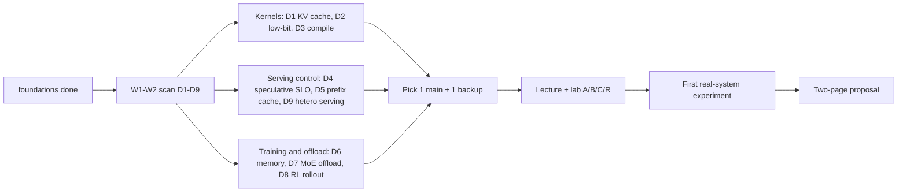

# 课程纲要

[课程说明](README.md) · [实验索引](../labs/index.md) · [选题地图](guides/directions.md) · [36h/周路线](guides/roadmap.md) · [从 lab 到真实系统](guides/real-systems.md)

本课程假定你已完成 foundations，能够解释 Roofline、online softmax、PagedAttention、推测采样与基本并行训练。在此基础上，研究这些方法在**预算、动态工作负载、精度、编译成本、样本语义和异构硬件**约束下何时有效，不再重复讲算法基础。

每讲按“问题 → 推导与手算 → 数据流/状态 → 代码接口 → 实验解释 → 前沿分歧”组织。完整学习一讲约需 **5h**，包括推导、练习和首次论文/代码导读；配套 lab 的实现、独立测试、测量与报告时间另计，见下表。两周扫描只读指定片段，不等于学完九讲。

重要小节后有 1–3 道随堂自测，要求手算、构造反例或判断实验结论。先写下答案，再展开“核对要点”；Obsidian 中答案默认折叠，其他 Markdown 阅读器可能直接显示。读完一讲后，用文末的“自测清单”检查能否独立完成相应产物，答不出的项目回到对应小节重做。

图解与交互资料放在相关小节旁，文末“资料汇总”再集中列一遍。先按指定任务看图、改一个变量或标出一条依赖，再读论文细节。随堂题与短篇读图任务计入已有课时；外部课程、工具教程的完整学习按需另行安排。各 lab 的“可选挑战”和“资料汇总”独立成节，挑战不计入必修工时。

> [!tip] 从这里开始
> 先看[选题与硬件地图](guides/directions.md)，再按 [36h/周路线](guides/roadmap.md) 用两周扫描九个方向、选一个主方向。首次实验进入 `labs/` 目录，按[环境配置](../labs/setup.md)运行 `setup_env` 和 `check_env`。课程、实验和答案分别在 `course/`、`labs/`、`solutions/`；[根目录 README](../README.md) 介绍项目入口、编辑器设置和格式规范。

## 九个方向

| 模块                                                                                      | 关键学习结果                                                 | 前置 foundations        | 实现重心                                              | 第一轮浏览终点                                       |
| ----------------------------------------------------------------------------------------- | ------------------------------------------------------------ | ----------------------- | ----------------------------------------------------- | ---------------------------------------------------- |
| [D1 KV 缓存](modules/01-kv-cache.md) · [lab1](../labs/lab1/README.md)                     | 区分压缩、淘汰和 offload；算清量化元数据与真实存储开销       | L2/L4                   | C++17 布局与量化；CUDA 融合 decode-attention kernel   | 算出 Qwen3-0.6B 的 GQA KV 字节数和两种量化轴的元数据 |
| [D2 低比特 kernel](modules/02-low-bit-kernels.md) · [lab2](../labs/lab2/README.md)        | 区分低比特格式与低延迟；实测 INT4/FP8/FP16 的交叉 batch      | L1/L2                   | C++17 + CUDA/PTX；cuBLAS 对照；sm_89 FP8              | 画出一个 warp 的 packed 访存，手算一个 byte 的解包   |
| [D3 动态编译](modules/03-dynamic-compilation.md) · [lab3](../labs/lab3/README.md)         | 定义编译摊销目标；在 guard、缓存、分桶和 CUDA graph 之间取舍 | L1/L3                   | Python DP 与 torch.compile；CUDA 融合 kernel 与 graph | 手算专用 kernel 的盈亏平衡和两种 bucket 的 padding   |
| [D4 推测解码](modules/04-speculative-slo.md) · [lab4](../labs/lab4/README.md)             | 区分生存概率与条件接受率；在删失反馈下按 SLO 控制推测长度    | L4/L5                   | Rust 策略与回放；Python/torch 真实接受 trace          | 对非线性验证耗时求最优 $k$                           |
| [D5 前缀缓存](modules/05-prefix-cache.md) · [lab5](../labs/lab5/README.md)                | 明确 KV 复用的身份与所有权；用实测 prefill 代价评估路由      | L4                      | Rust 缓存、事务与路由；Python 代价拟合                | 找出“相同文档不能直接复用”的反例                     |
| [D6 低显存训练](modules/06-memory-efficient-training.md) · [lab6](../labs/lab6/README.md) | 保持梯度一致地在显存、重计算和 LoRA 之间取舍                 | L0/L6                   | PyTorch autograd、自定义 Function、LoRA               | 推导参数、优化器、激活三类显存                       |
| [D7 MoE 卸载](modules/07-moe-offload.md) · [lab7](../labs/lab7/README.md)                 | 保持路由结果不变地优化专家数据移动                           | L1/L4                   | C++ 路由与缓存；CUDA stream/event 流水线              | 分清 active 参数、总驻留参数与本轮工作集             |
| [D8 RL rollout](modules/08-rollout-scheduling.md) · [lab8](../labs/lab8/README.md)        | 保持 rollout 组与版本语义地处理长尾                          | L4/L6/L7、RL 基础       | Rust 调度与分段账本；真实采样 trace 回放              | 区分“调度”与“改变采样分布”                           |
| [D9 异构 serving](modules/09-hetero-serving.md) · [lab9](../labs/lab9/README.md)          | 用标定过的代价模型做异构放置与按价格规划                     | L1 roofline、L4 serving | C++17 代价模型、max-flow 与规划器；CUDA 标定          | Qwen3-1.7B 单层 FLOPs/字节手算，3 卡 4 层的 max-flow |

箭头表示学习顺序，不要求先完成其他 intermediate lab。可组合的研究视角：

- **D1+D2**：同一张卡上 KV 与权重的字节账，以及“省下的字节能否被解码开销吃回去”。
- **D3+D9**：都是由代价模型驱动的离散规划（捕获尺寸 DP、层放置与 B&B），共同的问题是代价模型误差会不会翻转决策。
- **D4+D9**：推测解码的验证成本进入多模型、多 SLO 的容量规划。
- **D5+D9**：异构副本上带前缀亲和的路由，介于 Helix 和 Preble/DualMap 之间。
- **D6+D8**：RL 训练端的显存预算与 rollout 端的长尾调度。

第一轮最多深入一个组合。怎样在九个方向里选，见[选题地图](guides/directions.md)的优先级和“为什么这样排”。

## 完整学习的工作量

| 方向                                | 讲义    | lab（含报告） | 合计     | TODO / 参考 ELOC | 核心交付                                                                |
| ----------------------------------- | ------- | ------------- | -------- | ---------------- | ----------------------------------------------------------------------- |
| D1 / [lab1](../labs/lab1/README.md) | 5h      | 30h           | 35h      | 16 / 280         | INT4 KV、流式残余缓存、PQ 检索、int4 融合 decode kernel                 |
| D2 / [lab2](../labs/lab2/README.md) | 5h      | 35h           | 40h      | 22 / 375         | 可逐字节核对的 int4 格式、CUDA/PTX 解码 GEMV、AWQ 缩小版、FP8 GEMV      |
| D3 / [lab3](../labs/lab3/README.md) | 5h      | 38h           | 43h      | 21 / 349         | 有预算的分桶 DP、真实 torch.compile 执行、融合 RMSNorm、CUDA graph 分桶 |
| D4 / [lab4](../labs/lab4/README.md) | 5h      | 28h           | 33h      | 19 / 422         | 删失接受估计、SLO 预算、请求级服务仿真、真实接受 trace 回放             |
| D5 / [lab5](../labs/lab5/README.md) | 5h      | 31h           | 36h      | 20 / 388         | 链式块哈希、事务与 lease、缓存感知路由、实测 prefill 代价与回放         |
| D6 / [lab6](../labs/lab6/README.md) | 5h      | 30h           | 35h      | 21 / 417         | LoRA 生命周期、激活预算计划、真实训练接入、自定义 autograd Function     |
| D7 / [lab7](../labs/lab7/README.md) | 5h      | 30h           | 35h      | 25 / 403         | 路由约定、字节缓存与替换策略、有限槽专家执行、pinned 重叠流水线         |
| D8 / [lab8](../labs/lab8/README.md) | 5h      | 30h           | 35h      | 20 / 425         | 长度历史与 LPT、分段账本、版本队列与裁剪梯度、真实 trace 回放           |
| D9 / [lab9](../labs/lab9/README.md) | 5h      | 25h           | 30h      | 22 / 569         | 代价模型、Helix 式 max-flow 放置、SLO 下多模型共置、4060 上标定 $\eta$  |
| **总计**                            | **45h** | **277h**      | **322h** | **186 / 3628**   | 不含可选挑战；不要求全部完成才开始研究                                  |

lab 工时含 A/B/C/R 四个阶段和报告；R 阶段在 WSL2 的 RTX 4060 上运行，各平台范围见[实验索引](../labs/index.md)。D3 和 D2 最重，第一轮可以先跳过以下部分，等确定以它为主方向后再补：

- **D3（38h）**：C7 `fused_add_rmsnorm_f16`（1.5h）和 R4 `plan_capture_sizes`（2h）可以后补，第一轮约 34.5h。C5/C6 的 f32 kernel 和 R1–R3 的真实 graph 成本要保留，后面的规划依赖这些实测数。
- **D2（35h）**：B5/B6 的 split-K（2h）和 C5 `search_budget`（1h）可以后补，第一轮约 32h。R 阶段整段保留：R4 `fp8_tiled_batch` 给出 FP8 与 FP16 交叉 batch 的实测点，R5 `weight_bytes` 是基准计算带宽和检查 L2 冲刷要用的。

跳过的部分在 `grade.md` 里仍然计分，补做之前对应的测试和基准行会失败；这里只是第一轮的时间安排，不改变 lab 的验收要求。

工时按各阶段任务估算，尚未经学生试学验证；运行参考实现所需的时间，不等于学完所需的时间。按每周 36h 计算，全部内容约需 9 个完整工作周，还没算开放研究。建议扫描后只完整做一个主方向和一个备选，主方向的讲义加 lab 约 30–43h，一到一周半可以完成。各阶段的填空规模与估时口径见[工作量说明](../labs/docs/workload.md)。

## 资料汇总

- [完整资源索引](readings/resources.md)：论文、会议出处、代码与核验状态。
- [外部课程/lab 映射](readings/courses-and-labs.md)：只选相关作业，不重新修读整门课。
- [可视化](readings/visualizations.md)：各讲读图任务、外部交互与性能分析工具。
- [固定源码阅读入口](readings/code-map.md)：钉住 commit 的上游函数，与各 lab 阶段对应。
- [选题地图](guides/directions.md)、[时间路线](guides/roadmap.md)、[从 lab 到真实系统](guides/real-systems.md)、[实验规范](guides/experiments.md)、[PyTorch 桥接](guides/pytorch-bridge.md)。
