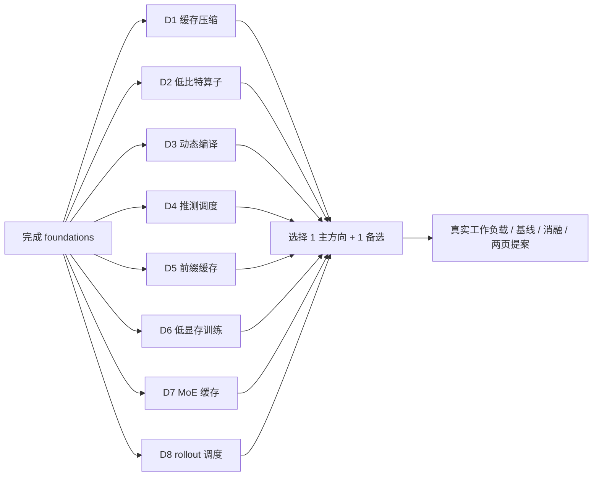

# 课程纲要

[课程说明](README.md) · [实验索引](../labs/index.md)

本课程假定你已完成 foundations，能够解释 Roofline、online softmax、PagedAttention、推测采样与基本并行训练。在此基础上，进一步研究这些方法在**预算、动态工作负载、精度、编译成本和样本语义**约束下何时有效，不再重复讲解算法基础。

每讲按“问题 → 推导与手算 → 数据流/状态 → 代码接口 → 实验解释 → 前沿分歧”组织。完整学习一讲约需 **5h**，包括推导、练习和首次论文/代码导读；配套 lab 的实现、独立测试、测量与报告时间另计，见下表。两周扫描只读指定片段，不代表完整学完八讲。

重要小节后安排 1–3 道随堂自测，要求手算、构造反例或判断实验结论。先写下答案，再展开“核对要点”；在 Obsidian 中答案默认折叠，其他 Markdown 阅读器可能直接显示。读完一讲后，用文末的“自测清单”检查能否独立完成相应产物，答不出的项目回到对应小节重做。

图解与交互资料放在相关小节旁，并在文末“资料汇总”集中列出。先按指定任务看图、改变一个变量或标出一条依赖，再读论文细节。随堂题与短篇读图任务计入已有课时；外部课程、工具教程的完整学习按需另行安排。各 lab 的“可选挑战”和“资料汇总”独立成节，挑战不计入必修工时。

> [!tip] 从这里开始
> 先看 [选题与硬件地图](guides/directions.md)，再按 [36h/周路线](guides/roadmap.md) 选择一个主方向。首次实验进入 `labs/` 目录，运行 [环境检查](../labs/setup.md)。课程、实验和答案分别位于 `course/`、`labs/`、`solutions/`；[根目录 README](../README.md)介绍项目入口、编辑器设置和格式规范。

| 模块                                          | 关键学习结果                               | 前置 foundations  | 实现重心                                  | 第一轮浏览终点                   |
| --------------------------------------------- | ------------------------------------------ | ----------------- | ----------------------------------------- | -------------------------------- |
| [D1](modules/01-kv-cache.md)                  | 区分压缩、淘汰和 offload；计算真实存储开销 | L2/L4             | C++ 布局、量化、预算选择                  | 算出 GQA KV 大小与量化元数据     |
| [D2](modules/02-low-bit-kernels.md)           | 区分低比特格式与低延迟；分析解包开销       | L1/L2             | CUDA、PTX、cuBLAS 对照                    | 画出一个 warp 的 packed 访存     |
| [D3](modules/03-dynamic-compilation.md)       | 定义编译摊销目标；处理形状漂移             | L1/L3             | CUDA 融合、Python 动态规划、torch.compile | 手算专用 kernel 的盈亏平衡       |
| [D4](modules/04-speculative-slo.md)           | 在延迟约束下选择推测预算；正确估计接受率   | L4/L5             | Rust 控制策略与观测更新                   | 对非线性验证耗时求最优 k         |
| [D5](modules/05-prefix-cache.md)              | 明确 KV 复用条件与活跃引用；衡量缓存收益   | L4                | Rust 缓存、事务、引用计数                 | 找出“相同文档不能直接复用”的反例 |
| [D6](modules/06-memory-efficient-training.md) | 保持梯度一致地交换显存与重计算             | L0/L6             | PyTorch/Autograd/LoRA                     | 推导参数、优化器、激活三类内存   |
| [D7](modules/07-moe-offload.md)               | 保持路由结果不变地优化专家数据移动         | L1/L4             | C++ dispatch/cache、CUDA stream           | 分清 active 参数与总驻留参数     |
| [D8](modules/08-rollout-scheduling.md)        | 保持 rollout 组与版本语义地处理长尾        | L4/L6/L7、RL 基础 | Rust 调度/分段恢复；真实 RL 接入          | 区分调度与改变采样分布           |

依赖箭头表示学习前置，不要求先完成其他 intermediate lab。D1+D2、D3+D4、D5+D7、D6+D8 是可组合的研究视角；第一轮最多深入一个组合。

## 完整学习的工作量

| 方向                                | 讲义    | 必修 lab（含报告） | 合计     | 核心交付                                           |
| ----------------------------------- | ------- | ------------------ | -------- | -------------------------------------------------- |
| D1 / [lab1](../labs/lab1/README.md) | 5h      | 24h                | 29h      | INT4、流式残余缓存、online softmax、PQ检索         |
| D2 / [lab2](../labs/lab2/README.md) | 5h      | 26h                | 31h      | 分组校准、CUDA/PTX多路径、激活感知量化             |
| D3 / [lab3](../labs/lab3/README.md) | 5h      | 26h                | 31h      | 分桶DP、有限编译缓存、真实Inductor执行、CUDA融合   |
| D4 / [lab4](../labs/lab4/README.md) | 5h      | 24h                | 29h      | 置信估计、预算控制、到达队列和SLO goodput          |
| D5 / [lab5](../labs/lab5/README.md) | 5h      | 25h                | 30h      | 祖先前缀、事务与lease、准入、公平调度及并发重放    |
| D6 / [lab6](../labs/lab6/README.md) | 5h      | 26h                | 31h      | LoRA生命周期、激活规划、真实offload和微批训练      |
| D7 / [lab7](../labs/lab7/README.md) | 5h      | 26h                | 31h      | 路由、字节缓存、INT8专家、CUDA单双槽流水线         |
| D8 / [lab8](../labs/lab8/README.md) | 5h      | 23h                | 28h      | 分段恢复、工作窃取、版本队列、真实小型策略梯度训练 |
| **总计**                            | **40h** | **200h**           | **240h** | 不含开放挑战，不要求全部完成后才开始研究           |

工时按各阶段任务估算，尚未经学生试学验证；运行参考实现所需的时间，不等于完成学习的时间。按每周 36h 计算，全部内容约需 6.7 个完整工作周，尚未计入开放研究。建议扫描后选择一个主方向，用一周完成主要课程和实验，必要时再留一周调试。[代码工作量审计](../labs/docs/workload.md)只计实际待填区域，另列与foundations的比较。

## 这套材料怎样接受审核

- 正确性：独立 oracle、边界测试与具体反例，不能只比较同一实现的两个输出。
- 实验方法：给出 baseline、变量、配置矩阵、计时范围、原始表与预注册判断标准。
- 学习任务：区分仓库已提供的内容、学生 TODO、学生新增实验和开放挑战；讲义阅读时间不重复计入实验课时。
- 内容审核：三个子代理分工撰写并交叉审核，主代理整合并试跑，见 [评审记录](../labs/docs/editorial-review.md)。
- 工程审核：采用 foundations 的格式参数，见 [格式规范](../labs/docs/formatting.md)；实际运行范围见 [验证记录](../labs/docs/validation.md)。

## 资料汇总

- [完整资源索引](readings/resources.md)：论文、会议出处、代码与核验状态。
- [外部课程/lab 映射](readings/courses-and-labs.md)：只选相关作业，不重新修读全部课程。
- [可视化](readings/visualizations.md)：离线交互与开源工具。
- [选题地图](guides/directions.md)、[时间路线](guides/roadmap.md)、[实验规范](guides/experiments.md)。
