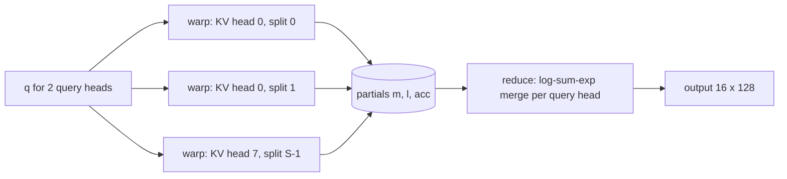

# D1 KV 缓存：量化布局、选择与质量预算

[← 课程索引](../index.md) · [配套 lab1](../../labs/lab1/README.md) · [D2 低比特 kernel →](02-low-bit-kernels.md)

> [!abstract] 这一讲要解决的问题
> foundations 讲过 attention 的 IO 和 paged KV。这一讲的约束更具体：8GB 的 RTX 4060 Laptop 上跑 Qwen3-0.6B/1.7B，32K 上下文的 bf16 KV 就有 3.5 GiB，和 1.7B 模型的权重一样大；而且 decode 每一步都要把整段 KV 从显存读一遍，速度由带宽决定。学完后你应该能：手算任意模型的 KV 字节和 decode 带宽下界；说清楚 Qwen3 缓存的 K 处在 QK-Norm 和 RoPE 之后意味着什么；实现能独立解码的 int4 布局、流式残余窗口和 PQ 检索；写出一个 GQA、split-K、在寄存器里反量化的 int4 decode kernel，并在 4060 上测出它相对 FP16 和“先反量化再算”两条基线的带宽利用率；最后在同一字节预算下比较“少存一些 token”和“每个 token 存得更粗”。

| 阅读模块                           | 时间  | 必须留下的学习产物                             | 对应实验  |
| ---------------------------------- | ----- | ---------------------------------------------- | --------- |
| §1 为什么要缓存，decode 为什么慢   | 40min | Qwen3 每 token 字节、32K 带宽下界的手算        | A0、R     |
| §2 Qwen3 里 K 在哪里被缓存         | 40min | 一张 k_proj 到 cache 的算子顺序图，sink 的作用 | B1、挑战  |
| §3 int4 仿射量化：轴、误差、元数据 | 55min | $3\times3$ 两种分组表，有效位宽表              | A1/A2、B2 |
| §4 误差传播、选择与检索            | 50min | K/V 误差界推导，选择不变量，方法分类卡         | B1/B5、C  |
| §5 流式缓存与融合 decode kernel    | 50min | 残余窗口状态图，split-K 合并公式与证明         | B2–B5、R  |
| §6 机制与代码的对应                | 15min | 机制到函数的对照表                             | 全部      |
| 前沿与 baseline 对照               | 40min | 三篇工作的机制差异卡                           | C/R       |
| 研究问题                           | 10min | 一个可证伪的假设和停止条件                     | R、挑战   |

**共 5h，另做 lab 约 30h。** 5h 包括手算、三段源码阅读（HF Qwen3 attention、llama.cpp q4_0 点积、vLLM split-K decode）和随堂自测；通读论文属于选读。外部图表都是作者在各自模型和硬件上的测量，不是你的结果，这一点下文不再重复。

随堂自测计入上表时间。先在笔记里写答案，再展开核对要点。

## §1 为什么要缓存，decode 为什么慢

### 1.1 prefill、decode 与重算的代价

自回归生成分两段。**prefill** 一次处理整段 prompt，所有位置并行算 Q/K/V；**decode** 每步只输入一个新 token，但它的 query 要和之前所有位置的 K、V 做 attention。

不缓存时，第 $t$ 步要为前面 $t$ 个位置重新做一遍 K/V 投影，生成 $T$ 个 token 共做 $\sum_{t=1}^{T}t=O(T^2)$ 次投影。缓存之后，每个位置的 K/V 只投影一次，第 $t$ 步只读 $t$ 行缓存。代价从重复计算变成了**存储和读取**：KV cache 用显存换计算。

[HF 的 KV caching 图解](https://huggingface.co/blog/not-lain/kv-caching)逐步画出了缓存怎样一行行增长；[Raschka 的从零实现](https://magazine.sebastianraschka.com/p/coding-the-kv-cache-in-llms)对比了有无缓存时第三步的计算量，代码目录里有 Qwen3 版本。

### 1.2 用 Qwen3 的配置算字节

每层、每个 KV head、每个 token 存一行 K 和一行 V，各 $D$ 个元素。$L$ 层、$H_{\mathrm{kv}}$ 个 KV head、每元素 $b$ 字节时，每个 token 的 KV 字节是

$$
M_{\mathrm{token}} = 2\,L\,H_{\mathrm{kv}}\,D\,b.
$$

Qwen3-0.6B 和 Qwen3-1.7B 的配置相同：$L=28$、$H_{\mathrm{kv}}=8$、$D=128$，bf16 下 $b=2$（见 [Qwen3-1.7B config](https://huggingface.co/Qwen/Qwen3-1.7B/blob/main/config.json)）：

$$
\begin{aligned}
M_{\mathrm{token}} &= 2\times28\times8\times128\times2 = 114688\,\mathrm{B} = 112\,\mathrm{KiB},\\
M(4\mathrm{K}) &= 4096\times112\,\mathrm{KiB} = 448\,\mathrm{MiB},\\
M(32\mathrm{K}) &= 32768\times112\,\mathrm{KiB} = 3.5\,\mathrm{GiB}.
\end{aligned}
$$

Qwen3-1.7B 的 bf16 权重约 $1.7\times10^{9}\times2\,\mathrm{B}\approx3.4\,\mathrm{GB}$。一条 32K 请求的 KV 就和整份权重一样大，两者加起来约 7.2 GB；8GB 显存剩下的部分还要留给激活、CUDA 工作区和分配器。batch 为 $B$ 的不等长序列用 $\sum_b T_b$ 代替 $BT$。

### 1.3 decode attention 的算术强度

只看一个 KV head。它的一行 K 和一行 V 共 $2Db$ 字节；GQA 下这个 KV head 被 $g=H_q/H_{\mathrm{kv}}$ 个 query head 共用，每个 query head 对这一行做 $q\cdot k$ 和 $p\,v$，各 $2D$ 次浮点运算。于是

$$
I = \frac{g\times 4D}{2Db} = \frac{2g}{b}\ \mathrm{FLOP/B}.
$$

Qwen3 的 $g=16/8=2$：bf16 时 $I=2$；int4 加元数据时 $b\approx0.53$，$I\approx7.5$。RTX 4060 Laptop 有 24 个 SM，按每 SM 128 个 FP32 lane、2.0 到 2.5 GHz 估算，FP32 峰值约 12 到 15 TFLOPS（modeled, not measured）；本机 copy kernel 实测带宽 195 到 223 GB/s（lab1 R 阶段的 bench 输出，measured）。拐点约 60 FLOP/B，decode attention 离它差一个数量级以上，**只受带宽限制**。int4 能提速多少，上限由字节数决定；真正可能吃掉收益的是解包和换算的整数指令，它们不算 FLOP，在算术强度里看不出来。

由此可以随手估一个下界：32K、一层、bf16 需要读 $32768\times8\times128\times2\times2\,\mathrm{B}=128\,\mathrm{MiB}$，按 200 GB/s 算约 0.67 ms，28 层合计约 19 ms，只算 attention 的读，还不含权重。lab1 R 阶段实测 FP16 split-K kernel 在这个尺寸上是 0.74 ms/层。[kipply 的 Transformer Inference Arithmetic](https://kipp.ly/transformer-inference-arithmetic/) 用 A100 推过同一个结论。

> [!question] 随堂自测 D1-1：字节与带宽
>
> 1. Qwen3-1.7B 在 8K 上下文、batch 4 时 bf16 KV 一共多少 GiB？若改成 int4 并带 FP16 的 scale 和 offset（组大小 $g=64$），又是多少？
> 2. 只把 query head 数从 16 改成 32，KV head 仍为 8。每 token 的 KV 字节和 decode attention 的算术强度各怎么变？

> [!tip]- 核对要点
>
> 1. bf16：$4\times8192\times112\,\mathrm{KiB}=3.5\,\mathrm{GiB}$。int4：每元素 $0.5+4/64=0.5625\,\mathrm{B}$，是 bf16 的 $0.5625/2$，约 $0.98\,\mathrm{GiB}$。
> 2. 字节不变，它只取决于 $H_{\mathrm{kv}}$；$g$ 从 2 变成 4，算术强度翻倍。前提是 kernel 真的把一个 KV head 只读一次、同时服务 4 个 query head，否则读的字节也会翻倍。

## §2 Qwen3 里 K 在哪里被缓存

### 2.1 GQA、MQA、MLA 与跨层共享

KV 字节只和 $H_{\mathrm{kv}}$ 成正比。MHA 是 $H_{\mathrm{kv}}=H_q$；[GQA](https://arxiv.org/abs/2305.13245) 把 query head 分组，每组共用一个 KV head；MQA 是只有一个 KV head 的极端情形。Qwen3 用 16 个 query head 对 8 个 KV head，KV 是 MHA 的一半。

GQA 不只是省字节，kernel 的写法也要跟着变：一个 KV head 的行应该只从显存读一次，在寄存器里同时算完它那一组的 $g$ 个 query head。HF 的 `repeat_kv` 把 KV head 复制成 $H_q$ 份再算，数值上等价，带宽上浪费 $g$ 倍。lab1 R2 里一个 warp 对一个（KV head，split）同时算两个 query head，就是为了这一点。query head $h$ 对应的 KV head 是 $\lfloor h/g\rfloor$。

MLA（[DeepSeek-V2](https://arxiv.org/abs/2405.04434)）缓存的不是每个头的 K/V，而是一条低秩的联合潜变量 $c_t^{\mathrm{KV}}$，外加一段单独做 RoPE 的 key；解码时把上投影矩阵吸收进 Q 和输出投影。按 [McCormick 的拆解](https://mccormickml.com/2025/04/26/inner-workings-of-mla/)，DeepSeek-V3 每层每 token 只存 576 个数。CLA（[NeurIPS 2024](https://arxiv.org/abs/2405.12981)）让相邻层共用 KV，YOCO（[NeurIPS 2024](https://arxiv.org/abs/2405.05254)）只缓存一份全局 KV 给后半部分所有层用。这些方法都要在训练时决定，本讲后面的压缩方法则是推理时对现成模型下手，两类结果不能直接放在一张表里比。

### 2.2 QK-Norm 和 RoPE 的位置

Qwen3 去掉了 QKV bias，加了 QK-Norm（[技术报告](https://arxiv.org/abs/2505.09388)）。HF 实现（[modeling_qwen3.py](https://github.com/huggingface/transformers/blob/main/src/transformers/models/qwen3/modeling_qwen3.py)）里 K 的算子顺序是：

```text
x --k_proj--> [T, Hkv*D] --view--> [Hkv, T, D] --k_norm (RMSNorm over D,
weight gamma[D] shared by all heads)--> --RoPE(pos)--> past_key_values.update
v_proj --view--> past_key_values.update          (V: no norm, no RoPE)
```

所以 **Qwen3 缓存的 K 已经过 RMSNorm 和 RoPE**，V 没有经过任何归一化。这有三个后果。

**RMSNorm 抹平了 token 间的尺度，没有抹平通道间的尺度。** 它先把每个 token 的 $k$ 除以自己的均方根，再乘上可学习的 $\gamma\in\mathbb{R}^{D}$，各通道的尺度由 $\gamma$ 固定下来。

**RoPE 混合了成对的通道。** 它把通道 $i$ 和 $i+D/2$ 配成一对，按位置 $p$ 旋转角度 $p\,\theta_i$，$\theta_i=\beta^{-2i/D}$，Qwen3 的 $\beta=10^{6}$：

$$
\begin{bmatrix}k'_i\\k'_{i+D/2}\end{bmatrix}
=\begin{bmatrix}\cos p\theta_i & -\sin p\theta_i\\ \sin p\theta_i & \cos p\theta_i\end{bmatrix}
\begin{bmatrix}k_i\\k_{i+D/2}\end{bmatrix}.
$$

高频对（$i$ 小）随位置快速转动，把两个通道的幅度来回混合；低频对几乎不转，原有的大幅值通道保留下来。[KVQuant](https://arxiv.org/abs/2401.18079) 因此在 RoPE **之前**按通道量化 K，再在 kernel 里融合反量化和 RoPE。拿到的若是 HF cache（RoPE 之后），按通道量化的统计会被高频对搅乱一部分。

**折掉 $\gamma$ 不是简单的逐通道除法。** 能不能在 per-token 量化前把 $\gamma$ 除掉、反量化后再乘回？RoPE 混合的是 $\gamma_i$ 和 $\gamma_{i+D/2}$ 两个通道，严格地说只能按对的尺度 $\max(\gamma_i,\gamma_{i+D/2})$ 来折，或者在 RoPE 之前做。这正是「研究问题」一节的候选假设。

本机实测（lab1 `axis_probe.py`，Qwen3-0.6B，输入是本讲旧版讲义 `git show 0332b83:course/modules/01-kv-cache.md` 的前 2048 个 token，2026-10-18）：按层平均，K 各通道平均绝对值的最大值是中位数的 38 倍。只把 K 改成 per-token int4（$g=128$）后，后 31 个 token 的平均 NLL 从 5.27 升到 8.36；改成 per-channel int4（沿 token 每 64 个一组）只升到 5.29。V 用哪个轴差别在 0.1 以内。Qwen3-1.7B 的趋势相同（4.94 到 7.62 和 4.96）。这是一段文本、31 个 token 的探针，只说明方向，正式结论要用 RULER 之类的评测重做。社区在 [llama.cpp 讨论 #21297](https://github.com/ggml-org/llama.cpp/discussions/21297) 里报告 Qwen3-8B 的 q4_0 K（每 32 个通道一组的 per-token 对称量化）只让 wikitext PPL 涨 4%，而 Qwen2.5 同样设置会彻底失效；那是非同行评审的单次实验，模型规模和组大小都和本机不同，两者并不矛盾，但都说明“轴的选择”在 Qwen3 上还没有定论。

### 2.3 attention sink：为什么 B1 要保留开头几个 token

[StreamingLLM](https://arxiv.org/abs/2309.17453) 发现，很多模型把大量 attention 质量放在最开头的几个 token 上，不管它们的内容是什么。论文的解释是：softmax 的权重必须加起来等于 1，当前 query 没有真正需要关注的位置时，多余的质量也得有个去处，而开头的 token 对所有后续位置都可见，于是成了这个去处。只保留最近窗口、把这几个 token 丢掉，困惑度会突然飙升；保留 4 个 sink 再加最近窗口，流式生成就稳定了。注意它只保证“不崩”，并不扩展可用上下文，窗口外的信息照样丢了。

[HAN Lab 的博客](https://hanlab.mit.edu/blog/streamingllm)画了三种方案的示意和 Llama-2 的 attention 图，还提到 sink token 往往带有极大的激活值，这对量化是坏消息：它们会撑大所在组的范围。lab1 B1 的 `sink` 参数和 C4 的 mandatory 集合都来自这里。

> [!question] 随堂自测 D1-2：K 的形态
>
> 1. 对 Qwen3，下面哪些说法对：(a) 缓存的 K 没有经过 RoPE；(b) RMSNorm 之后各通道尺度相同；(c) V 不经过归一化；(d) 16 个 query head 中第 13 个使用第 6 个 KV head（从 0 编号）。
> 2. 为什么只丢掉开头 4 个 token 就可能让流式生成崩溃，而丢掉中间同样多的 token 通常不会？

> [!tip]- 核对要点
>
> 1. (c)、(d) 对。(a) 错，缓存的是 RoPE 之后的 K；(b) 错，RMSNorm 的可学习权重 $\gamma$ 让通道尺度不同；(d) 中 $\lfloor 13/2\rfloor=6$。
> 2. 这些 token 承接了 softmax 中“无处可去”的质量。删掉后这部分质量被摊到其他位置，所有层的 attention 分布同时改变；中间 token 通常只承接与内容相关的少量质量。

## §3 int4 仿射量化：轴、误差、元数据

### 3.1 量化与反量化

设一组元素的最小值 $m$、最大值 $M$。4 bit 有 16 个码、15 个间隔：

$$
s=\frac{M-m}{15},\qquad q_i=\operatorname{clip}\!\Big(\operatorname{round}\big(\tfrac{x_i-m}{s}\big),0,15\Big),\qquad \hat x_i=m+s\,q_i .
$$

最近舍入时 $\lvert\hat x_i-x_i\rvert\le s/2$。$M=m$ 时不能除零，lab 约定 $s=1$、$q=0$，精确恢复。码是无符号的，8 到 15 不是负数；D2 会用另一种有符号格式，解码器不能混用。scale 先存成 FP32 再参与除法，恰好落在半整数附近的元素可能舍入到相邻的码（lab1 A1 的说明里有具体例子）。所以测试按“误差不超过半步”验收，不按理想实数逐位比对。

### 3.2 per-token 和 per-channel

把一个 KV head 的缓存写成行优先 $[T,D]$：行是 token，列是通道。**per-token** 分组沿通道切，每组是一个 token 的 $g$ 个通道；**per-channel** 分组沿时间切，每组是一个通道的 $g$ 个 token。

```text
              channel 0  channel 1  channel 2
 token 0           1          1         30
 token 1           1          2         29
 token 2           2          1         31

per-token   (g=3): one group per row    -> scale of row 0 = 29/15
per-channel (g=3): one group per column -> scale of col 0 = 1/15, col 2 = 2/15
```

上图里通道 2 是一个持续的大值通道。per-token 时它把每一行的 scale 撑到约 1.93，通道 0、1 上 1 和 2 的差别被量化掉；per-channel 时大值只影响自己那一列。把矩阵转置（大值集中在一个 token 上），结论就反过来。

[KIVI](https://arxiv.org/abs/2402.02750) 在 Llama/Mistral 上观察到 K 有固定的离群通道、V 没有，于是 **K 按通道、V 按 token**。V 按 token 还有一个理由：输出 $o=\sum_t p_t v_t$ 是 V 行的凸组合，每一行的误差被它自己的权重 $p_t$ 加权，与别的行无关。§2.2 的本机探针显示这个结论在 Qwen3 上大体成立，而且 K 用错轴的代价远大于 V。

### 3.3 误差和组范围

一组的舍入误差近似在 $[-s/2,s/2]$ 上均匀分布，均方误差约 $s^2/12=R^2/2700$，$R=M-m$ 是组范围。轴决定的是**哪些元素共用一个 $R$**。设某个通道恒为幅值 $A$ 的离群值，其余通道在 $[-a,a]$ 内且 $a\ll A$：

$$
\text{per-token: } R\approx A+a\ \text{(each token pays)},\qquad
\text{per-channel: } R\approx 2a\ \text{except the outlier channel}.
$$

per-token 时 $D$ 个通道全部承受 $s\approx A/15$ 的步长；per-channel 时只有离群通道那一列吃亏。代价是 per-channel 的组沿时间展开，必须攒够 $g$ 个 token 才能算出这一组的范围，所以需要一个高精度的残余窗口（§5.1）。

### 3.4 有效位宽：元数据不是零

每组存一个 scale 和一个 offset。设每个元数据占 $b_m$ 字节，组完整时每元素的字节数是

$$
b_{\mathrm{eff}}=\frac{1}{2}+\frac{2b_m}{g}.
$$

| 组大小 $g$ | FP16 元数据 $b_m=2$ | 相对 bf16 | FP32 元数据 $b_m=4$（lab） | 相对 bf16 |
| ---------: | ------------------: | --------: | -------------------------: | --------: |
|         32 |              0.625B |    3.2 倍 |                      0.75B |   2.67 倍 |
|         64 |             0.5625B |   3.56 倍 |                     0.625B |    3.2 倍 |
|        128 |            0.53125B |   3.76 倍 |                    0.5625B |   3.56 倍 |

lab 用 FP32 元数据只是为了让 CPU 上的检查简单，生产 kernel 一般用 fp16/bf16。不完整的尾组要单独计数：$[T,D]$ 矩阵 per-token 有 $T\lceil D/g\rceil$ 组，per-channel 有 $D\lceil T/g\rceil$ 组，lab 的打包字节数是 $\lceil TD/2\rceil+8G$。尾组的 min/max 只统计真实元素，不能补零：全为正的尾组 $[4,4,4]$ 补零后 offset 变成 0，scale 变成 $4/15$，这三个 4 仍能恰好恢复，但元数据已经错了；尾组换成 $[4,5,6]$，步长就从 $2/15$ 变成 $6/15$。

把 §2.2 的实测放进这个账：K per-token $g=32$ 每元素 0.625B（FP16 元数据），NLL 增量 0.29；K per-channel $g=64$ 每元素 0.5625B，NLL 增量 0.01。字节更少，误差小一个数量级以上，这才是“同预算下更好”的比较口径。

### 3.5 生产系统的格式选择

| 系统                                                                                       | KV 格式             | 分组                                 | 说明                              |
| ------------------------------------------------------------------------------------------ | ------------------- | ------------------------------------ | --------------------------------- |
| [vLLM](https://docs.vllm.ai/en/latest/features/quantization/quantized_kvcache.html)        | FP8（e4m3 或 e5m2） | per-tensor 或 per-KV-head scale      | 文档里没有 int4 KV                |
| [LMDeploy TurboMind](https://lmdeploy.readthedocs.io/en/latest/quantization/kv_quant.html) | int8 / int4，非对称 | per-head、per-token，在线计算        | 支持 sm70 以上，含 RTX 40 系列    |
| [llama.cpp](https://github.com/ggml-org/llama.cpp)                                         | q4_0、q8_0 等       | 沿 head_dim 每 32 个一组，fp16 scale | q4_0 解码为 $d\,(q-8)$，per-token |
| [KIVI](https://github.com/jy-yuan/KIVI)                                                    | int2 / int4，非对称 | K per-channel，V per-token           | fp16 残余窗口                     |

生产 kernel 几乎都用 per-token：元数据和码行一起到达，不需要残余窗口，append 时立刻能量化。per-channel K 在融合 kernel 里少见，它的元数据按（通道，token 块）索引，还要处理残余窗口。这个差别在 kernel 里到底值多少，是 §5 和「前沿」一节要回答的问题。

> [!question] 随堂自测 D1-3：分组、地址与字节
>
> 1. $T=5$、$D=7$、$g=4$，FP32 元数据。单个矩阵 per-token 和 per-channel 各占多少字节？和同尺寸 FP16 比，哪种更大？
> 2. 坐标 $(r,c)=(1,0)$ 的码在第几个 byte 的哪一半？两种轴下它属于第几组？为什么换轴后 byte 位置不变？

> [!tip]- 核对要点
>
> 1. 码 $\lceil35/2\rceil=18\,\mathrm{B}$。per-token $5\times\lceil7/4\rceil=10$ 组，共 $18+80=98\,\mathrm{B}$；per-channel $7\times\lceil5/4\rceil=14$ 组，共 $18+112=130\,\mathrm{B}$。FP16 是 70B，两种都更大：小矩阵上元数据压过了码本身。
> 2. 线性索引 $i=1\times7+0=7$，在 byte $\lfloor7/2\rfloor=3$ 的高半（位移 $4(i\bmod2)=4$）。per-token 组号 $1\times\lceil7/4\rceil+0=2$，per-channel 组号 $0\times\lceil5/4\rceil+\lfloor1/4\rfloor=0$。码始终按行连续存，只有元数据的索引随轴变化。

## §4 误差传播、选择与检索

### 4.1 K 的误差和 V 的误差走不同的路

对一个 query：

$$
s=\frac{qK^{\top}}{\sqrt D},\qquad p=\operatorname{softmax}(s),\qquad o=pV .
$$

压缩后 $K'=K+\Delta K$、$V'=V+\Delta V$，于是

$$
\Delta s=\frac{q\,\Delta K^{\top}}{\sqrt D},\qquad
\Delta o=(p'-p)\,V+p'\,\Delta V .
$$

第一项来自 attention 分配的变化（K 的误差），第二项来自 value 本身（V 的误差）。只看压缩前后的总 MSE，分不出主要误差来自哪一路。

### 4.2 一个可以直接用来验收的误差界

lab1 的 B5 和 R 阶段都用下面这个界检查“和未量化历史相比误差合理”。设对所有位置 $\lvert\Delta s_t\rvert\le\varepsilon$。因为 $p'_t/p_t=e^{\Delta s_t}/\sum_u p_u e^{\Delta s_u}$，有

$$
e^{-2\varepsilon}\le \frac{p'_t}{p_t}\le e^{2\varepsilon}.
$$

又因为 $\sum_t(p'_t-p_t)=0$，对任意常数 $c$ 都有 $(p'-p)V_{:,j}=\sum_t(p'_t-p_t)(v_{tj}-c)$。取 $c$ 为第 $j$ 列的中点，$\lvert v_{tj}-c\rvert\le R_j/2$，$R_j$ 是第 $j$ 列的极差：

$$
\big\lvert(p'-p)V_{:,j}\big\rvert\le\frac{R_j}{2}\sum_t p_t\Big\lvert\frac{p'_t}{p_t}-1\Big\rvert\le\frac{R_j}{2}\big(e^{2\varepsilon}-1\big).
$$

第二项 $\lvert p'\Delta V_{:,j}\rvert\le\max_t\lvert\Delta v_{tj}\rvert$。K 按通道量化、步长为 $s^K_{c}$ 时，$\varepsilon\le\max_t\sum_c\lvert q_c\rvert s^K_{c}/(2\sqrt D)$。合起来：

$$
\lvert\Delta o_j\rvert\le\max_t\frac{s^V_{t}}{2}+\frac{R_j}{2}\big(e^{2\varepsilon}-1\big).
$$

这个界很松（R 阶段测试里实际误差约 0.013，界的均值约 2.4），它的用处是排除“值都对得上，但读的是另一段历史”这类错误：比如 flush 时把块清零，解码出来的缓存和注意力输出自洽，却和原始 K/V 对不上。紧的检查另用 FP64 在**同一份 int4 值**上重算。

softmax 的 Jacobian 是 $\operatorname{diag}(p)-pp^{\top}$，局部放大倍数取决于当前分布：$q$ 的范数越大、竞争位置的分数越接近，K 的误差影响越大。“softmax 一定放大量化误差”不是定理。

### 4.3 选择失败的反例

取 $q=[10]$、$K=\begin{bmatrix}10\\0\end{bmatrix}$、$V=\begin{bmatrix}9\\1\end{bmatrix}$。$D=1$，完整 attention 的 logits 是 $[100,0]$，输出接近 9；只保留最近的位置 1，输出是 1。位置减半，答案完全变了。反过来，若 $V=\begin{bmatrix}1\\1\end{bmatrix}$，attention 分布怎么变输出都是 1。所以 KV 重构误差不等于 attention 输出误差，attention 输出误差也不等于任务准确率。lab 把指标分三层：元素误差界验收编码，attention 输出误差验收一次查询，真实任务（RULER、NIAH）验收模型质量，前两层通过不代表第三层通过。

### 4.4 选择的硬约束

保留预算为 $b$，先确定必须保留的集合：

$$
S_{\mathrm{must}}=\{0,\ldots,\mathrm{sink}-1\}\cup\{T-\mathrm{recent},\ldots,T-1\}.
$$

两段可能重叠，不能直接把长度相加。$\lvert S_{\mathrm{must}}\rvert>b$ 时问题不可行，应报错。剩余名额按分数降序从其他位置里选，**分数相同时选编号小的**，最后按位置排序输出。例：分数 $[0,3,5,3,3,0]$、$b=4$、sink 和 recent 各 1，mandatory 是 $\{0,5\}$，先选分数 5 的位置 2，最后一个名额在三个分数为 3 的位置里选最小的 1，得到 $[0,1,2,5]$。lab 测试专门构造了这种“预算边界上的并列”，排序规则写反就会被抓到。

### 4.5 两类方法：永久丢弃和按 query 取回

**淘汰（eviction）** 永久丢掉一部分位置，分数只能来自过去：

- 静态：StreamingLLM 的 sink 加最近窗口。
- 累计 attention：[H2O](https://arxiv.org/abs/2306.14048) 保留累计 attention 最大的 heavy hitter。
- prefill 时一次性压缩：[SnapKV](https://arxiv.org/abs/2404.14469) 用 prompt 末尾一个观察窗口为每个头投票。
- 层间预算：[PyramidKV](https://arxiv.org/abs/2406.02069) 让低层多留、高层少留。
- 头间预算：[Ada-KV](https://arxiv.org/abs/2407.11550) 按注意力输出损失的上界给每个头分配预算；[DuoAttention](https://arxiv.org/abs/2410.10819) 把头分成保留全部 KV 的 retrieval head 和只留 sink 加窗口的 streaming head。

**按 query 取回（retrieval）** 不丢弃，完整 KV 放在某处（常在 CPU 内存），每步用当前 query 挑出要读的部分：

- [Quest](https://arxiv.org/abs/2406.10774) 为每页存 K 的逐通道 min/max，给 $q\cdot k$ 求上界，只读上界最大的几页。
- [MagicPIG](https://arxiv.org/abs/2410.16179) 用 LSH 做重要性**采样**而不是 top-k，attention 放在 CPU 上算。
- [ShadowKV](https://arxiv.org/abs/2410.21465) 在 GPU 上只留 RoPE 之前 K 的低秩形式，V 放在 CPU，按块的 landmark 选出稀疏 KV 后现场重建。
- [PQCache](https://arxiv.org/abs/2407.12820) 用乘积量化给 K 建码本，decode 时用 PQ 内积近似找 top-k，再从 CPU 取回原 K/V。lab1 C 阶段实现的就是它的数值部分。

两类方法的成本口径不同。淘汰的分数若用了当前 query 的精确内积，选择器本身就做完了想省的那次 attention，只能作为标明的 oracle。按 query 检索是合法的，但建表、扫码和取回都要计入每步的时间。

### 4.6 PQ 检索的代价

把 $D$ 维分成 $M$ 个子空间，每个子空间用 Lloyd 聚成 $C$ 个中心，每个 key 存 $M$ 个中心编号。查询时先建表 $\mathrm{lookup}[p,c]=q_p\cdot\mu_{p,c}$，花 $O(CD)$；再对每个 key 把 $M$ 个表项相加，花 $O(TM)$；最后取回预算内的原向量。排序目标是**内积**，不是 query 到中心的欧氏距离：$q=1$，$k_1=1$、$k_2=2$，欧氏最近的是 $k_1$，内积大的是 $k_2$。索引不是 KV 的替代存储，报告里要同时列出码本、码、原 KV 和临时区。

> [!question] 随堂自测 D1-4：误差界
>
> 1. 所有位置的 logit 误差上界都是 $\varepsilon=0.05$，第 $j$ 列 V 的极差 $R_j=4$，V 的最大量化误差 0.02。按 §4.2 的界，$\lvert\Delta o_j\rvert$ 最多多少？
> 2. 一个实现把 flush 的块全部写成 0 再量化。为什么“materialize 后的密集 attention 和流式 attention 一致”这项检查抓不到它？应该加什么检查？

> [!tip]- 核对要点
>
> 1. $0.02+2\times(e^{0.1}-1)\approx0.02+0.21=0.23$。
> 2. 两条路径读的是同一份（错误的）缓存，彼此当然一致。要和**原始追加的 K/V** 比：逐块重算 FP64 的 min/max 和 scale，并用 §4.2 的界检查输出和未量化历史的差。

> [!question] 随堂自测 D1-5：选择与检索
>
> 1. $T=5$、sink=3、recent=3 时，预算 4 是否可行？
> 2. Quest 和 H2O 都“只读一部分 KV”。各说一句：它们省下的是显存、带宽还是两者，以及选错位置之后能否补救。

> [!tip]- 核对要点
>
> 1. 并集是 $\{0,1,2,3,4\}$，5 个位置，不可行。两段在位置 2 重叠，直接相加会算成 6。
> 2. H2O 永久删除，显存和带宽都省，选错了无法补救。Quest 保留全部 KV，只省读取带宽，下一步可以读回别的页，但不省显存。

## §5 流式缓存与融合 decode kernel

### 5.1 残余窗口为什么是状态机

per-channel 的组沿时间展开。若每来一个 token 就重算组的 scale，已经写好的旧码也得重编码，否则同一个码在不同 scale 下代表不同数值。KIVI 的做法是先把新 token 放进高精度的残余窗口，攒够一个块再整体量化：

```text
append t=0..R+B-2 : recent window holds up to R+B-1 exact rows
append t=R+B-1    : recent has R+B rows -> quantize the OLDEST B rows
                    (K per-channel over those B tokens, V per-token) -> packed chunk
                    recent keeps R rows
```

图中 $R$ 是残余窗口大小，$B$ 是块大小。lab1 B2 维护这几个不变量：`chunks.size()*block + recent_rows == tokens`；返回后 recent 行数小于 $R+B$；已量化块的元数据不会因为新 token 改变；非法输入在修改状态之前拒绝。总字节

$$
M=M_{\text{packed}}+M_{\text{metadata}}+M_{\text{residual}} .
$$

本 lab 让 K 和 V 在同一时刻 flush，KIVI 原实现两者的条件不同（见 [lab1 资源说明](../../labs/lab1/resources.md)）。量化块、分页块和淘汰块的粒度未必一致，接入真实 cache manager 之前要先想清楚：半个量化组能不能释放，scale 是否被几个页共用。

### 5.2 先反量化再算，还是在寄存器里反量化

“先反量化再算”把整段 int4 写成 FP16 的临时缓存，再交给普通 attention。设 int4 缓存 $B_4$ 字节、FP16 缓存 $B_{16}$ 字节，这条路径读 $B_4$、写 $B_{16}$、再读 $B_{16}$，总共 $B_4+2B_{16}$，比直接读 FP16 还多。融合 kernel 只读 $B_4$。按 lab1 R 阶段 bench 的逻辑字节口径，32K 时融合路径搬 42.4 MB，“先反量化”路径 311.6 MB，FP16 路径 134.2 MB。省字节必须落在 kernel 里，否则只是省了显存。

### 5.3 split-K（Flash-Decoding）与合并

batch 为 1 时，若每个 KV head 只用一个线程块扫完整个序列，Qwen3 一层只有 8 个块，而 4060 有 24 个 SM，大部分 SM 空着。[Flash-Decoding](https://crfm.stanford.edu/2023/10/12/flashdecoding.html) 把序列再切成 $S$ 段（split），每段独立做在线 softmax，得到三元组

$$
m_s=\max_{t\in\text{split }s}\sigma_t,\qquad
\ell_s=\sum_{t\in s}e^{\sigma_t-m_s},\qquad
a_s=\sum_{t\in s}e^{\sigma_t-m_s}\,v_t ,
$$

其中 $\sigma_t=q\cdot k_t/\sqrt D$。合并时取全局最大值 $M=\max_s m_s$：

$$
o=\frac{\sum_s e^{m_s-M}\,a_s}{\sum_s e^{m_s-M}\,\ell_s}.
$$

证明只需一行：$e^{m_s-M}a_s=\sum_{t\in s}e^{\sigma_t-M}v_t$，分母同理，分子分母同乘 $e^{M}$ 就是完整 softmax 的定义。减去 $M$ 不是可有可无的：不同 split 的局部最大值可以相差上百，FP32 的 $e^{x}$ 在 $x>88$ 时溢出。空 split 的 $m_s=-\infty$、$\ell_s=0$，权重记为 0。

在线 softmax（lab1 B5）是同一个公式的流式版本：新分数 $\sigma$ 到来时，$m'=\max(m,\sigma)$，旧的 $\ell$ 和 $a$ 都乘上 $e^{m-m'}$。漏掉对 $a$ 的重缩放是最常见的错误，测试里分数先小后大的序列会把它暴露出来。



### 5.4 lab1 R 阶段的 kernel 设计

一个 warp 负责一个（KV head，split），32 个 lane 每个持有 4 个连续通道。逐 token 的工作是：

1. **R1 解包**：每个 lane 读一个 16 bit 的字，里面是 4 个通道的码，偶数通道在低半字节；K 的 scale/offset 按（块，通道）索引，一个块里 64 个 token 共用，主要命中 L2；V 的 scale/offset 每个 token 一组。用 `fmaf(scale, code, offset)` 在寄存器里还原成 FP32。
2. **R2 部分 attention**：两个 query head 各算一次 $q\cdot k$，warp 内用 5 次 `__shfl_xor_sync` 规约；然后更新各自的 $(m,\ell,a)$。每次取 4 个 token 一起发出访存再计算，让多次读取的延迟重叠。残余窗口的 FP32 行由单独的读取函数处理。
3. **R3 合并**：每个 query head 一个线程块，128 个线程各管一个通道，按 §5.3 的公式合并。

本机实测（RTX 4060 Laptop，CUDA 12.6，一层、batch 1、残余窗口 64 行，cudaEvent 中位数，每次计时前清 L2）：

| 序列长度 | FP16 split-K | 先反量化再算 | 融合 int4 | 融合 / 实测 copy 峰值 |
| -------: | -----------: | -----------: | --------: | --------------------: |
|       4K |       106 µs |       131 µs |     70 µs |                  0.48 |
|      32K |       737 µs |      1549 µs |    382 µs |                  0.58 |

融合 kernel 在 32K 时比 FP16 快约 1.9 倍，字节却少 3.2 倍，说明它还没贴住带宽上限。可疑的有两处：每个 token 每个 query head 都要做 5 次 shuffle 规约；每个 lane 每次只读 2 B 的码，单次访存太小。K 元数据的重复读取不是原因：把它换成常数，速度没有可测的变化。一个踩过的坑：最初版本在解包函数里用 `if` 判断“这一行是 int4 还是残余窗口”，32K 时慢了约 1.8 倍；把残余窗口拆成单独的循环后才恢复，我的解释是分支妨碍了编译器把相邻 token 的访存连着发出去。另外，笔记本 GPU 会在 P-state 之间切换：主机准备下一组数据时 GPU 空闲，显存频率可能从 8000 MHz 掉到 810 MHz，这类访存受限的 kernel 随之慢到 8 倍。早期版本只做 5 次预热，split 扫描因此出现“有时快、有时慢 8 倍”的双峰。现在的 benchmark 计时前先让 GPU 连续忙 300 ms，并用 IQR 标记不稳定的行；测量前后各记录一次 `nvidia-smi` 时钟，是排除这类问题的第一步。

[BitDecoding](https://arxiv.org/abs/2503.18773) 用 Tensor Core 友好的布局和 warp 级并行解包，在 RTX 4090 上报告相对 FP16 FlashDecoding-v2 最高 7.5 倍；[QServe](https://arxiv.org/abs/2405.04532) 发现它的 KV4 decode kernel 一度受限于 CUDA core 上的反量化和地址计算。两者都说明：int4 的瓶颈从带宽转到了指令。

> [!question] 随堂自测 D1-6：split-K 的合并
>
> 1. 两个 split 的状态是 $(m_1,\ell_1,a_1)=(2,\,3,\,6)$ 和 $(m_2,\ell_2,a_2)=(5,\,1,\,4)$（$a$ 只取一个通道）。合并后的输出是多少？
> 2. 若合并时忘了乘 $e^{m_s-M}$，直接 $\sum a_s/\sum\ell_s$，什么情况下结果仍然正确？
> 3. 32K、FP16，“先反量化再算”为什么比直接读 FP16 还慢？用 §5.2 的字节式说明。

> [!tip]- 核对要点
>
> 1. $M=5$。分子 $e^{-3}\times6+4\approx4.30$，分母 $e^{-3}\times3+1\approx1.149$，输出约 3.74。
> 2. 只有所有 split 的 $m_s$ 相等时才对。测试故意让局部最大值相差 100 以上。
> 3. 它读 $B_4$、写 $B_{16}$、再读 $B_{16}$，总量 $B_4+2B_{16}$ 大于 $B_{16}$，而且多了一次 kernel 启动。

## §6 机制与代码的对应

| 机制或公式              | lab 中的函数                  | 上游实现位置                                                                                                                                                                                                                                                                     | 本 lab 简化了什么                 |
| ----------------------- | ----------------------------- | -------------------------------------------------------------------------------------------------------------------------------------------------------------------------------------------------------------------------------------------------------------------------------- | --------------------------------- |
| $s=(M-m)/15$，按轴分组  | `kv::quantize`（A1）          | [KIVI `models/llama_kivi.py`](https://github.com/jy-yuan/KIVI/blob/main/models/llama_kivi.py) 的量化分支                                                                                                                                                                         | 4 bit，FP32 元数据，CPU           |
| 残余窗口 flush          | `ResidualCache::append`（B2） | KIVI `key_states_full` 达到 residual_length 的分支；[LMDeploy `kv_cache_utils_v2.cu`](https://github.com/InternLM/lmdeploy) 的 `ProcessKV_v2`                                                                                                                                    | K/V 同时 flush，单头              |
| 在线 softmax            | `ResidualCache::attend`（B5） | [vLLM `triton_decode_attention.py`](https://github.com/vllm-project/vllm/blob/main/vllm/v1/attention/ops/triton_decode_attention.py) 的 `_fwd_kernel_stage1`                                                                                                                     | CPU、逐块反量化                   |
| sink 加 recent 加 top-k | `select_tokens`（B1）         | [KVCache-Factory](https://github.com/Zefan-Cai/KVCache-Factory) 的 SnapKV/H2O 实现                                                                                                                                                                                               | 分数由调用方给                    |
| PQ 码本与 ADC           | `ProductIndex`（C1–C3）       | [PQCache `cache_manager.py`](https://github.com/HugoZHL/PQCache/blob/master/vq_method/retrieval_based/cache_manager.py)；[FAISS `ProductQuantizer.cpp`](https://github.com/facebookresearch/faiss/blob/main/faiss/impl/ProductQuantizer.cpp)                                     | 无 GPU 缓存、无异步取回           |
| 寄存器内解包            | `Int4Cache::load4`（R1）      | [llama.cpp `fattn-common.cuh`](https://github.com/ggml-org/llama.cpp/blob/master/ggml/src/ggml-cuda/fattn-common.cuh) 的 `vec_dot_fattn_vec_KQ_q4_0`；[LMDeploy `quantization.h`](https://github.com/InternLM/lmdeploy/blob/main/src/turbomind/kernels/attention/quantization.h) | 不用 magic number 技巧，不用 dp4a |
| split-K 部分 attention  | `split_partial`（R2）         | [LMDeploy `decoding.cu`](https://github.com/InternLM/lmdeploy/blob/main/src/turbomind/kernels/attention/decoding.cu)；[llama.cpp `fattn-vec.cuh`](https://github.com/ggml-org/llama.cpp/blob/master/ggml/src/ggml-cuda/fattn-vec.cuh)                                            | 一层、batch 1、不分页             |
| log-sum-exp 合并        | `reduce_splits`（R3）         | [LMDeploy `reduce.cu`](https://github.com/InternLM/lmdeploy/blob/main/src/turbomind/kernels/attention/reduce.cu)；llama.cpp `flash_attn_combine_results`                                                                                                                         | 分两个 kernel                     |

上游仓库默认分支在 2026-10-18 可访问，引用前请固定 commit（见[源码地图](../readings/code-map.md)）。

## 前沿与 baseline 对照

核验日期：2026-10-18（逐条打开 arXiv 页面和代码仓库，会议信息来自论文页、会议官网或作者主页）。

| 工作（会议 年）                                                                                                                                                                                                                                                | 问题                       | 关键机制                                              | 与本 lab 关系（实现/简化/未覆盖）  | 研究时必须对比             |
| -------------------------------------------------------------------------------------------------------------------------------------------------------------------------------------------------------------------------------------------------------------- | -------------------------- | ----------------------------------------------------- | ---------------------------------- | -------------------------- |
| StreamingLLM（ICLR 2024）[论文](https://arxiv.org/abs/2309.17453) · [代码](https://github.com/mit-han-lab/streaming-llm)                                                                                                                                       | 无限长流式生成不崩         | 保留 sink token 加最近窗口                            | 实现：B1 的 sink/recent            | 任何淘汰方法的最弱基线     |
| H2O（NeurIPS 2023）[论文](https://arxiv.org/abs/2306.14048) · [代码](https://github.com/FMInference/H2O)                                                                                                                                                       | decode 时按重要性淘汰      | 累计 attention 选 heavy hitter                        | 简化：B1 只接收外部分数            | 同预算下的 RULER/LongBench |
| SnapKV（NeurIPS 2024）[论文](https://arxiv.org/abs/2404.14469) · [代码](https://github.com/FasterDecoding/SnapKV)                                                                                                                                              | prefill 后一次压缩         | prompt 末尾观察窗口按头投票                           | 未覆盖                             | 长 prompt、短输出任务      |
| PyramidKV（预印本）[论文](https://arxiv.org/abs/2406.02069) · [代码](https://github.com/Zefan-Cai/KVCache-Factory)                                                                                                                                             | 层间预算                   | 低层多留、高层少留                                    | 未覆盖                             | 统一预算与层分配           |
| Ada-KV（NeurIPS 2025）[论文](https://arxiv.org/abs/2407.11550) · [代码](https://github.com/FFY0/AdaKV)                                                                                                                                                         | 头间预算                   | 最小化输出损失上界分配每头预算                        | 未覆盖                             | 只有 8 个 KV head 时的收益 |
| DuoAttention（ICLR 2025）[论文](https://arxiv.org/abs/2410.10819) · [代码](https://github.com/mit-han-lab/duo-attention)                                                                                                                                       | 头的类型                   | retrieval head 留全量，streaming head 留 sink 加窗口  | 未覆盖                             | GQA 模型上的实际节省       |
| Quest（ICML 2024）[论文](https://arxiv.org/abs/2406.10774) · [代码](https://github.com/mit-han-lab/Quest)                                                                                                                                                      | 按 query 只读部分页        | 每页 K 的 min/max 求 $q\cdot k$ 上界                  | 未覆盖（C 阶段是另一种检索）       | 每步读字节与召回           |
| MagicPIG（ICLR 2025）[论文](https://arxiv.org/abs/2410.16179) · [代码](https://github.com/Infini-AI-Lab/MagicPIG)                                                                                                                                              | top-k 有偏                 | LSH 重要性采样，CPU 上算 attention                    | 未覆盖                             | 采样与 top-k 的误差        |
| ShadowKV（ICML 2025）[论文](https://arxiv.org/abs/2410.21465) · [代码](https://github.com/ByteDance-Seed/ShadowKV)                                                                                                                                             | 长上下文吞吐               | GPU 留低秩 RoPE 前 K，V 在 CPU                        | 未覆盖                             | 显存与吞吐                 |
| PQCache（SIGMOD 2025）[论文](https://arxiv.org/abs/2407.12820) · [代码](https://github.com/HugoZHL/PQCache)                                                                                                                                                    | 把 KV 检索当作 MIPS        | PQ 码本、ADC top-k、CPU 取回与 GPU 缓存               | 实现：C1–C4 的数值部分             | 召回、取回字节、准备成本   |
| KIVI（ICML 2024）[论文](https://arxiv.org/abs/2402.02750) · [代码](https://github.com/jy-yuan/KIVI)                                                                                                                                                            | 免调参的 2 bit KV          | K per-channel、V per-token、fp16 残余窗口             | 实现：A1/A2、B2–B5（4 bit）        | 同字节的质量               |
| KVQuant（NeurIPS 2024）[论文](https://arxiv.org/abs/2401.18079) · [代码](https://github.com/SqueezeAILab/KVQuant)                                                                                                                                              | 极长上下文的 KV 量化       | RoPE 前按通道量化 K，非均匀码，稀疏离群值             | 未覆盖（Qwen3 cache 已在 RoPE 后） | RoPE 前与 RoPE 后          |
| QJL（AAAI 2025）[论文](https://arxiv.org/abs/2406.03482) · [代码](https://github.com/amirzandieh/QJL)                                                                                                                                                          | 去掉元数据开销             | 随机 JL 投影后只存符号位，内积无偏                    | 未覆盖                             | 1 bit K 的内积误差         |
| PolarQuant（AISTATS 2026）[论文](https://arxiv.org/abs/2502.02617) · 无公开代码                                                                                                                                                                                | 去掉每块归一化常数         | 随机旋转后转极坐标，量化角度                          | 未覆盖                             | 旋转后轴问题是否消失       |
| TurboQuant（ICLR 2026）[论文](https://arxiv.org/abs/2504.19874) · 无官方代码（LMDeploy `quant_policy=42`）                                                                                                                                                     | 与数据无关的向量量化       | 随机旋转加固定 Lloyd-Max 码本，残差 1 bit QJL         | 未覆盖                             | 同 bit 下与 KIVI 布局比较  |
| MLA / DeepSeek-V2（技术报告 2024）[论文](https://arxiv.org/abs/2405.04434) · [代码](https://github.com/deepseek-ai/DeepSeek-V2)                                                                                                                                | 训练时减少 KV              | 低秩联合潜变量加解耦 RoPE key                         | 未覆盖（需训练）                   | 不能与推理时压缩混比       |
| CLA（NeurIPS 2024）[论文](https://arxiv.org/abs/2405.12981) · 无公开代码；YOCO（NeurIPS 2024）[论文](https://arxiv.org/abs/2405.05254) · [代码](https://github.com/microsoft/unilm/tree/master/YOCO)                                                           | 跨层冗余                   | 相邻层共享 KV；只缓存一次                             | 未覆盖                             | 同上                       |
| Flash-Decoding（博客 2023）[文章](https://crfm.stanford.edu/2023/10/12/flashdecoding.html)                                                                                                                                                                     | batch 1 长序列并行度不足   | 沿序列 split，log-sum-exp 合并                        | 实现：R2/R3                        | split 数的扫描             |
| QServe（MLSys 2025）[论文](https://arxiv.org/abs/2405.04532) · [代码](https://github.com/mit-han-lab/omniserve)                                                                                                                                                | W4A8KV4 系统               | per-head 动态 KV4，SmoothAttention 压低 K 离群通道    | 简化：R 只做 KV4 decode            | 反量化指令占比             |
| BitDecoding（arXiv 2025）[论文](https://arxiv.org/abs/2503.18773) · [代码](https://github.com/OpenBitSys/BitDecoding)                                                                                                                                          | 低 bit KV 用上 Tensor Core | Tensor Core 友好布局、warp 并行解包、流水线           | 简化：R 只用 CUDA core             | 同卡同形状的 GB/s          |
| LMDeploy TurboMind int4 KV（文档）[文档](https://lmdeploy.readthedocs.io/en/latest/quantization/kv_quant.html) · [代码](https://github.com/InternLM/lmdeploy)                                                                                                  | 生产级在线 KV 量化         | per-head、per-token 非对称 int4/int8                  | 对照：R 的 V 布局相同，K 布局不同  | 端到端 tokens/s            |
| llama.cpp q4_0 FlashAttention（代码）[代码](https://github.com/ggml-org/llama.cpp/blob/master/ggml/src/ggml-cuda/fattn-common.cuh)                                                                                                                             | 消费级 GPU 上的量化 KV     | 解包融合进 $q\cdot k$，dp4a                           | 对照：最常用的 int4 KV kernel      | 同卡 decode 速度           |
| vLLM FP8 KV（文档）[文档](https://docs.vllm.ai/en/latest/features/quantization/quantized_kvcache.html)                                                                                                                                                         | 工业默认                   | FP8 e4m3，per-tensor 或 per-head scale；无 int4 KV    | 未覆盖                             | int4 必须赢过的基线        |
| LongBench（ACL 2024）[论文](https://arxiv.org/abs/2308.14508) · [代码](https://github.com/THUDM/LongBench)；RULER（COLM 2024）[论文](https://arxiv.org/abs/2404.06654) · [代码](https://github.com/NVIDIA/RULER)；[kvpress](https://github.com/NVIDIA/kvpress) | 怎样评测                   | 多任务长文本；可设长度的合成任务；HF 上的统一压缩钩子 | 未覆盖；挑战中使用                 | RULER-4K 是 8GB 上的主评测 |

FlashInfer（MLSys 2025）的 decode kernel 只支持 fp8 KV，没有 int4 路径，这里不作为前沿对照，只在 R 阶段读它的 split-KV 和 `MergeStates` 代码时参考。

**查新结论**：

- **(d) GQA 和 QK-Norm 下 K 的量化轴，是最便宜的空白。** 最近的工作是 KIVI（在 MHA 时代的 Llama-2/Mistral 上提出 K per-channel）、KVQuant（RoPE 前按通道）、QServe 的 SmoothAttention（缩放 K 的离群通道而不换轴）、TurboQuant 和 PolarQuant（先随机旋转，轴的问题随之消失），以及在 Qwen3-8B 上发现 K 仍有少数大幅值通道的 Kitty（[arXiv 2511.18643](https://arxiv.org/abs/2511.18643)）。我没有找到单独分析“GQA 下一个 KV head 的误差会传给 $g$ 个 query head”或者“QK-Norm 的 $\gamma$ 如何决定通道离群值”的工作。§2.2 的本机探针表明，per-token int4 K 在 Qwen3-0.6B 上会让 NLL 明显上升，这个问题有实际意义，而且只用两个小模型和一张笔记本卡就能做。
- **(b) 淘汰加量化的混合已经很拥挤。** RDKV（[arXiv 2605.08317](https://arxiv.org/abs/2605.08317)）用率失真的反向注水在“删除到全精度”之间分配比特；BreadthKV（[arXiv 2610.05685](https://arxiv.org/abs/2610.05685)）认为字节在“token 数”和“精度”之间怎么分，比挑哪些 token 更重要；ThinKV（[arXiv 2510.01290](https://arxiv.org/abs/2510.01290)）和 QEvict（[arXiv 2608.05326](https://arxiv.org/abs/2608.05326)）做分层的量化与淘汰。只做“同预算下 Python 仿真的质量对比”会直接撞车；剩下的空白是一个 kernel 能否消费混合格式（删除、int2、int4、fp16 混在一起）而不把省下的字节赔给间接寻址。
- **(c) 融合 kernel 里的 per-channel K 很少被测量。** BitDecoding、LMDeploy、llama.cpp 和 QServe 的融合 kernel 都用 per-token 或 per-head 分组；KIVI 的 CUDA 实现是 $q\cdot K^{\top}$ 和 $pV$ 两个独立的 GEMV，没有融合。per-channel K 在融合 kernel 里额外付出多少（元数据按块索引、残余窗口分支），在笔记本 Ada 卡上和 per-token 相比差多少，我没有找到公开数据。lab1 R 阶段正好是这个测量的起点。

苗组相关工作：PQCache（SIGMOD 2025），作者含苗旭鹏和崔斌（经[苗老师主页](https://hsword.github.io/publications/)核实），是 lab1 C 阶段的原型；Multi-Segment Attention（AsymCache，[arXiv 2606.02964](https://arxiv.org/abs/2606.02964)，苗旭鹏为作者之一）让 attention kernel 直接处理不连续的 KV 段，淘汰时考虑每个块给 attention 带来的边际延迟，和 (b)、(c) 的“kernel 能否消费压缩后格式”直接相关。

## 研究问题

- **候选假设**：在 Qwen3-0.6B/1.7B 上，per-token int4 K 之所以比 per-channel 差，主要是因为 k_norm 的 $\gamma$ 固定了通道尺度。若在量化前按 RoPE 配对的尺度 $\max(\gamma_i,\gamma_{i+D/2})$ 把 $\gamma$ 折掉，反量化后乘回，per-token $g=128$ 的 NLL 增量会降到 per-channel $g=64$ 的 2 倍以内，同时保持 per-token 不需要残余窗口的优点。
- **最小实验**：在 `axis_probe.py` 里加一个“折叠 $\gamma$”的配置，两个模型、三类文本（代码、中文、英文），每类至少 5 段；对照组为 KIVI 布局、RoPE 前 per-channel（需要 hook）、随机 Hadamard 旋转后 per-token、FP8。通过后用 kvpress 跑 RULER-4K。再在 R 阶段 kernel 里加 per-token K 的变体，测同一形状下的 µs 和 GB/s。
- **继续或停止的证据**：折叠后 NLL 增量仍是 per-channel 的 5 倍以上，说明离群值不是 $\gamma$ 造成的，停下或转向 RoPE 前量化；增量相当，但 kernel 里 per-channel 和 per-token 的速度差小于 5%，说明这个优化没有系统价值，只能写成负结果；两者都成立才值得写成论文。
- **与导师讨论的问题**：RULER-4K 之外，组里是否有更接近真实负载的长文本 trace？结果要不要扩展到 MLA 或更大的 Qwen3（8GB 卡上跑不了 8B 的 32K）？这项测量能不能接到 AsymCache 的 kernel 上做混合格式？

## 资料汇总

下表的“指定观察”已计入本讲时间，通读论文或运行上游代码属于选读或 lab 挑战。

| 资料                                                                                                                                 | 类型        | 指定观察                                                                | 时间  |
| ------------------------------------------------------------------------------------------------------------------------------------ | ----------- | ----------------------------------------------------------------------- | ----- |
| [HF KV caching 图解](https://huggingface.co/blog/not-lain/kv-caching)                                                                | 图解        | 缓存逐步增长的示意；有无缓存的对比                                      | 10min |
| [Raschka：从零写 KV cache](https://magazine.sebastianraschka.com/p/coding-the-kv-cache-in-llms)                                      | 图解 / 代码 | 图 5 和图 6：第三步有无缓存的计算量                                     | 10min |
| [kipply：Transformer Inference Arithmetic](https://kipp.ly/transformer-inference-arithmetic/)                                        | 文章        | KV 字节公式与 decode 受带宽限制的论证                                   | 15min |
| [HF Qwen3 modeling_qwen3.py](https://github.com/huggingface/transformers/blob/main/src/transformers/models/qwen3/modeling_qwen3.py)  | 代码        | `Qwen3Attention.forward` 中 k_norm、RoPE、cache update 的顺序           | 10min |
| [HAN Lab：StreamingLLM 博客](https://hanlab.mit.edu/blog/streamingllm)                                                               | 图解        | 三种 attention 方案的示意；去掉首 token 后困惑度的突变                  | 10min |
| [McCormick：MLA 内部机制](https://mccormickml.com/2025/04/26/inner-workings-of-mla/)                                                 | 图解        | 共享潜变量表；每 token 576 个数                                         | 选读  |
| [Lilian Weng：推理优化](https://lilianweng.github.io/posts/2023-01-10-inference-optimization/)                                       | 文章        | 量化粒度图（per-tensor、per-token、per-channel）                        | 5min  |
| [HF KV 量化博客](https://huggingface.co/blog/kv-cache-quantization)                                                                  | 图解        | 追加示意；fp16 与 int4/int2 的 log-PPL 曲线                             | 10min |
| [Flash-Decoding 博客](https://crfm.stanford.edu/2023/10/12/flashdecoding.html)                                                       | 图解        | `parallelization_kv` 动画：分段与 log-sum-exp 合并                      | 10min |
| [llama.cpp `fattn-common.cuh`](https://github.com/ggml-org/llama.cpp/blob/master/ggml/src/ggml-cuda/fattn-common.cuh)                | 代码        | `vec_dot_fattn_vec_KQ_q4_0`：半字节解包、dp4a、零点修正                 | 15min |
| [vLLM `triton_decode_attention.py`](https://github.com/vllm-project/vllm/blob/main/vllm/v1/attention/ops/triton_decode_attention.py) | 代码        | `_fwd_grouped_kernel_stage1` 与 `_fwd_kernel_stage2`：GQA 和 split 合并 | 15min |
| [vLLM PagedAttention 博客](https://vllm.ai/blog/2023-06-20-vllm)                                                                     | 图解        | 逻辑块和物理块；区分分页空位与数值精度                                  | 选读  |
| [NVIDIA kvpress](https://github.com/NVIDIA/kvpress) 与[排行榜](https://huggingface.co/spaces/nvidia/kvpress-leaderboard)             | 工具        | 有哪些 press；排行榜用 RULER 4K                                         | 10min |
| [RULER](https://github.com/NVIDIA/RULER)、[LongBench](https://github.com/THUDM/LongBench)                                            | 评测        | 任务列表；哪些能在 8GB 上跑 4K                                          | 选读  |
| [MIT 6.5940 Fall 2026](https://hanlab.mit.edu/courses/2026-fall-65940)                                                               | 课程        | Lab 4 量化与 L15 长上下文的安排                                         | 选读  |
| [Lab 1](../../labs/lab1/README.md)、[源码地图](../readings/code-map.md)、[资源索引](../readings/resources.md)                        | 实验        | 对照 §6 的函数表                                                        | —     |

## 自测清单

- [ ] 不看讲义，算出 Qwen3-1.7B 每 token 112 KiB 和 32K 时 3.5 GiB，并给出 decode attention 的算术强度 $2g/b$。
- [ ] 画出 Qwen3 的 k_proj、k_norm、RoPE、cache update 顺序，说明缓存的 K 处在哪一步之后。
- [ ] 解释 attention sink 为什么存在，以及它和 B1 的 `sink` 参数的关系。
- [ ] 留下 $5\times7$ 的地址表和两种轴的元数据字节，写出 $b_{\mathrm{eff}}=0.5+2b_m/g$ 在 FP16 和 FP32 下的数值。
- [ ] 推导 §4.2 的误差界，并说明它能抓住哪类错误、为什么还需要 FP64 的紧检查。
- [ ] 写出选择集合的不变量，包括 sink/recent 重叠、不可行预算和边界并列。
- [ ] 证明 split-K 合并公式，说明为什么必须减去全局最大值。
- [ ] 对照表中至少三篇工作，各写一句与本 lab 的机制差异和简化边界。
- [ ] 写出一个可证伪的假设、必须对比的 baseline 和停止条件。

[← 课程索引](../index.md) · [配套 lab1](../../labs/lab1/README.md) · [D2 低比特 kernel →](02-low-bit-kernels.md)
