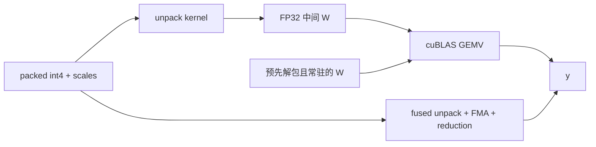

# D2 低比特 decode：从 nibble 到 CUDA 算子证据

[← D1 KV 缓存](01-kv-cache.md) · [课程索引](../index.md) · [配套 lab2](../../labs/lab2/README.md) · [D3 编译 →](03-dynamic-compilation.md)

> [!abstract] 这一讲要解决的问题
> 在 foundations 中，你已实现 GEMM，并学习了 GPU 数据搬运。本讲讨论小 batch 的 decode：即使权重压缩成 int4，每次计算仍要解包、查 scale、转换类型。这些成本会抵消多少带宽节省？怎样验证 kernel 的正确性，以及低比特格式对任务的实际作用？

| 模块                    | 时间  | 产物                         | 对应 lab |
| ----------------------- | ----- | ---------------------------- | -------- |
| §1 算术强度与字节模型   | 45min | 两种权重表示的流量账         | A        |
| §2 格式、寻址、PTX      | 65min | byte/lane/scale 布局图       | A        |
| §3 warp kernel 与正确性 | 65min | tail/归约不变量与独立 oracle | B        |
| §4 性能测量与诊断       | 55min | 三基线含义、两种失败假设     | C        |
| §5 前沿机制及源码       | 40min | AWQ/QServe 格式差异          | C        |
| §6 研究判断与自测       | 30min | 最小 shape 分发假设          | 报告     |

共 **5h**，实验另计 **26h**。本讲使用 **W4A32**：权重 4bit、激活与累加 FP32。这样可以单独分析解包与访存机制，范围不包含论文中的完整 W4A16/W4A8 系统。

随堂自测计入各模块的手算和分析时间，先写答案，再展开核对要点。外链只要求查看指定图或代码段，通读与移植放在选读和 lab 挑战中。

## §1 为什么 decode 需要重新思考线性层

### 1.1 GEMM 到 GEMV：权重重用机会发生变化

单个新 token 的线性层为 `y=Wx`，W 是 `[M,N]`，x 是 N 维。大约需要 `2MN` 次浮点操作；若权重为 FP32，仅权重读取就有 `4MN` 字节，因此忽略 x/y 的算术强度约为：

$$
I_{FP32}\approx\frac{2MN}{4MN}=0.5\ \mathrm{FLOP/byte}.
$$

batch B 增大时，同一权重可服务多个向量；如果实现复用良好，权重相关算术强度随 B 增大。这解释了为什么 batch=1 的最佳方案不一定适合 prefill 或大 batch serving。

对 int4 权重、每 g 个数一个 FP32 scale，权重相关有效字节约为：

$$
b_w=0.5+4/g.
$$

`g=128` 时为 0.53125B，理想权重流量下降约 7.53 倍。但每个权重新增了解包和尺度乘法，算术强度升高也不意味着一定更快。

### 1.2 4096×4096 的实际字节账

假设 N 为偶数且 group 整除：

```text
FP32 W：4096 × 4096 × 4 = 64 MiB
int4 codes：4096 × 4096 / 2 = 8 MiB
FP32 scales：4096 × (4096/128) × 4 = 0.5 MiB
x + y：4096 × 4 × 2 = 32 KiB
```

若先把 int4 解包成 FP32 W，再调用 cuBLAS，需要产生 64MiB 中间矩阵。其逻辑写入与后续读取必须计入成本；实际 DRAM 流量受缓存影响，不能直接把逻辑字节当 profiler 实测字节。

### 1.3 三条执行路径回答不同问题



- `unpack_then_cublas`：当前调用需要转换时，融合是否减少中间物化？
- `resident_fp32_cublas`：如果权重已可常驻 FP32，压缩路径还有多少执行优势？
- `fused`：压缩布局在本 kernel 内解码，避免生成完整 W。

现有 resident FP32 baseline 的 W 是**由相同量化码解出的权重**，不是未经量化的原始权重。这样，三条路径计算的是同一个数学问题；量化前后的质量差异则另行计算。

> [!question] 随堂自测 D2-1：流量能否换算成加速
>
> 1. 忽略 x/y，`g=128` 时本讲 W4A32 GEMV 的权重相关算术强度是多少？为什么不能把相对 FP32 的字节比直接写成实测加速比？
> 2. 已知 codes 为 8MiB、scales 为 0.5MiB，先解包再 GEMV 会增加多大的 FP32 中间矩阵？比较 fused 与 resident 时为什么要让二者使用同一量化权重？

> [!tip]- 核对要点
>
> 1. `2/(0.5+4/128)≈3.765 FLOP/byte`，只计算点积 FLOP 与权重流量。它没有包括解包指令、x/y、launch、归约及缓存行为，不能推出 7.53 倍实测加速。
> 2. 中间矩阵为 64MiB，逻辑上还需写入后再读取；硬件流量需另测。相同权重隔离执行路径差异，原始权重则用于单独衡量量化损失。

## §2 一个低比特格式必须说清楚的四件事

### 2.1 数值：对称 q，偏移存储

组内最大绝对值为 a，scale=`a/7`；lab 量化 q 到 `[-7,7]`，常量零组 scale 取 1。编码使用 `u=q+8`，因此码是 1–15，码 0 不由当前量化器生成。

两个 u 存在一个 byte：第一个占低四位，第二个占高四位。

```text
q       = [-7,  0,  7]
u=q+8   = [ 1,  8, 15]
bytes   = [0x81, 0x0f]
decode  = [1-8, 8-8, 15-8] = [-7,0,7]
```

请不要对 nibble 做 4bit 符号扩展。0xF 在当前格式中是 u=15、q=7；若按有符号 int4 解释，会误读为 -1。D1 的无符号仿射量化也不能直接复用。

### 2.2 布局：每行独立 padding

lab2 按行存储，每行使用 `ceil(N/2)` 个 byte：

```text
packed address = row * ceil(N/2) + col/2
shift          = 4 * (col % 2)
scale address  = row * ceil(N/group) + col/group
```

与 D1 整个矩阵平坦打包不同，N 为奇数时，每行最后高 nibble 空着，下一行从下一个完整 byte 开始。两个格式都合理，但调用方与 kernel 必须选择同一种。

精确容量为 `M*ceil(N/2)+4*M*ceil(N/g)`。N=31 时每行 16B codes；N=32 也为 16B。只计算 `MN/2` 会低估奇数行宽下的 padding。

### 2.3 指令：PTX 不是最终机器码

lab B1 用 `bfe.u32` 提取无符号位域，shift 为 0 或 4、宽度为 4。语义上等价于 `(byte >> shift) & 15`；[PTX ISA 文档](https://docs.nvidia.com/cuda/parallel-thread-execution/index.html) 给出指令定义。

CUDA 编译通常经历 CUDA C++→PTX→SASS。手写一条 PTX 并不能保证最终得到“恰好一条同名 SASS”，也不能保证优于普通位运算；后端可能选择不同等价指令。

因此需要保留两个版本：一个使用 `bfe.u32`，另一个使用 shift/mask。先检查生成代码，再计时。如果 SASS 相同，就说明源码写法的变化没有改变最终指令路径，这同样是值得记录的结果。

### 2.4 格式的代价不只有容量

元数据是否连续、每个 lane 是否重复读取 scale、一个 byte 是否被相邻 lane 重复加载、解包后是否能直接作为下游算术操作数，这些都影响执行效率。

缩小 group 以减少误差时，也会增加 scale 的数量，并可能增加寻址工作。比较时应固定原始 W/x，单独记录 quantization error；不能为每种 group 重新生成随机权重。

> [!question] 随堂自测 D2-2：格式必须逐字节一致
>
> 1. `M=3,N=5,g=4` 时 codes 与 scales 各占多少字节？坐标 `(1,0)` 的 codes 字节索引和 scale 元素索引是多少？
> 2. 对 `[0x81,0x0f]` 解出前三个整数权重，再说明为何 `0x0f` 的高 nibble 不能当成第四个有效权重。把 `bfe` 换成 shift/mask 后 SASS 相同，能够得到什么结论？

> [!tip]- 核对要点
>
> 1. codes 为 `3×ceil(5/2)=9B`，scales 为 `4×3×ceil(5/4)=24B`，共 33B；codes 字节索引=3，scale 元素索引=2，对应 FP32 scale 数组的字节偏移 8B。不能沿用 D1 跨行连续打包的 byte 地址。
> 2. 结果为 `[-7,0,7]`，最后高 nibble 是 padding，不代表有效的 -8。SASS 相同说明该编译配置下两种源码生成了相同指令路径；无法据此保证所有形状、编译器版本和架构都相同。

## §3 一个 warp 负责一行：逐步构建正确 kernel

### 3.1 从标量点积开始

第 r 行的输出是：

$$
y_r=\sum_{c=0}^{N-1}\left(u_{r,c}-8\right)s_{r,\lfloor c/g\rfloor}x_c.
$$

分配一个 warp 的 32 个 lane，lane l 处理 `c=l,l+32,l+64,…`。每个 lane 的局部和覆盖互不相交的列，所有 lane 的并集覆盖整行。

```text
lane 0: columns 0,32,64,...
lane 1: columns 1,33,65,...
...
lane31: columns31,63,95,...
        ↓ each holds partial sum
shuffle offset16 → 8 → 4 → 2 → 1
        ↓ lane0 has the row sum
```

每个线程先把 partial 初始化为 0。`N<32` 时，没有列可处理的 lane 仍参加归约，它的贡献为 0。

### 3.2 warp 到 block 的映射

默认 block 有 128 线程，即 4 个 warp；每 block 处理 4 行：

```text
lane = threadIdx.x & 31
row  = (blockIdx.x * blockDim.x + threadIdx.x) / 32
```

当 row≥M 时，整个 warp 都无效，可以一起返回。合法 warp 的所有 lane 都执行 shuffle，所以可以使用全 warp mask。

不能让 col≥N 的 lane 直接 return，再让其他 lane 使用全 mask shuffle：mask 指定参与的线程并未全部执行该指令，集体操作的前提不再成立。正确做法是仅跳过加载/FMA，让这些 lane 继续参与归约。

> [!example] 看图：沿 shuffle 边追踪一项部分和
> 打开 [NVIDIA 的 warp 原语图解](https://developer.nvidia.com/blog/using-cuda-warp-level-primitives/)，看开头的树形归约图和 Listing 1，再读 “Synchronized Data Exchange” 对 mask 的解释。在图上追踪 lane 31 的部分和怎样到达 lane 0，并把五轮 offset 标回自己的 kernel。该图解释通信关系，不给出本机延迟；本 lab 对有效行采用全 warp 参与、空 lane 贡献 0 的方案。

> [!question] 随堂自测 D2-3：覆盖与参与是两件事
>
> 1. `N=65` 时 lane 0 和 lane 31 分别处理哪些列？`N=1` 时，哪些 lane 有数据，哪些 lane 仍需执行 shuffle？
> 2. `M=5,blockDim=128` 时第二个 block 哪些 warp 有效？为什么整条无效行可以返回，而一条有效行内没有数据的 lane 不能照样返回？

> [!tip]- 核对要点
>
> 1. lane 0 处理 `{0,32,64}`，lane 31 处理 `{31,63}`；`N=1` 时只有 lane 0 加载/FMA，但 32 个 lane 都执行归约。
> 2. 第二个 block 的第一个 warp 处理 row 4，其余处理 row 5–7，全部越界。整 warp 返回不留下参与者；有效 warp 内部分返回会破坏当前全 mask 归约的参与约定。

### 3.3 尾部测试为什么比方阵更有用

现有测试包含 `(M,N)=(1,1),(3,31),(37,65),(128,256),(513,1025)`。这些输入覆盖以下边界情况：

- 极小工作量和大量空 lane；
- N 不是 warp 宽度倍数；
- 每行最后半 byte；
- M 不是每 block 行数的倍数；
- 多轮循环和尾组 scale。

如果只有 4096×4096 通过，寻址、mask 和尾组处理仍可能都有错。先让奇数形状通过测试，再讨论加速。

### 3.4 两种误差需要两个参考

`kernel error` 比较 GPU 输出与**同一量化权重**的 CPU 点积；它检查地址、解码、乘法、归约是否正确。

`quantization error` 比较量化权重点积与**原始浮点权重**点积；它反映格式造成的表示损失。

提供的 Fixture 在 CPU 生成两份输出参考，核对最大绝对 kernel error，并记录量化 relative L2。它使用浮点累加和容差，不是精确实数计算；要求 bitwise equality 没有必要。

> [!question] 随堂自测 D2-4：用哪个 oracle 定位问题
>
> 1. GPU 与量化 CPU oracle 一致，但与原始权重点积相差很大，应优先检查 CUDA 寻址还是量化误差？反过来，只有 `N=65` 的 kernel error 很大，应先检查哪三处？

> [!tip]- 核对要点
>
> 1. 前者首先说明当前近似表示的误差较大，不能宣称量化无损。后者优先检查行末 padding、列循环尾部和尾组 scale；比较基准仍须使用同一量化权重，避免把表示误差混入 kernel error。

## §4 怎样对一个“不快”的 kernel 做研究

### 4.1 先确定测到什么

GPU launch 是异步的，CPU 调用返回时间不等于执行时间。现有 bench 使用 CUDA event，先 warmup，再把多次执行放在同一 event 区间，最后同步并除以次数。

它排除了初始化、主机量化、显存分配和 Host→Device 传输；因此结论是“驻留数据下的局部算子时间”。若研究一次性推理或动态换权重，这些被排除成本要加回来。

每配置有五个 repeat，方法顺序轮换以减少固定热状态偏置。但这不等于严格清空 GPU cache；不要把当前结果标为 cold-cache benchmark。

### 4.2 一个简单性能模型及其用途

可以把 fused 时间粗分为：

$$
T_{fused}\approx T_{launch}+\max(T_{memory},T_{decode+FMA+reduce}).
$$

这个式子可用于提出假设，但不能代替 profiler 验证。以下观察各有多种可能解释：

| 观察               | 可能解释                    | 区分它们的干预             |
| ------------------ | --------------------------- | -------------------------- |
| 小 shape 两版相近  | launch 开销主导             | 增大计算量、比较 kernel 数 |
| 中型 resident 更快 | FP32 权重缓存驻留或解包受限 | 扫工作集、检查指令/流量    |
| 大 N 少 M 很慢     | 并行行数不足                | 改 M/N 比例、考虑 split-K  |
| 小 group 明显慢    | scale/寻址成本增大          | 固定矩阵扫 group，检查指令 |

同一现象可能有多个解释。没有 cache/指令证据时，应写“与假设一致”，而不是“证明由 cache 导致”。

### 4.3 一个可实现的布局改动

原 kernel 中相邻两 lane 分别读取同一 byte 的两个 nibble。可尝试每 lane 一次取一个 byte，连续处理两个列：`c=2*lane,2*lane+1`，下一轮加 64。

优点是可能减少重复地址/加载指令；代价是每 lane 更多活跃中间值、尾部处理更复杂。内存系统可能已合并原读取，所以不能预设一定更快。实验要求用同样布局、同样量化数据，隔离线程映射变化。

### 4.4 从 kernel 加速到模型加速

若线性层目标 kernel 占总 decode 时间比例 p，局部加速 s，则理想 Amdahl 总加速为：

$$
S=\frac{1}{(1-p)+p/s}.
$$

例如 p=0.4、s=2，总加速只有 1.25。如果还增加了格式转换、调度和同步成本，总收益会更小。先确认这个 kernel 是否构成真实 workload 的瓶颈，再决定是否围绕它的优化开展论文工作。

> [!question] 随堂自测 D2-5：怎样推翻自己的性能解释
>
> 1. 原始 decode 共 10ms，其中目标算子占 4ms；算子加速两倍，却新增 1ms 转换。总时间和加速比各是多少？
> 2. byte-pair 版本在小矩阵上没有收益。请提出两种不同解释，并各给一个能区分它们的测量；只说“访存优化无效”为什么不够？

> [!tip]- 核对要点
>
> 1. 新总时间为 `6+2+1=9ms`，约 1.11 倍，而不是局部的 2 倍，也不是忽略转换后的 1.25 倍。
> 2. 可能是 launch 主导，可扩大工作量观察差距；也可能加载已被合并或新增解包指令抵消收益，应检查生成代码、加载/指令指标。单次耗时相近无法区分这些机制。

## §5 前沿方法为何要共同设计格式与执行

[AWQ](https://github.com/mit-han-lab/llm-awq) 把 activation 信息用于权重量化，并配套低比特执行；[QServe](https://arxiv.org/abs/2405.04532) 明确讨论量化格式、解量化开销与服务执行的协同。阅读时，需要同时关注数值格式和执行方式，不能只看 float 到 int4 的转换。

| 对照维度 | 本 lab                   | AWQ / QServe 阅读问题                 |
| -------- | ------------------------ | ------------------------------------- |
| 权重格式 | 简单 per-group 对称 4bit | scale/zero 如何组织，为什么这样重排？ |
| 激活     | FP32                     | 激活 dtype 与矩阵指令如何匹配？       |
| kernel   | SIMT warp GEMV           | 小/大 batch 是否走不同路径？          |
| 校准     | C中基于激活的输出MSE搜索 | activation 或量化误差怎样指导格式？   |
| 系统     | 单算子                   | attention/KV、调度和资源怎么配合？    |

从 [固定版本源码地图](../readings/code-map.md) 打开 AWQ 的 GEMV 文件，只追踪“读取 packed→反量化→乘加→归约”四步。对 QServe/OmniServe 再找格式转换与调用入口，明确哪些准备成本在热路径之外。

4060 上先验证支持的 SIMT/CUDA 路径。Hopper/Blackwell 特有指令和需要大显存的演示，不能直接列为本机必修任务。以后扩展 Tensor Core 路径，要明确 dtype、alignment、compute capability 与 fallback。

> [!example] 看图：把数值变换和硬件布局分别标出来
> 看 [AWQ 作者论文 v5](https://arxiv.org/html/2306.00978v5) 的 Figure 2，标出哪些通道被缩放，以及输入端需要怎样补偿；再看 Figure 4，把一个 packed 值沿 AND/shift 路径追到解包结果。Figure 4 描述 **ARM NEON 的 SIMD 布局**，不能直接当作本 lab 的 CUDA row-major 布局。Figure 3 的 roofline 可选读，图中硬件和数值设置也不能直接移作 RTX 4060 的结论。

> [!question] 随堂自测 D2-6：校准改变了什么
>
> 1. `W=[2,3],x=[4,5],s=[2,0.5]`，分别计算 `W'=W diag(s)`、`x'=x/ s` 和变换前后点积。为什么量化以后还要搜索 s？
> 2. C3 的候选包含 alpha=0，是否保证 held-out 误差也不劣于 alpha=0？运行 C4 时为什么不能根据新输入再次估计通道尺度？

> [!tip]- 核对要点
>
> 1. `W'=[4,1.5]、x'=[2,10]`，两个点积都是 23。等价性只针对未量化浮点变换；量化舍入和分组范围随尺度变化，输出误差需要实际比较。
> 2. 只保证已评估候选中的校准目标不劣，不保证分布外表现。C4 使用冻结 artifact；临时改尺度会改变权重/输入的配对语义，也把评测变成新的校准过程。

## §6 一个适合当前设备的研究切口

候选假设：**真实小 batch shape 分布中，用少量布局/线程映射分支，能否在计入转换与调度成本后改善端到端 decode？** 已有许多类似的自动调优工作，因此需要找到明确的新约束或反复出现的失败模式，才能判断是否有创新空间。

先在小范围内完成对照实验：建立正确的 baseline，加入一个能解释其作用的改动，在方形与不规则矩阵上配对测量，并保留一个不获益的形状。再加入 batch、真正 FP16/BF16 强基线和成熟低比特实现；没有这些对照，不能宣称优于现有低比特系统。

如果只胜过先解包的弱 baseline，对 resident 或成熟实现没有收益，或者转换成本抵消了全部改进，就应停止推进这一假设。已有结果仍可整理为有价值的架构分析报告，也能帮助你判断是否喜欢 kernel 研究。

> [!question] 随堂自测 D2-7：一个可以判断成败的实验
>
> 1. 你的分发器在一个 shape 上胜过 `unpack_then_cublas`，在 resident 路径上更慢。为检验“改善真实 decode”，还缺哪些对照与费用？写出至少一条停止条件。

> [!tip]- 核对要点
>
> 1. 至少需要代表性 shape/batch 分布、相同权重与输入、成熟低比特及合适浮点基线，计入布局转换和分发，并重复配对测量。若完整成本抵消全部收益，或收益只来自弱基线，可停止当前假设，保留负结果解释。

## 新版实验映射：完整低比特路径

[Lab 2](../../labs/lab2/README.md)现有17个必修TODO，分为A基础、B核心、C前沿，252行有效算法实现、26h实验预算。A1–A6实现分组量化、字节布局、double oracle、误差证书与逐组clipping搜索；B1–B6实现PTX解码、warp、byte-pair、四token复用、split-K与合并；C1–C5实现激活通道尺度、等价变换、输出误差搜索、冻结artifact执行和group/alpha字节预算选择。

C 中已提供校准→artifact→held-out→CUDA 执行的完整参考答案。它借鉴 AWQ 的搜索机制，但只实现 W4A32 局部线性层，不包含整模型的层间 folding 和准确率评测。新`exercise.py`的四路径benchmark与旧`bench.cu`三基线诊断并存；旧版五repeat/方法轮换描述只适用于旧bench，新版单次记录需独立运行五次再做统计。见[具体资料借鉴](../../labs/lab2/resources.md)与[逐任务验收](../../labs/lab2/grade.md)。

## 资料汇总

| 资料                                                                                                                                                                        | 指定观察与用途                                                                |
| --------------------------------------------------------------------------------------------------------------------------------------------------------------------------- | ----------------------------------------------------------------------------- |
| [NVIDIA warp 原语图解](https://developer.nvidia.com/blog/using-cuda-warp-level-primitives/)                                                                                 | 归约树、Listing 1 和 mask 解释；画出 lane 31 到 lane 0 的传播路径。           |
| [AWQ 作者论文 v5](https://arxiv.org/html/2306.00978v5)                                                                                                                      | Figure 2 的通道缩放与 Figure 4 的 ARM NEON 打包；区分数值机制和架构相关布局。 |
| [AWQ 项目页](https://hanlab.mit.edu/projects/awq) / [代码](https://github.com/mit-han-lab/llm-awq)                                                                          | 选读作者讲解视频；沿源码地图定位校准与 GEMV，勿把本 lab 当作完整 AWQ。        |
| [PTX ISA](https://docs.nvidia.com/cuda/parallel-thread-execution/index.html)                                                                                                | 查 `bfe` 的位域定义，再核对生成的 SASS。                                      |
| [MIT 量化课程](https://hanlab.mit.edu/courses/2024-fall-65940)、[GPU Puzzles](https://github.com/srush/GPU-Puzzles)、[learn-cuda](https://github.com/gau-nernst/learn-cuda) | 选读：补量化、索引与 CUDA 归约练习，不要求通做整个仓库。                      |
| [QServe 论文](https://arxiv.org/abs/2405.04532) / [OmniServe 代码](https://github.com/mit-han-lab/omniserve)                                                                | 选读格式、反量化与服务路径的协同设计。                                        |
| [Lab 2](../../labs/lab2/README.md)、[源码地图](../readings/code-map.md)、[改编边界](../../labs/lab2/resources.md)                                                           | 对齐 A/B/C 接口、四条新 kernel 路径与旧三基线诊断。                           |

## 自测清单

- [ ] 独立计算含行 padding 和 scale 的字节数，留下 3×5 示例的地址表。
- [ ] 从 0x81/0x0f 解出三个权重，说明它与 D1 仿射格式的区别。
- [ ] 画出 warp 列覆盖、五轮归约与无效行行为，解释所有有效参与者的 mask 约定。
- [ ] 为不规则 shape 选择边界测试，区分 kernel error 与 quantization error。
- [ ] 留下 PTX 与 SASS 的对应观察，不把源码指令数量当作机器码或加速证据。
- [ ] 对三种 baseline 分别说明可支持的结论，并标出计时包含与排除的工作。
- [ ] 手算通道缩放等价式，说明校准最优不保证 held-out 改善。
- [ ] 为一个不加速配置写出两种解释、区分实验和计入转换的端到端时间账。
- [ ] 用一句话提出研究假设，同时写出强基线、重复测量办法和停止条件。
