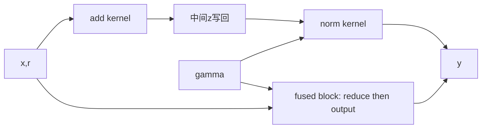

# D3 动态形状：从局部融合到编译成本摊销

[← D2 低比特算子](02-low-bit-kernels.md) · [课程索引](../index.md) · [配套 lab3](../../labs/lab3/README.md) · [D4 推测控制 →](04-speculative-slo.md)

> [!abstract] 这一讲要解决的问题
> foundations 的编译器实验关注算子如何加速。本讲考察完整的运行过程：输入形状不断变化，有限次调用能否摊销编译成本，cache 与 fallback 又如何影响后续执行。你将把离线分桶规划器接入实际的 torch.compile 测量，并通过 CUDA 局部融合理解编译器要实现的优化。

| 模块                     | 时间  | 产物                       | 对应 lab |
| ------------------------ | ----- | -------------------------- | -------- |
| §1 编译生命周期与回本    | 45min | 含冷启动的两条时间曲线     | A        |
| §2 形状语义与bucket DP   | 75min | 四种划分手算及递推证明     | A/B      |
| §3 CUDA residual RMSNorm | 65min | 数据流、归约不变量、流量账 | B        |
| §4 真实编译测量协议      | 45min | 校准/评测分割与缓存口径    | C        |
| §5 前沿编译与运行时      | 40min | 局部fusion到MPK的距离图    | C        |
| §6 研究决策与自测        | 30min | 有限生命周期假设           | 报告     |

共 **5h**，实验另计 **26h**。Python 负责成本规划与真实编译观测，CUDA C++ 负责一个可手工证明正确的融合算子；两者都属于必修。

随堂自测计入表中的推导和分析时间，先写答案，再展开核对要点。外部图解只需查看指定部分；完整 profiler 采样和更多 trace 分析可在 lab 中继续，不要求在 5h 内通读所有资料。

## §1 “稳态更快”为什么不等于“任务更快”

### 1.1 第一次调用和后续调用做的事不同

编译路径可能包含图捕获、guard 检查、图变换、代码生成、设备代码编译和缓存查询。随后相同条件的调用可复用结果；不同 shape/dtype/stride 等条件可能触发新路径。

因此至少区分：

```text
process start -> first call / compile -> reuse for the same shape
                                              |
                                              v
                                        new shape / guard check
                                              |
                             +----------------+----------------+
                             |                                 |
                             v                                 v
                    reuse or recompile                 unsupported / limit
                                                               |
                                                               v
                                                            fallback
```

冷启动需要区分不同层级：即使进程内的编译缓存为空，磁盘缓存中也可能已有编译产物；第一次调用还可能包含设备 context 的初始化。报告中要说明清空了哪一层缓存，不能将 first_call_ms 一概称为纯编译时间。

### 1.2 回本次数的推导

编译一次成本为 $C$，eager 每次耗时 $T_e$，编译后每次耗时 $T_c$，$N$ 次总耗时：

$$
T_e(N)=NT_e,\qquad T_c(N)=C+NT_c.
$$

若 $T_e>T_c$，编译获益条件为：

$$
N>\frac{C}{T_e-T_c}.
$$

例如 $C=800\,\mathrm{ms},\;T_e=0.12\,\mathrm{ms},\;T_c=0.08\,\mathrm{ms}$，需要超过20000次调用。5000次时 eager 是600ms，编译路径是1200ms；30000次时分别3600ms与3200ms。例子是手算，不是某版本PyTorch的实测。

若 $T_c\ge T_e$，增加调用次数也不会摊出正收益；若 shape 引起多次编译，要加上各次 $C$，而不是只加第一次。

在笔记中用同一组 $C$、$T_e$、$T_c$，补算 $N=20000$ 和 $N=20100$ 时的两条总耗时曲线。标出打平点与开始获益的位置，再将 $C$ 加倍，检查回本边界如何移动。这里比较的是整个会话的成本。

### 1.3 研究单位是 episode

一个 episode 可以是一段有限会话、一批作业或一个预先定义的服务时间窗口。优化目标是完成整个 episode 的时间，而非从中挑一个最有利的 warm shape。

记录中必须保留实际发生的 fallback、重编译和失败。如果 episode 较短时编译策略慢于 eager，这可能正是要研究的现象，不应删去相应结果。

> [!question] 随堂自测 D3-1：什么时候真的回本
>
> 1. 沿用 $C=800\,\mathrm{ms},\;T_e=0.12\,\mathrm{ms},\;T_c=0.08\,\mathrm{ms}$，20000 次调用是否已获得正收益？若两个 shape 各需编译一次，而总调用次数仍为 30000，结果怎样？
> 2. 新建进程后首次调用显著变快，能否直接断言编译器优化了代码生成？还应记录哪两类缓存或初始化状态？

> [!tip]- 核对要点
>
> 1. 20000 次恰好持平，为 2400ms；两次编译时总成本 $1600+30000\times 0.08=4000\,\mathrm{ms}$，慢于 eager 的 3600ms。模型中的 $C$ 必须按实际发生次数累计。
> 2. 不能。磁盘编译产物可能已存在，设备 context 或其他初始化状态也可能不同；还需说明进程内缓存与磁盘目录制度，不能只写“冷启动”。

## §2 形状选择怎样变成可证明的优化问题

### 2.1 三种策略承担不同成本

| 策略        | 优点                  | 代价与边界                    |
| ----------- | --------------------- | ----------------------------- |
| 每shape特化 | 容易生成针对性代码    | 编译项多、短任务摊不回        |
| 动态shape   | 多个shape可能共享路径 | guard/表达能力/性能约束仍存在 |
| 有限bucket  | 少量稳定shape         | padding浪费、长尾fallback     |

动态 shape 不保证一次编译就能支持所有输入。需要通过日志和测量确认实际行为，不能仅凭选项名称推断。[PyTorch官方教程](https://docs.pytorch.org/tutorials/intermediate/torch_compile_tutorial.html) 给出当前编译接口的使用方法。

### 2.2 padding首先是一个语义问题

本讲输入 $x,r\in\mathbb{R}^{\mathrm{rows}\times\mathrm{width}}$，$\gamma\in\mathbb{R}^{\mathrm{width}}$，每行独立归一化：

$$
z_{ij}=x_{ij}+r_{ij},
$$

$$
u_i=\left(\frac{1}{D}\sum_{j=0}^{D-1}z_{ij}^2+\epsilon\right)^{-1/2},
$$

$$
y_{ij}=z_{ij}u_i\gamma_j.
$$

把rows从17补到32，只增加15条独立行，取回前17行即可，真实行结果不变。把width从3补到4却仍除以4，会改变所有真实元素的归一化。

手算 $z=[1,2,2],\;\gamma=[1,1,1],\;\epsilon\approx0$：真实均方为 $3$，输出约 $[0.577,1.155,1.155]$。补0后若错误除4，均方为 $2.25$，输出变 $[0.667,1.333,1.333]$。

> [!question] 随堂自测 D3-2：padding 的语义证明
>
> 1. 把 $z=[1,2,2]$ 补成 $[1,2,2,0]$ 后仍除以 4，真实三项输出会被乘上什么比例？如果 attention 沿 token 维补零，是否能照搬“补独立行”的证明？

> [!tip]- 核对要点
>
> 1. 忽略 epsilon，错误结果与正确结果之比为 $\sqrt{4/3}\approx1.155$。attention 的 token 往往共同参与 softmax、位置与因果关系，需要 mask 等额外语义约束，不能套用独立 RMSNorm 行的证明。

### 2.3 离线bucket规划模型

校准直方图包含有序不同长度 $n_1<\cdots<n_m$，频次为 $f_i$。若连续一段形状 $n_j,\ldots,n_i$ 共享上界 $n_i$，每次执行按 $n_i$ 付费，假定单位 row 成本为 $a$、每个 bucket 编译成本为 $C$：

$$
\operatorname{cost}(j,i)=C+a n_i\sum_{t=j}^{i}f_t.
$$

为什么只考虑连续分段？在“总是选能容纳输入的最小bucket”的规则下，一个bucket接收的长度自然是一段区间。为什么上界取某个观测 $n_i$？在线性单调成本模型里，把边界从 $n_i$ 增加到两个观测之间不会接收新shape，只增加padding成本。

这些结论依赖上述成本模型和路由规则。实际硬件可能在特定对齐值上运行得更快；如果实测成本不单调，就需要扩展候选边界，不能再保证观测到的上界最优。

### 2.4 四种划分完整手算

取长度 $[1,4,8]$，频次 $[10,2,1]$，$a=0.1\,\mathrm{ms/row}$：

| 连续划分      | bucket上界 | 执行成本                     | 总成本   |
| ------------- | ---------- | ---------------------------- | -------- |
| $[1]/[4]/[8]$ | $[1,4,8]$  | $0.1\times(10+8+8)=2.6$      | $3C+2.6$ |
| $[1]/[4,8]$   | $[1,8]$    | $0.1\times(10+8\times3)=3.4$ | $2C+3.4$ |
| $[1,4]/[8]$   | $[4,8]$    | $0.1\times(4\times12+8)=5.6$ | $2C+5.6$ |
| $[1,4,8]$     | $[8]$      | $0.1\times8\times13=10.4$    | $C+10.4$ |

$C=0.1$ 时选三个 bucket，总成本2.9；$C=2$ 时选 $[1,8]$，总成本7.4；$C=10$ 时只用 $[8]$，总成本20.4。编译更贵时，接受更多padding可能更合理。

### 2.5 DP递推与正确性

设 $\mathrm{DP}[i]$ 为前 $i$ 个有序长度的最小成本，$\mathrm{DP}[0]=0$。最后一个 bucket 覆盖 $j,\ldots,i$，则：

$$
\mathrm{DP}[i]=\min_{1\le j\le i}\{\mathrm{DP}[j-1]+\operatorname{cost}(j,i)\}.
$$

最优子结构证明：若最优划分在 $j$ 开始最后一段，而前 $j-1$ 个长度不是最优划分，替换成更优前缀会降低总成本，矛盾。枚举最后一段起点覆盖了所有合法连续划分，因此递推不漏解。

频次前缀和让段频次 $\mathcal{O}(1)$ 计算，总时间 $\mathcal{O}(m^2)$、空间 $\mathcal{O}(m)$。记录每个最优前驱，回溯得到上界数组。输入重复shape先合并频次，再排序；空直方图返回空计划。

现有测试通过组合枚举所有切分，再与 DP 求得的最优成本比较，避免用同一递推生成 oracle。小规模穷举因此可以为算法正确性提供独立依据。

> [!question] 随堂自测 D3-3：规划器究竟保证什么
>
> 1. §2.4 的数据取 $C=2$，如果只允许一个 bucket，最优成本是多少？允许最多两个又是多少？这与不加数量约束的结果有什么关系？
> 2. 若硬件在 `bound=16` 上比 `bound=15` 更快，但校准只观察到 `shape=15`，“边界只取观测 shape”的最优性证明还成立吗？应扩展哪一部分模型？

> [!tip]- 核对要点
>
> 1. 一个 bucket 取 $[8]$，成本 12.4；最多两个取 $[1,8]$，成本 7.4，也是该例无数量约束的最优值。一般情形需在 DP 状态中加入 bucket 数量。
> 2. 不成立，原证明依赖执行成本随 bound 单调增加。需要加入未观测但可能有利的对齐边界，并测量相应成本；原来的连续分段 DP 并不能自动补全搜索空间。

### 2.6 未见过的shape必须有明确路径

`bucket_for(n,bounds)` 返回第一个满足 $b\ge n$ 的边界 $b$；超过所有边界返回None。实际运行时应回退到 eager，并记录 fallback 次数与耗时。不能使用最后一个较小的 bucket 截断输入，也不能用评测集的最大值扩大校准计划。

当前必修 B2 的 `route` 在这个基础上增加 `bound/n <= max_padding` 检查；超过填充比例也返回 None。A5 的 padding 统计按实际请求频次加权，fallback 请求按真实行数执行，不凭空增加填充。

### 2.7 计划还要通过缓存与回本检查

B3/B4 的应用层 cache 按 artifact 个数限制容量，正在执行的对象用 lease 引用计数保护。插入失败时不得改变原来的键和值或 LRU 顺序，执行结束或抛异常时都要释放 lease。这个 cache 不等于 PyTorch 的进程缓存或磁盘缓存，也不限制它们的实际字节占用。

B5 在预计未来调用量上检查回本。每次保守收益为 $\mathrm{eager\_ms}-\mathrm{steady\_ms}-\mathrm{margin}\cdot\mathrm{mad\_ms}$；只有收益为正，且累计收益严格大于 `first_premium_ms`，才准入。预测只能来自历史数据，不能等 held-out 结束后再把真实调用次数填回去。

> [!question] 随堂自测 D3-4：执行路径会怎样改变计划
>
> 1. $\mathrm{bounds}=[8,32]$、`max_padding=2`，输入长度 4、9、17、33 各走哪个 bucket 或 fallback？
> 2. 容量为 2，依次 `put(a),put(b),lease(a),put(c),lease(c),put(d)`，最后一步后 cache 有哪些键？为了“腾空间”，先删一项再检查 pin 有什么问题？
> 3. $\mathrm{eager}=3\,\mathrm{ms},\;\mathrm{steady}=1\,\mathrm{ms},\;\mathrm{premium}=10\,\mathrm{ms},\;\mathrm{MAD}=0.5\,\mathrm{ms},\;\mathrm{margin}=2$，预计 10 次和 11 次调用各会如何决策？

> [!tip]- 核对要点
>
> 1. 依次为 `8、fallback、32、fallback`；9 虽能放入 32，但 padding 比例超过 2。
> 2. c 淘汰未 pin 的 b；此后 a、c 都被 pin，d 被拒绝，键与 LRU 顺序保持原样。先破坏状态再发现不可淘汰，会违反失败时状态不变的事务约定。
> 3. 每次保守收益为 1ms，10 次恰好持平，因此拒绝；11 次准入。它是给定预测下的策略判断，不能保证真实运行一定回本。

## §3 CUDA局部融合：编译器究竟希望省掉什么

### 3.1 baseline先物化中间张量

提供的two-kernel路径先做$z=x+r$，再做RMSNorm。融合路径用一个block处理一行，先求 $\sum_j z_{ij}^2$，再生成输出。



当前 fused 实现在第二个循环中重新读取 x/r、计算 z，没有将整行 z 保存在寄存器中。这样能避免每个线程持有过多元素，但也意味着这份代码并非只读取一次输入。

### 3.2 按源级访存操作记账

忽略cache并以每个元素计，baseline：add读取x/r、写z；norm归约读z，输出阶段再读z/gamma、写y，共7次FP32访问，即28B。

当前fused：归约读x/r；输出阶段再读x/r和gamma、写y，共6次访问，即24B。它少一次kernel launch，也省掉中间存储容量，但不是简单“删除z的写读就从28B变成16B”，因为重读x/r也有成本。

由于 cache 可以复用同一行与 gamma，真实 DRAM 流量可能更低。上述计算只用于解释代码层面的取舍；实际带宽仍需通过测量或 profiler 确认。

### 3.3 block归约的不变量

默认256线程一block、一block一行。线程t处理$j=t,t+256,...$，生成局部平方和；写shared数组后同步，执行128、64、...、1的树形归约。

每轮归约后，前stride个位置分别含对应子集的总和。所有线程都必须到达`__syncthreads()`；不能把同步放在只有部分线程执行的分支内。

`width=31`时225线程的局部和为0，但它们仍参与同步。`width=513`时线程0处理三项，其他部分线程两项，尾部循环应自然停止。归约完成后分母使用真实width，不是blockDim或补齐宽度。

### 3.4 数值、并行度与融合限制

CPU oracle用更高精度累计平方和，GPU为FP32归约，因此有小误差容差；epsilon固定为1e-5，放在mean-square之后、rsqrt之前。gamma随机而非全1，有助于捕获错误广播。

rows很小时，只有少数block，GPU可能无法填满；width很小时，launch与同步占比大；width很大时，重复读取与寄存器策略又影响性能。因此，不能将一种融合方案视为所有 shape 下的最优解。

> [!question] 随堂自测 D3-5：从数据流证明融合实现
>
> 1. `width=513`、`blockDim=256` 时线程 0、1、255 各处理哪些列？`width=31` 时，没有元素的线程为什么也不能绕过 `__syncthreads()`？
> 2. 对 1000 个元素，按本节源码级模型计算 baseline 和 fused 的逻辑字节。能否将差值直接作为 profiler 中 DRAM bytes 的减少量？

> [!tip]- 核对要点
>
> 1. 分别为 $\{0,256,512\}$、$\{1,257\}$、$\{255,511\}$。空线程贡献零，但仍属于 block 归约的同步参与者，不能只让有数据的线程到达屏障。
> 2. 分别为 28000B 和 24000B，差 4000B；这是源级读写账。cache 重用、访问合并等会影响硬件流量，需独立测量，不能把公式值当成实测。

## §4 让真实测量约束成本模型

### 4.1 旧版独立诊断与新版闭环

| 文件              | 已提供什么                           | 尚未做什么                           |
| ----------------- | ------------------------------------ | ------------------------------------ |
| `policy_bench.py` | 假设C/a的DP演示、held-out fallback数 | 没有测torch.compile                  |
| `bench.cu`        | 手写fused和two-kernel GPU计时        | 没有编译生命周期                     |
| `torch_bench.py`  | eager/static/dynamic/固定bucket实测  | bucket固定[8,32,128]，没有读取DP计划 |

新版lab C在`src/execution_student.py`提供完整的校准→实测lookup表→DP→guard/cache/admission→真实bucket执行填空与参考答案。上表中的三个旧文件保留为独立对照；新闭环由`exercise.py`运行，其测量结果需要与旧诊断结果区分。

### 4.2 first-call不是可直接相减的编译时间

first_call包含guard、编译/cache查询、执行及可能的设备初始化；warm时间也会受同步与调用开销影响。`first_call-warm`可以作为指定环境下的初始化附加成本估计，但不能无条件命名为纯编译耗时。

必须记录缓存目录、是否首次使用、进程是否新建。要做冷/热cache对照，为实验使用独立新目录；不要删除全局用户cache。相同策略比较采用相同cache制度。

### 4.3 校准模型可以失败

简单DP要求标量C与线性a。可用校准shape的附加初始化成本中位数估C，对warm执行时间拟合过原点直线估a。随后画残差，检查小shape launch常数、对齐或kernel切换是否使线性模型失真。

如果残差足以改变 bucket 排序，就应报告当前模型无法预测该排序，再考虑加入截距或改用 lookup table。仍可执行 DP 计划并记录实际总时间，以保留正确性；不能为了改善图上的结果，用评测数据重新拟合。

### 4.4 三种held-out trace暴露不同失败

稳定trace检验摊销；突变trace检验旧bucket对新分布是否合适；罕见长尾检验fallback与额外编译。输入shape顺序也影响cache与首次调用，不能只留下总直方图而丢弃顺序。

记录`TORCH_LOGS=recompiles,graph_breaks`，保留警告与fallback。重编译上限等行为随版本变化，以运行日志为准；不能硬编码“static总会编译多少次”。

### 4.5 用时间线检查计时区间

> [!example] 看图：首次编译与稳态执行分别在哪里
> 查看 [PyTorch 官方编译 profiling 文档](https://docs.pytorch.org/docs/main/user_guide/torch_compiler/torch.compiler_profiling_torch_compile.html) 的 “Understanding compilation time” 时间线，以及 “Operator Kernels” 的 CPU event / launch / GPU event 图。在图上圈出 first-call 应覆盖的区间，再标出只测 GPU kernel 时的区间。两者会包含不同工作；页面示例 trace 也不等于本 lab 的运行记录。该链接是 main 文档，实际事件名称需结合你的 PyTorch 版本核对。

> [!example] 交互观察：时间线的总长度与事件长度之和
> 按 [Perfetto UI 官方指南](https://perfetto.dev/docs/visualization/perfetto-ui) 打开 [trace viewer](https://ui.perfetto.dev/)，从侧栏选择一个示例 trace；用 W/S 缩放，A/D 平移，选一个事件看详情，再框选一段时间。寻找重叠事件，解释为什么它们的 duration 不能直接相加作为 wall time。以后可以导入 `torch.profiler` 导出的兼容 Chrome trace；`tools/run.py` 生成的运行记录 JSON 并非这种格式，不能直接导入。

> [!question] 随堂自测 D3-6：证据能否支持成本模型
>
> 1. 假设实测校准用了 3s，held-out replay 用了 0.4s，eager replay 为 0.8s。本次只执行一次 episode，能否报告“总时间减半”？若复用同一校准结果，至少重复多少个同样 episode 才有正收益？
> 2. 两段 trace 的 shape 直方图相同，顺序不同，为什么应用 cache 的命中和总时间仍可能不同？应怎样保留这一变量？

> [!tip]- 核对要点
>
> 1. 不能，第一次总成本为 3.4s。若之后每次仍是 0.4s 且无需重新校准，则 $3+0.4N<0.8N$，最少 8 次；这些复用条件也要验证。
> 2. 有限容量和 LRU 依赖访问顺序，首次编译/复用也有时序。保留逐请求序列并让各策略回放同一序列，直方图只用于规划，不能替代 episode 输入。

## §5 从局部fusion到前沿编译/运行时

[Mirage](https://arxiv.org/abs/2405.05751) 探索多层次表示和优化搜索；[MPK](https://arxiv.org/abs/2512.22219) 进一步把tensor program组织为megakernel的编译与运行时；[Event Tensor](https://arxiv.org/abs/2604.13327) 讨论动态执行和事件依赖表达。这些工作进一步研究多任务依赖、资源调度和运行时执行。

| 层次                | 我们的例子             | 新增难题                     |
| ------------------- | ---------------------- | ---------------------------- |
| 算子内部            | 一行RMSNorm归约        | thread/warp同步、布局        |
| 相邻算子融合        | residual add + RMSNorm | 中间物化、寄存器重用         |
| 跨算子任务编排      | 多算子依赖图           | 可并发性、资源占用、调度     |
| megakernel/动态执行 | 更长tensor program     | 全局进度、依赖通知、通信重叠 |

仅将所有 kernel 的源码合并到一个`__global__`函数，并不足以实现 megakernel。跨 block 依赖处理不当时，等待者可能占满资源，使生产者无法运行，进而无法保证执行继续推进。

用[源码地图](../readings/code-map.md)找图构建→编译→launch→profile四个入口，画调用关系。先理解编译对象与运行时状态，再读特定GPU指令；本lab没有实现完整MPK调度器。

> [!question] 随堂自测 D3-7：更大范围的融合多了什么难题
>
> 1. 把两个 kernel 合成一个 `__global__` 函数，消费者 block 自旋等待生产者 block。若消费者先占满可驻留资源，会发生什么？为什么一行 RMSNorm 的 block 内归约不能证明这种调度正确？

> [!tip]- 核对要点
>
> 1. 生产者可能无法获得执行资源，等待无法结束。block 内屏障有既定参与范围；跨 block 还要保证依赖的生产者可运行及全局进度，不能用局部正确性替代运行时调度证明。

## §6 一个可在本机检验的研究问题

候选假设：**对于生命周期有限、shape变化频繁的推理任务，考虑预计剩余调用次数与编译代价的有限特化，能否降低总完成时间？** baseline 至少应包括 eager、static、dynamic 和固定 bucket；仅优于一个效率较差的手写版本，不足以支持结论。

先用本 lab 的 RMSNorm 验证实验方法，再替换为真实模型中的一个局部模块。正式研究要加入缓存容量、编译并发、真实shape trace和更强的编译基线；如果dynamic已覆盖目标变化且稳态优势充足，分桶可能没有研究空间。

分析负结果时，可以检查以下原因：padding 成本是否超过减少编译带来的收益，长尾输入的成本估计是否失真，生命周期是否已足够长而使编译成本影响很小，以及优化对象是否只占模型计算的一小部分。

> [!question] 随堂自测 D3-8：负结果要怎样推进研究
>
> 1. 你的 measured plan 在稳定 trace 上获益，在突变 trace 上变慢。能否根据突变 trace 的全部 shape 重新规划后，再称其为 held-out 收益？写出一个不泄漏的改进和一个必须保留的对照。

> [!tip]- 核对要点
>
> 1. 不能。可以只用已完成请求构造在线漂移检测与重校准策略，但新校准成本、触发时点及未来请求都要按顺序记录；保留冻结计划的失败结果，并与同一 trace 上的 eager/dynamic 等基线比较。

## 新版实验映射：15个必修任务

[Lab 3](../../labs/lab3/README.md)264行有效代码、26h实验预算。A1–A5覆盖按时间切分、稳健计时统计、区间成本、分布漂移和padding记账；B1–B5覆盖容量约束DP、guard、事务LRU、lease和回本admission；C1–C5覆盖真实Inductor校准、零填充执行、完整held-out闭环以及CUDA融合。

DP现在支持实测bound lookup成本和bucket数量约束；上文线性C/a模型仍作为手算基线保留。校准自身会编译候选，必须单列总校准成本。C5是手写融合对照，未注入Inductor图。CPU运行会明确标记C5未运行，完整验收需CUDA。参阅[资源借鉴映射](../../labs/lab3/resources.md)和[评分测试对应表](../../labs/lab3/grade.md)。

## 资料汇总

| 资料                                                                                                                                    | 指定观察与用途                                                                      |
| --------------------------------------------------------------------------------------------------------------------------------------- | ----------------------------------------------------------------------------------- |
| [PyTorch 编译 profiling 图解](https://docs.pytorch.org/docs/main/user_guide/torch_compiler/torch.compiler_profiling_torch_compile.html) | 首次编译时间线、CPU→GPU 启动关系；选读 graph break 示例，结合安装版本核对事件名称。 |
| [Perfetto UI 指南](https://perfetto.dev/docs/visualization/perfetto-ui) / [交互 viewer](https://ui.perfetto.dev/)                       | 打开示例 trace，缩放、选区并查看事件；区分事件累计时长与 wall time。                |
| [PyTorch 编译教程](https://docs.pytorch.org/tutorials/intermediate/torch_compile_tutorial.html)                                         | 选读当前接口与 graph break 行为；以本机日志和版本为准。                             |
| [CMU MLSys](https://mlsyscourse.org/)、[Stanford CS336 systems 作业](https://github.com/stanford-cs336/assignment2-systems)             | 选读系统测量与 profiling 练习，不要求在本讲通做课程。                               |
| [Mirage 论文](https://arxiv.org/abs/2405.05751) / [代码](https://github.com/mirage-project/mirage)                                      | 区分 tensor program 候选搜索与本 lab 的 shape 分段 DP。                             |
| [MPK](https://arxiv.org/abs/2512.22219)、[Event Tensor](https://arxiv.org/abs/2604.13327)                                               | 选读跨任务依赖与执行；先画对象和状态，不直接照搬特定 GPU 指令。                     |
| [Lab 3](../../labs/lab3/README.md)、[源码地图](../readings/code-map.md)、[实验改编说明](../../labs/lab3/resources.md)                   | 对齐 guard、lease、admission、实测校准和独立 CUDA 对照。                            |

## 自测清单

- [ ] 推导严格回本条件，处理重复编译、持平和 $T_c\ge T_e$，保留累计成本曲线。
- [ ] 留下 rows padding 的语义证明和 width padding 的数值反例。
- [ ] 手算四种 bucket 划分，说明数量约束、候选边界与成本模型的适用条件。
- [ ] 写出 `shape=4/9/17/33` 的 guard 路径，并画出带 pin 的事务 LRU 状态变化。
- [ ] 手算 admission 的 10/11 次分界，说明预测来自哪里、何时冻结。
- [ ] 画出 `width=513` 的线程覆盖，推导 28B/24B 逻辑流量并说明同步要求。
- [ ] 在外部示例 trace 上标出编译区间、CPU/GPU 事件与重叠，区分示例和本机记录。
- [ ] 列出校准、replay、fallback 和缓存制度，保留稳定/突变/长尾 trace 的原始顺序。
- [ ] 写出一个有限生命周期假设，明确失败标准与无评测泄漏的后续实验。
