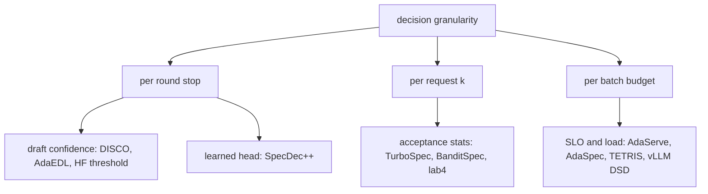
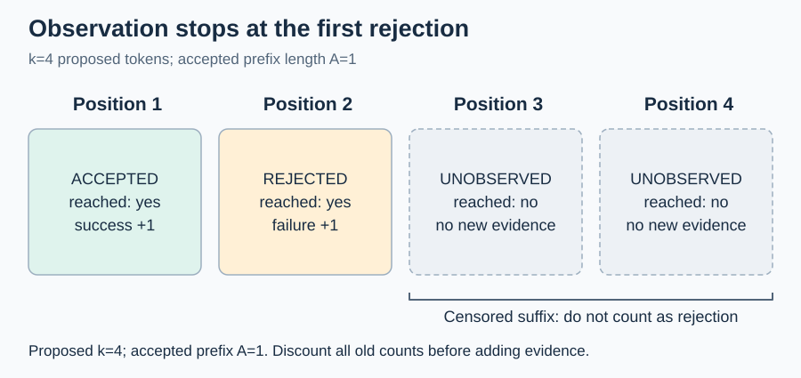
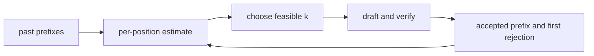
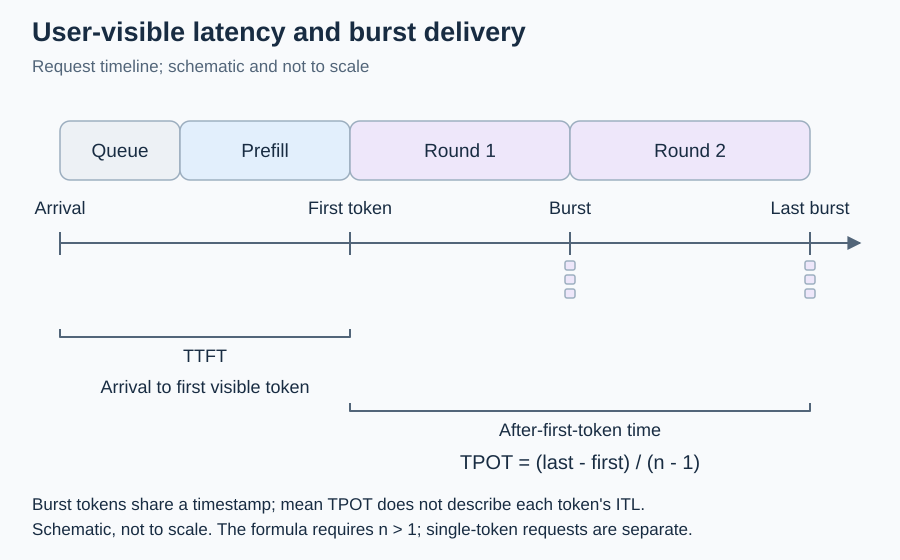

# D4 推测解码与 SLO：从条件接受率到受删失反馈的在线控制

[← 课程索引](../index.md) · [配套 lab4](../../labs/lab4/README.md) · [← D3 动态编译](03-dynamic-compilation.md) · [D5 前缀缓存 →](05-prefix-cache.md)

> [!abstract] 这一讲要解决的问题
> foundations L5 证明了推测采样不改变目标分布，并在 RTX 4060 上测到 Qwen3-0.6B 草稿配 Qwen3-1.7B 目标时 $c=T_d/T_v\approx0.47$，加速只有约 1.2 倍。本讲接着问：在这种不便宜的成本结构下，每一轮该推测多少个 token，什么时候该干脆不推测，多个请求共享验证预算、又各有延迟 SLO 时该怎么分。我们先把接受率拆成三个容易混淆的量，再说明真实 trace 上接受长度为什么不是 i.i.d.，最后把控制器只能看到“自己付过钱的那一段”这一删失结构变成研究切口。学完后你能在 lab4 中用 Rust 写出估计器、预算分配器和离散事件服务模拟器，用 PyTorch 在 4060 上采集可回放的真实接受 trace 和 cudaEvent 成本表，并判断一个“自适应 k”方案和 BanditSpec、TurboSpec、AdaServe 的差别在哪里。

| 阅读模块                    | 时间  | 必须留下的学习产物                              | 对应实验        |
| --------------------------- | ----- | ----------------------------------------------- | --------------- |
| §1 正确性与一轮提交量       | 45min | 三种接受率的换算表、一张 $\mathbb{E}[N]$ 手算表 | A1/A2、R1       |
| §2 成本比、加速比与 batch   | 45min | $c=0.08$ 与 $c=0.5$ 两张决策表                  | A4/A5、B3       |
| §3 设计空间：草稿与决策粒度 | 40min | 一张“粒度、信号、目标”三维定位图                | C、阅读         |
| §4 部分观测、删失与探索     | 50min | 三轮计数器状态、no-probe 反例、删失反馈的推导   | B1/B2/B4、R3/R4 |
| §5 SLO、goodput 与共享预算  | 40min | 四种 goodput 对照、贪心反例与 DP                | B5/B6、C        |
| §6 真实 trace 与回放        | 30min | 回放精确性的条件、实测加速与模型的误差          | R               |
| §7 机制与代码对应           | 10min | 函数对照表                                      | 全部            |
| 前沿与 baseline 对照        | 40min | 对照表中三篇工作的机制差异卡                    | C/R             |
| 研究问题                    | 20min | 一个可证伪假设与停止条件                        | R               |

**共 5h，另做 lab 约 28h。** 5h 包括 §1、§2、§4、§5 的手算和随堂题（约 1.5h），以及对照表中 AdaServe、BanditSpec、HedgeSpec 三篇的摘要和指定图表（约 40min）。其余论文全文、上游源码和可视化页面都是选读。随堂自测的时间已计入上表；先在笔记里写答案，再展开核对要点。

## §1 一轮到底提交多少 token

### 1.1 先固定正确性契约

草稿模型 $q$ 依次提出 $k$ 个 token $x_1,\ldots,x_k$，目标模型 $p$ 在一次前向里给出 $k+1$ 个位置的分布。第 $j$ 个候选按下面的规则验证（Leviathan 等，ICML 2023；Chen 等，2023）：

$$
\Pr(\text{accept }x_j)=\min\left(1,\frac{p(x_j)}{q(x_j)}\right),
$$

首次拒绝时，从残差分布

$$
p'(x)=\frac{\max(p(x)-q(x),0)}{\sum_{y}\max(p(y)-q(y),0)}
$$

里采一个 token 作为纠正；全部接受时，再从 $p$ 的第 $k+1$ 个位置采一个 bonus token。可以验证每个位置的输出边缘分布恰好是 $p$。一个候选被接受的概率是

$$
\beta=\sum_{x}\min(p(x),q(x)),
$$

这就是 Leviathan 文中 Corollary 3.6 的 $\alpha=\mathbb{E}[\beta]$。贪心解码是它的特例：$p,q$ 都退化为 one-hot，接受当且仅当草稿的 argmax 等于目标的 argmax。

本讲只调整“推测多长”。拒绝采样的概率、token tree 的 mask、KV 的提交和回滚规则都不动。降低验证精度，或者把未验证的 token 先发给用户，会改变输出分布，已经不是这里讨论的控制问题。

> [!info] 图解：把一次 verify 对应到提交事件
> 打开 [Adaptive ML 的 Speculative Decoding, Visualized](https://www.adaptive-ml.com/post/speculative-decoding-visualized)，看 $\min(p,q)$ 重叠面积的动画和残差重采样那一段，记下动画里接受概率与重叠面积的关系。再看 [Leviathan 等人论文](https://arxiv.org/pdf/2211.17192) 的 Figure 1，沿一行标出接受的草稿、拒绝位置和纠正 token。两处都是作者给的示例，不是本机测量。

### 1.2 不假设 i.i.d. 的期望提交量

设一轮接受了前 $A$ 个候选，$0\le A\le k$。不考虑 EOS 和长度上限时，这一轮提交 $N_k=A+1$ 个 token，多出来的 1 个是纠正或 bonus token。

对非负整数 $A$，有 $\mathbb{E}[A]=\sum_{i=1}^{k}\Pr(A\ge i)$：一个 $A=3$ 的样本在 $\mathbf{1}_{\{A\ge1\}}+\mathbf{1}_{\{A\ge2\}}+\mathbf{1}_{\{A\ge3\}}$ 里恰好贡献 3。定义**条件接受率**（也叫 hazard 的补）

$$
a_j=\Pr(\text{accept }j\mid\text{accepted }1,\ldots,j-1),
$$

由链式法则 $\Pr(A\ge i)=\prod_{j=1}^{i}a_j$，于是

$$
\mathbb{E}[N_k]=1+\sum_{i=1}^{k}\prod_{j=1}^{i}a_j.
$$

这一步不需要独立性，$a_j$ 本身就是以“走到第 $j$ 个位置”为条件的概率。只有在 $a_j\equiv\alpha$ 时，才化成 Leviathan 的 Eq. 1：

$$
\mathbb{E}[N_k]=\frac{1-\alpha^{k+1}}{1-\alpha}\qquad(\alpha<1).
$$

$\alpha=1$ 时直接得 $k+1$，所以代码里用逐项乘积，不用这个闭式。

手算一例：$a=[0.8,0.5,0.25]$，$k=3$。

| 接受前缀 $A$ | 概率                             | 提交 $N=A+1$ |
| ------------ | -------------------------------- | ------------ |
| 0            | $1-0.8=0.2$                      | 1            |
| 1            | $0.8\times(1-0.5)=0.4$           | 2            |
| 2            | $0.8\times0.5\times(1-0.25)=0.3$ | 3            |
| 3            | $0.8\times0.5\times0.25=0.1$     | 4            |

按分布算，$\mathbb{E}[N]=0.2+0.8+0.9+0.4=2.3$；按尾概率算，$1+0.8+0.4+0.1=2.3$。两条路径独立，结果一致。lab 的 A1 测试就是这样做的：枚举所有 $2^k$ 个接受/拒绝向量，按首次拒绝位置聚合，不调用被测函数。

### 1.3 三种“接受率”不能混用

工具和论文里的“接受率”至少有四种口径：

| 名称                | 定义                                              | 谁在用                                     |
| ------------------- | ------------------------------------------------- | ------------------------------------------ |
| 生存概率 $S_j$      | $\Pr(A\ge j)$                                     | vLLM 的 per-position acceptance rate       |
| 条件接受率 $a_j$    | $S_j/S_{j-1}$，$S_0=1$                            | lab4 的估计器、Sequoia 的位置向量          |
| 草稿接受率          | 已接受草稿数 / 已提出草稿数                       | 多数系统的汇总日志                         |
| 平均接受长度 $\tau$ | 每轮提交 token 数，含 bonus，即 $1+\mathbb{E}[A]$ | EAGLE 系列、vLLM 的 mean acceptance length |

vLLM 的 metrics 代码按 `sum(accepted_per_pos)/num_drafts` 计算 per-position 接受率。在它 PR #17010 的例子里，5 次草稿的 `accepted_per_pos=[5,3,1]`，得到 $[1.0,0.6,0.2]$。这是 $S_j$：即使 $a_j$ 完全不随位置变，$S_j$ 也会按几何级数衰减。把它直接当成 $a_j$ 喂给控制器，会把“深位置更难走到”误读成“深位置更难接受”。换算回来是 $a=[1.0,0.6,0.2/0.6]=[1.0,0.6,0.333]$。

第二个陷阱是**删失**：提出 4 个、接受 1 个时，第 3、4 个位置根本没被检验，不是两次失败。条件接受率的分母只能包含走到该位置的轮次。

> [!question] 随堂自测 D4-1：分布、换算与观测条件
>
> 1. 对 §1.2 的例子计算 $\operatorname{Var}(N)$；再写出 $k=0$ 的分布、期望和方差。
> 2. 某系统报告 per-position 接受率 $[0.8,0.6,0.45]$。把它换成 $a_j$，并判断“接受率随深度下降”这一结论是否成立。
> 3. 100 轮里有 21 轮走到第 8 个候选，其中 17 轮接受。第 8 位置的 $a_8$ 应估计为 17/100 还是 17/21？另外 79 轮算什么信息？

> [!tip]- 核对要点
>
> 1. $\mathbb{E}[N^2]=0.2+1.6+2.7+1.6=6.1$，$\operatorname{Var}(N)=6.1-2.3^2=0.81$。$k=0$ 时 $\Pr(N=1)=1$，期望 1，方差 0。
> 2. $a=[0.8,0.75,0.75]$。$S_j$ 下降是必然的，$a_j$ 从第二位起是平的，不能据此说深位置更难接受。
> 3. $17/21\approx0.81$。其余 79 轮在更早的位置已经停下，对第 8 位置是删失，不能记成失败。

## §2 成本比、加速比与 batch

### 2.1 从 i.i.d. 公式到真实成本

设草稿一步耗时 $T_d$，目标验证 $k$ 个候选（$k+1$ 个位置）耗时 $T_v(k)$，一轮总成本

$$
T(k)=kT_d+T_v(k),\qquad R(k)=\frac{\mathbb{E}[N_k]}{T(k)}.
$$

若 $T_v(k)\approx T_v(0)$，记 $c=T_d/T_v(0)$，相对普通解码的加速比是 Leviathan Theorem 3.8 的形式：

$$
S(k)=\frac{\mathbb{E}[N_k]\,T_v(0)}{T(k)}=\frac{1-\alpha^{k+1}}{(1-\alpha)(1+kc)}.
$$

原讲义 §2.2 的表用 $T_d=0.08\,\mathrm{ms}$、$T_v\approx1\,\mathrm{ms}$，即 $c\approx0.08$。这个数对“草稿比目标小一两个数量级”的配置合理，但对本课程的硬件和模型对太乐观。Qwen3-0.6B 和 Qwen3-1.7B 都是 28 层，hidden 分别是 1024 和 2048。单 token decode 在 8GB 笔记本 GPU 上主要受 kernel 启动和逐层同步限制，草稿的层数和目标一样多，步时自然接近。HF 博客给的经验是草稿至少小 10 倍，这一对按参数量只小约 2.7 倍。

lab4 R 阶段在本机测到的值（2026-10-18，RTX 4060 Laptop，驱动 566.24，torch 2.14.1+cu126，bf16，上下文 256；每行计时前先让 GPU 连续忙 300 ms，再 warmup 5 次、重复 20 次取中位数，全部行满足 $p_{75}\le1.5\,p_{25}$）：

| 执行方式                | $T_d$/ms | $T_v(0)$/ms | $T_v(1..8)$/ms | $c$  |
| ----------------------- | -------- | ----------- | -------------- | ---- |
| PyTorch eager           | 27.8     | 29.0        | 29.4–31.7      | 0.96 |
| 每个宽度一个 CUDA graph | 9.0      | 18.1        | 19.1–19.3      | 0.50 |

eager 下草稿几乎和目标一样贵，推测永远不划算；用 CUDA graph 去掉启动开销后，$c$ 回到 foundations 测得的 0.47 附近。$T_v(k)$ 在 $k=1..8$ 几乎是平的，说明一次验证 9 个位置和验证 2 个位置的成本差不多，这一段是带宽受限的。这些数会随驱动、频率和温度变化，所以 lab 要求你在 R 阶段重新测，报告里写上自己的数。

把两种成本代入同一个 $\alpha=0.8$：

| $k$ | $\mathbb{E}[N]$ | $c=0.08$ 时 $T(k)$/ms | $R(k)$ | $c\approx0.5$ 实测时 $T(k)$/ms | $S(k)$ |
| --- | --------------- | --------------------- | ------ | ------------------------------ | ------ |
| 0   | 1               | 1.00                  | 1.000  | 18.1                           | 1.00   |
| 1   | 1.8             | 1.13                  | 1.593  | 28.0                           | 1.16   |
| 2   | 2.44            | 1.31                  | 1.863  | 37.0                           | 1.19   |
| 3   | 2.952           | 1.59                  | 1.857  | 46.1                           | 1.16   |
| 4   | 3.3616          | 2.02                  | 1.664  | 55.1                           | 1.10   |

左半边的最优点 $k=2$ 能把速率提高 86%；右半边最优仍是 $k=2$，但只有 19%，而且按同一模型算，$k\ge6$ 就比不推测还慢。成本比一变，“推测多长”就从调参小事变成了“要不要推测”，控制器的决策在这一区域才真正影响结果。表中 $c=0.08$ 一列是教学假设，$c\approx0.5$ 一列来自实测的 $T_d$、$T_v$，$\mathbb{E}[N]$ 仍是 i.i.d. 模型。

> [!info] 图解：最优 $k$ 随 $\alpha$ 和 $c$ 怎么变
> 看 [Leviathan 等人论文](https://arxiv.org/pdf/2211.17192) 的 Figure 3（不同 $c$ 下最优 $\gamma$ 随 $\alpha$ 的曲线），在图上标出 $(\alpha,c)=(0.8,0.08)$ 和 $(0.8,0.5)$ 两个点，读出最优 $\gamma$，再和上表比较。图假设 i.i.d. 接受和常数验证成本，§6 会看到真实 trace 偏离这两个假设。

### 2.2 受约束的单轮选择

lab 的 B3 解的是

$$
\max_{k\in\{0,\ldots,K\}}R(k)\quad\text{s.t.}\quad T(k)\le B,\ k\le r-1,
$$

其中 $B$ 是本轮预算，$r$ 是请求剩余要生成的 token 数。候选只有个位数，直接穷举。速率并列时选较短的 $k$，少做无用的草稿。若连 $T(0)$ 都超过 $B$，正确的返回值是“不可行”，调用方要显式记账（拒绝、降级或记一次违约），不能把回退到 $k=0$ 当成满足了约束。

三个反直觉的边界：草稿极慢时，接受率再高也是普通解码最快；$T_v$ 在某个 $k$ 处跳一级时，$\alpha=1$ 也不保证越长越好；成本预测偏低时，预计可行的 $k$ 实测会违约，优化均值也不能自动保证尾部。

### 2.3 batch 维度

上面的账只对 batch 为 1 成立。验证的工作量是 batch $\times(k+1)$ 个位置。batch 小时 GPU 空闲，多验证几个位置几乎免费；batch 一大，验证进入计算受限区，额外位置开始按比例收费，推测的收益下降，最优 $k$ 随之缩短。生产系统的做法很直接：vLLM 的 Dynamic Speculative Decoding 用一张按 batch 大小查的表，例如 `[[1,64,3],[65,128,1],[129,512,0]]`，batch 超过 128 就关掉推测。这张表只看 batch，不看接受率。TurboSpec（原名 SmartSpec）用离线 profile 加在线反馈选每个请求的推测长度，目标是每秒接受的 token 数。

反例来自长上下文。MagicDec（ICLR 2025）指出，序列足够长时 KV 读取成为主要成本，验证 $k+1$ 个位置和验证 1 个位置读的是同一份 KV，此时大 batch 下推测反而有收益。Performance or Illusion（MLSys 2026）在 vLLM 上系统测量后发现，验证占执行时间的大头，接受长度在输出位置、请求和数据集之间差异明显，实测加速远低于理论上界。

> [!question] 随堂自测 D4-2：成本结构决定可行集合
>
> 1. 用 §2.1 的实测成本，$\alpha=0.9$ 时 $k=2$ 的 $S(k)$ 是多少？要让 $k=2$ 达到 1.5 倍加速，$c$ 至少要降到多少（$\alpha=0.8$，$T_v$ 视为常数）？
> 2. 预算 $B=30\,\mathrm{ms}$、剩余 $r=1$ 时，B3 应返回什么？$B=17\,\mathrm{ms}$ 呢？

> [!tip]- 核对要点
>
> 1. $\mathbb{E}[N]=1+0.9+0.81=2.71$，$S=2.71\times18.1/37.0\approx1.33$。$2.44/(1+2c)\ge1.5$ 推出 $c\le0.313$。
> 2. $r=1$ 时只能 $k=0$，$T(0)=18.1\le30$，返回 0。$B=17$ 时连 $k=0$ 都超预算，返回不可行（`None`），调用方记一次 infeasible 再执行 $k=0$。

## §3 设计空间：草稿从哪来，决策在哪一层

### 3.1 草稿家族

| 家族         | 代表工作                                                                    | 草稿来源                          | 对控制器的影响                           |
| ------------ | --------------------------------------------------------------------------- | --------------------------------- | ---------------------------------------- |
| 独立小模型   | Leviathan、Chen、本 lab                                                     | 同词表的小模型逐 token 生成       | $c$ 由层数和启动开销决定，本机约 0.5     |
| 多头         | Medusa（ICML 2024）、Hydra（COLM 2024）                                     | 目标最后一层隐藏态上加多个预测头  | 草稿几乎免费，$c$ 很小，但深位置接受率低 |
| 特征级自回归 | EAGLE（ICML 2024）、EAGLE-2（EMNLP 2024）、EAGLE-3（NeurIPS 2025）          | 在目标特征上自回归的小头          | EAGLE-2 用草稿置信度近似接受率，动态建树 |
| 树验证       | SpecInfer（ASPLOS 2024）、Sequoia（NeurIPS 2024）、SpecExec（NeurIPS 2024） | 多条候选组成 token tree，一次验证 | 决策从“长度”变成“树的形状和大小”         |
| 无草稿模型   | Lookahead（ICML 2024）、REST（NAACL 2024）、SuffixDecoding（NeurIPS 2025）  | Jacobi 迭代、检索库或后缀树       | 接受率强依赖任务，复制型任务很高         |

本 lab 只做单链独立草稿。树验证把每轮决策从一个整数 $k$ 变成一个预算内的树，Sequoia 用位置接受向量做动态规划找最优树形，SpecInfer 用多个小模型合并出树。理解链的控制是读这些工作的前提。

### 3.2 决策粒度、信号与目标

图中第一层是决策在哪一层做，第二层是代表工作和它们依赖的信号。

**每轮停止**：草稿边生成边决定要不要继续。DISCO（NeurIPS 2024 ENLSP workshop）训练一个分类器决定是否继续；AdaEDL 用草稿熵给出接受概率的下界，不需要训练；SpecDec++（COLM 2025）把它写成 MDP，证明最优策略是阈值策略，再训练一个预测头估计“后面至少有一次拒绝”的概率。HF transformers 从 4.45 起默认 `assistant_confidence_threshold=0.4`，也就是说，直接调用 HF 的 assisted generation 时，k 默认就不是固定的。lab 的 R 阶段做 HF 交叉检查时，把这个阈值设成 0 才是真正的固定 $k$。

**每请求 $k$**：用历史接受统计选长度。TurboSpec 是闭环反馈；BanditSpec（ICML 2025）把每个 $k$（或每个草稿模型）当成一个臂，用 UCB 或 EXP3 选；HF 的 heuristic schedule 在全部接受时 $k$ 加 2，否则减 1。

**每批预算**：多个请求共享一次验证。AdaServe（EuroSys 2026）把每个请求的 TPOT SLO 换算成需要的期望接受数，按“先满足 SLO、再按路径概率填满预算”两阶段贪心建树；AdaSpec（SoCC 2025）按效率模型选 batch 级 $k$，并在验证时间超过 TPOT SLO 时封顶；TETRIS（ACL 2025）在批内按累计接受概率贪心挑草稿 token，只优化吞吐。

目标也要写清楚：最大化 $\mathbb{E}[N]$、最大化 $\mathbb{E}[N]/T$、在时间预算内最大化 $\mathbb{E}[N]$、最大化满足 SLO 的请求数，是四个不同的问题。

> [!question] 随堂自测 D4-3：定位一个方案
>
> 1. “每轮按草稿 top-1 概率是否低于 0.4 决定停不停”属于哪个粒度，依赖什么信号？它需要知道 $T_d$ 和 $T_v$ 吗？
> 2. vLLM 的 batch 大小查表为什么在单请求、长上下文的场景下可能选错？

> [!tip]- 核对要点
>
> 1. 每轮停止，信号是草稿置信度，HF 默认就是这样做的。它本身不读成本，阈值隐含了某个成本比；成本比变了，阈值要重调，SpecDec++ 的 MDP 推导里阈值就是成本比的函数。
> 2. 表只看 batch，不看接受率和上下文长度。单请求时它给出固定的 3；长上下文时 MagicDec 说明验证的边际成本更低，更长的 $k$ 可能更好；接受率很低的任务上，3 又可能太长。

## §4 部分观测、删失与探索

### 4.1 只更新真正观察到的事件

提出 4 个、接受 1 个，观测是：

图：只有位置 1 增加成功、位置 2 增加失败；位置 3 和 4 不增加新的失败证据，旧计数仍按原公式折扣。

| position | observation | reached |
| -------- | ----------- | ------- |
| 1        | accepted    | yes     |
| 2        | rejected    | yes     |
| 3        | unobserved  | no      |
| 4        | unobserved  | no      |

lab 的 B1 对每个位置维护折扣计数 $s_j,f_j$，初值为 0。每轮先把所有位置乘以 $\lambda$（包括 $k=0$ 的轮次，旧证据照样变旧），再给已接受的前缀加成功、给首次拒绝的位置加失败：

$$
s_j\gets\lambda s_j+\mathbf{1}[j\le A],\qquad f_j\gets\lambda f_j+\mathbf{1}[j=A+1\le k].
$$

读数时用 Beta(1,1) 平滑均值 $\hat a_j=(s_j+1)/(s_j+f_j+2)$。$\lambda=0.97$ 时，`observe(1,4)` 后四个位置分别是 $(1,0),(0,1),(0,0),(0,0)$；再 `observe(0,2)` 后是 $(0.97,1),(0,0.97),(0,0),(0,0)$。第三轮留作自测。

### 4.2 保守分数：Wilson 下界

只用均值，1 次成功和 100 次成功给出差不多的估计。B2 在 $z>0$ 时返回 Wilson score 区间的下端。它来自把 $\lvert\hat p-x\rvert\le z\sqrt{x(1-x)/n}$ 两边平方，解关于 $x$ 的二次方程 $(\hat p-x)^2=z^2x(1-x)/n$，较小的根是

$$
L(\hat p,n,z)=\frac{\hat p+\frac{z^2}{2n}-z\sqrt{\frac{\hat p(1-\hat p)}{n}+\frac{z^2}{4n^2}}}{1+\frac{z^2}{n}},
$$

较大的根（取加号）是上端 $U$。$n=0$ 时下端取 0。lab 的测试不抄这个闭式，而是用二分法直接解上面的二次方程，对比你的数值。计数经过折扣、分布还会漂移，所以这个数不再有经典置信区间的覆盖率保证，只能叫“保守控制分数”。

### 4.3 控制器决定自己能看到什么

图中是一个闭环：估计决定 $k$，$k$ 决定下一轮能观察到什么，观察再回到估计。

把下界喂给 B3 会发生什么？零证据时所有位置的下界都是 0，任何 $k>0$ 的期望提交量都是 1，而成本更高，于是选 $k=0$；$k=0$ 不产生任何接受事件，下界永远是 0。这个 no-probe 控制器和普通解码的时间线完全一样，lab 的测试会检查这一点。

在 $c\approx0.5$ 下，连均值控制器也会卡住：先验均值 0.5 时，$\mathbb{E}[N_1]=1.5$，$T(1)=28.0\,\mathrm{ms}$，速率 $0.054$，低于 $k=0$ 的 $1/18.1=0.055$，于是同样停在 $k=0$。在 lab 的真实 trace 上，均值控制器、池化 i.i.d. 控制器和 no-probe 控制器全部停在 $k=0$，比最好的固定 $k$ 慢 19%。换成 $c=0.08$ 的成本表，先验 0.5 已经让 $k=2$ 最优（$1.75/1.31\approx1.34>1$），均值控制器会自己去探索。同一个控制器在两种成本下行为完全不同。

### 4.4 删失反馈有结构：一次长探测回答所有短问题

这里的观测并不是普通的 bandit 反馈。固定草稿样本（贪心解码，或者采样时固定随机数）以后，从位置 $s$ 开始、草稿能连续匹配的长度 $L(s)$ 是确定的，和这一轮提出多少个无关。提出 $k$ 个时，接受数是

$$
A(k)=\min(L(s),k).
$$

所以提出 $K$ 个之后，你同时知道了每个 $k\le K$ 会接受多少：若 $A(K)<K$，则 $L(s)=A(K)$ 已经精确知道；若 $A(K)=K$，则只知道 $L(s)\ge K$。对 $k>K$ 的结果是右删失的，$k=0$ 什么都不揭示。

这给探索带来两条结论。第一，把每个 $k$ 当独立臂的 bandit（BanditSpec 的做法）浪费了信息：拉一次 $K$ 臂，其实给所有更短的臂都提供了一个样本。第二，探索的方向是单边的，要了解深位置就必须付出更长 $k$ 的成本；只要估计足够悲观，控制器就再也不会付这个钱（§4.3）。

lab R4 的控制器用的就是这条结构：每个位置用 Wilson **上端** $U$ 作乐观估计，没观测过的位置取 1，再交给 B3 选 $k$。乐观值只在走到那个位置时才会被修正，而更长的轮次会同时修正所有更浅的位置。HedgeSpec（ICLR 2026）利用了类似的“全信息”观察来选草稿模型，它指出每个草稿都能在不额外调用目标的情况下被评估；本讲的结构是在长度维度上的单边、删失版本。

> [!question] 随堂自测 D4-4：计数器、反馈与删失
>
> 1. 接着 §4.1，写出第三轮 `observe(2,2)` 后四个位置的 $(s_j,f_j)$。
> 2. 某轮提出 $K=4$ 个、接受 2 个。$k=1,2,3,6$ 时各自会接受多少？哪些是确定的，哪些只知道下界？
> 3. 一个 UCB 控制器只在 $k=2$ 的臂上积累了 50 次样本，从未试过 $k=4$。按 §4.4 的结构，它对 $k=1$ 的估计应该有多少样本？对 $k=4$ 呢？

> [!tip]- 核对要点
>
> 1. $(1.9409,0.97)$、$(1,0.9409)$、$(0,0)$、$(0,0)$。第三轮全部接受，不给第 3 个位置记失败。
> 2. $L=2$ 已精确知道，所以 $k=1\to1$、$k=2\to2$、$k=3\to2$、$k=6\to2$，都是确定的。若这一轮接受了 4 个，就只知道 $k\le4$ 的结果，$k=6$ 只有下界 4。
> 3. $k=1$ 也有 50 次（每次 $k=2$ 的结果都包含 $\min(L,1)$），$k=4$ 只知道每个样本 $L\ge2$ 还是 $L<2$，深位置是删失的，需要真正去探测。

## §5 SLO、goodput 与共享预算

### 5.1 一轮多个 token 不等于用户平滑地收到 token

TTFT 是到达到第一个 token 可见的时间；TPOT 是一个请求在首 token 之后平均每个 token 的时间，$(t_{\mathrm{finish}}-t_{\mathrm{first}})/(n-1)$；ITL 是相邻两个可见 token 的间隔分布。推测一次提交多个 token，同一轮的 token 时间戳相同，ITL 会变得突发：一次验证 37ms 提交 3 个 token，平均每 token 12.3ms，但用户看到的是等 37ms 后一下出来 3 个。

图：TTFT 包括排队；同轮 token 可以同时可见，平均 TPOT 不等于逐 token 的 ITL。横向间距不代表实测时长。

这里的 finish 是最后一个可见 token 的输出时刻；$n>1$ 时，$\mathrm{TPOT}=(t_{\mathrm{finish}}-t_{\mathrm{first}})/(n-1)$。同一轮输出多个 token 时，它们可共享时间戳，不能把平均 TPOT 当作每个 token 的 ITL。

图中 TTFT 包含排队和 prefill，TPOT 只看首 token 之后。lab C 没有 prefill 模型，TTFT 是首轮提交的时延。

### 5.2 goodput 至少有四种定义

| 出处                     | goodput 的定义                                                                          |
| ------------------------ | --------------------------------------------------------------------------------------- |
| TurboSpec                | 每秒接受的 token 数，不涉及 SLO                                                         |
| DistServe（OSDI 2024）   | 在 SLO 达成率（TTFT 和 TPOT 同时满足）不低于目标（如 90%）时，每 GPU 能承受的最大请求率 |
| AdaServe（EuroSys 2026） | 达标请求产生的 token 每秒数，达标指请求的平均 TPOT 不超过它的 SLO                       |
| lab4 C 阶段              | 截止时间前完成的请求数 / 从首次到达到最后完成的时间，含排空区间                         |

四个数没法互相比较。读论文先看它用的是哪一个；写报告时写清楚分母、成功事件和是否包含排空区间。lab 的 C4 同时给出 p95 TPOT，方便你按 AdaServe 的口径重算。

### 5.3 共享预算：贪心不是最优

多个请求共享一轮的验证预算 $B$，每个请求 $i$ 选 $k_i$，目标是总期望提交量：

$$
\max_{k_1,\ldots,k_n}\sum_i\mathbb{E}[N_{k_i}^{(i)}]\quad\text{s.t.}\quad\sum_i T_i(k_i)\le B.
$$

这是多选背包。B5 的贪心先给每个请求 $k=0$，再反复选“边际增益 / 额外成本”最大且放得下的升级。反例：基础分配后剩 1.6，请求 A 的升级是增益 0.6、成本 1.0，请求 B 的升级是增益 0.9、成本 1.6。贪心按比值先选 A（0.6 对 0.5625），剩 0.6 放不下 B，总增益 0.6；只选 B 得 0.9。

B6 把成本按量子 $\delta$ 离散成整数刻度，做动态规划：$V_i(b)=\max_k\{\mathbb{E}[N_k^{(i)}]+V_{i+1}(b-w_{ik})\}$，复杂度 $O(nKB/\delta)$。lab 的测试用穷举验证 DP 的最优值，用“字典序最小”作为并列规则，也验证贪心从不超过最优、并且停下时没有放得下的正收益升级。测试用的 300 个随机小实例里，贪心严格次优的约占 2%；B benchmark 的 2、4、8 请求实例里，这个比例分别是 10%、19%、27%，最坏一例只拿到最优的 85%。

AdaServe 的贪心在它的问题里是对的：它在一棵树上按路径概率 $f(v)$ 选节点，每个节点成本相同，按 $f$ 从大到小取就是最优。lab 的 B5 让不同请求、不同 $k$ 的成本不同，问题变成背包，贪心才会失效。读论文时要分清“算法是贪心”和“问题结构让贪心最优”是两回事。

> [!question] 随堂自测 D4-5：时间线与预算
>
> 1. 两个请求都用 $k=0$，每轮 1ms。r0 在 $t=0$ 到达、需要 2 个 token；r1 在 $t=0.5$ 到达、需要 1 个。按“新到达先入队、正在运行的请求随后回队”的规则，写出提交时间、TTFT、E2E，并按 lab 的口径算 goodput（截止时间都是 2.5ms）。
> 2. B6 的量子取 0.1，某个请求 $T(1)=2.6$。为什么实现里要写 `ceil(cost/quantum - 1e-9)`，不写 `ceil(cost/quantum)`？

> [!tip]- 核对要点
>
> 1. r0 在 1ms、3ms 提交，r1 在 2ms 提交。TTFT 为 1、1.5ms，E2E 为 3、1.5ms。只有 r1 达标，窗口 0–3ms，goodput $=1/0.003\approx333$ 请求/秒。
> 2. 二进制浮点里 $2.6/0.1=26.000000000000004$，直接向上取整得 27 个刻度，最优解可能被误判为超预算。减一个很小的容差再取整，得到 26。测试里的贪心反例正好踩到这一点。

## §6 真实 trace 与回放

### 6.1 一次生成、一次草稿前向，就能回放任意策略

贪心解码时，目标模型的输出 $y_0,y_1,\ldots,y_{T-1}$ 与 $k$ 无关（$y_0$ 来自 prefill，不参与推测）。对每个 decode 步 $i$，看草稿在 $y_{\le i}$ 下的 argmax 是否等于 $y_{i+1}$，得到一串 0/1 标记 $d_i$。草稿用 teacher forcing 一次前向就能算出全部 $d_i$。令 $L(i)$ 为从 $i$ 开始连续 1 的个数，任意策略在第 $e$ 步开始的一轮若提出 $k$ 个，接受数都是 $\min(L(e),k)$，下一轮从 $e+A+1$ 开始。这就是 §4.4 的结构，也是 lab R3 的回放环境。

采样解码也可以这样做：在每个位置用由 (seed, prompt, 位置) 确定的随机数抽草稿 token、做接受测试、从残差分布抽纠正 token，接受与否就和策略无关了。lab R1 的 `coupled_step` 实现这一步，并记录 $\beta_s=\sum_x\min(p,q)$ 作为零方差的接受概率。

### 6.2 回放什么时候不精确

bf16 下，宽度为 $k+1$ 的验证和宽度为 1 的普通解码走的是不同的 GEMM 分块，舍入不同。lab 的参考 trace 里，8 个 prompt 在 128 个 token 内大多和普通贪心解码在某个位置分开；分叉处目标 top-2 logit 的差全部不超过 0.25，也就是 1–2 个 bf16 ulp（logit 在 16 到 32 之间时 ulp 是 0.125）。草稿侧也有同样的问题：一轮全部接受后，草稿要一次补喂 2 个 token，宽度 2 的舍入和宽度 1 不同。按分叉前的部分比较，回放和真实循环的逐轮 (提出, 接受) 在 98% 的轮次上相同。lab 的测试只在分叉之前比较，阈值 95%。bf16 推测解码本来就不逐位等于贪心解码，这不是实现错误，报告里要写明。

### 6.3 实测加速与模型

参考 trace 上，手写的固定 $k$ 循环与普通解码相比：

| $k$ | 实测加速 | 回放 + 成本表预测 | i.i.d. 公式预测 |
| --- | -------- | ----------------- | --------------- |
| 1   | 1.06     | 1.09              | 1.17            |
| 2   | 1.04     | 1.04              | 1.20            |
| 3   | 0.96     | 0.97              | 1.18            |
| 4   | 0.88     | 0.88              | 1.12            |
| 6   | 0.73     | 0.75              | 1.00            |

其一，回放加成本表预测的解码耗时比实测少 2% 到 6%，差的主要是每轮的 host 同步和 Python 开销，这一项不在 $T(k)$ 里。其二，i.i.d. 公式明显偏乐观：它用的 $\alpha$ 是全体位置的平均 0.81，但接受是成簇出现的。trace 里 $S_j$ 从 0.81 降到 0.40（$j=1..6$），而 $a_j$ 从 0.81 **升**到 0.90：一旦进入草稿擅长的区域，就容易连续接受；而推测时每一轮都要从一次拒绝后的位置重新开始，正好落在难的地方。按任务分，代码和数学的 $a_1$ 在 0.91 左右，写作只有 0.67。这既说明 per-position 的估计有用，也说明“位置”不是唯一的条件变量。

固定 $k$ 中最好的是 $k=2$。在同一个 trace 上，R4 的乐观控制器比最好的固定 $k$ 慢约 2.3%，把每个 $k$ 当独立臂的 UCB 慢 7.1%，HF heuristic 慢 10.0%，均值和 no-probe 控制器卡在 $k=0$，慢 19%。这个 trace 上没有哪个自适应策略赢过事后最好的固定 $k$；要让自适应真正有价值，需要更强的漂移、更多样的负载，或者能提前知道“下一轮难不难”的上下文信号。下面的研究问题从这里出发。

> [!question] 随堂自测 D4-6：回放的边界
>
> 1. 回放环境返回 $\min(L(e),k)$。如果实现成直接返回 $L(e)$，控制器会多知道什么？哪些 lab 测试能抓到？
> 2. 为什么不能只用 $\mathbb{E}[N]$ 的平均值验证回放，而要比较逐轮的 (提出, 接受) 序列？

> [!tip]- 核对要点
>
> 1. 会知道本轮没付钱的那部分未来（$L>k$ 时的真实长度），等于偷看删失数据。`r_trace_env_censors` 逐个 $(e,k)$ 检查，accepted 不得超过 $k$。
> 2. 平均值能被两个方向相反的错误抵消，例如下一轮起点差一位但接受数恰好补回来。逐轮序列一旦错位就会立刻分开，off-by-one 几乎在第一轮就会暴露。

## §7 机制与代码的对应

| 机制或公式                                  | lab 中的函数                                                                         | 上游实现位置                                                                                                                                                                              | 本 lab 简化了什么                   |
| ------------------------------------------- | ------------------------------------------------------------------------------------ | ----------------------------------------------------------------------------------------------------------------------------------------------------------------------------------------- | ----------------------------------- |
| $\mathbb{E}[N_k]=1+\sum_i\prod_{j\le i}a_j$ | `committed_distribution`、`committed_moments`（A1/A2）                               | Leviathan Eq. 1（i.i.d. 特例）                                                                                                                                                            | 只做链，不做树                      |
| 中位数校准的成本表 $T_v(L,k)$               | `calibrate`（A5）、`real/profile_student.py`（R2）                                   | [Sequoia `test_accept.py`](https://github.com/Infini-AI-Lab/Sequoia) 测位置接受向量                                                                                                       | 单 GPU、batch 1                     |
| 删失计数与 Wilson 下界                      | `Estimator::observe/probabilities`（B1/B2）                                          | 无直接对应；SpecDec++ 学习条件接受概率                                                                                                                                                    | 折扣计数，不训练                    |
| 单轮选 $k$                                  | `choose_k`（B3）                                                                     | HF `AssistedCandidateGenerator.update_candidate_strategy`（transformers v5.18.0 `candidate_generator.py`）                                                                                | 穷举，不做阈值停止                  |
| 共享预算                                    | `allocate_round`、`allocate_round_exact`（B5/B6）                                    | [flexflow-serve `request_manager.cc`](https://github.com/flexflow/flexflow-serve/blob/7f07ba2bf98c505c86dd4c1bacb6384454fa37a5/src/runtime/request_manager.cc) 的 `add_tokens_toward_slo` | 链而非树，B5/B6 不接入 C 的单服务台 |
| 离散事件服务与 SLO 指标                     | `simulate`、`summarize`（C3/C4）                                                     | DistServe、AdaServe 的评测口径                                                                                                                                                            | 无 prefill、无 batch 并行           |
| 贪心接受标记与耦合采样                      | `greedy_flags`、`coupled_step`（R1）                                                 | HF `_speculative_sampling`（transformers v5.18.0 `utils.py`）                                                                                                                             | 手写循环，单请求                    |
| $A(k)=\min(L,k)$ 回放、乐观探索             | `run_lengths`/`censored_accept`/`fixed_k_schedule`（R3）、`CensoredUcb::upper`（R4） | BanditSpec（臂独立）、HedgeSpec（全信息选草稿）                                                                                                                                           | 只有贪心 trace 进入 Rust 回放       |

## 前沿与 baseline 对照

核验日期：2026-10-18（逐条打开论文页面或代码仓库，确认会议、年份和链接；“无公开代码”表示核验时没有找到作者仓库）。

| 工作（会议 年）                                                                                                                                                                                         | 问题                         | 关键机制                                                                          | 与本 lab 关系（实现/简化/未覆盖）                     | 研究时必须对比                    |
| ------------------------------------------------------------------------------------------------------------------------------------------------------------------------------------------------------- | ---------------------------- | --------------------------------------------------------------------------------- | ----------------------------------------------------- | --------------------------------- |
| Speculative Decoding（ICML 2023）：[论文](https://arxiv.org/abs/2211.17192)，无公开代码                                                                                                                 | 不改分布地并行化解码         | 拒绝采样 + 残差分布；i.i.d. 下 $\mathbb{E}[N]$ 与加速公式，Fig. 3 给最优 $\gamma$ | 实现：R1 `coupled_step`；A 阶段把 i.i.d. 推广到 $a_j$ | 固定 $\gamma$ 的最优值            |
| SpecInfer（ASPLOS 2024）：[论文](https://arxiv.org/abs/2305.09781)，[代码](https://github.com/flexflow/flexflow-serve)                                                                                  | 多个小模型的候选怎样一次验证 | token tree + tree attention                                                       | 未覆盖：只做链                                        | 同预算下链与树的接受长度          |
| Medusa（ICML 2024）：[论文](https://proceedings.mlr.press/v235/cai24b.html)，[代码](https://github.com/FasterDecoding/Medusa)                                                                           | 去掉独立草稿模型             | 最后一层多个预测头 + 笛卡尔积树                                                   | 未覆盖；作为 $c\to0$ 的对照                           | 草稿成本几乎为 0 时的最优 $k$     |
| EAGLE-2（EMNLP 2024）：[论文](https://aclanthology.org/2024.emnlp-main.422/)，[代码](https://github.com/SafeAILab/EAGLE)                                                                                | 接受率随上下文变             | 用草稿置信度近似接受概率，动态建树                                                | 简化：R 阶段记录草稿 top-1 概率但控制器未用           | 置信度信号对 $a_j$ 的解释力       |
| Sequoia（NeurIPS 2024）：[论文](https://proceedings.neurips.cc/paper_files/paper/2024/hash/ea1f5f0878d43ff4fb8bf64ef4a2326c-Abstract-Conference.html)，[代码](https://github.com/Infini-AI-Lab/Sequoia) | 树形状怎么选                 | 位置接受向量上的 DP，感知硬件                                                     | 简化：B6 的 DP 在请求之间分预算，不在树上             | 离线位置向量与在线估计            |
| SpecDec++（COLM 2025）：[论文](https://arxiv.org/abs/2405.19715)，[代码](https://github.com/Kaffaljidhmah2/SpecDec_pp)                                                                                  | 每轮何时停                   | MDP 证明阈值最优；训练接受预测头                                                  | 未覆盖：lab 每轮开始时一次决定 $k$                    | 每轮停止 vs 每轮定长              |
| MagicDec（ICLR 2025）：[论文](https://arxiv.org/abs/2408.11049)，[代码](https://github.com/Infini-AI-Lab/MagicDec)                                                                                      | 大 batch 下推测是否还有用    | 长上下文时 KV 读取主导，稀疏 KV 草稿                                              | 未覆盖：lab 只有 batch 1                              | 不同 batch 和上下文长度下的成本表 |
| DistServe（OSDI 2024）：[论文](https://www.usenix.org/conference/osdi24/presentation/zhong-yinmin)，[代码](https://github.com/LLMServe/DistServe)                                                       | SLO 下的服务能力怎么衡量     | 以 SLO 达成率定义 goodput                                                         | 简化：C4 用截止时间达标和 p95 TPOT                    | 同一 goodput 定义下的对比         |
| TurboSpec / SmartSpec（arXiv 2024，v3 2025）：[论文](https://arxiv.org/abs/2406.14066)，无公开代码                                                                                                      | 按负载选推测长度             | 离线 profile + 在线反馈，目标为每秒接受 token                                     | 简化：R 阶段的均值控制器                              | 负载变化下的闭环 $k$              |
| BanditSpec（ICML 2025）：[论文](https://arxiv.org/abs/2505.15141)，[代码](https://github.com/sail-sg/BanditSpec)                                                                                        | 在线选推测超参               | UCBSpec / EXP3Spec，每个配置一个臂                                                | 简化：R 阶段提供的 `ArmUcb`                           | 同 trace 上的 regret 与探索成本   |
| AdaSpec（SoCC 2025）：[论文](https://arxiv.org/abs/2503.05096)，[代码](https://github.com/cerebellumking/AdaSpec)                                                                                       | SLO 下的自适应 $k$           | 效率模型选 batch 级 $k$，按 TPOT 封顶                                             | 未覆盖：lab 没有 batch 级 $k$                         | TPOT 达成率                       |
| TETRIS（ACL 2025）：[论文](https://aclanthology.org/2025.acl-long.1598/)，无公开代码                                                                                                                    | 批内草稿 token 怎么选        | 按累计接受概率贪心分配验证预算                                                    | 简化：B5 贪心、B6 精确 DP                             | 贪心与精确解的差距                |
| AdaServe（EuroSys 2026）：[论文](https://arxiv.org/abs/2501.12162)，[代码](https://github.com/zikun-li/AdaServe-Artifact-Evaluation)                                                                    | 多 SLO 请求共享推测预算      | TPOT SLO 换算成所需接受数；先满足 SLO 再按路径概率填满；树深宽随请求数调整        | 简化：B5/B6 的共享预算，C 的 SLO 指标；无树           | 路径概率代理的校准误差            |
| HedgeSpec / Not-a-Bandit（ICLR 2026）：[论文](https://arxiv.org/abs/2510.20064)，无公开代码                                                                                                             | 在线选草稿模型               | 每个草稿都能免费评估，变成全信息在线学习                                          | 简化：R4 用在长度维的删失版本                         | 全信息 vs 删失信息下的 regret     |
| Speculative Decoding: Performance or Illusion?（MLSys 2026）：[论文](https://proceedings.mlsys.org/paper_files/paper/2026/hash/554e056fe2b6d9fd27ffcd3367ae1267-Abstract-Conference.html)，无公开代码   | 真实系统里推测的收益有多少   | vLLM 上系统测量；验证主导，接受长度随位置、请求、数据集变化                       | 对应：R 阶段的实测与回放对比                          | 同引擎下的实测加速                |
| vLLM Dynamic Speculative Decoding（文档 2026）：[文档](https://docs.vllm.ai/en/latest/features/speculative_decoding/dynamic_speculative_decoding/)，代码在 vLLM                                         | 生产里按负载开关推测         | batch 大小查表决定 $K$                                                            | 未覆盖：lab 只有 batch 1                              | 生产默认基线                      |

苗组相关工作：SpecInfer（ASPLOS 2024，苗旭鹏为第一作者）和 AdaServe（EuroSys 2026，苗旭鹏为作者之一），作者列表已在论文页面核对。苗旭鹏现为北京大学计算机学院助理教授（[主页](https://hsword.github.io/)，2026-10-18 核验）。SpecInfer 是本讲树验证的源头，AdaServe 是“SLO 定制的推测预算”最近的工作，研究题必须和它对比。

**查新结论**：“按 SLO 或负载自适应地选推测长度”已经很拥挤。最接近的工作和它们做到的程度如下：BanditSpec 把每个 $k$ 当独立臂，给出停时 regret，但没有利用 $A(k)=\min(L,k)$ 的删失结构，也不涉及 SLO；HedgeSpec 用全信息反馈选草稿模型，长度维的反馈是单边删失的，$k=0$ 不揭示任何信息，它的结论不能直接搬过来；TurboSpec 和 vLLM DSD 用 profile 加反馈，没有显式探索，也没有分析“悲观估计导致永远停在 $k=0$”；AdaServe 解决了多 SLO 的共享预算，但接受模型是草稿路径概率的代理，没有在线学习，也只报告平均 TPOT 达成。剩下的空白有两个。一是利用删失单调结构的探索：给出代价感知的探测计划，并在分段平稳的接受率下给出 regret 或检测延迟的界，在真实 trace 上和 BanditSpec 的 UCB/EXP3 比较。二是在 $c\approx0.5$ 的单卡 8GB 场景下，用在线学到的、带不确定性的接受模型做共享预算，并报告尾部 TPOT。如果只做到“用 UCB 选 $k$”，就和 BanditSpec 撞车；如果只做到“按 SLO 分预算”，就和 AdaServe、AdaSpec 撞车。本讲 §6.3 的实测还提示一个风险：在平稳的 trace 上，事后最好的固定 $k$ 很难被打败，研究题必须先构造或找到确实存在漂移的负载。

## 研究问题

- **候选假设**：在分段平稳、按任务切换的真实 Qwen3-0.6B→1.7B 贪心 trace 上，利用 $A(k)=\min(L,k)$ 的乐观探索控制器，在每次任务切换后 200 轮内的累计 regret（相对事后最好的固定 $k$）比臂独立的 UCB 低至少 30%，且平稳段的 regret 不高于 5%。
- **最小实验**：用 lab R 阶段采集 3 组不同任务顺序的 trace（每组至少 36 个 prompt，128 token），在 R3 回放环境里比较 `Fixed(0..6)`、事后最优固定 $k$、`ArmUcb`（BanditSpec 式）、`HfHeuristic` 和你的控制器，各跑 5 个 prompt 顺序；同时用 C 阶段按 AdaServe 的平均 TPOT 口径报告 SLO 达成率。成本表用本机重测的 $T(k)$。
- **继续或停止的证据**：如果把任务切换次数加倍后，所有自适应策略仍不能比最好的固定 $k$ 快 3% 以上，说明这类负载上自适应的价值不够，应停下或换成“上下文信号预测下一轮难度”（例如 R 阶段记录的草稿 top-1 概率）的问题。如果乐观探索的优势只在 $c<0.1$ 的模拟成本下出现、在实测成本下消失，也应停止。
- **与导师讨论的问题**：一，是否有组内可用的、带任务切换的真实请求 trace（例如 AdaServe artifact 使用的重标定 trace）；二，研究应在单链上做到底，还是直接进入 AdaServe 的树结构；三，regret 分析应基于 bandit 还是 partial monitoring 框架。

## 资料汇总

下表的“指定观察”已计入本讲时间；通读论文、运行上游代码属于选读或 lab 挑战。

| 资料                                                                                                                        | 类型        | 指定观察                                                   | 时间  |
| --------------------------------------------------------------------------------------------------------------------------- | ----------- | ---------------------------------------------------------- | ----- |
| [Leviathan 等，Fast Inference from Transformers via Speculative Decoding](https://arxiv.org/pdf/2211.17192)                 | 论文        | Figure 1 的接受/拒绝/纠正；Eq. 1；Figure 3 的最优 $\gamma$ | 15min |
| [Speculative Decoding, Visualized（Adaptive ML）](https://www.adaptive-ml.com/post/speculative-decoding-visualized)         | 图解        | $\min(p,q)$ 重叠面积动画与残差重采样                       | 10min |
| [Google Research：Looking back at speculative decoding](https://research.google/blog/looking-back-at-speculative-decoding/) | 图解        | 接受/拒绝动画、计算与带宽的示意图                          | 5min  |
| [EAGLE 项目页](https://sites.google.com/view/eagle-llm)                                                                     | 图解        | Figure 5：链、Medusa 笛卡尔树、EAGLE 稀疏树的对比          | 5min  |
| [Medusa 博客（Together）](https://www.together.ai/blog/medusa)                                                              | 图解        | tree attention 的 mask；头的 top-k 消融                    | 5min  |
| [HF Assisted Generation 博客](https://huggingface.co/blog/assisted-generation)                                              | 图解        | 采样温度与延迟的图；“草稿至少小 10 倍”的经验               | 5min  |
| [HF assisted decoding 文档](https://huggingface.co/docs/transformers/main/en/assisted_decoding)                             | 文档        | 不支持 batch 输入；`assistant_confidence_threshold`        | 5min  |
| [AdaServe](https://arxiv.org/abs/2501.12162)                                                                                | 论文        | 摘要与两阶段选择的描述；goodput 定义                       | 15min |
| [BanditSpec](https://arxiv.org/abs/2505.15141)                                                                              | 论文        | 摘要；臂的定义和 regret 的口径                             | 10min |
| [HedgeSpec](https://arxiv.org/abs/2510.20064)                                                                               | 论文        | 摘要；为什么草稿选择是全信息问题                           | 10min |
| [vLLM DSD 文档](https://docs.vllm.ai/en/latest/features/speculative_decoding/dynamic_speculative_decoding/)                 | 文档        | batch 大小到 $K$ 的查表                                    | 5min  |
| [Spec-Bench](https://github.com/hemingkx/Spec-Bench)                                                                        | 代码 / 评测 | README 的方法列表和指标；480 个 prompt 的任务构成          | 选读  |
| [CMU 15-779 课程表](https://www.cs.cmu.edu/~zhihaoj2/15-779/schedule.html)                                                  | 课程        | 10/31 推测解码一讲的必读文献                               | 选读  |
| [Lab 4](../../labs/lab4/README.md)                                                                                          | 实验        | 对照 §7 的函数表                                           | —     |

## 自测清单

- [ ] 不看讲义，推导 $\mathbb{E}[N_k]=1+\sum_i\prod_{j\le i}a_j$，说明它为什么不需要独立性，并完成一张分布与方差手算表。
- [ ] 把 vLLM 的 per-position 接受率换成 $a_j$，说出 $S_j$ 衰减与 $a_j$ 衰减分别意味着什么。
- [ ] 用实测的 $T_d$、$T_v$ 算出 $\alpha=0.8$ 时的最优 $k$ 和加速比，说明 eager 下为什么推测永远不划算。
- [ ] 手算三轮折扣计数，标清首次拒绝与未观测后缀；画出 no-probe 控制器卡在 $k=0$ 的反馈过程。
- [ ] 推导 $A(k)=\min(L,k)$，说明一轮 $K$ 能揭示哪些 $k$ 的结果，以及它和臂独立 bandit 的区别。
- [ ] 复述共享预算的贪心反例，写出 DP 的状态、转移和复杂度。
- [ ] 对照表中至少三篇工作（建议 AdaServe、BanditSpec、HedgeSpec），各写一句机制差异和本 lab 的简化边界。
- [ ] 写出一个可证伪的假设、必须对比的 baseline 和停止条件。

[← 课程索引](../index.md) · [配套 lab4](../../labs/lab4/README.md) · [← D3 动态编译](03-dynamic-compilation.md) · [D5 前缀缓存 →](05-prefix-cache.md)
