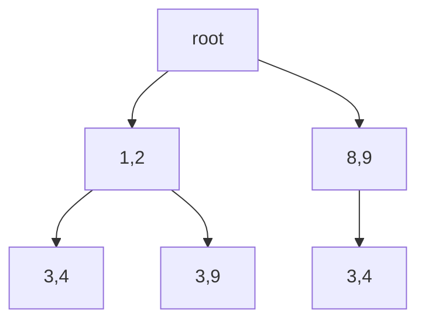

# D5 前缀缓存：计算身份、资源生命周期与收益

[← 课程索引](../index.md) · [配套 lab5](../../labs/lab5/README.md) · [源码阅读地图](../readings/code-map.md)

> [!abstract] 这一讲要解决的三个问题
>
> 1. 两个请求包含相同文档，哪些 KV 可以精确复用？
> 2. 缓存命中后，到请求结束之间，谁保证物理块仍然存在？
> 3. 为什么提高命中率可能既不降低首 token 延迟，也不改善公平性？

你在 foundations 中已实现分页 KV 与 continuous batching。本讲沿用分页地址换算知识，进一步讨论缓存的**计算语义、所有权和准入规则**。实验先在 CPU 上用 Rust 检验这些规则，课程最后再说明如何接入真实引擎。应先保证生命周期正确，再考虑将容器换成 radix tree。

**5h 学习安排**：§1–§2 推导与手算 1h；§3–§4 生命周期和事务 1.25h；§5–§6 成本与反例 1h；§7 固定版本源码阅读 1h；§8 自测与选题卡 0.75h。另有 25h 配套实验，不能把阅读时间重复计入实验。随堂题与指定图解计入上述 5h；先画状态、写答案，再展开核对要点。正文只要求查看指定图和段落，资源全文留作选读。

| 节    | 本讲输出                         | lab 对应 |
| ----- | -------------------------------- | -------- |
| §1–§2 | 缓存身份判定表与块边界手算       | A1       |
| §3–§4 | 六步事件轨迹与事务不变量         | B1–B3    |
| §5–§6 | 命中率、节省成本、准入失败三种图 | C        |
| §7–§8 | 上游生命周期图与可证伪问题       | C / 报告 |

## §1 缓存存储的究竟是什么

### 1.1 KV 是计算结果，不是文本的另一种编码

考虑第 ℓ 层、第 t 个 token。在简化表示中：

$$
K_t^{(\ell)}=h_t^{(\ell-1)}W_K^{(\ell)},\qquad
V_t^{(\ell)}=h_t^{(\ell-1)}W_V^{(\ell)}.
$$

其中高层的 $h_t^{(\ell-1)}$ 经过前面各层的因果 attention，依赖 $x_{0:t}$；位置编码、mask、权重和数值路径也属于计算条件。因此缓存键至少应标识**相同计算的完整前缀**。仅仅用当前文档 token 的 hash，不能证明高层 KV 相同。

```text
A = [system: translate][document X][question A]
B = [system: summarize][document X][question B]
                           文档 token 相同
                           高层 hidden state 一般不同
```

问题不在于 hash 碰撞：即使用无碰撞的文档 ID 作为键，也没有记录决定计算结果的上文。

### 1.2 因果性给出的复用边界

若模型在确定性的相同计算条件下运行，而且 A、B 的前 t 个 token 完全一致，则后缀不同不会影响前 t 个位置的因果结果；这些位置的 KV 可复用。把双向 attention、不同 mask 或不同位置策略套入这个推理，会破坏前提。

因此可以把 exact prefix reuse 写成一个充分条件：

$$
\text{same namespace}\ \land\ A_{0:t}=B_{0:t}
\quad\Longrightarrow\quad
\text{reuse the corresponding KV}.
$$

“same namespace” 不应只指模型名字。实验的 `Namespace` 含 `model`、`adapter`、`tokenizer`、`tenant`、`position_offset`。其中 tokenizer 字段可编码 chat template 版本；真实服务还应把权重 revision、RoPE 配置、dtype、attention 实现等需要固定的条件纳入配置指纹。

`tenant` 则用于租户隔离：即使计算相同，服务也可能禁止跨租户共享。本实验采用这一共享策略，比较算法时必须保持一致，否则会将跨租户共享带来的容量收益误归因于淘汰算法。

### 1.3 KV 命中不自动提供下一 token 的 logits

缓存只含 K/V 时，完整 prompt 命中也不等于已经保存了最后位置的 hidden state 或 logits。真实引擎可能保留末 token 重算，也可能另存所需状态。lab5 的 `matched_tokens` 只回答“有多少 token 的完整块已登记”，不负责生成下一个 token，不能直接用它作为模型执行长度。

使用这个计数函数时，应遵守接口约定，不能将计数结果直接赋予模型执行层面的含义。

> [!question] 随堂自测 D5-1：相同文本是否意味着相同计算
>
> 1. 构造两个文档 token 完全相同、却不能共享文档高层 KV 的请求；再说明只换 LoRA adapter 会怎样。
> 2. 同 namespace 下，完整 prompt 的所有 K/V 都命中，能否直接宣称这次请求无需任何模型计算即可生成下一 token？

> [!tip]- 核对要点
>
> 1. 例如上文分别要求翻译和总结，文档的因果上下文不同；改变 adapter 通常也改变高层计算，实验按不同 namespace 处理。
> 2. 不能。还需要末位置 hidden state/logits 或相应重算路径；`matched_tokens` 只统计已登记完整块，不定义 next-token 执行。

## §2 从 token 前缀到块与树

### 2.1 一个可手算的例子

设每块 B=2 个 token，缓存了 `[1,2,3,4]`。实验存储两个键：

```text
K0 = (namespace, [1,2])
K1 = (namespace, [1,2,3,4])
```

第二个键包含完整 ancestry，而不是仅含 `[3,4]`。请求 `[1,2,3,9]` 命中 2 token；`[8,9,3,4]` 命中 0；`[1]` 没有完整块，命中 0。

对一般长度 T，登记的块数为 $\lfloor T/B\rfloor$。当前接口忽略未满尾块；尾部空间浪费小于一块，但复用粒度受 B 限制。B 变小通常改善匹配粒度，同时增加索引、引用计数与查找工作。

### 2.2 为什么命中必须连续

沿前缀查找时，遇到第一个缺失块就停止。假设完整前缀键存在，却缺少其祖先，说明数据结构不变量已经损坏；不能跳过缺失部分继续把后代当作正常命中。

实验用 `BTreeMap<Key, Entry>` 保存节点，便于观察全序、确定性 tie-break 和完整键；`block_keys()` 返回请求路径上的所有整块前缀。它并不是高效的 radix tree。

若 T=4096、B=16、token ID 为 4 字节，只计算每节点保存的前缀向量元素，总计：

$$
4B\sum_{j=1}^{T/B}j
=4\cdot16\cdot\frac{256\cdot257}{2}
=2{,}105{,}344\ \text{bytes}.
$$

这还没有计入 `Vec`、字符串、树节点和分配器开销。一次 prompt 的原始 token IDs 仅占 16KiB。显式保存 ancestry 便于教学和验证正确性，但空间成本很高。

### 2.3 hash 链与 radix tree 怎样缩小表示

hash 链可以令 $h_i=H(h_{i-1},\text{tokens of block }i,\text{namespace})$，使每块键大小固定。此时需要明确碰撞处理和配置版本。radix tree 共享公共路径，边上可存一段 token，遇到部分匹配时拆分节点。两者减少表示冗余，但生命周期问题仍存在。



右侧 `[3,4]` 与左侧 `[3,4]` 不是同一个计算前缀。图中的位置比边标签本身更能表达 KV 身份。

> [!info] 图解：前缀身份与块边界
> 查看 [vLLM APC 设计中的三块前缀示意及文末 Example](https://docs.vllm.ai/en/latest/design/prefix_caching/)。先沿第三块回溯 parent hash，再看 Time 3：块大小为 4 时，共同的 10 个 token 为什么只复用 8 个？这些是数据结构和事件示意，不是延迟曲线；上游版本的空闲队列实现也不等同于本实验的叶节点淘汰。

> [!question] 随堂自测 D5-2：匹配粒度与元数据
>
> 1. B=2，已缓存 `[1,2,3,4]`。请求 `[1,2,3,9]`、`[8,9,3,4]`、`[1]` 各命中多少 token？若第一块缺失而第二个完整前缀键仍在，查找应怎样处理？
> 2. T 从 4096 翻倍到 8192、B=16 不变时，显式完整前缀键的 token payload 增加几倍？请计算 bytes，不计容器开销。

> [!tip]- 核对要点
>
> 1. 依次命中 2、0、0。遇到缺失祖先立即停止；后代残留属于拓扑损坏，应由 `validate` 检出，不能越过缺口复用。
> 2. 新值为 4×16×512×513/2=8,404,992 bytes，约为原来的 3.992 倍；固定 B 时是二次增长，不是原始 token 数的线性增长。

## §3 活跃请求与缓存拥有不同的生命周期

### 3.1 三种状态不能混淆

一个缓存块可能处于：未分配；已缓存但没有运行中请求引用；已缓存且被一个或多个请求引用。请求结束不一定意味着缓存立即删除：保留无引用的块，才可能让后续请求复用。

`Entry.refs` 表示活跃 lease 引用数，`last` 表示最近访问时钟，`hits` 表示被 acquire 的累计次数。`refs=0` 是可淘汰的必要条件；在本实验中还必须是 leaf，并且不在当前插入路径上。

```text
insert       -> 缓存中存在，refs=0
acquire A    -> refs=1
acquire B    -> refs=2
release A    -> refs=1，仍不可驱逐
release B    -> refs=0，可参加淘汰候选筛选
```

仅更新 `last`，让块看起来刚被访问过，不能替代 pin。LRU 用于优化性能，pin 则约束哪些块可以安全删除；应先满足正确性约束，再按性能策略排序。

### 3.2 六步小轨迹

容量 2 块、B=2，先插入 `[1,2,3,4]`，随后两个请求都 acquire 这条路径。

| 事件      | `[1,2]` refs | `[1,2,3,4]` refs | 允许插入 `[5,6]`？ |
| --------- | -----------: | ---------------: | ------------------ |
| insert    |            0 |                0 | 可以淘汰叶子       |
| acquire A |            1 |                1 | 不允许             |
| acquire B |            2 |                2 | 不允许             |
| release A |            1 |                1 | 不允许             |
| 插入失败  |            1 |                1 | 缓存状态不变       |
| release B |            0 |                0 | 可以淘汰叶子       |

淘汰时不能先删除 `[1,2]` 而留下 `[1,2,3,4]`。从叶子向上回收可保留路径完整性。真实 radix tree 可能使用更紧凑的计数传播方式，需要证明相同性质。

### 3.3 Rust 能保证什么，不能保证什么

`release(&mut self, lease: Lease)` 消费 lease，安全 Rust 中同一个值不能再被释放一次；私有字段阻止外部伪造 lease 内容。但这并不自动保证“lease 来自当前 Cache”。本接口要求调用者在创建 lease 的缓存上释放，也没有实现 `Drop` 自动归还。

因此，忘记显式 release 会使块长期被 pin，减少可用容量。这不构成内存安全漏洞，却可能影响服务可用性。扩展为生产 API 时，还需分析缓存身份、RAII guard、错误路径和异步取消之间的关系，不能认为使用 Rust 就已保证全部正确性。

> [!question] 随堂自测 D5-3：引用与缓存寿命
>
> 1. 两块前缀同时被 A、B 两个 lease 引用。释放 A 后，pinned blocks 和 references 分别是多少？再释放 B 后，缓存是否必须删除？
> 2. 一个节点 refs=0，却有后代或属于正在插入的路径。它能否被 `victim` 选择？Rust 消费 lease 是否同时证明 lease 属于当前 cache？

> [!tip]- 核对要点
>
> 1. 释放 A 后两块各 refs=1，所以 pinned blocks=2、references=2；释放 B 后两者均为 0，缓存仍可保留供未来复用。
> 2. 不能，候选还须为未受保护的叶子；所有权消费只防止同一个 lease 值重复使用，cache 身份匹配仍是调用方契约。

## §4 事务插入：失败也需要规格

### 4.1 为什么逐块插入可能留下坏状态

假设新路径需要 3 个块，缓存只剩 1 个可用块。若先淘汰一个旧叶子、插入新第一块，然后发现其他块都被 pin，返回 false，旧缓存已经受到破坏。调用方收到准入失败的结果时，缓存却已发生接口未声明的状态变化。

本实验规定 `insert` 为全有或全无：失败后节点、引用、LRU/frequency 统计与路径拓扑都不变。新增路径长度超过总容量时可立即失败。

### 4.2 clone-and-commit 的证明思路

教学参考把 `self` 复制为 `next`，全部修改在副本中进行；成功时用副本替换原状态，失败时丢弃副本。这样便于证明 rollback 正确：任何失败分支都没有修改原缓存。

在每次寻找 victim 前筛选：

$$
V=\{v:\ refs(v)=0,\ v\notin\text{new path},\ v\text{ has no descendant}\}.
$$

然后在 V 内按 LRU 或 frequency 排序。V 为空时返回失败。不能先按全体节点选“最冷的”，再假设它能够被删除。

代价是复制整个索引，并反复检查后代关系。实验为了便于学习状态机而接受这些成本。如果要研究 CPU 管理开销，则应与共享路径、parent/child 计数、rollback log 等方案对照。

### 4.3 测试只检查了部分契约

`b_transaction_rollback_and_leaf_order` 检查完整节点映射和clock快照，且构造先能淘汰一个节点、随后被pin阻塞的失败情形。`b_resize_transaction_with_pins` 将同一事务不变量扩展到运行时缩容。

`a_keys_namespace_and_tail` 显式检查model、adapter、tokenizer、tenant和position_offset都影响身份；这些测试在独立文件中，参考overlay不会覆盖。

> [!question] 随堂自测 D5-4：失败也要可验证
>
> 1. 一次 insert 先找到可淘汰叶子，随后被其他 pinned 节点阻塞。若实现返回 false，测试应比较哪些状态，而不只是检查新路径没插入？
> 2. 运行时 resize 因 pin 无法达到目标容量。如果节点恢复了、capacity 或 clock 却改变了，是否满足本实验事务契约？

> [!tip]- 核对要点
>
> 1. 比较完整节点映射及 refs/last/hits、路径拓扑和 clock；旧叶子也必须存在。可对照 `b_transaction_rollback_and_leaf_order` 的完整快照。
> 2. 不满足。容量及统计时钟都属于失败前后应保持的状态；同一 rollback 思路适用于 insert、invalidate 和 resize。

## §5 从命中率走向真实收益

### 5.1 三种容易混淆的命中指标

请求命中率是“至少命中一个块的请求比例”；token 命中率是复用 token 数除以请求 token 总数；成本命中率是节省计算成本除以无缓存计算成本。一个只命中 4 token 的长请求与命中 1024 token 的请求，在请求命中率里贡献相同。

lab 默认报告 token 命中率：

$$
H=\frac{\sum_r \text{matched tokens}_r}{\sum_r \text{prompt tokens}_r}.
$$

C阶段trace每请求8token，前4token可形成热点，后4token含唯一请求ID，因此默认trace的跨请求共享只发生在前半段。180请求分热点60、扫描60、恢复60，缓存与准入历史跨阶段保留，不能把恢复阶段当作冷启动。

### 5.2 一个具体收益账

假设某请求复用前缀节省 12ms prefill，查询与引用管理增加 0.4ms，载入缓存增加 3ms，排队额外增加 10ms，则首 token 净变化约为：

$$
\Delta TTFT\approx -12+0.4+3+10=+1.4\text{ms}.
$$

这个例子中，虽然命中了很多 token，用户仍更晚收到首 token。数值只用于解释公式，不是 lab 实测结果。

真实测量必须记录到达、prefill 开始、首 token 和结束时间。仅用 `matched_tokens * constant` 推出 TTFT 是成本模型，需要用引擎数据校准，也不能把它写成服务实测。

### 5.3 公平性从哪里来

cache-aware 调度若优先处理热门前缀，可能不断推迟冷请求。按总体 p99 汇总还可能掩盖小租户的问题。至少按租户/请求长度分组报告 TTFT、准入失败和等待；同时固定是否允许跨租户共享、是否有容量配额。

B阶段回放是串行状态检查；C阶段是带3个抽象worker的离散事件回放：运行期间保持lease，完成时才release并发布新prefix。它可以测量成本模型中的队列和租户差异，实际服务TTFT及SLO仍须接入真实引擎。

> [!question] 随堂自测 D5-5：命中率、事件与用户等待
>
> 1. 两个请求分别复用 2/2 和 0/8 token，总体 token hit ratio 是多少？若按 §5.2 的教学成本账结算，TTFT 是改善还是恶化？
> 2. 设 B=2、缓存容量为 2 块、2 个 worker、Always 准入；两个相同的 2-token 请求在 t=0 并发启动，起初无缓存，每 token prefill=1ms、decode=1ms；第三个相同请求 t=4 到达。按 C 阶段语义分别写出 hit 与 finish。

> [!tip]- 核对要点
>
> 1. 总体为 2/(2+8)=0.2；§5.2 的 TTFT 增加 1.4ms，命中并不保证用户等待减少。
> 2. hit=[0,0,2]，finish=[3,3,5]ms。前两个请求完成前，新 KV 尚未发布，不能让第二个请求复用正在计算的结果；这对应 `c_replay_hand_timeline`。

## §6 稳定热点、扫描与热点切换

LRU 依赖近期局部性；frequency 依赖长期频次。稳定热点下，频次有机会保护常用前缀；热点迁移后，旧频次又可能阻碍新内容进入。这些机制假设需要在相同 trace 上验证，不能视为对所有工作负载的保证。

B benchmark为4容量×2淘汰策略，共8行；C benchmark为3容量×2准入策略×2调度策略×3租户视图，共36行。TwoHit用有界历史挡住一次性扫描，LPM按命中选择并为等待超过阈值的请求恢复先来顺序。

分析总体token hit ratio、各租户mean wait/p95 E2E和容量失败。默认trace是确定性的，重复跑同一个trace不增加统计独立性；增加burst或scan长度才形成敏感性比较。

> [!question] 随堂自测 D5-6：准入与公平性
>
> 1. TwoHit 的历史容量足够，B=2，依次访问 `[1,2,3,4]` 与 `[1,2,9,9]`。两次允许缓存的连续前缀分别多长？若容量为 0 呢？
> 2. 频次策略只在大缓存中获益，你首先检查哪些机制？年龄保护为什么仍不能保证过载下每个请求在固定时间内完成？

> [!tip]- 核对要点
>
> 1. 依次为 0、2 token：公共第一块被观察两次，新尾块仍只有一次。TwoHit 历史容量为 0 时无法保留重复证据，允许长度为 0。
> 2. 先看整条路径准入是否受容量限制、热工作集大小和合法 victim；年龄阈值只改变调度优先级，持续到达的工作仍可能超过服务能力。

## §7 从实验走到前沿实现

### 7.1 SGLang / RadixAttention

[SGLang（NeurIPS 2024）](https://arxiv.org/abs/2312.07104) 是学习前缀树与运行时协作的入口。打开[固定源码地图](../readings/code-map.md)中的 `radix_cache.py` 与 `scheduler.py`，围绕 `match_prefix`、`inc_lock_ref`、`dec_lock_ref`、`evict` 做一次调用链阅读。

阅读后需要画出“请求状态→缓存动作”图，仅翻译函数说明还不够。图中应标明：等待请求如何匹配，运行请求何时加锁，取消、完成或抢占时何时解锁，以及哪一层拥有物理 KV buffer。再对照本实验，指出至少两个被简化的状态。

> [!info] 图解：节点拆分与叶子回收
> 对照 [SGLang 作者文章 Figure 3、Figure 4](https://www.lmsys.org/blog/2024-01-17-sglang/)。先在共享模式图中标出相同计算前缀，再跟随九步树变化，手画 step 4 的拆边与 step 8 的淘汰。它们是机制图，不是本实验的运行轨迹；给自己的图补上 refs，指出原图未单独展示的 pin 约束。

### 7.2 CacheBlend 与 exact prefix 的边界

[CacheBlend（EuroSys 2025）](https://www.microsoft.com/en-us/research/publication/you-only-prefill-once-combining-cached-knowledge-for-large-language-model-serving-with-cacheblend/) 处理缓存知识的组合，超出了简单 exact prefix 复用。这一机制涉及选择性重计算与质量权衡，仅将 lab 的缓存键改成文档 ID，并不足以实现它。

读论文时画出被复用与被重新计算的位置，回答：为什么普通前缀复用无须处理的上下文依赖，在这里重新出现？质量评估的对象是什么？[LMCache](https://github.com/LMCache/LMCache) 是相关工程阅读入口，但当前主分支不自动等于论文 artifact。

### 7.3 三类问题的研究距离

| 问题                   | 本实验可验证          | 还缺什么                           |
| ---------------------- | --------------------- | ---------------------------------- |
| 带 pin 的淘汰是否正确  | 事件序列、事务快照    | 真实异步取消/引擎集成              |
| 热点切换后准入是否更稳 | 同 trace 的命中与失败 | 真实 tokenized trace、CPU 管理成本 |
| 非前缀文档 KV 能否复用 | 只能构造错误复用反例  | 论文机制、模型质量和端到端性能     |

> [!question] 随堂自测 D5-7：把阅读落到实现差距
>
> 1. 从 SGLang 图解或固定版本源码中选一次共享和一次回收，映射到本实验 `acquire/release/victim`；指出至少两个简化状态。
> 2. 把缓存键改为文档 ID，就可以声称复现 CacheBlend 吗？除了命中率，还缺少什么验证？

> [!tip]- 核对要点
>
> 1. 映射应体现请求引用期间不可回收，结束后才进入可淘汰集合。实验没有 radix 拆分、真实 GPU KV buffer、异步取消/抢占等完整路径。
> 2. 不可以。非前缀组合还要处理上文改变后的计算依赖、选择性重计算与模型质量，并测端到端性能；仅放宽缓存身份会产生错误复用。

## §8 从可执行假设到导师讨论

可以先提出一个范围有限的假设：固定容量、固定租户共享规则时，结合近期节省 prefill 成本与准入代价，能否比 LRU/frequency 更快适应热点迁移？成本感知缓存与调度已有大量研究，因此需要从明确的约束或观察中寻找新意。

第一轮证据应包括稳定热点、迁移热点、无重用三个负载；同容量 baseline；元数据与查询成本；一个策略不如 baseline 的反例。随后再接入 foundations 的模型引擎测量 TTFT，不必先设计复杂的打分公式。

停止或转向条件：优势只来自知道未来；只在无限缓存成立；CPU 管理成本吞掉节省；跨租户规则不一致；仅提高命中而服务目标变差。

> [!question] 随堂自测 D5-8：从曲线到可证伪问题
>
> 1. 同一确定性 trace 重跑 5 次，能否作为 5 个独立工作负载样本计算策略收益置信区间？应该改变什么？
> 2. 某策略总体命中更高，但冷租户 p95 E2E 更差。写出一个可验证解释，并给出一项能推翻它的对照。

> [!tip]- 核对要点
>
> 1. 不能。重跑可检查确定性或单独研究运行耗时，但不能增加 trace 的统计独立性；可改变 burst、scan 长度、热点迁移模式，或引入明确的独立 trace 生成过程。
> 2. 例如 LPM 持续优先热点，使冷租户排队更久；固定缓存、trace 和准入，只切换 FIFO/LPM 并分租户观察等待。若差异仍在，应继续查容量与工作量差异。

## 实验映射：从结构到闭环

| 阶段   | 必修实现                            | 不变量                                  | 参考填空量/时间 |
| ------ | ----------------------------------- | --------------------------------------- | --------------- |
| A 基础 | A1–A5键/匹配/叶淘汰/审计/字节计数   | namespace、祖先、pin乘数                | 60行/5h         |
| B 核心 | B1–B5插入/acquire/release/失效/缩容 | 事务失败不改变状态                      | 61行/7h         |
| C 前沿 | C1–C4准入/调度/事件循环/租户指标    | in-flight miss不可复用，请求与lease守恒 | 139行/10h       |

加3h报告，总25h；讲义5h另计。15个独立测试已覆盖所有14个TODO。详见[Lab5任务书](../../labs/lab5/README.md)、[评分](../../labs/lab5/grade.md)、[固定公开来源](../../labs/lab5/resources.md)。

## 资料汇总

- 图解必看：[vLLM APC 的 hash 前缀与分配/释放示意](https://docs.vllm.ai/en/latest/design/prefix_caching/)，对应 §2；[SGLang 作者图解 Figure 3–4](https://www.lmsys.org/blog/2024-01-17-sglang/)，对应 §7。两者用于画状态与查找路径，不提供本机性能结论。
- 论文与工程选读：[SGLang 论文](https://arxiv.org/abs/2312.07104)、[固定代码入口](../readings/code-map.md)、[CacheBlend 论文 PDF](https://www.microsoft.com/en-us/research/uploads/prod/2024/09/eurosys25-final999.pdf)、[LMCache](https://github.com/LMCache/LMCache)。先完成正文指定的图解，再按实验方向选一条深入。
- 实验：[Lab 5](../../labs/lab5/README.md)、[改编来源](../../labs/lab5/resources.md)、[实验规范](../guides/experiments.md)、[外部课程与 lab 对照](../readings/courses-and-labs.md)。

## 自测清单

- [ ] 写出一对文档相同、计算前缀不同的请求，并列出 namespace 中的隔离条件。
- [ ] 手算三种块匹配结果，画出 hash ancestry 或 radix 共享路径。
- [ ] 算出完整前缀 Vec 键的 payload，说明固定块大小下的二次增长。
- [ ] 画出两个 lease 共享、依次释放的状态表，区分 pinned blocks 与 references。
- [ ] 给出 insert/resize 的失败快照检查，并列出合法 victim 的全部条件。
- [ ] 手算 in-flight miss 时间线，区分命中率、成本模型延迟与真实 TTFT。
- [ ] 比较热点、扫描、恢复三个阶段，解释准入历史容量和租户等待的影响。
- [ ] 完成一张论文机制对照卡与一张研究卡，保留负结果和停止条件。
