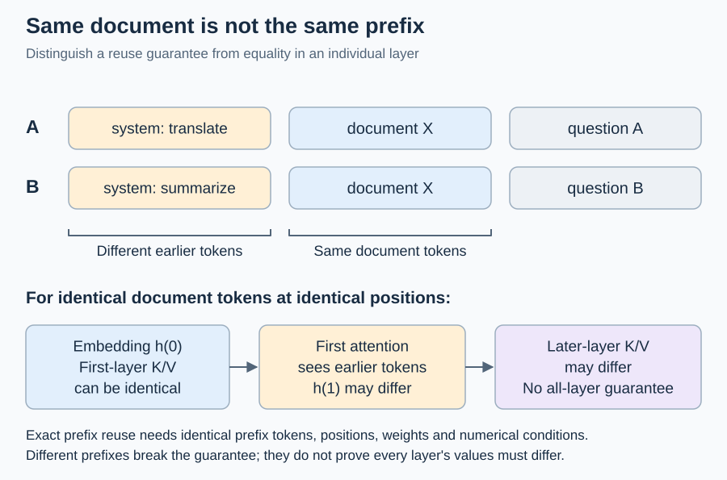
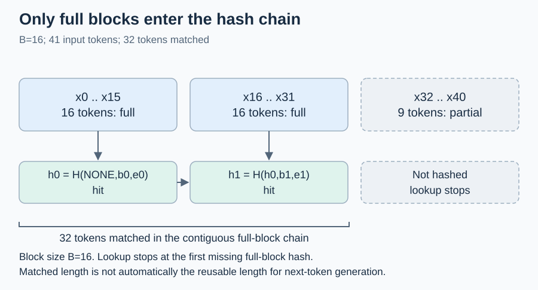
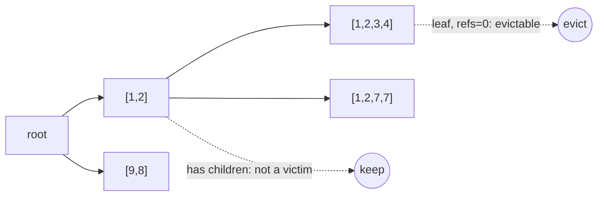
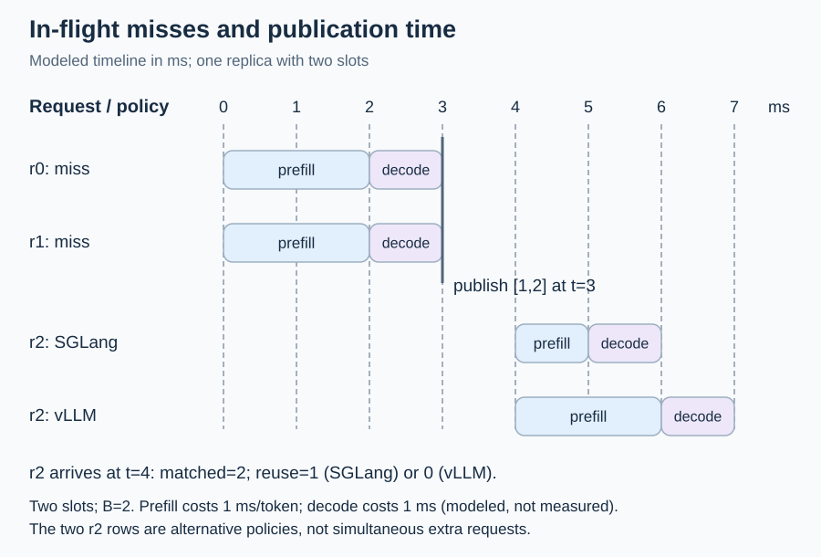

# D5 前缀缓存：KV 复用的身份、所有权、代价与跨副本路由

[← 课程索引](../index.md) · [配套 lab5](../../labs/lab5/README.md) · [← D4 推测解码](04-speculative-slo.md) · [D6 低显存训练 →](06-memory-efficient-training.md)

> [!abstract] 这一讲要解决的问题
> foundations 里你已经写过分页 KV 和 continuous batching，知道一个请求的 KV 怎样按块存放。本讲问的是：两个请求什么时候可以共用同一段 KV，谁保证这段 KV 在被读的时候还在，复用之后到底省了多少时间，以及多副本部署时该把请求送到持有前缀的那台机器还是送到最闲的那台。我们先从因果 attention 推出复用成立的条件，再列出“文本相同但 KV 不同”的全部来源（BPE 边界、chat template、LoRA、多模态、`cache_salt`），对照 vLLM 的块哈希链和 SGLang 的 radix tree 两种实现及其淘汰语义；然后用 RTX 4060 上实测的 Qwen3-0.6B 预填充代价 $T(p,n)$ 说明 token 命中率和节省的时间为什么不是一回事；最后进入跨副本的缓存感知路由，以及共享缓存带来的时序侧信道。学完后你能在 lab5 中用 Rust 写出块身份、带租约的事务缓存、准入、全命中规则、四种路由策略和多副本事件回放，用 PyTorch 在 4060 上测出并拟合代价模型，再把它用到 Mooncake 格式 trace 的回放里。

| 阅读模块                      | 时间  | 必须留下的学习产物                     | 对应实验 |
| ----------------------------- | ----- | -------------------------------------- | -------- |
| §1 复用为什么成立             | 25min | 因果性推导、两条全命中规则的手算       | C2       |
| §2 文本相同，KV 不一定相同    | 35min | 一张身份判定表、一次 BPE 实验          | A1/A2    |
| §3 块键：哈希链与 radix tree  | 25min | 哈希链手算、显式前缀键的字节账         | A1–A3    |
| §4 所有权与两种淘汰模型       | 40min | 六步租约轨迹、不变量清单               | A4–A6、B |
| §5 代价模型：命中率不等于省时 | 40min | 4060 上的 $T(p,n)$、一个请求的节省比例 | R1/R3    |
| §6 单副本内的准入与调度       | 25min | in-flight miss 时间线                  | C1/C2/C4 |
| §7 跨副本的缓存感知路由       | 35min | 四种路由策略的对照表                   | C3–C6、R |
| §8 分层、传输与非前缀复用     | 15min | 一张“放松哪条假设”的对照               | 阅读     |
| §9 共享缓存的侧信道与租户隔离 | 10min | 威胁模型一句话                         | A1/B4    |
| §10 机制与代码对应            | 10min | 函数对照表                             | 全部     |
| 前沿与 baseline 对照          | 30min | 三篇工作的机制差异卡                   | C/R      |
| 研究问题                      | 10min | 一个可证伪假设与停止条件               | R        |

**共 5h，另做 lab 约 31h**（A 5.5h、B 7h、C 10h、R 5.5h、报告 3h）。5h 包括 §1、§3、§5、§6 的手算和随堂题（约 1.5h），以及 vLLM 前缀缓存设计文档和 SGLang 博客的指定图（约 30min）。论文全文、上游源码和 trace 下载都是选读。随堂自测的时间已计入上表；先在笔记里写答案，再展开核对要点。

## §1 复用为什么成立

### 1.1 因果 attention 推出的复用条件

记输入 token 为 $x_0,x_1,\dots$，第 $\ell$ 层第 $t$ 个位置的隐藏状态为 $h_t^{(\ell)}$。decoder-only 模型每一层都用因果 mask：

$$
h_t^{(\ell)}=F^{(\ell)}\!\left(h_t^{(\ell-1)},\ \operatorname{Attn}\big(q_t^{(\ell)},\ \{k_s^{(\ell)},v_s^{(\ell)}\}_{s\le t}\big)\right),
\qquad
k_t^{(\ell)}=\operatorname{RoPE}_t\!\big(h_t^{(\ell-1)}W_K^{(\ell)}\big),\quad v_t^{(\ell)}=h_t^{(\ell-1)}W_V^{(\ell)}.
$$

对层数做归纳：第 0 层的 $h_t^{(0)}$ 只取决于 $x_t$；若第 $\ell-1$ 层的所有 $h_s^{(\ell-1)}$（$s\le t$）只依赖 $x_{0:s}$，那么第 $\ell$ 层位置 $t$ 的 attention 只读 $s\le t$ 的键值，于是 $h_t^{(\ell)}$ 只依赖 $x_{0:t}$。所以：

$$
x_{0:t}=y_{0:t}\ \land\ \text{same weights, positions, numerics}
\quad\Longrightarrow\quad
\big(k_s^{(\ell)},v_s^{(\ell)}\big)_{s\le t,\ \ell\le L}\ \text{are identical}.
$$

这是**精确前缀复用**的全部依据。条件有三部分：token 序列相同（不是文本相同，见 §2）；从位置 0 开始（RoPE 把绝对位置转进了 $k$）；权重和数值路径相同（同一模型、同一 LoRA、同一 dtype 与 attention 实现）。后缀不同不影响前缀的 KV，所以两个共享系统提示的请求可以共用系统提示那一段；但同一段文档放在不同上文之后，高层 KV 可能不同，不能仅凭文档相同就保证整段、全层缓存可复用。



图：即使文档 token 和位置都相同，不同上文也会破坏整段、全层 KV 一致的保证。首层 K/V 可相同；第一次 attention 后的隐藏状态及后续层 K/V 可能不同。

### 1.2 全命中也要算一点

缓存里只有 K/V，没有最后一个位置的 logits。要生成下一个 token，至少得把一个 token 送进模型做一次前向（HF transformers 的 `forward` 也需要非空的 `input_ids`）。两个引擎的处理不同：

- **vLLM**（v0.32.0 `kv_cache_manager.py`）：命中长度上限是 `num_tokens - 1`，查找按整块进行，所以实际复用量是 $\lfloor (T-1)/B\rfloor\cdot B$ 与命中量中的较小者。源码注释说这“可能导致整块重算”。
- **SGLang**（`schedule_batch.py` 的 `_compute_max_prefix_len`）：上限是 `input_len - 1`。`page_size=1` 时按 token 计，只重算 1 个 token；`page_size>1` 时匹配结果还要向下取整到页，于是和 vLLM 一样可能重算整页。

例：$T=32$、$B=16$，两块全在缓存里。vLLM 上限 31，向下取整到 16，**重算 16 个 token**；SGLang（页大小 1）复用 31、重算 1。反过来 $T=33$ 时，vLLM 上限 32，正好两块，只重算 1 个 token。提示长度差 1，重算量差 16 倍。lab5 的 C2 `reusable_tokens` 把两条规则都实现为配置，C4 的回放按所选规则计费。旧版 lab 把全命中的预填充记为 0，和两个引擎都不符，本版已改正。

> [!question] 随堂自测 D5-1：复用条件与全命中
>
> 1. 请求 A 的 token 是 $[s_1,s_2,d_1,d_2]$，B 是 $[s_1,s_2,d_1,d_3]$。哪些位置的 KV 可以复用？如果 B 改成 $[s_3,s_2,d_1,d_2]$ 呢？
> 2. $B=16$，提示长 48 个 token 且全部命中。vLLM 与 SGLang（页大小 1）各重算多少个 token？提示长 49 呢？

> [!tip]- 核对要点
>
> 1. 前三个位置 $s_1,s_2,d_1$ 可复用（按块计还要看块边界）。B 改成以 $s_3$ 开头后，连续公共前缀长度为 0，因此前缀缓存不能保证复用后面相同的 $s_2,d_1,d_2$ 的全层 KV；这不等于这些位置在每一层的 KV 都必然不同。
> 2. 48：vLLM 上限 47，取整到 32，重算 16；SGLang 重算 1。49：vLLM 上限 48，三块全用，重算 1；SGLang 重算 1。

## §2 文本相同，KV 不一定相同

缓存的键是**token 序列加计算条件**，不是字符串。下表列出生产系统里让“看起来相同”的请求拿不到命中的原因，以及 vLLM v0.32.0 怎样把它们放进键里（`kv_cache_utils.py` 的 `generate_block_hash_extra_keys`）。

| 来源                   | 发生了什么                                                                                                                                                                     | 引擎怎样处理                                                                                           | lab5 对应                    |
| ---------------------- | ------------------------------------------------------------------------------------------------------------------------------------------------------------------------------ | ------------------------------------------------------------------------------------------------------ | ---------------------------- |
| BPE 边界               | 分词器会跨拼接点合并：$\operatorname{tok}(A)\Vert\operatorname{tok}(B)$ 不一定等于 $\operatorname{tok}(A\Vert B)$。经典例子是以 `http:` 结尾的提示与训练语料里整体出现的 `://` | 引擎按 token id 匹配，不处理；客户端重新分词解码后的文本时最容易踩到                                   | 不建模；做下面的练习         |
| chat template 改写历史 | Qwen3 的模板会去掉之前轮次的 `<think>` 内容，第 $N$ 轮的 token 序列于是不是第 $N+1$ 轮的前缀（QwenLM/Qwen3 issue 1826）                                                        | 不处理，多轮命中率会掉；需要模板和引擎配合                                                             | `tokenizer` 字段编码模板版本 |
| 系统提示或上文不同     | 因果性：第一个不同的位置之后全部不同                                                                                                                                           | 哈希链在第一处不同后全部分叉                                                                           | A2/A3                        |
| 位置不同               | RoPE 旋转了 $k$；同一段文档放在偏移 512 处和偏移 0 处的 KV 不同                                                                                                                | 精确前缀引擎不复用；位置无关缓存（EPIC、CacheBlend、Prompt Cache）靠局部重算或预留位置                 | `position_offset` 作替身     |
| LoRA 适配器            | 不同权重从第 1 层起就改变 $k,v$                                                                                                                                                | 每一块的 extra key 都带 `(lora_name, lora_path)`；带路径是为了让同名指向新权重时不误用旧 KV            | A1 `Lora`，A2 `adapter`      |
| 多模态输入             | 图像占位 token 在不同图片之间完全相同                                                                                                                                          | 与图像重叠的每一块都加 `(identifier, offset)`                                                          | A1 `Mm`                      |
| `cache_salt`（租户）   | 有意隔离：同样的计算也不让别人读                                                                                                                                               | **只加在第 0 块**，靠父哈希传给后面所有块                                                              | A1 `Salt`，A2 `tenant`       |
| prompt embeddings      | 直接输入向量，没有 token id                                                                                                                                                    | 对每块的嵌入张量做哈希                                                                                 | 不建模                       |
| 采样参数               | temperature、top-p、seed 只作用在 logits 上，不改变预填充 KV                                                                                                                   | **不进键**。例外：要 prompt logprobs 的请求在 vLLM 里跳过读缓存，SGLang 把前缀截到 `logprob_start_len` | 不进键                       |

模型版本、dtype、attention 后端也会影响数值，但它们不在 vLLM 的块哈希里：缓存只活在一个引擎实例中，这些条件对实例是常量。跨实例共享 KV（LMCache、P2P 传输）时就必须显式比对它们，见 §3.2 的哈希种子问题。

**lab 怎样对应。** A1 `block_hashes` 照 vLLM 的顺序拼 extra key：先 `Lora`（每块都有），再与本块重叠的每个 `Mm`（偏移是图像起点减块起点，可以为负），最后 `Salt`（只有第 0 块）。A2 的 `Namespace` 是教学用的完整身份：`model`、`adapter`、`tokenizer`（含模板版本）、`tenant`（相当于 `cache_salt`）、`position_offset`（代表位置无关缓存才会遇到的“同一段放在别处”）。

> [!example] 练习：用 Qwen3 分词器验证 BPE 边界（约 10min，WSL 或任何装了 transformers 的环境）
>
> ```python
> from transformers import AutoTokenizer
> tok = AutoTokenizer.from_pretrained("~/models/Qwen3-0.6B")
> pairs = [("see http", "://example.com"), ("Hello", " world"), ("价格是", "100元。")]
> for a, b in pairs:
>     joint = tok(a + b).input_ids
>     split = tok(a).input_ids + tok(b).input_ids
>     print(repr(a), repr(b), joint == split, joint, split)
> ```
>
> 记录哪些组合不相等、差在哪个位置，再用 `apply_chat_template(..., enable_thinking=False)` 生成第 1 到第 3 轮的 token，检查前一轮是不是后一轮的前缀。结论写进报告；不要预设结果。

> [!question] 随堂自测 D5-2：哪些字段该进键
>
> 1. 同一个基座模型挂了两个 LoRA，名字都叫 `sql`，但运维把 `sql` 从 `/adapters/v1` 改指到 `/adapters/v2`。如果键里只有名字，会发生什么？
> 2. vLLM 只在第 0 块加 `cache_salt`。为什么第 5 块不用再加一次也能隔离？如果实现错把 salt 加在了最后一块，哪一块会在租户之间共享？
> 3. 两个请求的提示相同、temperature 不同。它们能否共用预填充 KV？要 prompt logprobs 的请求呢？

> [!tip]- 核对要点
>
> 1. 新权重的请求会命中旧权重算出的 KV，输出悄悄错掉。vLLM 键里带路径就是为了这个。
> 2. 第 $i$ 块的哈希以第 $i-1$ 块的哈希为父，第 0 块不同则后面全部不同。salt 错放到最后一块时，前面所有块（包括第 0 块）都与无 salt 的请求和其他租户相同，可以被跨租户复用。lab5 的错误注入 `a1-salt-on-last-block` 就是这个错误。
> 3. 能，采样参数不改变预填充。要 prompt logprobs 时需要每个提示位置的 logits，vLLM 因此不读前缀缓存。

## §3 块键：哈希链与 radix tree

### 3.1 哈希链

vLLM 只给**完整块**算哈希（“We only hash full blocks”），第 $i$ 块覆盖 token $[iB,(i+1)B)$：

$$
h_0=H\big(\texttt{NONE\_HASH},\ x_{0:B},\ e_0\big),\qquad
h_i=H\big(h_{i-1},\ x_{iB:(i+1)B},\ e_i\big),
$$

其中 $e_i$ 是 §2 的 extra key 列表。因为 $h_i$ 含 $h_{i-1}$，两个请求的第 $i$ 块哈希相等，就意味着前 $i+1$ 块全部相等（不计碰撞）。查找从第 0 块开始，**遇到第一个不在表里的哈希就停**；即使后面某块的哈希碰巧在表里，它也不可达。设计文档里的例子是块大小 4、两个请求共享 10 个 token，只复用 8 个：第三块没满，不进表。



图：两个完整块各含 16 个 token，末尾 9 个 token 构成部分块；匹配长度与实际复用长度分开计算。

| 块      | token 范围                      | 哈希 / 查找结果                     |
| ------- | ------------------------------- | ----------------------------------- |
| $b_0$   | $x_0,\ldots,x_{15}$（16 个）    | $h_0=H(\mathrm{NONE},b_0,e_0)$，hit |
| $b_1$   | $x_{16},\ldots,x_{31}$（16 个） | $h_1=H(h_0,b_1,e_1)$，hit           |
| partial | $x_{32},\ldots,x_{40}$（9 个）  | 不哈希，停止；共匹配 32 个 token    |

### 3.2 哈希函数与种子

vLLM 默认用 sha256，可选 `sha256_cbor`、`xxhash`、`xxhash_cbor`（`--prefix-caching-hash-algo`）。sha256 的 `NONE_HASH` 用固定种子，跨进程一致，便于多个实例共享 KV。xxhash 不是密码学哈希，vLLM 给它的 `NONE_HASH` 用**每进程随机**的种子，源码注释的理由是：种子可预测时，攻击者能离线构造碰撞块。lab5 的 `hash_block`（已提供）是 64 位 FNV-1a，确定性、无密钥，只用于让测试能独立重算期望值，不能当安全哈希用。

### 3.3 radix tree 与教学键

SGLang 用 radix tree：边上存一段 token，查找沿树走到第一个不匹配处，部分匹配时拆分节点。默认 `page_size=1`，按 token 粒度匹配；`page_size>1` 时键先截到整页，匹配向下取整。两种结构回答的是同一个问题：“这个请求从位置 0 开始的最长已缓存前缀有多长”。

lab5 的 `Key{ns, prefix: Vec<u32>}` 是第三种写法：每块的键存从位置 0 到块尾的**全部 token**。它没有碰撞，方便测试判断对错，代价是显式前缀的字节数随长度二次增长。块数为 $T/B$ 时：

$$
\text{payload}=4B\sum_{j=1}^{T/B} j=4B\cdot\frac{(T/B)(T/B+1)}{2}\ \text{bytes}.
$$

A 阶段的 bench 会把这一列和“每块 8 字节哈希”并排打印。

> [!question] 随堂自测 D5-3：链与字节账
>
> 1. $T=4096$、$B=16$、token id 4 字节。显式前缀键共多少字节？换成每块一个 8 字节哈希呢？$T$ 翻倍到 8192 时两者各变成几倍？
> 2. 表里有 $h_0$ 和 $h_2$，没有 $h_1$。一个前三块都与之相同的请求命中多少块？$h_2$ 这时算什么？

> [!tip]- 核对要点
>
> 1. $4\times16\times256\times257/2=2{,}105{,}344$ 字节；哈希只要 $256\times8=2048$ 字节。$T=8192$ 时显式前缀为 $4\times16\times512\times513/2=8{,}404{,}992$ 字节，约 3.99 倍；哈希为 4096 字节，2 倍。
> 2. 命中 1 块。$h_2$ 不可达：在 vLLM 里它是白占的容量；在 lab5 的 SGLang 语义里它违反了不变量，A5 `validate` 应报 `Orphan`。

## §4 所有权与两种淘汰模型

### 4.1 三种状态与租约

一个缓存块有三种状态：未分配；已缓存、无人引用（`refs=0`，可被淘汰，也可被命中）；已缓存、被运行中的请求引用（`refs>0`，不能淘汰）。请求结束时**不删除**它的块，只把引用减一；留下来的块才能让后面的请求命中。

lab5 用 `Lease` 表达引用：B2 `acquire` 对连续命中链上的每块 `refs += 1` 并刷新 `last`、`hits`，B3 `release` 消费租约、从深到浅减引用。下面是容量 2 块、$B=2$ 的六步轨迹（B 阶段测试的原型）：

| 事件                | $[1,2]$ refs | $[1,2,3,4]$ refs | 能否为 $[5,6]$ 腾位置 |
| ------------------- | -----------: | ---------------: | --------------------- |
| insert $[1,2,3,4]$  |            0 |                0 | 能，淘汰叶子          |
| acquire A           |            1 |                1 | 不能                  |
| acquire B           |            2 |                2 | 不能                  |
| release A           |            1 |                1 | 不能                  |
| insert $[5,6]$ 失败 |            1 |                1 | 状态完全不变          |
| release B           |            0 |                0 | 能                    |

Rust 能保证的有限：`release(lease: Lease)` 按值消费，安全代码里同一个租约不能释放两次；`Lease` 字段私有，外部伪造不了。但它不保证租约还给了生成它的那个 `Cache`，也没有 `Drop` 自动归还。忘了 release 不是内存安全问题，却会让块一直被钉住、容量越来越小。C4 的“租约泄漏”错误注入就是这种情况，测试靠回放结束时检查 `refs` 全为 0 抓住它。

### 4.2 事务插入

插入一条路径可能要先淘汰几块。如果边淘汰边插，中途发现剩下的候选都被钉住，返回失败时旧缓存已经被删掉一部分，而调用方以为什么都没发生。lab5 的 B1 `insert` 规定全有或全无：在副本上规划，成功才整体替换，失败时节点、元数据和时钟都不变。每次挑选牺牲者只在合法集合里挑：

$$
V=\{\,v \mid \operatorname{refs}(v)=0,\ v\notin\text{new path},\ v\ \text{has no resident descendant}\,\}.
$$

$V$ 为空就失败。不能先按 LRU 选出全局最老的块，再假设它可以删。B5 `resize` 和 B4 `invalidate` 用同样的回滚语义。整表复制是为了让回滚好证明，代价是 $O(\text{nodes})$ 的拷贝；研究 CPU 管理开销时应和 undo log 或计数传播方案对照。

### 4.3 两种淘汰模型

| 方面           | vLLM v1（`block_pool.py`、`kv_cache_utils.py`）                                                                  | SGLang（`radix_cache.py`、`evict_policy.py`）                                    |
| -------------- | ---------------------------------------------------------------------------------------------------------------- | -------------------------------------------------------------------------------- |
| 候选集合       | 一个双向链表 `FreeKVCacheBlockQueue`，所有 `ref_cnt=0` 的块都在里面                                              | 只看 `evictable_leaves`：没有子节点且 `lock_ref=0` 的叶子                        |
| 顺序           | 队头最久未用。同一请求释放的块**逆序**入队，尾块离队头更近，先被淘汰                                             | 按策略给叶子排优先级再弹出；叶子删掉后父节点若变成无子且未锁，就成为新叶子       |
| 命中时         | `touch()` 把命中的空闲块从队列里摘出                                                                             | `inc_lock_ref` 从节点一路加到根，`dec_lock_ref` 反向                             |
| 父先于子被淘汰 | 队列不检查后代，结构上允许。子块的哈希还在表里，但查找在父块处就停了，子块变成**查不到的浪费容量**，不是数据损坏 | 不会发生：只删叶子                                                               |
| 策略           | LRU（释放顺序即 LRU 顺序）                                                                                       | LRU、LFU（`hits`，再 `last_access_time`）、FIFO、MRU、FILO、Priority、TLRU、SLRU |

lab5 采用 SGLang 语义：A4 `victim` 只在 $V$ 里选，A5 `validate` 把“子块在、父块不在”报为 `InvariantError::Orphan`。这在 vLLM 里只是浪费，在本 lab 里是不变量破坏，因为我们要求每个常驻块都可达。A4 的 `Frequency` 排序 $(\text{hits},\text{last},\text{key})$ 正是 SGLang 的 `LFUStrategy`，不是自创策略。A5 的其他错误类型：`OverCapacity`、`Misaligned`、`PinAboveParent`（子块引用数大于父块，说明有租约跳过了祖先）、`FutureClock`。A6 `stats` 区分被钉住的块数和引用总数：一块被 3 个租约引用，算 1 个钉住块、3 个引用。



图中 $[1,2]$ 再老也不能先删；$[1,2,3,4]$ 删掉后，若 $[1,2,7,7]$ 也不在了，$[1,2]$ 才成为叶子。

> [!question] 随堂自测 D5-4：引用、事务与淘汰
>
> 1. 两块前缀同时被 A、B 两个租约引用。释放 A 后，`pinned_blocks` 和 `references` 各是多少？再释放 B，缓存必须删掉这两块吗？
> 2. 容量 2，缓存里有 $[1,2]$（`last=1`）和 $[9,9]$（`last=2`），都未被引用。插入 $[1,2,3,4]$ 时应淘汰谁？如果实现忘了保护新路径会怎样？
> 3. 同样一棵树，vLLM 先淘汰了父块。用户看到的是错误输出、命中率下降，还是程序崩溃？

> [!tip]- 核对要点
>
> 1. 释放 A 后两块各 `refs=1`：`pinned_blocks=2`、`references=2`。释放 B 后都为 0，但应保留，留给以后的命中。
> 2. 新路径缺 1 块，要腾 1 个位置。$[1,2]$ 是新路径的一部分，受保护，所以淘汰 $[9,9]$。忘了保护会淘汰更老的 $[1,2]$，再把它和 $[1,2,3,4]$ 一起插回，节点数变成 3，超过容量（错误注入 `b1-path-not-protected`）。
> 3. 只是命中率下降、容量浪费：查找在父块处停止，不会读到错的 KV。

## §5 代价模型：命中率不等于省时

### 5.1 推导

设非嵌入参数量为 $N$，层数 $L$，query 头数乘头维为 $n_q d_h$。一个新 token 在上下文长度为 $j$ 的位置上，线性层约 $2N$ FLOPs，attention 的 $QK^\top$ 和 $AV$ 每层各约 $2 n_q d_h j$，合计 $4 L n_q d_h j$。已缓存 $p$ 个 token、新算 $n$ 个时，对 $j=p,\dots,p+n-1$ 求和：

$$
\text{FLOPs}(p,n)\approx 2Nn+4Ln_qd_h\,n\Big(p+\frac{n}{2}\Big).
$$

两项在 $j^\ast=2N/(4Ln_qd_h)$ 处相等。Qwen3-0.6B：$N\approx0.44\times10^9$、$L=28$、$n_qd_h=16\times128=2048$，得 $j^\ast\approx3.8\text{k}$；Qwen3-1.7B 的 $N\approx1.4\times10^9$，同样的 $L$ 和 $n_qd_h$，$j^\ast\approx12\text{k}$。两个模型都是 28 层、8 个 KV 头、头维 128，bf16 下每 token 的 KV 是

$$
2\times28\times8\times128\times2=114{,}688\ \text{B}=112\ \text{KiB},
$$

**两者相同**。所以同一条 PCIe 链路上，“从 CPU 搬回 KV”与“重算”的分界点，1.7B 比 0.6B 晚大约 3 倍（§8）。

真实时间还要加两项：每次前向读一遍已缓存的 KV（与 $p$ 成正比），以及 eager 模式下 CPU 发射 kernel 的下限。lab5 用的模型是

$$
T(p,n)=\max\Big(T_{\text{floor}},\ a+b\,n+c\,n\big(p+\tfrac{n}{2}\big)+d\,p\Big),
$$

交叉点 $p^\ast=b/c$ 是“每个新 token 的 attention 代价等于线性层代价”的上下文长度。

### 5.2 在 4060 上测出来的数

R1 的测量协议（`labs/lab5/real/measure.py`）：bf16、sdpa、batch 1；先把一个 `DynamicCache` 预填到最长前缀，每个 $p$ 用 `copy.deepcopy` 加 `crop(-k)` 做快照（transformers 5.18 里负数参数表示删掉 $k$ 个 token），快照不计时；计时区间只有一次 `model(ids[p:p+n], past_key_values=snap, logits_to_keep=1)`，`logits_to_keep=1` 让 LM head 只算最后一个位置；每次调用后 `crop(-n)` 回滚；每行先让 GPU 连续忙 300ms 再计时，输出 `stable` 列（$p_{75}\le1.5\,p_{25}$）；几个 $(p,n)$ 上用缓存路径的最后一个 logits 与完整前向比对，作为正确性闸门。

2026-10-18 在本机（RTX 4060 Laptop、驱动 566.24、torch 2.14.1+cu126、transformers 5.18）测得 49 个点，全部 stable，闸门 4/4 通过。R1 拟合（`lab5/real/data/cost-qwen3-0.6b-rtx4060.json`，**measured**）：

| 系数               | 值                             | 解释                                                                                         |
| ------------------ | ------------------------------ | -------------------------------------------------------------------------------------------- |
| $T_{\text{floor}}$ | 23.2 ms                        | eager HF 的发射下限：小输入时 GPU 在等 CPU                                                   |
| $a$                | 约 0                           |                                                                                              |
| $b$                | 66.7 $\mu\text{s}$/token       | 线性层                                                                                       |
| $c$                | 16.2 ns/$\text{token}^2$       | attention                                                                                    |
| $d$                | 5.7 $\mu\text{s}$/已缓存 token | 读 KV，加上 HF `DynamicCache` 每次 `torch.cat` 的拷贝（单独测得约 1.86 $\mu\text{s}$/token） |

实测交叉点 $p^\ast=b/c\approx4.1\text{k}$，和 FLOP 估计的 3.8k 很接近。49 个点上的最大相对误差 24.5%，最差的点在下限附近（GPU 工作刚好与发射时间相当）和 $p=0,n=2048$。$d$ 里有一部分是 HF 特有的：分页 KV 的引擎只写新 token，不复制整段缓存。

### 5.3 命中率与省下的时间

一个请求共 $t$ 个 token，复用 $r$ 个。不计下限时节省比例为

$$
\frac{T(0,t)-T(r,t-r)}{T(0,t)}=\frac{b\,r+\tfrac{c}{2}r^2-d\,r}{a+b\,t+\tfrac{c}{2}t^2}.
$$

它与 token 命中率 $r/t$ 不同：剩下的 $t-r$ 个 token 仍要对整段前缀做 attention，$d\,r$ 这一项还会抵掉一部分。有下限时差得更多：两边都落在 $T_{\text{floor}}$ 上，命中多少都省不了时间。lab5 的 R3 `compute_saved` 同时报告两者。vLLM 的 Prometheus 指标 `vllm:prefix_cache_hits` 除以 `vllm:prefix_cache_queries` 是**token 命中率**，不是省时比例。

> [!question] 随堂自测 D5-5：用 4060 的系数算一个请求
>
> 1. 用上表系数（$a=0$），一个 4096 token 的请求复用 3072 个。分别算 $T(0,4096)$、$T(3072,1024)$、节省比例和 token 命中率。
> 2. 一个 200 token 的请求复用一半。实测模型下省了多少时间？为什么？
> 3. 换成 Qwen3-1.7B，FLOP 估计的交叉点变成多少？你预计 $b/c$ 会怎样变？

> [!tip]- 核对要点
>
> 1. $T(0,4096)=0.0667\times4096+1.62\times10^{-5}\times4096\times2048\approx273.2+135.9=409.1$ ms。$T(3072,1024)=68.3+1.62\times10^{-5}\times1024\times3584+0.0057\times3072\approx68.3+59.5+17.5=145.3$ ms。节省 $1-145.3/409.1\approx0.645$，token 命中率 0.75。
> 2. 两边的“工作”都只有约 7 到 14 ms，低于 23.2 ms 的下限，所以都是 23.2 ms，省时为 0，命中率却是 0.5。
> 3. 约 12k。$b$ 随参数量大约变成 3 倍多，$c$ 不变，$b/c$ 也应变大到同一量级；要在 R 阶段自己测了再下结论。

## §6 单副本内的准入与调度

### 6.1 准入：要不要把这次算出来的块存下来

完成的请求会把它算出的完整块插入缓存。一次性扫描（大量只出现一次的前缀）会把热数据挤掉。CDN 的老办法是**第二次命中才缓存**（Akamai 的 cache-on-second-hit，Maggs 和 Sitaraman，SIGCOMM CCR 2015）：用一张有界的访问历史记住见过的键，第二次见到才准入。lab5 的 C1 `Admission::observe` 实现它：

- 历史表容量是**参数**（`ClusterConfig::history_capacity`），不是隐藏常数；
- 超出容量时忘掉**最近一次被观察**最早的键（LRU），不是最早被插入的（FIFO），测试专门构造了能区分两者的序列；
- TwoHit 准入的是从第 0 块起、计数都不小于 2 的最长连续前缀，父块没过线就停。

TwoHit 只是基线。频率类策略（SGLang 的 LFU）和成本感知策略都已有相关工作：T-LRU（NeurIPS 2025）假设 TTFT 随未缓存长度线性增长，优先淘汰不影响尾延迟目标的块；Marconi（MLSys 2025）面向混合模型，按“每字节省下的 FLOPs”淘汰。

### 6.2 in-flight miss：还没算完的 KV 不能复用

两个相同前缀的请求同时到达、同时开始，谁都还没把 KV 写进缓存，所以两个都要付全额预填充。KV 只在请求完成时发布。C4 的手算时间线（$B=2$，1 个副本、2 个槽位，每个未缓存 token 1 ms，decode 1 ms）：



图：两种 r2 时间线是替代策略；发布发生在 3 ms，4 ms 到达的请求才可命中。时间由讲义给定代价推算，非本次实测。

| 请求 / 策略      | 到达时刻（ms） | 查找与复用                                                 | 首 token / 完成时刻（ms） |
| ---------------- | -------------- | ---------------------------------------------------------- | ------------------------- |
| r0，输入 $[1,2]$ | 0              | miss                                                       | 2 / 3                     |
| r1，输入 $[1,2]$ | 0              | miss；r0 尚未完成                                          | 2 / 3                     |
| 发布             | 3              | 两请求完成，发布 $[1,2]$                                   | —                         |
| r2，SGLang       | 4              | matched 2，复用 $\min(2,2-1)=1$，prefill 1 ms              | 5 / 6                     |
| r2，vLLM         | 4              | matched 2，复用 $\lfloor1/2\rfloor\times2=0$，prefill 2 ms | 6 / 7                     |

命中 $[0,0,2]$，SGLang 规则下完成时刻 $[3,3,6]$，vLLM 规则下 $[3,3,7]$。

### 6.3 最长前缀优先与饥饿

SGLang 在一个副本内用 LPM（longest prefix match）排队列：命中多的先跑，减少重算，也让共享前缀的请求挨在一起。代价是冷请求可能被热请求一直往后推。加年龄阈值只能限制优先级反转，持续过载时仍没有固定的响应上界。lab5 本版的副本内队列是 FIFO，LPM 留作挑战，重点放到 §7 的跨副本决策上。

> [!question] 随堂自测 D5-6：准入历史与 in-flight
>
> 1. 历史容量 2、$B=2$，依次观察 $[1,2]$、$[3,4]$、$[1,2]$、$[5,6]$、$[3,4]$。最后一次 TwoHit 准入多少 token？如果历史是 FIFO 呢？
> 2. 把 §6.2 的槽位数改成 1，r1 什么时候开始？SGLang 规则下它的完成时刻是多少？

> [!tip]- 核对要点
>
> 1. LRU：观察 $[5,6]$ 时忘掉最后一次被看到最早的 $[3,4]$，最后一次 $[3,4]$ 计数重新从 1 开始，准入 0。FIFO 会在那时忘掉最早插入的 $[1,2]$，$[3,4]$ 计数变成 2，准入 2。
> 2. r1 在 r0 完成的 $t=3$ 开始，此时 $[1,2]$ 已发布，复用 1 个 token，预填充 1 ms、decode 1 ms，$t=5$ 完成。

## §7 跨副本的缓存感知路由

### 7.1 路由器看到的是什么

多副本部署时，每个副本有自己的缓存。路由器要在“送到持有最长前缀的副本”和“送到最闲的副本”之间取舍。各系统看到的信息不同：

- **精确视图**：llm-d 订阅 vLLM 的 KV 事件，维护每个 pod 的块索引，按最长连续块匹配打分，再和负载分数合并。Dynamo 的 KV router 的代价是 `kv_overlap_score_weight` 乘以要预填充的块数，加上 decode 块数，权重为 0 时退化为纯负载均衡。
- **近似视图**：SGLang 的网关按**字符**为每个 worker 维护一棵近似 radix tree，在**路由时**就把请求插进去，不等 KV 真正算完。
- **Preble**（ICLR 2025）：全局 radix tree，加上 E2 规则：未命中部分比已命中部分短就“利用”（送到命中的副本），否则“探索”，按负载代价 $L+M+P$（近期负载、淘汰代价、新预填充）挑副本，还会复制热前缀、重新均衡。

lab5 的 C3 `Router::route` 用精确视图：每个副本报告 `load`（排队加运行的请求数）和 `matched`（只读查询得到的命中 token 数）。四种策略：

| 策略                    | 规则                                                                                                                                                                                                              |
| ----------------------- | ----------------------------------------------------------------------------------------------------------------------------------------------------------------------------------------------------------------- |
| `RoundRobin`            | 轮流，不看状态                                                                                                                                                                                                    |
| `LeastLoad`             | 最小 `load`，并列取下标小的                                                                                                                                                                                       |
| `PrefixAffinity`        | 最大 `matched`，并列再比 `load`、下标；完全不看负载                                                                                                                                                               |
| `Hybrid{abs,rel,cache}` | SGLang 网关的规则：若 $\max-\min>\text{abs}$ **且** $\max>\text{rel}\cdot\min$（负载），视为失衡，走 `LeastLoad`；否则取亲和选择 $c$，当 $\text{matched}_c/\text{prompt}>\text{cache}$ 时用它，不然走 `LeastLoad` |

C4 `replay` 把这些策略放进多副本事件回放：完成、到达（路由）、开始三个阶段按固定顺序处理，同一时刻后到的请求能看到前面请求更新过的负载。C5 `summarize` 报告按 token 加权的命中率、排队、TTFT 均值与 p95，以及负载失衡度（各副本忙碌时间的最大值除以平均值，空闲副本也算进平均）；C6 `duplicated_blocks` 统计同一块在多个副本上的额外副本数。

### 7.2 命中与重复、热点与均衡

亲和路由让同一会话留在同一副本，命中率高，跨副本重复少；但热门前缀会把请求集中到一台机器，尾延迟变差。“A Year in LLM Serving”（arXiv 2026，一年、61 亿请求的 trace）观察到：负载上来后路由把同一用户的请求分散到多个副本，命中率靠**复制前缀**维持，而复制又挤掉了其他用户的块。DualMap（arXiv 2026）给每个请求两个候选副本（power of two choices）再按 SLO 选；CacheRoute（arXiv 2026）周期性规划热前缀的放置，并报告了一个负结果：当亲和能省下的 KV 工作很少时，收益消失。

lab5 参考实现的 bench 结果（**modeled, not measured**；成本模型取 4060 拟合值）。C 阶段：4 副本、每副本 4 槽、每副本缓存 256 块（每块 32 token）、SGLang 规则、每秒 2 个新会话：

| 路由            | 命中率 | 平均 TTFT (ms) | p95 TTFT (ms) | 失衡度 | 重复块 |
| --------------- | -----: | -------------: | ------------: | -----: | -----: |
| round_robin     |  0.496 |           51.7 |         124.7 |   1.03 |    604 |
| least_load      |  0.647 |           39.0 |          87.8 |   2.74 |    352 |
| prefix_affinity |  0.801 |           26.7 |          34.0 |   2.34 |      0 |
| hybrid          |  0.801 |           26.7 |          34.0 |   2.34 |      0 |

这个负载下 TwoHit 在每种路由下都降低命中率（例如亲和路由从 0.801 降到 0.665）。工作负载里没有一次性扫描，TwoHit 只是推迟了本该缓存的块：这是一个要写进报告的负结果。

R 阶段：合成的 Mooncake 格式 trace（1200 个请求，512 token 一块），4 副本、每副本 2 槽、vLLM 规则、4060 拟合的成本模型：

| 路由            | token 命中率 | 省时比例 | 平均 TTFT (ms) | p95 TTFT (ms) | 失衡度 |
| --------------- | -----------: | -------: | -------------: | ------------: | -----: |
| round_robin     |        0.442 |    0.354 |            262 |           733 |   1.02 |
| least_load      |        0.441 |    0.354 |            262 |           719 |   1.53 |
| prefix_affinity |        0.564 |    0.482 |            261 |           830 |   2.67 |
| hybrid          |        0.574 |    0.498 |            205 |           647 |   1.61 |

纯亲和把命中率从 0.44 提到 0.56，p95 却从 733 ms 涨到 830 ms：热点副本在排队。Hybrid 在这条 trace 上两项都最好。每一行的省时比例都比 token 命中率低 7 到 9 个百分点，原因见 §5.3。SGLang 与 vLLM 两条全命中规则的结果相差不到 0.1%：trace 里只有 25 个逐字重复的提示，全命中很少。这些数都来自合成 trace 和单一种子，不能直接推广到真实负载。

> [!question] 随堂自测 D5-7：手算一次 Hybrid
>
> 1. Hybrid$\{\text{abs}=2,\text{rel}=1.5,\text{cache}=0.3\}$，三个副本的 $(\text{load},\text{matched})$ 为 $(6,80)$、$(4,0)$、$(5,0)$，提示 100 token。送到哪个副本？把第一个副本的 load 改成 9、其余改成 0 和 1 呢？
> 2. 为什么 C5 的失衡度要把空闲副本算进平均？如果只对有活的副本求平均，纯亲和路由的失衡度会被怎样低估？

> [!tip]- 核对要点
>
> 1. $6-4=2$，不大于 2，不失衡；$80/100>0.3$，走亲和，送副本 0。改成 $(9,80),(0,0),(1,0)$ 后 $9-0>2$ 且 $9>1.5\times0$，失衡，送最闲的副本 1。
> 2. 亲和路由可能让某个副本整段时间空闲。只对忙的副本求平均，平均值偏高，比值偏小，失衡被藏起来（错误注入 `c5-imbalance-busy-only`）。

## §8 分层、传输与非前缀复用

GPU 显存放不下所有前缀时，可以把 KV 下放到 CPU 内存或 SSD，命中时再搬回来：

- **CachedAttention**（原名 AttentionStore，USENIX ATC 2024）：按会话把 KV 存在 HBM、DRAM、SSD 三层，逐层预取，按调度信息预取和淘汰。
- **CacheGen**（SIGCOMM 2024）：把 KV 量化加算术编码再传输，带宽不够时改为重算。
- **Mooncake**（FAST 2025 最佳论文）：预填充与解码分离，加一个分布式 CPU 内存与 SSD 的 KV 池，调度器以 KV 为中心；开源的 trace 里 `hash_ids` 是 512 token 块的链式哈希重映射，正好对上 lab5 R2 的输入格式。仓库是 Apache-2.0，README 没有单独说明 trace 文件的许可。
- **LMCache**（技术报告 2025）、**SGLang HiCache**（2025 博客）、**vLLM 的 KV offloading connector**（2026 博客）：工程上的分层缓存层。
- **Cake**（ICML 2025）：从前往后算、从后往前搬，两头相遇，比只算或只搬都快。

4060 是 PCIe 4.0 x8，理论约 16 GB/s，WSL 下锁页内存的实际带宽要自己测，这里不给数字。§5.1 说过 0.6B 和 1.7B 每 token 的 KV 一样大而算力需求差 3 倍左右，所以“搬还是算”的分界点在两个模型上差很多。这是一个在本机就能做、能被推翻的小问题。

精确前缀只是一种约束。放松它的工作有三类：

- **位置无关缓存**：Prompt Cache（MLSys 2024）用模式声明可复用模块并预留位置；CacheBlend（EuroSys 2025 最佳论文）复用非前缀的文档 KV，只重算少量 token 恢复跨段 attention；EPIC（ICML 2025，北大谢涛组与华为，不是苗组）对每段开头几个 token 重算，消除各段自己的 attention sink。
- **共享前缀的 attention kernel**：ChunkAttention（ACL 2024）、Hydragen（arXiv 2024）、FlashInfer 的 cascade attention（2024-02-02 博客）把共享前缀那部分 attention 合并成矩阵乘，再与各自后缀的结果按 LSE 合并。
- **混合模型**：Marconi（MLSys 2025）面对 SSM 状态不能回退的问题，只有精确命中才算数，于是按命中类型准入、按 FLOP 效率淘汰。

## §9 共享缓存的侧信道与租户隔离

共享前缀缓存的命中会缩短 TTFT，这个时间差就是信号。PROMPTPEEK（NDSS 2025）针对 SGLang 的 radix 缓存加 LPM 调度，逐 token 还原别的用户的提示；“The Early Bird Catches the Leak”（IEEE TIFS，arXiv 2409.20002）和 InputSnatch（arXiv 2411.18191）在 vLLM 和 SGLang 上做了类似的提示窃取。“Auditing Prompt Caching in Language Model APIs”（ICML 2025）用统计检验发现包括 OpenAI 在内的 7 家 API 提供方存在跨用户的全局缓存共享。防御方面，SafeKV（arXiv 2025）只共享非敏感块，PrefixWall（arXiv 2026）给可疑前缀的后续内容单独隔离，KVGov（arXiv 2026，单作者、仿真评估）用按主体派生的 salt 在分叉点加盐。

vLLM 文档把 `cache_salt` 写成防提示猜测的手段。lab5 的 `tenant` 字段就是它：A1 的 salt 放在第 0 块，A2 的 `Namespace` 把租户编进键，B4 `invalidate` 只清一个租户。块粒度本身也影响攻击者的分辨率：vLLM 16 token 一块，加上 $n-1$ 上限，攻击者一次最多知道“又多命中了一块”；SGLang 页大小 1 时分辨率是单个 token。这里只讨论防御，相关实验只在自己的机器上用模拟数据做。

> [!question] 随堂自测 D5-8：隔离做在哪一层
>
> 1. 一个服务只在**路由层**按租户分配副本，副本内部缓存全局共享。这能防住 §9 的攻击吗？
> 2. 租户配额淘汰（每个租户最多占若干块）为什么也可能变成侧信道？

> [!tip]- 核对要点
>
> 1. 只要两个租户可能被送到同一副本（负载均衡、故障转移），共享缓存仍会泄露。隔离要进缓存键（salt）或者物理分区。
> 2. 别的租户能不能命中、什么时候被淘汰，取决于其他租户占了多少配额；观察自己的命中时间就能推断别人的占用。这是容量公平与泄露耦合在一起的地方。

## §10 机制与代码的对应

| 机制或公式                         | lab 中的函数                                                | 上游实现位置（固定版本）                                                                                                   | 本 lab 简化了什么                         |
| ---------------------------------- | ----------------------------------------------------------- | -------------------------------------------------------------------------------------------------------------------------- | ----------------------------------------- |
| $h_i=H(h_{i-1},x_{iB:(i+1)B},e_i)$ | `block_hashes`（A1）                                        | vLLM v0.32.0 `vllm/v1/core/kv_cache_utils.py`：`hash_block_tokens`、`generate_block_hash_extra_keys`                       | FNV-1a 代替 sha256；无 prompt embeds      |
| 完整身份与租户                     | `Namespace`、`block_keys`（A2）                             | SGLang `python/sglang/srt/mem_cache/radix_cache.py` 的 `RadixKey`（`extra_key`、`cache_salt`）                             | 显式前缀向量，不压缩                      |
| 首个缺失即停止                     | `matched_tokens`（A3）                                      | vLLM `single_type_kv_cache_manager.py` 的 `find_longest_cache_hit`；SGLang `match_prefix`                                  | 不做细粒度哈希与 CoW 尾块                 |
| 叶子淘汰、LFU 顺序                 | `victim`（A4）                                              | SGLang `radix_cache.py` 的 `evict`；`evict_policy.py` 的 `LFUStrategy`                                                     | 每次线性扫描，不维护堆                    |
| 不变量                             | `validate`、`InvariantError`（A5），`stats`（A6）           | SGLang `inc_lock_ref`/`dec_lock_ref` 的计数传播                                                                            | 只做审计，不做增量维护                    |
| 事务插入、租约                     | `insert`/`acquire`/`release`/`invalidate`/`resize`（B1–B5） | vLLM `block_pool.py`（`touch`、`free_blocks`、`get_new_blocks`）                                                           | 整表复制回滚                              |
| 第二次命中才缓存                   | `Admission::observe`（C1）                                  | 无直接对应（CDN 做法）                                                                                                     | 每副本独立历史                            |
| 全命中上限                         | `reusable_tokens`（C2）                                     | vLLM `kv_cache_manager.py` `get_computed_blocks` 的 `num_tokens - 1`；SGLang `schedule_batch.py` `_compute_max_prefix_len` | 不处理 prompt logprobs                    |
| 缓存感知路由                       | `Router::route`（C3）                                       | SGLang `sgl-model-gateway/src/policies/cache_aware.rs`                                                                     | 精确视图，按请求数计负载                  |
| 多副本事件回放与指标               | `replay`、`summarize`、`duplicated_blocks`（C4–C6）         | 无直接对应；口径参考 Preble、DualMap 的评测                                                                                | 槽位是抽象服务台，不建模 batch 内互相拖慢 |
| $T(p,n)$ 拟合                      | `fit_cost_model`（R1，Python）                              | transformers v5.18 `cache_utils.py` 的 `Cache.crop`；`modeling_qwen3.py` 的 `logits_to_keep`                               | batch 1、eager                            |
| Mooncake trace 适配与省时指标      | `parse_mooncake_line`、`compute_saved`（R2/R3）             | Mooncake `FAST25-release/README.md` 的字段说明                                                                             | 只回放 TTFT，decode 不建模                |

## 前沿与 baseline 对照

核验日期：2026-10-18（逐条打开论文页面或代码仓库，确认会议、年份和链接；“无公开代码”表示核验时没有找到作者仓库；会议只在核验到时写出）。

| 工作（会议 年）                                                                                                                                                                                                      | 问题                      | 关键机制                                                | 与本 lab 关系（实现/简化/未覆盖）                   | 研究时必须对比               |
| -------------------------------------------------------------------------------------------------------------------------------------------------------------------------------------------------------------------- | ------------------------- | ------------------------------------------------------- | --------------------------------------------------- | ---------------------------- |
| PagedAttention / vLLM（SOSP 2023）：[论文](https://arxiv.org/abs/2309.06180)，[代码](https://github.com/vllm-project/vllm)                                                                                           | KV 碎片与共享             | 分页 KV、按引用计数共享块                               | 实现：B 阶段的引用计数与租约                        | 同容量下的块利用率           |
| vLLM Automatic Prefix Caching（文档 2024–26）：[文档](https://docs.vllm.ai/en/latest/design/prefix_caching/)，代码在 vLLM                                                                                            | 跨请求复用前缀            | 链式块哈希、LRU 空闲队列、尾块先淘汰、全命中 $n-1$ 上限 | 实现：A1 哈希、C2 vLLM 规则；简化：淘汰改为叶子语义 | 生产默认基线                 |
| SGLang / RadixAttention（NeurIPS 2024）：[论文](https://proceedings.neurips.cc/paper_files/paper/2024/hash/724be4472168f31ba1c9ac630f15dec8-Abstract-Conference.html)，[代码](https://github.com/sgl-project/sglang) | 结构化程序里的前缀共享    | radix tree、`lock_ref`、叶子淘汰、LPM 调度              | 实现：A4/A5 的叶子语义、C2 SGLang 规则              | 同 trace 上的命中与 TTFT     |
| Prompt Cache（MLSys 2024）：[论文](https://arxiv.org/abs/2311.04934)，[代码](https://github.com/yale-sys/prompt-cache)                                                                                               | 非前缀的模块复用          | 模式语言声明模块并预留位置 ID                           | 未覆盖；`position_offset` 只作替身                  | 质量与复用率                 |
| ChunkAttention（ACL 2024）：[论文](https://arxiv.org/abs/2402.15220)，[代码](https://github.com/microsoft/chunk-attention)                                                                                           | 共享前缀的 attention 计算 | 前缀树上的 KV 块加两阶段 kernel                         | 未覆盖                                              | kernel 级加速                |
| Hydragen（arXiv 2024）：[论文](https://arxiv.org/abs/2402.05099)，[代码](https://github.com/ScalingIntelligence/hydragen)                                                                                            | 大批量共享前缀的解码      | 前缀与后缀分开算 attention，前缀部分批成矩阵乘          | 未覆盖                                              | 批量共享前缀的吞吐           |
| CachedAttention（ATC 2024）：[论文](https://www.usenix.org/conference/atc24/presentation/gao-bin-cost)，无公开代码                                                                                                   | 多轮对话的 KV 保存        | HBM/DRAM/SSD 三层、逐层预取                             | 未覆盖（§8）                                        | 带宽受限时的 TTFT            |
| CacheGen（SIGCOMM 2024）：[论文](https://arxiv.org/abs/2310.07240)，[代码](https://github.com/UChi-JCL/CacheGen)                                                                                                     | KV 传输带宽               | 量化加算术编码、按带宽切换重算                          | 未覆盖                                              | 搬运 vs 重算                 |
| Preble（ICLR 2025）：[论文](https://openreview.net/forum?id=meKEKDhdnx)，代码仓库未核验                                                                                                                              | 多副本前缀调度            | 全局 radix tree、E2 利用/探索、负载代价 $L+M+P$         | 简化：C3 的 Hybrid 只有阈值，没有淘汰代价 $M$       | 同负载下的 p95 TTFT          |
| Mooncake（FAST 2025）：[论文](https://www.usenix.org/conference/fast25/presentation/qin)，[代码](https://github.com/kvcache-ai/Mooncake)                                                                             | 以 KV 为中心的分离式服务  | 分布式 KV 池、KV 感知调度、提前拒绝                     | 实现：R2 读取其 trace 格式                          | 真实 trace 上的命中上限      |
| CacheBlend（EuroSys 2025）：[论文](https://arxiv.org/abs/2405.16444)，代码在 [LMCache](https://github.com/LMCache/LMCache)                                                                                           | RAG 中非前缀文档的复用    | 选择性重算少量 token                                    | 未覆盖                                              | 质量与 TTFT 的折中           |
| EPIC（ICML 2025）：[论文](https://proceedings.mlr.press/v267/hu25j.html)，代码未核验                                                                                                                                 | 位置无关缓存              | 每段开头重算几个 token 消除 sink                        | 未覆盖                                              | 与 CacheBlend 同口径         |
| Marconi（MLSys 2025）：[论文](https://arxiv.org/abs/2411.19379)，[代码](https://github.com/ruipeterpan/marconi)                                                                                                      | 混合模型的前缀缓存        | 按命中类型准入、FLOP 效率淘汰                           | 未覆盖；研究题 (b) 的近邻                           | 每字节省下的 FLOPs           |
| Cake（ICML 2025）：[论文](https://proceedings.mlr.press/v267/jin25d.html)，代码未核验                                                                                                                                | 搬运还是重算              | 前算后搬、两头相遇                                      | 未覆盖；R 阶段的 $T(p,n)$ 是它的输入                | 本机带宽下的分界点           |
| T-LRU（NeurIPS 2025）：[论文](https://arxiv.org/abs/2510.15152)，代码未核验                                                                                                                                          | 面向尾延迟的淘汰          | 假设 TTFT 线性于未缓存长度，先淘汰不影响阈值的尾块      | 未覆盖；§5 说明线性假设在长上下文不成立             | 非线性代价下的 p90 TTFT      |
| LMCache（技术报告 2025）：[论文](https://arxiv.org/abs/2510.09665)，[代码](https://github.com/LMCache/LMCache)                                                                                                       | 引擎无关的 KV 层          | GPU 到 CPU、磁盘、远端的分层与控制 API                  | 未覆盖                                              | 分层后的命中率               |
| KVFlow（arXiv 2025）：[论文](https://arxiv.org/abs/2507.07400)，代码未核验                                                                                                                                           | 多智能体工作流的前缀缓存  | 按“距离下次执行的步数”淘汰与预取                        | 未覆盖                                              | 工作流负载上的命中           |
| DualMap（arXiv 2026）：[论文](https://arxiv.org/abs/2602.06502)，[代码](https://github.com/ASISys/DualMap)                                                                                                           | 亲和与均衡兼得            | 每个请求两个哈希候选，按 SLO 选，热点再均衡             | 简化：C3 Hybrid 只有一个亲和候选                    | Mooncake trace 上的 SLO 达成 |
| CacheRoute（arXiv 2026）：[论文](https://arxiv.org/abs/2608.19677)，无公开代码                                                                                                                                       | 大规模亲和路由            | 周期规划热前缀放置；亲和省不下工作时收益消失            | 未覆盖；其负结果是研究题的停止条件                  | 规划 vs 在线阈值             |
| A Year in LLM Serving（arXiv 2026）：[论文](https://arxiv.org/abs/2608.13573)，[trace](https://github.com/HarvardMadSys/chutes_workload)                                                                             | 生产负载里的缓存与均衡    | 一年 trace 测得：负载上来后靠复制前缀维持命中           | 对应：C6 的重复块统计                               | 重复与命中的折中曲线         |

苗组相关工作：苗旭鹏组（[主页](https://hsword.github.io/publications/)，2026-10-18 核验）**没有直接做前缀缓存的论文**。最近的两篇是 MapFlow（“Accelerating Cross-Model LLM Inference via Attention Map Reuse”，SIGMOD 2027，[论文](https://arxiv.org/abs/2610.14688)，[代码](https://github.com/PKU-DAIR/MapFlow)），在共用分词器的**不同模型**之间复用 attention map，相当于动了缓存键里的 `model` 字段；以及 PQCache（SIGMOD 2025，[论文](https://arxiv.org/abs/2407.12820)，[代码](https://github.com/HugoZHL/PQCache)），把完整 KV 放在 CPU 内存、用乘积量化检索要取回的 token，属于解码阶段的分层 KV。两者都不是前缀缓存，只能作为“放松身份约束”和“CPU 层”的延伸阅读。组里的 Helix（ASPLOS 2025，异构 GPU 上的最大流放置）与研究题 (a) 的“异构副本”相邻，见 D9。

**查新结论**：候选问题是“在预填充代价非线性、副本可能异构的条件下，什么时候应该把热前缀复制到第二个副本，什么时候应该排队等持有它的副本”。最接近的工作和它们做到的程度如下：Preble 用 E2 规则和含淘汰代价的负载函数做决策，但机制较重、没有给出可分析的阈值；SGLang 网关、Dynamo、llm-d 用固定阈值或加权分数，不计复制前缀本身的代价；DualMap 用两候选加 SLO 选择，在 Mooncake trace 上评估，没有用实测的非线性 $T(p,n)$；CacheRoute 做离线规划，并报告亲和省不下多少工作时收益消失；“A Year in LLM Serving”只测量了复制与命中的折中，没有给出策略。剩下的空白是：一条以前缀长度、副本负载和实测 $T(p,n)$ 为输入、可解析的“复制还是排队”规则，以及它在异构副本（每 token 重算代价不同）上的推广。淘汰方向的近邻是 Marconi（FLOP 感知，但针对 SSM 状态）、T-LRU（假设线性代价）和 KVFlow（按工作流步数），树深度带来的 attention 代价差异尚未见专门处理。这两处空白都是根据笔记推断的，**提给导师之前必须重新检索一次**；如果只做到“按阈值在亲和与均衡之间切换”，就和 SGLang 网关、Preble 撞车。

## 研究问题

- **候选假设**：在 Mooncake toolagent trace 上，用实测 $T(p,n)$ 设定失衡阈值的 Hybrid 路由（当亲和副本的预期排队时间超过在最闲副本上重算该前缀的代价时，改送最闲副本并复制前缀），在命中率不低于固定阈值 Hybrid（abs 4、rel 1.5、cache 0.3）的前提下，把 p95 TTFT 降低至少 15%。
- **最小实验**：在 lab5 的 C3 加一个 `CostAware` 策略；R 阶段用 4060 拟合的成本模型，在合成 trace 和下载的真实 trace（只取前 4k–8k 个请求，保证容量有压力）上，各取 3 个 `time_scale`（轻、中、重载），对比 RoundRobin、LeastLoad、PrefixAffinity、固定阈值 Hybrid 和新策略，报告 token 命中率、省时比例、p95 TTFT、失衡度和重复块。每组至少换 3 个随机到达种子。
- **继续或停止的证据**：如果在所有负载下新策略与调好参数的固定阈值 Hybrid 相差不到 5%，说明阈值本身已经够用，应停下或转向异构副本；如果收益只在省时比例很低（亲和省不下多少预填充）时消失，那正是 CacheRoute 报告的情形，要在报告里把这一条件写清楚。若真实 trace 的输入长度超出 4060 能测的范围（约 8k），外推的 $T(p,n)$ 不可信，结论只能限定在测量范围内。
- **与导师讨论的问题**：一，组里是否有带前缀信息的真实请求 trace，或能否在多卡机器上复现 Mooncake trace 的回放；二，研究应先做同构副本上的解析规则，还是直接结合 Helix 做异构放置；三，评价指标以 p95 TTFT 为主，还是用 SLO 达成率（goodput）。

## 资料汇总

下表的“指定观察”已计入本讲时间；通读论文、运行上游代码或下载 trace 属于选读或 lab 挑战。

| 资料                                                                                                        | 类型        | 指定观察                                                                                                                                         | 时间  |
| ----------------------------------------------------------------------------------------------------------- | ----------- | ------------------------------------------------------------------------------------------------------------------------------------------------ | ----- |
| [vLLM Automatic Prefix Caching 设计文档](https://docs.vllm.ai/en/latest/design/prefix_caching/)             | 文档 / 图解 | 哈希链示意；“free queue after a request is freed”图里尾块的位置；Example Time 1 到 6，尤其 Time 3 的 10 个共享 token 只复用 8 个和 Time 6 的淘汰 | 15min |
| [SGLang 博客（2024-01-17）](https://www.lmsys.org/blog/2024-01-17-sglang/)                                  | 图解        | Figure 3 的四种共享模式；Figure 4 的九步 radix 变化，手画第 4 步的拆边和第 8 步的淘汰，补上 `lock_ref`                                           | 15min |
| [Mooncake FAST25-release README](https://github.com/kvcache-ai/Mooncake/blob/main/FAST25-release/README.md) | 数据说明    | 三个 trace 的字段、请求数、`hash_ids` 的含义                                                                                                     | 5min  |
| [FlashInfer cascade inference 博客](https://flashinfer.ai/2024/02/02/cascade-inference.html)                | 图解        | 前缀与后缀分开算再合并 attention 状态的示意                                                                                                      | 选读  |
| [LMCache 架构文档](https://docs.lmcache.ai/developer_guide/architecture.html)                               | 文档        | 下放、异步写、预取、复用的流程图                                                                                                                 | 选读  |
| [CMU 15-779 课程表](https://www.cs.cmu.edu/~zhihaoj2/15-779/schedule.html)                                  | 课程        | 第 10 周 Batching、PagedAttention、RadixAttention 一讲                                                                                           | 选读  |
| [Lab 5](../../labs/lab5/README.md)                                                                          | 实验        | 对照 §10 的函数表                                                                                                                                | —     |

## 自测清单

- [ ] 不看讲义，用归纳法证明前缀 KV 只依赖前缀 token，说出三个前提。
- [ ] 手算 $T=32$、$B=16$ 和 $T=33$ 时两条全命中规则各重算多少 token。
- [ ] 列出至少五个“文本相同但 KV 不同”的原因，说明 vLLM 怎样把它们放进键里，以及 `cache_salt` 为什么只放第 0 块。
- [ ] 画出六步租约轨迹，写出合法牺牲者集合 $V$，并说明 vLLM 与 SGLang 在“父先于子被淘汰”上的区别。
- [ ] 用 4060 的系数算一个请求的省时比例，说明它为什么低于 token 命中率，以及下限怎样抹掉小的节省。
- [ ] 手算 in-flight miss 时间线和一次 Hybrid 路由决策。
- [ ] 对照表中至少三篇工作（建议 Preble、DualMap、CacheRoute），各写一句机制差异和本 lab 的简化边界。
- [ ] 写出一个可证伪的假设、必须对比的 baseline 和停止条件。

[← 课程索引](../index.md) · [配套 lab5](../../labs/lab5/README.md) · [← D4 推测解码](04-speculative-slo.md) · [D6 低显存训练 →](06-memory-efficient-training.md)
