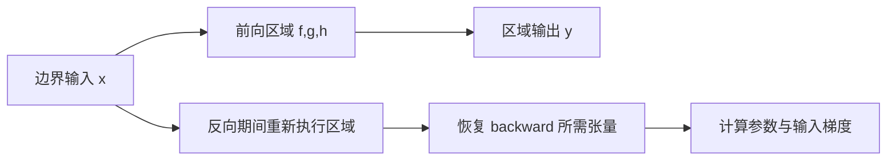

# D6 低显存训练：LoRA 梯度、重计算与激活预算

[← 课程索引](../index.md) · [配套 lab6](../../labs/lab6/README.md) · [PyTorch 桥接](../guides/pytorch-bridge.md)

> [!abstract] 这一讲要解决的三个问题
>
> 1. 基座参数已经冻结，为什么反向图和激活仍可能占满显存？
> 2. checkpointing 在什么条件下才与原来的梯度计算一致？
> 3. 一个数学上满足预算的保留计划，为什么仍可能在 GPU 上 OOM？

本讲接续张量运行时、反向传播和 GPU 测量的知识：先推导 LoRA 的梯度语义，再实现重计算，最后通过实测解释内存—时间曲线，将这些步骤接入一套小型训练流程。微型网络足以验证机制，但不能代表真实 LLM 的显存构成。

**5h 学习安排**：§1–§2 显存账与 LoRA 推导 1.5h；§3–§4 checkpoint 语义 1h；§5 规划手算 0.75h；§6 测量口径 0.75h；§7–§8 前沿对照与研究卡 1h。另配 26h 实验。以下随堂题与指定图解包含在 5h 阅读、推导时间内；先写答案，再看折叠提示。全文阅读、采集新快照和真实模型训练均为选做，不把它们塞进这 5h。

| 节    | 必须得到的产物                       | lab 对应 |
| ----- | ------------------------------------ | -------- |
| §1–§2 | 参数量、梯度公式与输入梯度反例       | A1       |
| §3–§4 | RNG 重算图、全部参数梯度对照         | B1       |
| §5–§6 | 背包手算、实际内存—时间曲线          | B2–B5/C5 |
| §7–§8 | 与 QLoRA、选择性重计算、共服务的差距 | C/报告   |

## §1 训练显存不是“参数量乘一个常数”

### 1.1 从活对象开始列账

把某个训练时刻的显存拆成：

$$
M=M_W+M_G+M_O+M_A+M_{workspace}+M_{runtime}.
$$

W 是参数，G 是梯度，O 是优化器状态，A 是仍需使用的激活。workspace 包括算子临时区；runtime 还可能含通信和图执行缓冲。这些对象的生命周期各不相同，因此显存峰值不一定出现在前向的最后一层。

例如 FP32 参数每元素 4 bytes，FP32 梯度每元素也是 4 bytes，Adam 的两个 FP32 动量通常再占 8 bytes。还需根据实际配置检查是否存在 FP32 master weights、状态是否使用低比特表示，以及实现是否额外保留张量，不能将所有混合精度训练都按“16 bytes/parameter”计算。

### 1.2 冻结参数省掉哪些项

若 W 不可训练，通常不需要为它保存梯度和优化器状态，但它仍须参与前向，还可能参与输入梯度计算。对中间激活的需求取决于计算图，而不是仅由 `requires_grad` 的参数比例决定。

lab 的 Model 默认有 8 个 residual block，实际默认 benchmark 使用 4 个块，每块是 LayerNorm→LoRA up projection→GELU→LoRA down projection→dropout。它**没有 attention、词表 logits、KV 或交叉熵**。长序列让中间张量随 token 数增长，但不能据此估计真实 Transformer 的全部峰值。

### 1.3 一个单位检查

形状 `[B,T,H]=[2,128,256]` 的 FP32 张量占：

$$
2\cdot128\cdot256\cdot4=262{,}144\ \text{bytes}=0.25\ \text{MiB}.
$$

单个 up projection 输出宽度 512，对应 0.5MiB。autograd 可能保存多个相关张量；反向时梯度与 optimizer 状态也存在。因此不能用“每块一个 0.5MiB 激活”替代实际峰值测量。

> [!question] 随堂自测 D6-1：先分清账目与单位
>
> 1. 忽略 bias，din=dout=1024、r=8、全部 FP32 时，基座 W 与可训练 A/B 各占多少 MiB？是否能据此推出训练峰值？
> 2. 冻结 W 后，W 本体、W 梯度、W 的优化器状态、输入梯度所需计算分别怎样变化？

> [!tip]- 核对要点
>
> 1. W 占 4MiB，A/B 合计 65,536 bytes=0.0625MiB。它们未包括梯度、优化器、激活、临时区与 allocator，因此不能直接推出训练峰值。
> 2. W 本体仍在；通常不分配它的梯度与优化器状态；若 X 需要梯度，基座分支仍参与输入反传。

## §2 LoRA：从矩阵布局到梯度归属

### 2.1 形状先于代码

令输入 X 为 `[N,d_in]`，基座 W 为 `[d_out,d_in]`，低秩 A 为 `[r,d_in]`，B 为 `[d_out,r]`。输出：

$$
Y=XW^T+sXA^TB^T,\qquad s=\alpha/r.
$$

`torch.nn.functional.linear(X,W)` 按这一权重布局计算，不应再手动转置一次。输入也可以带多个前导 batch 维；只对最后一维做线性变换。

```text
X [N, din] ────────── Wᵀ ──────────────────┐
     └──────── Aᵀ → [N,r] → Bᵀ → ×s ─────┼→ Y [N,dout]
                                           ┘
```

新增参数量为 $r(d_{in}+d_{out})$。当 `din=dout=1024,r=8`，LoRA 参数为 16,384，基座为 1,048,576，比例 1/64。这个比例只描述参数，不是训练峰值比例。

### 2.2 为什么 B=0 时 A 的首次梯度为零

令 G=$\partial L/\partial Y$，忽略 batch 维展开问题，有：

$$
\frac{\partial L}{\partial B}=sG^T(XA^T),\qquad
\frac{\partial L}{\partial A}=sB^TG^TX.
$$

初始 B=0 时，LoRA 分支输出为 0，所以模型初始输出等于基座；A 的梯度也为 0，而 B 的梯度一般非零。更新 B 后，下一步 A 才可能得到非零梯度。不能为了让 A 首次获得非零梯度而改变规定的初始化。

实验的 `test_a1_frozen_base_input_and_adapter_gradients` 正是在检验这组关系：base 输出一致、W 没有 grad、B 有梯度、A 首次梯度为零。

### 2.3 冻结 W 不等于关闭基座分支的 autograd

输入梯度仍包含：

$$
\frac{\partial L}{\partial X}=GW+sGBA.
$$

如果 X 来自上游可训练层，错误地在 `no_grad` 中计算 `XWᵀ` 会丢掉第一项。此时 loss 仍可能下降，B 也可能仍有梯度，因此仅检查这两点无法发现错误。

一个最小反例：取 r=1、B=0、X.requires_grad=True，令 loss 为输出求和。此时正确输入梯度等于 W 每列的和，而不是全零。`test_a1_frozen_base_input_and_adapter_gradients` 的后半段将 B 设为非零，用独立矩阵公式检查两条分支的输入梯度；仅检查初始输出与 A/B 参数梯度，不能代替这一检查。

### 2.4 与完整微调的比较条件

若要比较 LoRA 与全量训练，应声明基座精度、训练参数集合、rank、学习率和数据预算。LoRA 会限制可训练的更新空间，并非只改变内存调度。因此，训练质量有变化时，不能将差异全部归因于系统实现。

本实验始终保持相同 LoRA 模型，只改变激活保存策略，从而更容易把性能变化归因给 checkpointing。

> [!question] 随堂自测 D6-2：一个梯度错误能否被 loss 发现
>
> 1. 设 W=[[1,2],[3,4]]、B=0、X=[[5,6]]，loss 为两个输出之和。正确的输入梯度是多少？若给基座分支加 `no_grad()` 呢？
> 2. B=0 时 A 的首次梯度为零是否说明 LoRA 实现坏了？如何让测试同时覆盖基座与低秩分支的输入梯度？

> [!tip]- 核对要点
>
> 1. 正确梯度为 [[4,6]]；错误关闭基座 autograd 后，只剩 B=0 的低秩分支，输入梯度为零。loss 数值此时仍可能相同。
> 2. 不是，这是初始化带来的结果，B 的梯度通常非零。再令 B 非零、给定上游 G，用 `GW+sGBA` 独立计算输入梯度；不能用另一遍相同 forward 当 oracle。

## §3 Autograd 保存了什么，checkpoint 改了什么

### 3.1 保存与重算的依赖图

对 `u=f(x),v=g(u),y=h(v)`，普通 autograd 根据 backward 所需保存输入或中间结果。checkpoint 可以只保留某个区域的边界输入，在 backward 需要时重新运行该区域，恢复相关张量。



重计算并不会消除参数、梯度、优化器状态和边界输入；也不保证峰值只由保存张量大小决定。重算临时区与梯度同时存活时，峰值可能出现在 backward。

### 3.2 keep 向量的准确含义

lab 的 `run_blocks(blocks,x,keep)` 采用每 block 一个决策：True 走普通 autograd，False 走非重入 checkpoint。`len(keep)` 必须等于 block 数，不能让 `zip` 默默截短网络。

`keep=[True,False,True]` 表示仅中间 block 重算，不代表把整个三个 block 当成一个 checkpoint segment。不同分段方式保留的边界张量不同，因此实验结果不能直接外推到任意 checkpoint 调度。

### 3.3 非重入、显式参数与 PyTorch 文档

本实验按 [PyTorch checkpoint 文档](https://docs.pytorch.org/docs/stable/checkpoint.html)使用 `use_reentrant=False`，并显式设置 `preserve_rng_state=True`。不同版本的默认值与支持条件可能变化，所以实验记录必须包含 torch 版本。

阅读文档时找三点：输入/输出是否需要 `requires_grad`；反向时如何执行重计算；随机状态和多设备行为的限制。本实验不在 block 内移动张量到新设备，避免引入额外的 RNG 保存假设。

> [!info] 图解：沿黑色箭头数保存的张量
> 看 [PyTorch checkpoint 技术说明的 “Activation Memory Basics” 与 “Activation Checkpointing” 图](https://pytorch.org/blog/activation-checkpointing-techniques/)。分别圈出普通前向与 checkpoint 区域保存的值，再给图补上 backward 重算箭头。随后查看 “Selective Activation Checkpoint” 的红色保留算子，说明它比每块一个 keep 更细在哪里。
>
> 文中的速度—内存图是机制示意，其中 memory 指区域内为 backward 保存的量，并非本实验整步 `peak_allocated_bytes`；不能读取示意点的位置作为加速数据。

> [!question] 随堂自测 D6-3：边界保存与网络完整性
>
> 1. 三个 block 的 keep=[True,False,True] 会重算什么？把它误解为一个覆盖三块的大 checkpoint 区域，会改变哪些边界保存？
> 2. 若 keep 只有两个值，为什么不能直接 `zip(blocks,keep)` 后返回结果？checkpoint 能删除 W、参数梯度和 optimizer state 吗？

> [!tip]- 核对要点
>
> 1. 仅中间 block 采用 checkpoint，并保留其所需边界；整个三块区域的边界不同，中间两个边界的保存/重算安排也会改变。
> 2. zip 会静默跳过第三块，实际计算了另一个网络；应先检查长度。checkpoint 主要调整反传所需中间值，不会删除上述常驻对象。

## §4 随机操作使“再算一遍”变得不平凡

### 4.1 Dropout 的反例

若前向用了 mask m，重计算时用了 m'，backward 看到的可能不再是原前向路径。即使 mask 的分布相同，也不等于单次梯度相同。

设 $y=xm/(1-p)$。一次前向 m=0 导致 y=0，而重计算 m'=1；若继续使用这次重算生成的导数，所得梯度不对应原来的随机路径。研究中有时可以接受不同随机估计器，但不能称其与原算法逐步等价。

### 4.2 公平的梯度对照流程

先构造并复制相同初始模型；固定输入和 target；每个策略前恢复相同 RNG seed；分别运行 no checkpoint、all checkpoint、partial checkpoint；比较 loss 和**所有可训练参数**的梯度。

`test_b1_checkpoint_dropout` 对 loss 使用 `torch.testing.assert_close` 的默认容差，对参数梯度显式使用 `rtol=1e-4,atol=1e-6`。误差门槛是这一微型 FP32 网络的测试契约，不是所有 dtype/硬件的通用保证。

不要为了通过测试而关闭 dropout，否则可能漏掉随机状态管理中的错误。也不能只比较梯度范数，因为方向完全不同的向量也可能具有相同范数。

### 4.3 多步检查补充单步检查

一次 backward 正确后，再从同一初始模型、optimizer 状态和 RNG 开始跑几步，比较参数与 loss 轨迹。这样可以发现 stale gradient、未清零、共享 optimizer 状态等流程错误。

lab C3 在 dropout 开启时比较输入和参数梯度，C4 对不均匀微批与完整batch的optimizer更新做独立比较。默认benchmark做真实AdamW step，学习率0用于固定参数的策略测量；更长期的收敛比较仍需另外设计。

> [!question] 随堂自测 D6-4：随机等价不是分布相同
>
> 1. 取 p=0.5、y=xm/(1−p)、loss=y，原前向 m=0，重算却用 m′=1。两条路径对 x 的导数各是多少？只固定最开始的一次 seed 足够公平比较多个策略吗？
> 2. 两种实现得到同样的 loss，梯度分别为 [1,0] 与 [0,1]。梯度范数能发现错误吗？应如何比较？

> [!tip]- 核对要点
>
> 1. 导数分别为 0 和 2。比较策略前还应恢复相同 RNG，并让 checkpoint 保存/恢复区域随机状态；连续运行会消耗不同的 RNG 序列。
> 2. 两者范数都是 1，无法发现方向差异；应逐参数、逐元素比较，并覆盖需要梯度的输入。

## §5 激活预算可先抽象成背包

### 5.1 从目的推到目标函数

给 block i 指定保存代价 $s_i$ 与不保存时的重计算成本 $c_i$，选择 $x_i\in\{0,1\}$ 表示是否保存。若 B 是额外激活预算，希望尽量避免昂贵的重算：

$$
\max_x\sum_i c_ix_i\quad\text{s.t.}\quad\sum_i s_ix_i\le B.
$$

这就是 0/1 knapsack。目标是最大化节省的重算成本。如果误写成最小化保存成本，最优解就会是什么都不保存，无法回答原来的问题。

### 5.2 用独立枚举校验一个小例子

取 sizes=`[2,5,3,7]`，costs=`[1,9,4,6]`，B=8。可保存 block 1 和 2，总大小 8、收益 13；保存 block 0 和 1，总大小 7、收益 10。枚举 16 个子集可以得到独立 oracle。

动态规划状态可定义为前 i 项、已使用 u 单位时的最大收益。第 i 项有不选与选两种转移；记录 mask 或前驱用于重建。注意 0/1 的“每项至多一次”：原地更新容量时需要正确方向，或者像参考那样从旧状态构造新状态。

`plan_keep` 返回长度等于 block 数的 bool 列表。空输入返回空列表；预算非负整数；sizes 为正整数；costs 有限且非负。units 由调用者定义，例如 MiB，而不是函数内部自动测量 CUDA bytes。

### 5.3 为什么可行背包仍可能 OOM

这个抽象忽略生命周期重叠、残差边界、重算时临时区、allocator 碎片和 optimizer 状态。不同 block 的激活也不一定能简单相加。因此满足 $\sum s_ix_i\le B$ 只能证明**模型预算**可行。

B2 用手工小表验证0/1规划，B4扩展为多选DP。B5实际测每块retain/checkpoint保存storage和执行时间，C5将计划接进完整训练。默认calibrated策略预算单位KiB，是saved-storage加和近似，不能解释成保证整步峰值的硬上界。

### 5.4 量化成本模型误差

后续可以逐块 profile，记录输入长度、保存张量规模与重算时间，用其中一部分配置拟合 s/c，再用未参与拟合的长度测试。比较预测峰值与实际峰值。误差较大时，应先修正成本模型，否则即使规划器求出最优解，也可能在优化错误的目标。

[交互演示](../visuals/index.html)中的激活预算面板可用于手算验证。改变预算观察离散跳变，解释为何多 1 个单位有时无收益、有时能省掉一个昂贵 block。

> [!question] 随堂自测 D6-5：规划最优与实际可行
>
> 1. 对 sizes=[2,5,3,7]、costs=[1,9,4,6]、B=8，给出最优 keep 和收益。若动态规划一次更新重复选了某层，它解决的还是本题吗？
> 2. 两个计划都满足预测 retained KiB 预算，其中一个实际 OOM。应先怀疑 DP 还是成本模型？列出至少两项被模型省略的内存。

> [!tip]- 核对要点
>
> 1. keep=[False,True,True,False]，大小 8、收益 13；重复选同一层违反 0/1 约束，要从旧状态转移或采用正确的逆序更新。
> 2. 先用穷举检查 DP，再检查模型边界；参数/optimizer 常驻、重算临时区、边界张量与梯度同时存活、allocator 行为等都可能造成偏差。

## §6 怎样得到可信的内存—时间曲线

### 6.1 先定义一次 step

lab 的计时包含 zero_grad、forward、loss、backward 和 optimizer step；不包括模型创建和数据生成。CUDA 计时前后需要同步，完成 1 次完整 warmup 后，再测量 3 次 step 的平均耗时。warmup 中已初始化 optimizer 状态，避免将首步分配的影响混入测量。

`peak_allocated_bytes` 是 PyTorch allocator 记录的活分配峰值；`peak_reserved_bytes` 包含保留池。它们均不是显卡所有进程的总占用，也不包含系统层面所有 GPU 内存。

### 6.2 为什么 empty_cache 不是修复方案

`empty_cache` 不能释放仍由 tensor 引用的内存。实验会在切换配置时删除测量对象，但 allocator 可能继续保留内存池，因此 allocated/reserved 必须分列。不能在每个训练 step 调用它，就声称模型对活内存的需求降低了。

如果 reserved 高而 allocated 稳定，可能只是缓存池保留；若每步 allocated 持续增长，检查是否把 loss tensor、输出或带图对象存入列表。保存日志通常应使用 detach 后的标量。

### 6.3 图应该帮助判断什么

横轴画实际 peak allocated MiB，纵轴画 step ms；同一个长度使用同组 seed，颜色表示策略。因 OOM 无法运行的配置也要记入表格，不能删除。再画长度→内存曲线，观察哪个区域主要由激活决定。

checkpoint 用额外计算换取空间，因此变慢本身不意味着失败。应比较的是：在给定的真实内存上限内，它是否比其他可行方案更快。不满足预算的 retain 不能作为同样可部署的方案参与比较，但仍应展示它提供的上界信息。

> [!info] 图解：从峰值数字回到活对象
> 查看 [PyTorch 的 GPU memory 时间线教程](https://pytorch.org/blog/understanding-gpu-memory-1/)中正常三次迭代、错误版本和修复后版本的截图。先找哪些带状分配跨越迭代边界，再看 “Categorized Memory Usage” 中首次出现后持续保留的 optimizer state。截图来自作者示例，不是本实验测量。
>
> 有 CUDA 时可选用[官方交互查看器](https://docs.pytorch.org/memory_viz)载入自己的 snapshot，缩放一个峰值并悬停查看分配调用栈。CPU 学习者先完成截图判读即可；采集快照属于额外诊断练习，开销不计入正常 step benchmark。

### 6.4 offload 的生命周期与微批权重

C1/C2 实现同步 pack/unpack：只把符合条件的 CUDA 激活复制到独立 CPU 存储，保留 device，反传时恢复；排除参数和共享参数 storage 的 view。这里没有异步传输或计算重叠。hook退出不表示packed对象已经释放。累计搬运bytes不等于host峰值，CPU fallback也不能证明CUDA传输发生。

C3把retain/checkpoint/offload接入同一网络，C4将微批MSE sum除以总元素数后累积，最后只clip/step一次。不等大小微批不能直接平均各自mean loss。C5在warmup后运行真实optimizer，分开记录峰值与时间。[对应任务和上游教程](../../labs/lab6/resources.md)提供逐函数入口。

> [!question] 随堂自测 D6-6：峰值、搬运与训练目标
>
> 1. 一个符合 offload 条件的 4KiB CUDA 激活 pack 一次、unpack 两次。packed bytes、D2H copies、H2D copies、restores 各是多少？能否据此推出 host 峰值为 4KiB或传输已被隐藏？
> 2. 两个微批的 target 元素数为 2 和 3，MSE mean 分别为 1 和 4。整体目标是多少？简单平均两个 mean 会得到什么？
> 3. 曲线上 reserved 高于 allocated、但各步 allocated 稳定，是否足以证明内存泄漏？为何计时先 warmup，并把快照采集与正常测量分开？

> [!tip]- 核对要点
>
> 1. 分别为 4096、1、2、2；它们是累计计数，不能描述全部 host 活对象峰值。本实现同步复制，也不能据此宣称有传输重叠。
> 2. 整体目标为 (2×1+3×4)/5=2.8；简单平均为 2.5，错误增加了小微批的权重。应按总 target.numel 归一化 sum loss。
> 3. 不足以证明，可能只是 allocator 保留池。warmup 初始化优化器等状态；快照记录会增加诊断开销，应单独运行并注明条件。

## §7 前沿方法分别改变哪一项

| 工作                                                                                          | 核心对象           | 与本实验的关系          | 必须额外验证                   |
| --------------------------------------------------------------------------------------------- | ------------------ | ----------------------- | ------------------------------ |
| [QLoRA，NeurIPS 2023](https://arxiv.org/abs/2305.14314)                                       | 量化基座与低秩训练 | LoRA 只是其中一部分     | 量化格式、质量、优化器路径     |
| [选择性 activation checkpoint](https://pytorch.org/blog/activation-checkpointing-techniques/) | 更细粒度保存/重算  | 可替代每 block 单一决策 | 算子策略与实际峰值             |
| [FlexLLM，NSDI 2026](https://www.usenix.org/conference/nsdi26/presentation/oliaro)            | 推理/微调共服务    | 引入动态预算和服务目标  | 推理 SLO、训练有效进度、公平性 |

QLoRA 不保证任意 7B 模型都能在 8GB 显存下使用任意上下文长度微调。权重、optimizer、序列长度和实现都会影响峰值。本实验基座为 FP32，没有实现 NF4、双重量化或 paged optimizer。

FlexLLM 研究共服务，不能仅用单独训练时节省的显存来评价。打开[固定 artifact 入口](../readings/code-map.md)，先列出共享资源和测量指标，再讨论如何缩小到单卡。仅通过暂停全部训练来加快推理，不能证明共服务的整体表现更好。

阅读 [CS336 Systems](https://github.com/stanford-cs336/assignment2-systems) 中的 profile/benchmark 任务时，可以借用测量方法，而不必搬入与当前硬件不匹配的完整配置。

> [!question] 随堂自测 D6-7：论文名字不能代替机制
>
> 1. Lab 6 已有 LoRA、checkpoint 和 CPU offload，为什么仍不算 QLoRA 复现？
> 2. 如果共服务实验通过完全暂停训练改善推理延迟，只报推理 SLO 是否足够评价 FlexLLM 类问题？

> [!tip]- 核对要点
>
> 1. 这里基座是 FP32，未实现 NF4、双重量化与 paged optimizer，也未进行对应模型质量和端到端验证。
> 2. 不够。还需报告训练有效进度、共享资源占用及公平性；让训练零进度可能只是把代价转给另一个目标。

## §8 一个适合本机起步的问题

假设：在给定真实显存上限内，利用当前序列长度选择保留计划，能否比固定间隔和全 checkpoint 更快，并保持相同梯度语义？这个问题可以通过实验检验，但与已有选择性 checkpoint 研究重叠，还不能直接作为新的研究想法。

第一轮比较 retain、all checkpoint、固定间隔、预算计划；至少三个长度、三个 seed；固定模型和数据；同时报告规划耗时、实际峰值与步耗时。只有优于这些 baseline 且误差模型可解释，才值得接入更真实的 0.6B 模型。

若研究梯度累积，还需保持 loss 归一化语义：不同有效 token 数的 microbatch，直接平均各自 mean loss 会赋予不同于整体 token mean 的权重。系统优化前先写出训练目标。

停止条件包括梯度不等价、规划成本高于收益、OOM 由参数而非激活主导，或收益只来自不合理 baseline。负结果也可以用于和导师讨论，帮助明确哪些瓶颈值得继续研究。

> [!question] 随堂自测 D6-8：选择下一轮实验
>
> 1. 规划策略比全 checkpoint 更快，但比固定间隔慢，且所有策略都满足真实显存上限。这个结果支持什么结论，下一步应测什么？
> 2. 若 OOM 时参数和 optimizer 已占绝大多数内存，继续细化激活 DP 的收益可能受什么限制？

> [!tip]- 核对要点
>
> 1. 只能说明它优于全重算这一 baseline；应计入校准/规划耗时，检查未见长度下的模型误差，并保留固定间隔结果，不能直接宣称自适应规划有效。
> 2. 可节省激活在总内存中占比有限；先列实测内存构成，再判断是否应转向基座精度、优化器状态或模型规模问题。

## 实验映射：从梯度契约到真实训练步

| 阶段   | 讲义对应 | 实验产物                                                | 时间 |
| ------ | -------- | ------------------------------------------------------- | ---- |
| A 基础 | §1–§2    | LoRA forward、merge/unmerge、注入与原子加载，参数内存账 | 6h   |
| B 核心 | §3–§5    | RNG 等价、saved storage 统计、两类 DP 与实测校准        | 8h   |
| C 前沿 | §6–§7    | 同步 offload、不均匀微批、实际 optimizer step 测量      | 9h   |
| 报告   | §8       | 内存—时间曲线、预测误差与研究卡                         | 3h   |

17 个 TODO 和 14 个测试方法的具体契约见 [Lab 6](../../labs/lab6/README.md)与[评分](../../labs/lab6/grade.md)。CPU 可完成算法和训练正确性；设备搬运和 allocator 峰值仍须使用 CUDA 验证。

## 资料汇总

- 图解必看：[PyTorch checkpoint 保存/重算与选择性保存图](https://pytorch.org/blog/activation-checkpointing-techniques/)，对应 §3；[GPU memory 时间线与分类图](https://pytorch.org/blog/understanding-gpu-memory-1/)，对应 §6。先完成指定图的标注，全文可选读。
- 可选交互：[官方 memory snapshot 查看器](https://docs.pytorch.org/memory_viz)，用于自己的 CUDA 记录；[本地激活预算面板](../visuals/index.html)，用于教学背包手算。两类图的数据来源不同。
- 接口与实验：[PyTorch checkpoint 文档](https://docs.pytorch.org/docs/stable/checkpoint.html)、[saved tensors hooks 教程](https://docs.pytorch.org/tutorials/intermediate/autograd_saved_tensors_hooks_tutorial.html)、[Lab 6](../../labs/lab6/README.md)、[改编来源](../../labs/lab6/resources.md)、[PyTorch 桥接](../guides/pytorch-bridge.md)、[实验规范](../guides/experiments.md)。
- 前沿选读：[QLoRA](https://arxiv.org/abs/2305.14314)、[FlexLLM 项目](https://flexllm.github.io/)、[artifact](https://github.com/FlexLLM/artifact)、[CS336 Systems](https://github.com/stanford-cs336/assignment2-systems)、[固定源码入口](../readings/code-map.md)。按目标选读，不要求同时运行所有上游工程。

## 自测清单

- [ ] 列出参数、梯度、优化器、激活和临时区的内存账，能做 bytes/MiB 换算。
- [ ] 推导 A/B/X 梯度，并用非零 B 的独立矩阵式检测输入梯度错误。
- [ ] 画出每 block checkpoint 的边界，解释 keep 长度和随机状态契约。
- [ ] 给出 dropout 重算不一致与“同范数不同方向”的反例。
- [ ] 用穷举核对预算规划，并说明 retained KiB 不等于 allocator 峰值上界。
- [ ] 从时间线区分短期临时分配、持续状态与可能的跨步对象残留。
- [ ] 算清重复 unpack 的计数和不均匀微批的归一化，保持同步 offload 的性能边界。
- [ ] 交付含强 baseline、准备开销、负结果与停止条件的研究卡。
