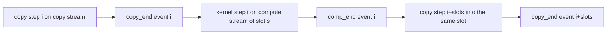

# D7 MoE 卸载：路由约定、专家缓存与真实重叠

[← 课程索引](../index.md) · [配套 lab7](../../labs/lab7/README.md) · [← D6 低显存训练](06-memory-efficient-training.md) · [D8 RL rollout →](08-rollout-scheduling.md)

> [!abstract] 这一讲要解决的问题
> foundations 讲过 CUDA stream、pinned memory 和带宽测量。本讲面对的约束很具体：RTX 4060 Laptop 只有 8 GB 显存、PCIe 4.0 x8、`asyncEngineCount` 为 1，而一个 OLMoE-1B-7B 的 bf16 权重有 13.8 GB。学完以后你能推导“每 token 激活 1.3B 参数却要搬 13.8 GB 权重”这笔账，能分辨已发布模型实际使用的三种路由归一化约定、说出哪个 checkpoint 用哪一种，并写出会把它们算错的数值例子，能用 cudaEvent 分段计时测出真实的 copy/compute 重叠比，并能判断一次“预取命中率提高”到底有没有省下 PCIe 字节。

| 阅读模块                     | 时间  | 必须留下的学习产物            | 对应实验 |
| ---------------------------- | ----- | ----------------------------- | -------- |
| §1 MoE 层与路由约定          | 50min | 三种归一化的手算权重表        | A1       |
| §2 参数账与数据搬运预算      | 40min | active/total/工作集三栏账     | A0/R4    |
| §3 布局：dispatch 与 combine | 40min | offsets 与加权合并的手算      | A2–A6    |
| §4 专家缓存与替换策略        | 50min | 四态图加一条 LRU/LFU 分歧轨迹 | B1–B8    |
| §5 重叠模型与依赖图          | 50min | 槽复用的双向依赖图            | R1–R3    |
| §6 CPU/GPU 混合执行          | 30min | 一条判定不等式和它的实测输入  | R5       |
| 前沿与 baseline 对照         | 50min | 对照表中三篇工作的机制差异卡  | C/R      |
| 研究问题                     | 30min | 一个可证伪的假设和停止条件    | R        |

**共 5h，另做 lab 约 30h。** 5h 里包含路由约定的手算、缓存事件表推演、依赖图绘制，以及对照表里指定的论文片段和图解。HF 源码的逐行阅读、整篇论文、nsys 全部文档属于选读。

随堂自测计入上表时间。先在笔记里写答案，再展开核对要点。

## §1 MoE 层解剖：选择和加权是两件事

### 1.1 最小形式

router 为 token $x$ 打分，选出专家集合 $\mathcal{K}(x)$，输出是被选专家的加权和：

$$
y(x)=\sum_{e\in\mathcal{K}(x)}g_e(x)\,f_e(x).
$$

$f_e$ 是第 $e$ 个专家的 FFN，$g_e(x)$ 是它的 gate 值（无量纲）。常见实现里 $f_e$ 是 SwiGLU 或 `down(ReLU(up(x)))`，参数量为 $3\,d_{\text{model}}d_{\text{ff}}$ 或 $2\,d_{\text{model}}d_{\text{ff}}$。

关键在于：**“选哪些专家”和“每个专家的权重是多少”是两个独立的步骤**，而已发布的模型在这两步上的组合各不相同。把它们混成一句“softmax 后取 top-k”，就会写出一个在某些 checkpoint 上数值错误、却仍能通过粗糙测试的 router。

除了 routed expert，DeepSeekMoE 系列还有 $K_s$ 个 **shared expert**：每个 token 都经过它们，不参与路由。它们的参数永远驻留显存，不进专家缓存，算 active 参数时必须单独计入。

### 1.2 已发布模型的归一化约定（核验日期 2026-10-18）

下表每一行都对照过模型实现或 checkpoint 的 `config.json`。六行模型归结为三种实现上不同的约定，lab7 的 `Norm` 枚举就是这三种：`TopkSoftmax`、`SoftmaxNoRenorm`、`SigmoidRenorm`。

| 模型                              | 选择依据                                      | 权重                                                                                 | 来源                                                                                                                                           |
| --------------------------------- | --------------------------------------------- | ------------------------------------------------------------------------------------ | ---------------------------------------------------------------------------------------------------------------------------------------------- |
| Switch Transformer                | softmax 全部后取 top-1                        | $p$ 本身，不归一化                                                                   | [arXiv 2101.03961](https://arxiv.org/abs/2101.03961) Eq.1–2                                                                                    |
| GShard                            | softmax 全部后取 top-2                        | $g_1/(g_1+g_2)$，重归一化                                                            | [arXiv 2006.16668](https://arxiv.org/abs/2006.16668) Alg.1                                                                                     |
| Mixtral                           | logits 取 top-k                               | 对选中的 $k$ 个 logit 做 softmax（等价于先 softmax 再除以选中部分之和）              | [modeling_mixtral.py](https://github.com/huggingface/transformers/blob/main/src/transformers/models/mixtral/modeling_mixtral.py)               |
| Qwen1.5-MoE / OLMoE / DeepSeek-V2 | softmax 全部后取 top-k                        | 直接取选中位置的 $p$，**不重归一化**（这些 checkpoint 的 `norm_topk_prob` 为 false） | [modeling_olmoe.py](https://github.com/huggingface/transformers/blob/main/src/transformers/models/olmoe/modeling_olmoe.py) + checkpoint config |
| Qwen3-30B-A3B                     | 同上                                          | **重归一化**（该 checkpoint 把 `norm_topk_prob` 设为 true，尽管类默认是 false）      | [config.json](https://huggingface.co/Qwen/Qwen3-30B-A3B/blob/main/config.json)                                                                 |
| DeepSeek-V3                       | $\mathrm{sigmoid}(z_e)+b_e$，$b_e$ 只用于选择 | 选中专家的**无偏** sigmoid 归一化后乘 `routed_scaling_factor` $=2.5$                 | [DeepSeek-V3 技术报告](https://arxiv.org/abs/2412.19437) §2.1.2                                                                                |

为什么顺序会影响数值？设 logits 为 $z=[2,1,0,-1]$、$k=2$：

- **先取 top-k 再 softmax**：$w=\left[\frac{e^{1}}{e^{1}+1},\frac{1}{e^{1}+1}\right]=[0.73105858,\,0.26894142]$，和为 1。
- **先 softmax 全部再取 top-k、不重归一化**：分母是 $e^{2}+e^{1}+e^{0}+e^{-1}=11.4752$，于是 $w=[0.64391426,\,0.23688284]$，和只有 0.8808。

两者相差 12%，而且差多少取决于未被选中的 logit 有多大。换句话说，**不重归一化时，权重和携带了“router 有多犹豫”的信息**；重归一化会把这个信息抹掉。Switch 论文在 Eq.2 下面专门解释过为什么 top-1 不能归一化：归一化后 gate 恒为 1，梯度就传不回 router。

DeepSeek-V3 的 bias 还有一层讲究。它做的是 aux-loss-free 负载均衡：$b_e$ 只加在选择用的分数上，权重用的是**没加 bias 的** sigmoid 值。设 $z=[0.1,0.2,0.3]$、$b=[0.9,0.5,0]$、$k=2$，sigmoid 为 $[0.52497919,\,0.54983400,\,0.57444252]$，加 bias 后选择分数为 $[1.42497919,\,1.04983400,\,0.57444252]$，所以选中专家 0 和 1；权重则是

$$
\frac{0.52497919}{0.52497919+0.54983400}=0.48843761,\qquad \frac{0.54983400}{0.52497919+0.54983400}=0.51156239,
$$

再各乘 2.5。如果把 bias 也带进权重，选中的集合仍然正确，gate 值却全错——这种错误不改变任何 shape，只有逐元素比对权重才能发现。实验 A1 的 `a_router` 就是按这三种约定分别断言精确权重的，`faults.json` 里 `a1-bias-enters-weights`、`a1-renormalise-no-renorm`、`a1-topk-before-softmax` 三个注入专门检查它。

还有一个纯数值陷阱：logits 里出现 1000 这样的值时，不减最大值就直接 `exp` 会溢出成 inf，权重变成 nan。本 lab 的 `{1000,1000,0}` 测试行同时检查溢出和并列——并列时必须确定性地偏向编号小的专家，否则同一份输入在不同机器上会路由到不同专家。

> [!question] 随堂自测 D7-1：三种约定的数值差异
>
> 1. logits 为 $[3,1,1]$、$k=2$。分别按“先 top-k 再 softmax”和“softmax 全部后不重归一化”写出两条 route 的权重（保留 4 位小数），并说明两者权重和分别是多少。并列的两个 1 应该选谁？
> 2. 某 checkpoint 的 `config.json` 写着 `"norm_topk_prob": false`，而你的实现总是重归一化。在什么输入下这个 bug 完全观察不到？

> [!tip]- 核对要点
>
> 1. 先 top-k 再 softmax：分母 $e^{2}+1=8.3891$，权重 $[0.8808,\,0.1192]$，和为 1。softmax 全部：分母 $e^{3}+e^{1}+e^{1}=25.5221$，权重 $[0.7870,\,0.1065]$，和为 0.8935。并列时选编号较小的 expert1，并且这条规则必须写进排序的 tie-break 里，不能依赖 `std::sort` 的未定义相对顺序。
> 2. 当被选中的 $k$ 个 logit 远大于其余 logit 时（例如 $[100,99,0,0]$），softmax 全部的权重和本来就接近 1，重归一化几乎不改变数值。只用这种输入测试，就永远看不出区别——这正是旧版 lab7 用 $\{1000,1000,0\}$ 作唯一断言时漏掉这个 bug 的原因。

## §2 稀疏计算不等于稀疏存储

### 2.1 三个“大小”必须分开报告

- **总参数量**决定权重占多少字节，必须全部放在显存、主机内存或磁盘的某一层。
- **active 参数量**决定每个 token 的算术量。
- **本轮工作集**是这一步实际需要加载的专家集合，决定 PCIe 压力。

它们不是一个数。以 [OLMoE-1B-7B-0924](https://huggingface.co/allenai/OLMoE-1B-7B-0924) 为例（Apache-2.0，16 层、每层 64 个 routed expert、top-8、$d_{\text{model}}=2048$、$d_{\text{ff}}=1024$）：

$$
S_{\text{expert}}=3\times 2048\times 1024\times 2\ \text{B}=12.58\ \text{MB},
$$

其中 3 是 SwiGLU 的三个矩阵、2 是 bf16 的字节数。全部专家：

$$
16\times 64\times 12.58\ \text{MB}=12.9\ \text{GB},
$$

加上 attention 和 embedding 共约 13.8 GB。而每个 token 只激活 $16\times 8=128$ 个专家，合计约 1.6 GB——注意这是**整次前向**要碰到的专家权重，不是“每层 8 个 $\times$ 12.58 MB = 100 MB”那一层的量。这 1.6 GB 对应约 0.8B 参数，加上 attention 和 embedding 才是官方口径的 1.3B active 参数。8 GB 显存放不下 13.8 GB 权重，int4 量化后约 3.4 GB 才能全驻留。

batch 里不同 token 选不同专家，所以一层实际需要的专家数远大于 8。64 个专家、top-8、$B$ 个 token 时，若路由独立均匀，某个专家一次都没被选中的概率是 $(1-8/64)^{B}$，期望被触及的专家数为

$$
E\left[\lvert\mathcal{U}\rvert\right]=64\left(1-\left(\tfrac{7}{8}\right)^{B}\right).
$$

$B=16$ 时已是 $64(1-0.1181)=56.4$ 个专家——几乎整层。**这就是 batch 越大、专家卸载越不划算的原因**：decode 阶段 $B=1$ 时每层只要 8 个专家，prefill 阶段几乎要全部。

### 2.2 搬运预算：这台机器的实测数字

`nvidia-smi --query-gpu=pcie.link.gen.max,pcie.link.width.max` 在本机返回 `4, 8`，即 PCIe 4.0 x8。PCIe 4.0 是 16 GT/s、128b/130b 编码，每 lane 每方向 1.969 GB/s，所以 x8 的理论值是

$$
8\times 1.969\ \text{GB/s}=15.75\ \text{GB/s}.
$$

stage R 在这台机器上实测（32 MiB、pinned、spin 预热后取 9 次中位数）：

| 来源     | H2D 带宽（measured） | 占理论值 |
| -------- | -------------------- | -------- |
| pinned   | 12.6 GB/s            | 80%      |
| pageable | 11.6 GB/s            | 73%      |

1 MiB 的小传输差距更大：12.0 对 9.0 GB/s。pageable 慢的原因是驱动必须先把数据搬进一个内部的 pinned staging buffer，这一步在 [NVIDIA 的传输优化教程](https://developer.nvidia.com/blog/how-optimize-data-transfers-cuda-cc/)里有示意图。更要紧的是语义：CUDA Programming Guide 写明异步拷贝要求 host buffer 是 page-locked 的，`cudaMemcpyAsync` 在 pageable 内存上“会正确工作，但会退化成同步行为，不与其他工作重叠”。也就是说，**用错内存类型不会报错，只会让流水线悄悄串行化**。stage R 的 `r_pool` 用 `cudaPointerGetAttributes` 直接检查这件事，而不是相信一个布尔参数。

于是单个专家的传输下界是

$$
T_{\text{copy}}\ge\frac{S_{\text{expert}}}{B_{\text{H2D}}}=\frac{12.58\ \text{MB}}{12.6\ \text{GB/s}}=1.00\ \text{ms}.
$$

decode 一步要 128 个专家，全 miss 时是 128 ms，对应约 7.8 tok/s 的上限——而且这还只是传输，没算计算。命中率因此是这里最值钱的变量：**命中率从 50% 提到 90%，这一项就从 64 ms 降到 12.8 ms**。

主机侧也有预算。WSL2 默认把内存配额设为宿主机的 50%，本机 16 GB 就是约 8 GB，还要同时装下模型分片、pinned 池和 page cache。NVIDIA 的 WSL 文档明确说 pinned system memory “可供应用使用的量是受限的”，但没有给数字，所以 stage R 的 `build_pool` 在 `cudaMallocHost` 失败时抛一条带 “pinned” 字样的错误，bench 捕获后跳过这一档并打印原因，而不是整个崩掉。

> [!question] 随堂自测 D7-2：参数账
>
> 1. Qwen1.5-MoE-A2.7B 有 24 层、每层 60 个 routed expert、top-4、$d_{\text{model}}=2048$、$d_{\text{ff}}=1408$。算出 bf16 下单个专家的字节数、routed 专家总字节数，以及在 12.6 GB/s 下搬运一个专家的时间。int4（约 bf16 的 1/4）后能否放进 8 GB 显存？
> 2. 某同学报告“top-8 只激活 12.5% 的专家，所以显存需求降到 12.5%”。用 §2.1 的公式指出他在哪一步偷换了概念，并给出 $B=32$、64 个专家、top-8 时期望触及的专家数。

> [!tip]- 核对要点
>
> 1. $3\times 2048\times 1408\times 2=17.3$ MB；$24\times 60\times 17.3\ \text{MB}=24.9$ GB；$17.3/12600=1.37$ ms。int4 约 6.2 GB，加上 shared expert、attention 和 KV cache 后在 8 GB 上很勉强，需要部分卸载——这与 GPTQ-Int4 仓库约 8.4 GB 的实际大小一致。
> 2. 他把 active 参数量当成了存储需求：没被选中的专家仍然要存在某处，只是不参与这次计算。$64(1-(7/8)^{32})=64\times(1-0.0138)=63.1$，即 32 个 token 几乎必然触及全部 64 个专家。

## §3 布局：dispatch 是转置，combine 是它的逆

### 3.1 为什么要重排

路由按 token 顺序产生，专家计算却希望同一专家的 token 连续，这样才能做一次大 GEMM 而不是 $R$ 次 GEMV。dispatch 把 token-major 变成 expert-major，同时保留回到原 token 的映射。

给五条 route、4 个专家：

```text
r0: token0 -> expert2, weight=.75
r1: token0 -> expert0, weight=.25
r2: token1 -> expert2, weight=.50
r3: token1 -> expert2, weight=.50   # duplicate route kept intentionally
r4: token2 -> expert1, weight=1.0
```

计数为 $[1,1,3,0]$，排他前缀和即 $\mathrm{offsets}=[0,1,2,5,5]$。专家 $e$ 占据 `ordered[offsets[e] : offsets[e+1]]`，空专家的区间长度为 0，最后一项必须等于 route 总数 $R$。复杂度 $O(R+E)$，额外存储 $O(R+E)$。

桶内顺序必须稳定（按输入顺序）。数学上不稳定也能算对，但稳定顺序让 combine、pack 和测试都能用同一个确定的下标，也让 bug 可复现。

### 3.2 combine 是带权散射，不是拷贝

对 ordered 的第 $i$ 条 route：

$$
\mathrm{out}[t_i,j]\ \mathrel{+}=\ w_i\cdot\mathrm{expert\_outputs}[i,j].
$$

写成 `=` 会让一个 token 只保留最后一个专家的贡献。设专家 $e$ 对任何输入都返回 $[e+1,\,2(e+1)]$，上例中 token0 是

$$
0.75\times[3,6]+0.25\times[1,2]=[2.5,\,5],
$$

token1 是 $0.5\times[3,6]+0.5\times[3,6]=[3,6]$，token2 是 $[2,4]$。

重复 route 必须累加而不是去重——这在数学上等价于把该专家的权重加倍，是 capacity 溢出和 top-k 实现 bug 的常见表现，必须能被测试看见。

tile 打包时还要区分两种零：padding 行的 `route_index` 为 $-1$，而一个真实 token 的激活恰好全零时 `route_index` 仍是合法下标。把 padding 标成 route 0，padded tile 就会向 token 0 写入真实输出。

### 3.3 GPU 化新增的问题

dispatch 需要计数、前缀和与 gather/scatter；专家侧要按不同大小的组做 GEMM；combine 要处理写冲突。小 batch 下，布局转换本身可能比专家算术还贵。所以测完整系统时至少要分出 dispatch、H2D、expert compute、combine 和 wall time 五段——而且因为它们可能重叠，**各段之和大于 wall time 是正常的，不能据此判定计时错误**。

> [!question] 随堂自测 D7-3：布局守恒
>
> 1. 在 §3.1 的五条 route 末尾追加 `r5: token2 -> expert0, weight=.2`。写出新的 offsets 和 ordered 序列，空 expert3 的区间怎么表示？
> 2. 把 token1 的两条 expert2 route 去重成一条（权重不变）。哪些不变量被破坏？只检查输出 shape 能发现吗？

> [!tip]- 核对要点
>
> 1. $\mathrm{offsets}=[0,2,3,6,6]$，顺序为 `r1, r5, r4, r0, r2, r3`，expert3 是空区间 $[6,6)$。桶内 `r1` 在 `r5` 之前，因为输入里 `r1` 更早。
> 2. route 总数和逐条保留的契约被破坏，token1 的输出减半。shape 完全正确，所以必须检查 route 覆盖和数值累加——这正是 `a_combine` 用 $[2,4,6,8]\to[3,14]$ 这个手算例子的原因。

## §4 专家缓存：命中、等待、发起与阻塞是四件事

### 4.1 四种返回值

lab7 的 `Cache::request(id, bytes, time, prefetch)` 返回四种状态：

| 返回值    | 含义                         | 调用方下一步                       |
| --------- | ---------------------------- | ---------------------------------- |
| `Hit`     | 已驻留且 `ready <= time`     | 可以 `pin` 后计算                  |
| `Pending` | 同一专家已有未完成的加载     | 等它的 `ready`，不能重复提交拷贝   |
| `Loaded`  | 已为新专家预留空间并发起加载 | 等待完成，此刻还不能计算           |
| `Blocked` | 专家超容量，或腾不出足够空间 | 等资源释放；超容量请求等多久都没用 |

最容易误读的是 `Loaded`：它表示**加载被接纳**，不表示数据就绪。loading 的 entry 从被接纳起就占容量，完成前既不能 pin 也不能被淘汰。

单个串行 copy engine 的模型是

$$
\mathrm{ready}=\max(\mathrm{now},\ \mathrm{link\_free})+\frac{\mathrm{bytes}}{B},\qquad \mathrm{link\_free}\gets\mathrm{ready}.
$$

这个 $\max$ 不是随便加的：本机 `asyncEngineCount` 实测为 1（stage R 每次运行都打印它），意味着 H2D 之间必须排队。少了这个 $\max$，两个同时发起的加载会都声称提前完成，整个事件模型就失去了意义。

### 4.2 准入必须是原子的

容量 20 B、带宽 2 B/us：0 us 请求 expert0 的 12 B，再请求 expert1 的 8 B，串行链路让它们分别在 6 us、10 us 完成。6 us 时 pin expert0；到 10 us 请求 expert2 的 10 B 必须返回 `Blocked`——唯一可淘汰的 expert1 只能提供 8 B。

关键在于这次失败**不能先把 expert1 淘汰掉再发现不够**。正确做法是先规划出全部受害者、确认总空间足够，再提交淘汰。否则一个注定失败的请求会污染缓存。`faults.json` 的 `b1-evict-before-planning` 就注入这个错误。

pin 是引用计数：两个消费者各 pin 一次后，release 一次仍有一个引用，不能淘汰。

### 4.3 替换策略是一个开放问题

LRU 按 `stamp`（最近一次 demand 访问或 pin）淘汰，LFU 按驻留期间的 demand 使用次数淘汰、并列时看 `stamp`。两者什么时候会分歧？构造一条让它们必须给出不同答案的轨迹：3 个专家填满 3 槽，再依次 demand `0,0,1,2`。此时使用次数是 $0{:}3,\ 1{:}2,\ 2{:}2$，最近使用顺序是 $0,1,2$。接纳第 4 个专家时，**LRU 淘汰 0（最久未用），LFU 淘汰 1（用得最少，并列时取更旧的）**。`b_policy` 用的就是这条轨迹；如果 LFU 悄悄退化成 LRU，它会立刻失败。

这里有一条容易写错的规则：**预取命中一个已驻留的 entry 时，不能刷新它的 recency 或使用次数**。否则预测器就能靠“猜一下”把自己猜中的专家保护起来，而 `wasted_bytes` 永远记不到任何东西。

哪种策略更好？已发表的研究互相矛盾：一份 2025 年的缓存分析（arXiv 2511.05814）发现 Mixtral 上 LFU 胜过 LRU；[Euro-Par 2025 的 Cache Management for MoE LLMs](https://arxiv.org/abs/2509.02408) 提出 LLRU 并给出竞争比界；SpecMD（arXiv 2602.03921）则认为 LRU/LFU 都不行，因为专家访问是**逐层顺序**的，同一层的专家在本次迭代内不会再被访问，纯 recency 没有意义，于是改用 “Least-Stale”；FlashMoE（arXiv 2601.17063）改为学习一个策略，报告命中率比 LRU/LFU 高最多 51%。llama.cpp 至今没有合入 GPU 专家缓存，唯一的尝试是未合并的 draft PR #27861。**这正是 lab7 的 B 阶段值得做的原因：几篇论文用不同模型、不同 trace，彼此无法比较。**

### 4.4 一张必须平衡的字节账

总加载字节是

$$
B_{\text{total}}=\sum_{\text{demand loads}}S_e+\sum_{\text{prefetch loads}}S_e .
$$

举例：demand-only 加载 100 次；开预取后 demand 只剩 40 次，但 prefetch 发起了 80 次，总加载从 100 变成 120，**涨了 20%**。只报告“demand miss 降低 60%”就掩盖了这件事。

所以 B 阶段的每一行都要同时给出：`finish_us`、`transferred_bytes`、`prefetched_bytes`、`wasted_bytes`、`stranded_bytes`、`misses`、`prefetch_hits`、`blocked`、`oracle_misses`。三个字节口径必须分清：

- `wasted_bytes`：预取进来、被 demand 碰到之前就被淘汰的字节。
- `stranded_bytes`：跑完时仍驻留但从未被 demand 碰过的预取字节。
- 二者之和不超过 `prefetched_bytes`，差额就是真正起作用的预取。

`oracle_misses` 来自隔离的等大小 Belady：它知道未来，给 **demand-only** 的换入次数当下界。开了预取以后 `misses` 可以比 `oracle_misses` 还低——这不是突破了最优下界，而是两个计数口径根本不同（一个算“demand 没能立刻拿到就绪专家的次数”，一个算“等大小 demand-only 的最少换入次数”）。旧版 lab7 在容量 4096 B 时出现 9 < 72，就是这个现象，报告里必须写明口径。

### 4.5 容量矩阵要设计得能分开

旧版 B benchmark 在容量 8192 和 12288 B 下输出逐字节相同的行，因为 trace 只用 3 个和 4 个 2048 B 的专家，容量到 8192（4 槽）之后一切都命中，12288 完全冗余。现在的矩阵改成 $\{2048,4096,6144,8192\}$（1–4 槽）$\times$ {LRU, LFU} $\times$ {prefetch on/off} $\times$ 三条 trace：

- `phase`：前 60 步在专家 0–2 之间循环，后 60 步换成 3–6。**相变是用来暴露陈旧转移表的**。
- `uniform`：120 次在 8 个专家上均匀取样，没有任何可预测的转移，命中率只能来自容量。
- `skewed`：Zipf 式流行度加长度为 2 的连续段，偏斜但不周期。

6144 B（3 槽）这一档是关键：它放得下相变前的 3 个专家，却放不下相变后的 4 个，于是能看到“容量刚好够一个阶段、不够另一个”的抖动。实测结果里，`phase` + 3 槽 + 预取把 misses 从 63 降到 8，代价是多搬 2048 B 的无效预取；而 `uniform` + 2 槽 + 预取让 misses 只从 86 降到 85，字节数却从 176 KB 涨到 324 KB——**同一个预测器在没有局部性的 trace 上纯属浪费**。

> [!question] 随堂自测 D7-4：缓存状态与账本
>
> 1. 容量 20 B、带宽 2 B/us。0 us 请求 12 B 的 expert0，1 us 再请求它一次，分别返回什么？`advance(5)` 之后能 pin 吗？`advance(6)` 之后两次 pin、一次 release，能淘汰吗？
> 2. demand-only 加载 100 次；预取方案 demand 40 次、prefetch 80 次，专家等大。总字节怎么变？若后者的 `misses` 小于 Belady 的 `oracle_misses`，能否说突破了缓存下界？

> [!tip]- 核对要点
>
> 1. 先 `Loaded` 后 `Pending`（同一专家的在途加载不能重复提交拷贝）。5 us 时 `ready` 是 6，不能 pin。6 us 已就绪，但两次 pin 后只 release 一次仍有一个引用，不能淘汰。
> 2. 总字节从 100 个专家的量涨到 120，即 +20%。不能：`misses` 数的是 demand 没能立刻命中的次数，Belady 数的是等大小 demand-only 的最少换入次数，两个口径不可比。要下结论必须同时看 `transferred_bytes` 和 `finish_us`。

## §5 重叠：异步 API 不是重叠的证据

### 5.1 重叠模型

把一步的拷贝和计算分别记为 $T_{\text{copy}}$、$T_{\text{compute}}$。完全串行时一步要 $T_{\text{copy}}+T_{\text{compute}}$；理想流水线下，稳态每步的代价是

$$
T_{\text{step}}=\max(T_{\text{copy}},\ T_{\text{compute}}),
$$

$N$ 步的总时间约为 $N\max(T_{\text{copy}},T_{\text{compute}})+\min(T_{\text{copy}},T_{\text{compute}})$（后一项是流水线填充）。能被隐藏的最多就是较短的那一边，所以衡量重叠要用

$$
\rho=\frac{\sum T_{\text{copy}}+\sum T_{\text{compute}}-T_{\text{wall}}}{\min\left(\sum T_{\text{copy}},\ \sum T_{\text{compute}}\right)},
$$

截断到 $[0,1]$。$\rho=0$ 是完全串行，$\rho=1$ 是较短的一边被完全隐藏。注意分母不能写成 $T_{\text{wall}}$：那样算出来的数在 $T_{\text{copy}}\gg T_{\text{compute}}$ 时永远很小，看不出流水线其实已经满了。

双缓冲需要的槽数由比值决定。若 $T_{\text{copy}}\approx T_{\text{compute}}$，两槽就够；若拷贝是计算的 $m$ 倍，再多槽也只能把每步压到 $T_{\text{copy}}$，因为单 copy engine 本身成了瓶颈。stage R 的实测证实了这一点：

| 专家大小 | 槽数 | reads | wall (ms) | $\sum T_{\text{copy}}$ | $\sum T_{\text{compute}}$ | $\rho$ |
| -------- | ---- | ----- | --------- | ---------------------- | ------------------------- | ------ |
| 16 MiB   | 1    | 2     | 18.36     | 15.74                  | 1.92                      | 0      |
| 16 MiB   | 2    | 2     | 15.99     | 15.75                  | 2.19                      | 0.876  |
| 16 MiB   | 3    | 2     | 16.23     | 15.83                  | 3.41                      | 0.889  |
| 16 MiB   | 2    | 16    | 17.48     | 15.83                  | 14.14                     | 0.882  |

（measured，RTX 4060 Laptop，12 步、9 次重复取中位数。）单槽的 $\rho$ 精确为 0，双槽跳到 0.88，第三个槽几乎没有额外收益——因为这台机器上拷贝始终是长边。把 `reads` 从 2 提到 16 让计算时间涨到和拷贝相当，wall 却只从 15.99 涨到 17.48：多出来的 12 ms 计算几乎全被藏进了拷贝的影子里。

### 5.2 预取距离与浪费

提前 $d$ 层预取能覆盖的传输时间是 $d\cdot T_{\text{layer}}$，所以隐藏一个 $T_{\text{copy}}$ 需要

$$
d\ \ge\ \frac{T_{\text{copy}}}{T_{\text{layer}}}.
$$

但 $d$ 越大，缓存里要同时容纳的推测专家越多，预测准确率也越低。设单次预测准确率为 $a$，提前 $d$ 层的联合准确率大致是 $a^{d}$（每层独立预测时），浪费的字节约为 $(1-a^{d})S_{\text{expert}}$ 乘以预取次数。Fate（arXiv 2502.12224）报告用 layer $i$ 的输入跑 gate$_{i+1}$ 能达到 97% 的准确率，因为相邻层输入的余弦相似度超过 83%；Pre-gated MoE（ISCA 2024）则改模型，让第 $N$ 块的 pre-gate 直接决定第 $N+1$ 块的专家，用微调换 100% 的“预测”准确率。SpecMD 的结论是：**准确率高不等于收益大**，因为预取和 demand 抢同一条 PCIe 链路。

### 5.3 依赖图：两个方向都要

一个槽被反复复用时，有两条必须成立的 happens-before：

```text
slot s, step i:
  comp_end[i-slots] --(WAR)--> copy_start[i] : the copy must not overwrite a slot a kernel still reads
  copy_end[i]       --(RAW)--> comp_start[i] : the kernel must not read a half-written slot
```



上图是一个槽的依赖链：拷贝完成事件解锁本步计算，本步计算完成事件才解锁下一次对同一槽的拷贝。host 的提交顺序**不构成**跨 stream 的依赖；同一 stream 内有序，跨 stream 必须用 event。

还有第三条容易漏：compute stream 建成 `cudaStreamNonBlocking` 之后，它**不会**自动与默认流汇合。循环结束后如果不让 copy stream 等每个槽的最后一个 `comp_end`，读事件时就会拿到 `cudaErrorNotReady`。这个坑在 stage R 第一次跑的时候就把参考实现绊倒了。

怎么确定性地检测缺失的依赖？光比时间不行，笔记本的时钟波动比效应还大。stage R 的做法是**让数据自己告状**：kernel 先把整个槽读一遍求和，然后（可选地）自旋一段时间，再重读若干遍；任何一遍和第一遍不一致，就在 device 上 `atomicAdd` 到 `bad` 计数器。把自旋设成 60M 周期（几十 ms，远长于一次 16 MiB 拷贝的 1.3 ms），缺 WAR 边时覆盖必然落在 kernel 执行期间，`bad` 立刻非零。缺 RAW 边则更直接：槽在 R1 里被 memset 成 0，kernel 会把零求和，和 host 端按 `rfix::pattern` 算出的校验和对不上。

### 5.4 为什么旧的 C4 测不出重叠

旧版 C4 的专家记录是 $2HD+4(H+D)$ 字节：$w=64,h=129$ 时约 17.3 KB，$w=128,h=257$ 时约 67.3 KB。在 12.6 GB/s 下分别是 1.3 µs 和 5.3 µs，而 WSL2 的 kernel launch 延迟就有几十 µs——**测到的全是 launch 和 WDDM 开销，不是 PCIe**。而且计时把 `cudaMallocHost`、`cudaMalloc`、`cudaStreamCreate`、事件创建、输入输出的同步拷贝和 CPU combine 全包了进去，事件还是用 `cudaEventDisableTiming` 创建的，不能传给 `cudaEventElapsedTime`。

所以现在分工明确：**C4 只负责依赖图的正确性**（用 512 token、8 专家、1/2 槽、重复 8 次的压力用例，让槽复用的竞态暴露成数值错误），**stage R 负责定量的重叠测量**（4–32 MiB 专家、预分配、分段 cudaEvent、spin 预热、中位数加 IQR、`stable` 列）。两张表不能互相替代，也不能拼成一个“完整 MoE 引擎的 tok/s”。

> [!question] 随堂自测 D7-5：依赖与证据
>
> 1. 删掉“拷贝等待该槽上次 compute”的依赖，保留“compute 等待本次拷贝”。写出一次会覆盖旧权重的交错。为什么单纯比较 wall time 不能可靠地发现这个 bug？
> 2. 某份报告说：双槽比单槽快 13%，所以 copy/compute 重叠了。这句话缺什么证据？用 §5.1 的公式说明，若 $\sum T_{\text{copy}}=15.7$ ms、$\sum T_{\text{compute}}=1.9$ ms、$T_{\text{wall}}=16.0$ ms，$\rho$ 是多少？

> [!tip]- 核对要点
>
> 1. 槽 0 上 expert0 的 kernel 还在读，expert2 的 H2D 已经开始写同一块显存，随后才 record ready；新 kernel 等 ready 并不保护旧 kernel。单看 wall time 不可靠，因为竞态只在计算足够长时才命中，而笔记本的时钟波动可以轻易掩盖十几个百分点的差异——所以要用自旋拉长计算，并让 kernel 在 device 上重读校验。
> 2. 缺的是“较短一边被隐藏了多少”的度量和一条 profiler 轨道。$\rho=(15.7+1.9-16.0)/\min(15.7,1.9)=1.6/1.9=0.84$。注意同样的数据若用 $T_{\text{wall}}$ 当分母只有 0.1，会得出“几乎没重叠”的错误结论。

## §6 CPU/GPU 混合：一条可以用实测值填的判定式

权重搬不动的时候，还有一条路：**把激活搬过去，在 CPU 上算这个专家**。Fiddler（ICLR 2025）的核心观察是，一个专家的权重有几十 MB，而一个 token 的激活只有几 KB，miss 时在 CPU 上算完再把结果传回来，可能比等权重到位更快。

判定式很简单。对某一步、某个专家：

$$
T_{\text{GPU}}=\frac{S_{\text{expert}}}{B_{\text{H2D}}}+T_{\text{gpu-compute}},\qquad T_{\text{CPU}}=T_{\text{cpu-compute}},
$$

已驻留则 $T_{\text{GPU}}=T_{\text{gpu-compute}}$。选小的那个，并列时选 GPU（因为那次拷贝顺便把专家留在了缓存里，对后续步骤有益）。还有一条不变量：**CPU 步不搬权重，所以它不能让专家变成 resident，也不能淘汰任何东西**。违反这条就等于凭空发明了 GPU 上并不存在的驻留状态。

本机的实测结果是：16 MiB 专家、`reads=2` 时，$T_{\text{cpu}}=7.74$ ms，而 $T_{\text{fetch}}+T_{\text{gpu}}=1.33+0.18=1.51$ ms。标量 CPU 内核比 PCIe 慢 5 倍，**所以在这台笔记本上纯标量的 CPU 专家永远不划算**。这不是普遍结论：kTransformers（SOSP 2025）用 AMX 指令，服务器 CPU 的矩阵吞吐高一两个数量级。stage R 的 bench 因此扫描一个 `cpu_speedup` 因子（1/4/16/64），把“向量化能买到多少”做成显式的、标注为 modeled 的一列，让你看到 crossover 落在哪里。这正好对应研究问题 (b)：**消费级笔记本没有 AMX，而且 CPU 算专家时还要和 DMA 抢 DRAM 带宽，这个干扰没人量过。**

工程实现上，llama.cpp 提供的是静态开关：`-ot/--override-tensor`（PR #11397，2025-04-02 合入）用正则匹配张量名，例如 `-ot exps=CPU`；注意 `exps` 不匹配 `_shexp`，shared expert 不会被放到 CPU。`--n-cpu-moe N`（PR #15077，2025-08-04）把**前** N 层的 MoE 放 CPU。两者都是静态的、与路由无关的划分，正是在线策略应该超越的 baseline。

> [!question] 随堂自测 D7-6：混合执行的判定
>
> 1. 专家 12.58 MB、$B_{\text{H2D}}=12.6$ GB/s、$T_{\text{gpu}}=0.2$ ms。CPU 算一个专家要多快，才值得在 miss 时走 CPU？若该专家已驻留呢？
> 2. 某策略在 CPU 上算了一个专家之后，把它标记为 resident。给出一个会因此出错的后续步骤。

> [!tip]- 核对要点
>
> 1. $T_{\text{fetch}}=12.58/12600=0.998$ ms，所以需要 $T_{\text{cpu}}<0.998+0.2=1.198$ ms。已驻留时门槛降到 $T_{\text{cpu}}<0.2$ ms，几乎不可能达到——**驻留专家永远该在 GPU 上算**。
> 2. 下一步再次路由到该专家时，策略会报告命中并直接启动 kernel，而 GPU 显存里根本没有这份权重：轻则读到上一个专家的权重得出错误数值，重则读到未初始化显存。`r5-cpu-step-warms-the-cache` 注入的就是这个错误。

## §7 机制与代码的对应

| 机制或公式                           | lab 中的函数                                 | 上游实现位置                                                | 本 lab 简化了什么                 |
| ------------------------------------ | -------------------------------------------- | ----------------------------------------------------------- | --------------------------------- |
| 三种路由归一化 + selection-only bias | `route_topk`（A1）                           | transformers `MixtralTopKRouter`、`modeling_deepseek_v3.py` | 不训练 router，不做 aux loss      |
| counting sort 成 expert-major 布局   | `dispatch`（A2）                             | MegaBlocks `indices_and_bins`                               | 不做 block-sparse GEMM            |
| 带权散射回 token                     | `combine`（A4）                              | MegaBlocks `permute_and_compute`                            | 单头、CPU 顺序累加，无原子        |
| 字节容量准入 + pin 引用计数          | `Cache::request/pin`（B1–B4）                | MoE-Infinity `ArcherPrefetchHandle`                         | 单层、无磁盘层、无多 GPU          |
| LRU / LFU 替换                       | `Cache` 的 `Policy`（B1）                    | mixtral-offloading 的 per-layer LRU                         | 等大小专家，不含 LLRU/Least-Stale |
| 历史转移预测 + 字节预算准入          | `Predictor`（B5/B6）                         | ProMoE 的 learned predictor                                 | 一阶 Markov，不学习               |
| 等大小 Belady 下界                   | `oracle_misses`（B8）                        | —                                                           | 隔离的 oracle，不喂给在线策略     |
| INT8 专家 MLP                        | `evaluate`/`expert_matvec`（C1/C3）          | —                                                           | 无 Tensor Core、无 grouped GEMM   |
| 槽复用的 WAR/RAW event 依赖          | `offload_forward`（C4）/`run_pipeline`（R2） | CUDA Programming Guide 异步执行一节                         | 固定槽数，无动态调度              |
| $\rho$ 重叠比与分段计时              | `overlap_ratio`（R3）                        | NVIDIA overlap 教程的 C1060 面板                            | 不含 D2H，不做 nsys 自动分析      |
| pinned vs pageable H2D               | `measure_h2d`（R4）                          | `bandwidthTest --memory=pinned`                             | 只测 H2D 单向                     |
| Fiddler 式 CPU/GPU 判定              | `hybrid_plan`（R5）                          | Fiddler、kTransformers、llama.cpp `-ot`                     | 标量 CPU 内核，无 AMX/AVX2        |

## 前沿与 baseline 对照

核验日期：2026-10-18（逐条打开论文页面与代码仓库，确认会议、年份和链接）。

| 工作（会议 年）                                                                                                                                                                                     | 问题                 | 关键机制                                                                         | 与本 lab 关系                     | 研究时必须对比                |
| --------------------------------------------------------------------------------------------------------------------------------------------------------------------------------------------------- | -------------------- | -------------------------------------------------------------------------------- | --------------------------------- | ----------------------------- |
| Switch Transformer（JMLR 2022）[论文](https://jmlr.org/papers/v23/21-0998.html)·[代码](https://github.com/tensorflow/mesh)                                                                          | top-1 路由为何可训   | softmax 全部后取 top-1，**不重归一化**，否则 gate 恒为 1 没有梯度                | 实现：A1 的 SoftmaxNoRenorm       | 同 capacity 下的路由分布      |
| GShard（ICLR 2021）[论文](https://openreview.net/forum?id=qrwe7XHTmYb)·无官方代码                                                                                                                   | top-2 门控           | $g_1/(g_1+g_2)$ 重归一化，第二专家按 $2g_2$ 概率分派，capacity + aux loss        | 实现：A1 的 TopkSoftmax           | 容量因子与丢弃率              |
| DeepSeek-V3（技术报告 2024）[论文](https://arxiv.org/abs/2412.19437)·[EPLB](https://github.com/deepseek-ai/EPLB)                                                                                    | 无辅助损失的均衡     | sigmoid 亲和度 + **仅用于选择**的 bias + 归一化 $\times$ 2.5；EPLB 复制热专家    | 实现：A1 的 SigmoidRenorm         | 均衡度与冗余副本数            |
| MegaBlocks（MLSys 2023）[论文](https://proceedings.mlsys.org/paper_files/paper/2023/hash/5a54f79333768effe7e8927bcccffe40-Abstract-mlsys2023.html)·[代码](https://github.com/databricks/megablocks) | 稀疏**计算**布局     | block-sparse matmul，dropless 且无 padding                                       | 简化：A2/A5 只做布局，不做 kernel | 稀疏 GEMM 时间，不是命中率    |
| Mixtral-offloading（arXiv 2023）[论文](https://arxiv.org/abs/2312.17238)·[代码](https://github.com/dvmazur/mixtral-offloading)                                                                      | 消费级显卡跑 Mixtral | 逐层 **LRU** 专家缓存 + HQQ 混合量化（推测式预载在 README 里标注为未实现）       | 实现：B1 的 LRU                   | 同容量下的 demand miss 与字节 |
| Pre-gated MoE（ISCA 2024）[论文](https://arxiv.org/abs/2308.12066)·[代码](https://github.com/ranggihwang/Pregated_MoE)                                                                              | 预取准确率           | 第 $N$ 块的 pre-gate 决定第 $N+1$ 块的专家，需要微调                             | 未覆盖（本 lab 不改模型）         | 预取准确率与质量损失          |
| Fiddler（ICLR 2025）[论文](https://openreview.net/forum?id=N5fVv6PZGz)·[代码](https://github.com/efeslab/fiddler)                                                                                   | miss 时怎么办        | 在 **CPU 上算**这个专家，搬激活而不是搬权重；热专家常驻 GPU                      | 实现：R5 的判定式                 | 同 trace 下的端到端延迟       |
| MoE-Lightning（ASPLOS 2025）[论文](https://dl.acm.org/doi/10.1145/3669940.3707267)·[artifact](https://github.com/caoshiyi/artifacts/tree/asplos25)                                                  | 吞吐导向的卸载       | CGOPipe 三级流水 + paged weights + CPU attention；分层 roofline 选策略           | 未覆盖（本 lab 是 batch 1 延迟）  | 吞吐与 HBM/PCIe 利用率        |
| KTransformers（SOSP 2025）[论文](https://dl.acm.org/doi/10.1145/3731569.3764843)·[代码](https://github.com/kvcache-ai/ktransformers)                                                                | CPU 侧算力           | AMX CPU 内核跑 routed expert，shared expert 与 attention 留 GPU；Expert Deferral | 对照：R5 的 `cpu_speedup` 扫描    | 同模型的 tok/s 与 CPU 利用率  |
| HybriMoE（DAC 2025）[论文](https://arxiv.org/abs/2504.05897)·[代码](https://github.com/PKU-SEC-Lab/HybriMoE)                                                                                        | 层内动态调度         | 层内 CPU/GPU 动态分配 + impact-driven 预取 + score-based 缓存                    | 对照：R5 的 baseline              | 与 kTransformers 的同口径对比 |
| AdapMoE（ICCAD 2024）[论文](https://dl.acm.org/doi/10.1145/3676536.3676741)·[代码](https://github.com/PKU-SEC-Lab/AdapMoE)                                                                          | 自适应专家数         | 按敏感度调整 k + 跨层相似度预取 + DP 分配各层缓存                                | 未覆盖（本 lab 固定 k）           | 质量与命中率的联合曲线        |
| HOBBIT（arXiv 2024）[论文](https://arxiv.org/abs/2411.01433)·无公开代码                                                                                                                             | 混合精度缓存         | miss 时载入低重要度专家的 int4/int2 副本；层级预取；多维缓存                     | 未覆盖（A3 只有 INT8 一档）       | 固定显存预算下的质量与 tok/s  |
| Cache Management for MoE LLMs（Euro-Par 2025）[论文](https://arxiv.org/abs/2509.02408)·无公开代码                                                                                                   | 替换策略的理论       | 分层分页模型，LLRU 优于 LRU 并给出竞争比界                                       | 对照：B 阶段的策略比较            | 与 Belady 的差距              |
| Not All Models Suit Expert Offloading（ICLR 2026）[论文](https://arxiv.org/abs/2505.16056)·[代码](https://github.com/ljcleo/moe-lrc)                                                                | 哪些模型适合卸载     | SRP/SCH 局部路由一致性指标，20 个模型；约 2 倍 active 专家的缓存即够             | 对照：B 的容量矩阵                | 跨模型的一致性指标            |
| SpecMD（arXiv 2026）[论文](https://arxiv.org/abs/2602.03921)·无公开代码                                                                                                                             | 预取策略的系统评测   | 模块化 benchmark；指出 LRU/LFU 因**逐层顺序访问**而失效，提出 Least-Stale        | 对照：B8 的 oracle 与策略         | 准确率与实际收益的脱节        |
| FlashMoE（arXiv 2026）[论文](https://arxiv.org/abs/2601.17063)·无公开代码                                                                                                                           | 学习替换策略         | 结合 recency 与 frequency 的学习策略，命中率比 LRU/LFU 高最多 51%；SSD 层        | 对照：B 的 LRU/LFU                | 同 trace 的命中率与开销       |

综述：[“A Survey on Inference Optimization Techniques for Mixture of Experts Models”](https://doi.org/10.1145/3794845)（ACM CSUR 58(10) Art. 247, 2026），论文清单见 [awesome-moe-inference](https://github.com/MoE-Inf/awesome-moe-inference)。

**查新结论（d）专家缓存替换**：本讲「研究问题」一节的候选假设（统一 replay harness 下比较专家缓存替换策略）最接近的工作是三篇。Euro-Par 2025 的 Cache Management for MoE LLMs 给了分层分页模型和 LLRU 的竞争比界，但只在它自己选的模型与 trace 上验证；SpecMD（arXiv 2602.03921）做了模块化的预取与淘汰 benchmark，指出 LRU/LFU 因逐层顺序访问而失效并提出 Least-Stale，但没有公开代码，也没有把结论接到真实 PCIe 流水线上；FlashMoE（arXiv 2601.17063）学了一个策略并报告命中率最多提升 51%，同样没有公开实现。它们还没有回答的是：**在同一台 8 GB、PCIe x8、单 copy engine 的机器上，用同一组真实路由 trace 和同一个 Belady 基准，这些策略的排序是否稳定，以及命中率的提升能否转化为端到端时间的减少**。如果只做到“在合成 trace 上 LFU 比 LRU 命中率高”，就会和 arXiv 2511.05814 撞车；必须同时给出真实 trace、Belady 差距，以及接到 stage R 真实拷贝流水线后的净收益，这个组合目前没有工作做过。

**查新结论（a）跨层预取预测器**：最接近的是 Pre-gated MoE（ISCA 2024，微调出一个 pre-gate）、Fate（arXiv 2502.12224，直接用第 $i$ 层的输入跑 gate$_{i+1}$，报告 97% 准确率）、AdapMoE（ICCAD 2024，跨层相似度预取）和 Pre-Attention Expert Prediction（arXiv 2511.10676，用同层 attention 之前的激活做线性预测，93–97.6%）。它们各自报告 top-k 准确率，但**没有人在同一个模型、同一台机器上横向比较预测器家族**（下一层 gate 复用、pre-attention 线性模型、小型学习模型、本 lab 的转移表），更没有以"单 copy engine 和 8 GB 约束下，每 token 净省下的 PCIe 字节"为指标。只报准确率就会和上面四篇撞车，SpecMD 已经说明准确率高不等于收益大。B5/B6 加真实 OLMoE trace 是这条路的起点。

**查新结论（b）CPU/GPU 混合执行策略**：最接近的是 Fiddler（ICLR 2025）、MoE-Lightning（ASPLOS 2025）、KTransformers（SOSP 2025）、HybriMoE（DAC 2025）和 DAOP（DATE 2025）。缺口在评测平台：这些工作都在桌面或服务器 CPU 上评测（AMX、多核、充足内存带宽），而消费级笔记本没有 AMX、会热降频，并且 **CPU 算专家时与 DMA 争用同一份 DRAM 带宽——这项干扰还没有人测量过**。stage R 实测的 $T_{\mathrm{cpu}}=7.74$ ms 对 $T_{\mathrm{fetch}}+T_{\mathrm{gpu}}=1.51$ ms 正是这个缺口的第一个数据点。要立住，必须同时给出 DMA 与 CPU 计算并发时的带宽实测，并和 llama.cpp 的静态 `--n-cpu-moe` 同口径比较。

**查新结论（c）混合精度专家缓存**：最接近的是 HOBBIT（arXiv 2411.01433，miss 时载入低重要度专家的 int4/int2 副本，无公开代码）、EdgeMoE（IEEE TMC 2025，逐专家位宽）、FloE（ICML 2025，压缩专家矩阵 9.3 倍）和 SliceMoE（arXiv 2512.12990，位切片以免存多份副本）。**没有人针对 8 GB、PCIe x8 的笔记本回答"固定显存预算下，更多的 int2/int4 专家和更少的 int8/bf16 专家哪个更好"**，因为这需要把困惑度或任务准确率和 tok/s、命中率放在同一张表里。HOBBIT 闭源，所以一次开放、可复现的重评测本身就有价值。本 lab 的 A3 只有 INT8 一档，加第二个精度层是自然的扩展，但这条路线需要真实模型权重，优先级低于 (d)。

苗组相关工作：[NetMoE（ICLR 2025 Spotlight）](https://openreview.net/forum?id=1qP3lsatCR)和 [FlexMoE（SIGMOD 2023）](https://dl.acm.org/doi/10.1145/3588964)都在**训练侧**利用路由局部性做放置——NetMoE 搬 sample 而不是搬 expert 以减少 All-to-All，FlexMoE 在运行时重新映射专家到设备。与本讲的关系是方法论上的：同样是“利用路由局部性做放置决策”，只是把轴从网络换成了 PCIe。核验过苗老师的[发表列表](https://hsword.github.io/publications/)，**他没有 MoE 推理或卸载方向的论文**，所以本 lab 不复现任何苗组系统，这一点在和他讨论时要讲清楚。

## 研究问题

- **候选假设**：在同一台 8 GB / PCIe x8 / 单 copy engine 的机器上，用真实 OLMoE 路由 trace 替换合成 trace 后，LRU 与 LFU 的优劣次序会反转；并且命中率最高的策略不是端到端时间最短的策略，因为预取与 demand 争用同一条链路。
- **最小实验**：用 B 阶段的 replay harness（已有 LRU/LFU/Belady 和三条合成 trace），加一条用 `output_router_logits` 录的 OLMoE trace；固定容量扫描 1–4 槽，每种策略跑 demand-only 与 prefetch 两档，记录 `misses`、`transferred_bytes`、`wasted_bytes` 和 `finish_us`；再把最优策略接到 stage R 的真实拷贝流水线上，比较事件模型预测的 finish 与实测 wall。对照组是对照表里的 mixtral-offloading（LRU）、Euro-Par 的 LLRU、SpecMD 的 Least-Stale，以及 llama.cpp 的静态 `--n-cpu-moe`。
- **继续或停止的证据**：若合成 trace 与真实 trace 上的策略排序一致，且命中率与端到端时间同向，说明这个切口没有新东西，应该停下来转向研究问题 (b)（CPU 侧 DRAM 带宽干扰）。若两者出现分歧，尤其是出现“命中率更高但更慢”的点，就值得继续，并把 $\rho$ 和链路占用作为解释变量。
- **与导师讨论的问题**：（1）组里有没有现成的多 GPU MoE trace，可以让这套 harness 从 batch 1 推到 EP 场景；（2）NetMoE 的 sample placement 与 PCIe 轴上的 expert placement 能否共用一个形式化；（3）投稿时这类“重新评测”的工作，审稿人通常要求多少个模型和多少条 trace 才算充分。

## 资料汇总

下表的“指定观察”已计入本讲时间，通读论文或运行上游代码属于选读或 lab 挑战。

| 资料                                                                                                                           | 类型     | 指定观察                                                                                            | 时间  |
| ------------------------------------------------------------------------------------------------------------------------------ | -------- | --------------------------------------------------------------------------------------------------- | ----- |
| [Switch Transformers 图 2（PDF 第 4 页）](https://jmlr.org/papers/volume23/21-0998/21-0998.pdf#page=4)                         | 论文图   | 追踪两个 token 从 router 到不同 FFN；读 Eq.2 下方关于 top-1 不重归一化的解释                        | 15min |
| [HF, Mixture of Experts Explained](https://huggingface.co/blog/moe)                                                            | 教学图解 | 只看 `01_moe_layer.png`（路由结构）和 `11_expert_matmuls.png`（MegaBlocks 的 block-sparse）         | 20min |
| [A Visual Guide to Mixture of Experts](https://newsletter.maartengrootendorst.com/p/a-visual-guide-to-mixture-of-experts)      | 教学图解 | 只看 router → top-k → 加权求和那一组图，以及负载均衡/capacity 一节                                  | 20min |
| [NVIDIA, How to Overlap Data Transfers in CUDA C/C++](https://developer.nvidia.com/blog/how-overlap-data-transfers-cuda-cc/)   | 实测图解 | **只看 C1060 面板**（单 copy engine，与本机 `asyncEngineCount=1` 同构），对比两种提交顺序的临界路径 | 20min |
| [NVIDIA, How to Optimize Data Transfers in CUDA C/C++](https://developer.nvidia.com/blog/how-optimize-data-transfers-cuda-cc/) | 实测图解 | pageable → pinned 的 staging 示意图和带宽表；对照 §2.2 本机的 12.6 / 11.6 GB/s                      | 15min |
| [CUDA Programming Guide, 异步执行](https://docs.nvidia.com/cuda/cuda-programming-guide/02-basics/asynchronous-execution.html)  | 文档     | 找到“pageable 内存上 `cudaMemcpyAsync` 退化为同步“的那一句，抄进笔记                                | 10min |
| [CUDA on WSL User Guide §5.1–5.2](https://docs.nvidia.com/cuda/wsl-user-guide/index.html)                                      | 文档     | Unified Memory 不支持、pinned memory 受限、nsys 为 preview 三条限制                                 | 10min |
| [Fiddler（ICLR 2025）](https://openreview.net/forum?id=N5fVv6PZGz)                                                             | 论文     | 只看“miss 时在 CPU 上算”的延迟对比图，记下它假设的 CPU 算力                                         | 20min |
| [llama.cpp server README 的 `-ot` / `--n-cpu-moe`](https://github.com/ggml-org/llama.cpp/blob/master/tools/server/README.md)   | 代码文档 | 两个开关的语义；确认 `exps` 不匹配 `_shexp`                                                         | 10min |
| [Lab 7](../../labs/lab7/README.md)                                                                                             | 实验     | 对照 §7 的函数表                                                                                    | —     |

## 自测清单

- [ ] 不看讲义，写出三种路由归一化约定，并用 $z=[2,1,0,-1]$、$k=2$ 算出各自的权重和权重和。
- [ ] 算出 OLMoE 的单专家字节数、总字节数和单专家传输时间，解释 active 参数量为什么不等于显存需求。
- [ ] 手算 §3.1 的 offsets 与加权 combine，说明重复 route 和 padding 行各由哪个测试检查。
- [ ] 画出 `Hit/Pending/Loaded/Blocked` 四态，构造一条让 LRU 与 LFU 淘汰不同专家的轨迹。
- [ ] 写出 $\rho$ 的定义，说明分母为什么不能用 $T_{\text{wall}}$，并指出单槽为什么必然得到 0。
- [ ] 画出槽复用的 WAR/RAW 双向依赖，说明用什么**数据**（而不是时间）来确定性地检测缺失的边。
- [ ] 写出 CPU/GPU 判定式，解释为什么已驻留的专家几乎永远该在 GPU 上算。
- [ ] 写出一个可证伪的假设、必须对比的 baseline 和停止条件。

[← 课程索引](../index.md) · [配套 lab7](../../labs/lab7/README.md) · [← D6 低显存训练](06-memory-efficient-training.md) · [D8 RL rollout →](08-rollout-scheduling.md)
