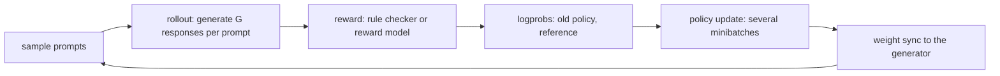

# D8 RL rollout：长尾调度、陈旧度与样本语义

[← 课程索引](../index.md) · [配套 lab8](../../labs/lab8/README.md) · [← D7 MoE 卸载](07-moe-offload.md) · [D9 异构 serving →](09-hetero-serving.md)

> [!abstract] 这一讲要解决的问题
> 你已经熟悉策略梯度和 PPO，本讲关注系统一侧：LLM 后训练一步的时间大多花在生成上，生成长度又有长尾。系统为了把 GPU 用满，会重排、拆分、异步执行，甚至丢弃部分 rollout，这些做法各自改变了训练用的样本分布和重要性权重。本讲先把 GRPO 的组优势、PPO 裁剪梯度的分支、behavior/proximal/current 三个策略的分工推导清楚，再写出异步 RL 的版本界和 partial rollout 的比值选择，最后用一份在 RTX 4060 上实测的 Qwen3-0.6B 长度 trace，量化“保留先完成的 $n$ 条”造成的长度偏差。学完后，你能在 lab8 里用 Rust 实现调度器、陈旧度界、解耦的重要性项和长度预测器，在真实 trace 上同时报告吞吐和分布偏移，并能判断一个 rollout 加速方案是只改了执行顺序，还是改了训练目标。

| 阅读模块                       | 时间  | 必须留下的学习产物                                    | 对应实验        |
| ------------------------------ | ----- | ----------------------------------------------------- | --------------- |
| §1 一步 RL 的时间账            | 30min | makespan 下界、真实 trace 上的组内长尾比              | A5、R1          |
| §2 GRPO 组优势与 Dr. GRPO      | 35min | 两种 std 约定的手算；长度偏差的推导                   | A4              |
| §3 PPO 裁剪目标的梯度          | 40min | 六种情形的梯度表、两个数值反例                        | C3/C4           |
| §4 三个策略与重要性权重        | 30min | AReaL 解耦目标的推导；为什么信赖域中心不该是 behavior | C6              |
| §5 异步 RL 的版本界            | 30min | $\lfloor g/B\rfloor\le v+\eta$ 的推导与对照表         | C1/C2/C5/C7     |
| §6 partial rollout 的正确性    | 25min | 分段轨迹的逐 token 比值；重算 KV 与保留旧 KV 的区别   | B1、C6          |
| §7 选择偏差                    | 35min | 先完成者入选的顺序统计量推导；DARTS 读码卡            | B2/B4、R1       |
| §8 调度：LPT、窃取、预测、尾批 | 35min | LPT 反例、预测器与调度器的 $2\times2$ 归因            | A1–A3/B3、R2/R3 |
| §9 系统全景与代码对应          | 20min | 架构分类表；函数对照表                                | 全部            |
| 前沿与 baseline 对照、研究问题 | 40min | 三篇工作的机制差异卡；一个可证伪假设                  | R               |

**共 5h，另做 lab 约 30h。** 5h 里约 2h 是推导和随堂题（§2–§7），约 40min 是指定的论文图表和源码片段（AReaL §5、DAPO §3、DARTS 的 `RedundancyCounter`），其余论文全文和框架文档是选读。随堂自测的时间已计入上表，先在笔记里写答案，再展开核对要点。

## §1 一步 RL 的时间账

### 1.1 RLHF 与 RLVR 的一步

一步基于生成的 RL 后训练包含以下阶段：

图中各阶段依次是：抽 prompt、每个 prompt 生成 $G$ 条回答、算奖励、算训练所需的 logprob、更新参数、把新权重同步给生成端。

RLHF 的奖励来自奖励模型，PPO 还要一个 critic。RLVR（verifiable reward，比如数学题对答案、代码跑测试）用规则判分，GRPO 去掉了 critic。本讲关心的是 RLVR + GRPO 这一类，因为它的生成最长、长尾最重。

生成为什么占大头：训练是一次前向加一次反向，序列整条并行；生成是逐 token 的自回归 decode，每步只产出一个 token，受显存带宽限制。DAPO 论文提到，同步系统里生成时间由长尾决定，所以多采样不一定拖慢（[DAPO §3.2](https://arxiv.org/abs/2503.14476)）。具体比例取决于模型、长度和框架，必须实测，不能直接搬别人的数字。

### 1.2 同步 rollout 的下界

把一个生成单元（一条回答，或者一次批量生成的一组）看成任务 $i$，在 $W$ 个同速 worker 上需要 $t_i$ 时间，不可抢占。任何排程的完成时间 $T$ 满足

$$
T\ge\max\left(\max_i t_i,\ \frac{1}{W}\sum_i t_i\right).
$$

第一项说的是最长任务不能拆，第二项说的是总工作量要有人做。利用率 $U=\sum_i t_i/(WT)$。

例：4 个 worker，长度 $[700,100,100,100,100,100,100,100]$，总量 1400，平均下界 350，最长下界 700，所以 $U\le 50\%$。这类长尾光靠重排没用，要改变任务粒度（分段、迁移）或改变分布（截断、冗余采样）。后两种做法都会带来 §6、§7 的语义问题。

### 1.3 一份真实 trace 里的长尾

lab8 R 阶段附带一份在本机采集的 trace：Qwen3-0.6B（bf16）对 32 道课程自编的算术应用题各采样 2 轮、每轮一组 8 条，温度 1.0，最多 512 token，一组用一次 `generate`（batch = 组）。这份数据是**直接采样得到的，不来自 GRPO 训练**，权重没有更新过。实测（RTX 4060 Laptop，驱动 566.24，2026-10-18）：

| 量                                    | 数值                                        |
| ------------------------------------- | ------------------------------------------- |
| 回答长度 p10 / p50 / p90 / max        | 130 / 208.5 / 312 / 512 token               |
| 组内最长与组内中位数之比（p50 / p90） | 1.26 / 1.49                                 |
| 静态 batch 中槽位空等的比例           | 21%（每组 $1-\bar\ell/\ell_{\max}$ 的平均） |
| decode 每步中位数                     | 26.2 ms（batch 8）                          |
| 正确率；正确与错误回答的平均长度      | 82%；214 与 238 token                       |

一组 8 条放在同一个 batch 里时，整组要等最长那条结束，所以每组约有 21% 的槽位时间在空转。错误回答平均更长，§7 会用到这一点。

> [!question] 随堂自测 D8-1：下界与空转
>
> 1. 两个同速 worker 执行 $[8,3,3,2]$，任务不可拆。求下界、一个达到下界的分配，并判断一份声称 $T=7$ 的结果可不可信。
> 2. 一组 8 条回答的长度为 $[100,110,120,130,140,150,160,400]$，放在一个静态 batch 里生成。槽位空转比例是多少？如果系统在第 7 条结束时把最后一条“截掉”，节省了多少步、改变了什么？

> [!tip]- 核对要点
>
> 1. 总量 16，最长 8，下界 8；$[8]$ 与 $[3,3,2]$ 达到下界。$T=7$ 低于下界，与前提矛盾，要查单位、是否漏任务或是否允许了拆分。
> 2. 平均长度 163.75，空转比例 $1-163.75/400\approx 59\%$。在第 7 条结束（160 步）时截掉，能省 240 步，但被截掉的是最长的回答。训练集里少了长回答，下游算出的组优势和长度分布都变了，这属于 §7 讲的选择偏差。

## §2 GRPO 的组相对优势

### 2.1 定义与推导

GRPO（[DeepSeekMath §4.1.2](https://arxiv.org/abs/2402.03300)）对同一个 prompt 采样 $G$ 条回答 $o_1,\ldots,o_G$，得到奖励 $r_1,\ldots,r_G$，用组内归一化代替 critic：

$$
\hat A_{i,t}=\tilde r_i=\frac{r_i-\operatorname{mean}(\mathbf r)}{\operatorname{std}(\mathbf r)},
$$

同一条回答的所有 token 共享这个优势。原式的目标是

$$
J(\theta)=\frac1G\sum_{i=1}^G\frac1{\lvert o_i\rvert}\sum_{t=1}^{\lvert o_i\rvert}\min\left(\rho_{i,t}\hat A_{i,t},\ \operatorname{clip}(\rho_{i,t},1-\epsilon,1+\epsilon)\hat A_{i,t}\right)-\beta\,\mathrm{KL},
$$

其中 $\rho_{i,t}=\pi_\theta(o_{i,t}\mid q,o_{i,<t})/\pi_{\theta_{\text{old}}}(o_{i,t}\mid q,o_{i,<t})$。

减均值的作用是基线：$\mathbb E[\nabla\log\pi\cdot b]=0$，所以减去任何与动作无关的 $b$ 不改变梯度期望，只降低方差。组均值依赖同组的其他样本，严格说它和 $o_i$ 不独立，带来 $O(1/G)$ 的偏差。RLOO 用“除自己以外的均值”消除这一点，[RLHF Book](https://rlhfbook.com/c/11-policy-gradients) 式 36–38 指出 Dr. GRPO 与 RLOO 只差一个因子 $G/(G-1)$。

### 2.2 标准差的约定

“std”有两种：总体 std 除以 $G$，样本 std 除以 $G-1$。主流实现都用样本 std：

| 实现     | 约定                                                                                                 | 位置                                                                                                                                                                           |
| -------- | ---------------------------------------------------------------------------------------------------- | ------------------------------------------------------------------------------------------------------------------------------------------------------------------------------ |
| verl     | `torch.std`（无偏）+ `epsilon=1e-6`；单元素组 std 设为 1；`norm_adv_by_std_in_grpo=False` 时只减均值 | [`core_algos.py` @18cfb74](https://github.com/verl-project/verl/blob/18cfb74852a053a27dcf301d3318a093be81b628/verl/trainer/ppo/core_algos.py) `compute_grpo_outcome_advantage` |
| TRL 1.16 | `nanstd`（Bessel 校正），分母加 `1e-4`；`scale_rewards` 取 `"group"`（默认）、`"batch"` 或 `"none"`  | [GRPOTrainer 文档](https://huggingface.co/docs/trl/main/en/grpo_trainer)                                                                                                       |
| CS336 A5 | 要求用默认的 `torch.std`；`advantage_eps` 默认 1e-6                                                  | [assignment5-alignment](https://github.com/stanford-cs336/assignment5-alignment)                                                                                               |

奖励 $[0,1]$ 用总体 std 得优势 $\pm1$，用样本 std 得 $\pm1/\sqrt2\approx\pm0.707$。lab A4 两种都要求实现，用 `bessel` 参数切换，C 阶段的 bandit 用总体约定。

### 2.3 Dr. GRPO 的两个偏差

[Dr. GRPO（COLM 2025）](https://arxiv.org/abs/2503.20783) §3.1–3.2 指出原式有两处偏差。

**长度偏差。** 看单条回答对目标的贡献：$\frac1{\lvert o_i\rvert}\sum_t\rho_{i,t}\hat A_i$。在 $\rho=1$ 处，每个 token 的梯度权重是 $\hat A_i/\lvert o_i\rvert$。

- 若 $\hat A_i>0$，越短的回答每个 token 的权重越大，模型被推向“短而对”。
- 若 $\hat A_i<0$，越长的回答每个 token 受罚越轻，错误回答没有被有效压短，反而越写越长。

**难度偏差。** 除以组内 std 时，奖励方差小的题（几乎全对或几乎全错）权重被放大。

修正办法是两项都去掉：不除 $\lvert o_i\rvert$（改成除以常数），不除 std。这等价于用无偏基线做 Monte Carlo 策略梯度。

loss 怎么聚合也决定长度怎么被加权。TRL 的 `loss_type`：`"grpo"` 按序列长度归一化（文档不推荐）；`"dr_grpo"` 除以常数 $L\cdot G$，$L$ 为 `max_completion_length`；`"dapo"`（当前默认）除以全局累积 batch 的有效 token 数；`"bnpo"` 除以本地 batch 的有效 token 数。verl 用 `loss_agg_mode` 选 `token-mean`、`seq-mean-token-sum`、`seq-mean-token-mean` 或 `seq-mean-token-sum-norm`。比较两个 RL 系统的“长度变化”时，先核对这一项。

> [!question] 随堂自测 D8-2：std 与长度权重
>
> 1. 奖励 $[0,0,1,1]$，分别用总体 std 和样本 std 算优势。
> 2. 一组两条回答，长度 10 和 100，奖励 1 和 0。在 $\rho=1$ 处，按原式（除 $\lvert o_i\rvert$）每个 token 的梯度权重各是多少？按 Dr. GRPO（除以常数 $L=100$、不除 std）又是多少？

> [!tip]- 核对要点
>
> 1. 均值 0.5，总体方差 0.25、std 0.5，优势 $[-1,-1,1,1]$；样本方差 $1/3$，std $\approx0.577$，优势 $\approx[-0.866,-0.866,0.866,0.866]$。
> 2. 总体 std 下优势 $\pm1$。原式：短的正确回答每 token $+1/10=0.1$，长的错误回答每 token $-1/100=-0.01$，错误回答的惩罚被摊薄到十分之一。Dr. GRPO：优势 $\pm0.5$（不除 std），每 token 都是 $\pm0.5/100=\pm0.005$，长短一视同仁。

## §3 PPO 裁剪目标的梯度

### 3.1 按优势符号和比值区间分情形

单样本的裁剪目标是 $J=\min(\rho A,\ \operatorname{clip}(\rho,1-\epsilon,1+\epsilon)A)$，$\nabla_\theta\rho=\rho\,\nabla_\theta\log\pi_\theta$。

**$A>0$ 时**，$J=A\cdot\min(\rho,\operatorname{clip}(\rho))$。若 $\rho\le1+\epsilon$，那么 $\operatorname{clip}(\rho)\ge\rho$（$\rho<1-\epsilon$ 时 clip 得 $1-\epsilon>\rho$），最小值取 $\rho$，梯度为 $\rho A\nabla\log\pi$。若 $\rho>1+\epsilon$，最小值取常数 $1+\epsilon$，梯度为 0。

**$A<0$ 时**，$J=A\cdot\max(\rho,\operatorname{clip}(\rho))$。若 $\rho\ge1-\epsilon$，最大值取 $\rho$，梯度非零；若 $\rho<1-\epsilon$，最大值取常数 $1-\epsilon$，梯度为 0。

汇总成表（$\rho$ 在信赖域内的两行合并为情形 1/2）：

| 情形 | $\rho$ 区间               | $A$   | 取哪一支                | 梯度                   |
| ---- | ------------------------- | ----- | ----------------------- | ---------------------- |
| 1/2  | $[1-\epsilon,1+\epsilon]$ | $\pm$ | 未裁剪                  | $\rho A\nabla\log\pi$  |
| 3    | $<1-\epsilon$             | $>0$  | 未裁剪（$\rho A$ 更小） | 非零，把概率往回拉     |
| 4    | $<1-\epsilon$             | $<0$  | 常数 $(1-\epsilon)A$    | 0                      |
| 5    | $>1+\epsilon$             | $>0$  | 常数 $(1+\epsilon)A$    | 0                      |
| 6    | $>1+\epsilon$             | $<0$  | 未裁剪                  | 非零，且随 $\rho$ 无界 |

裁剪只在“继续往有利方向走”的一侧把梯度切掉（情形 4、5）。走错方向时（情形 3、6）梯度保留，用来纠正。所以“$\rho$ 越界就零梯度”是一个常见的错误实现。

情形 6 的梯度随 $\rho$ 无上界：behavior 策略很不可能采到的 token，在当前策略下概率变大、又是负优势时，会产生很大的更新。dual-clip 在 $A<0$ 时再取一次 $\max(\cdot,\,cA)$，把 $\rho>c$ 的部分截成常数。verl 的 `clip_ratio_c` 默认 3.0（[`compute_policy_loss`](https://github.com/verl-project/verl/blob/18cfb74852a053a27dcf301d3318a093be81b628/verl/trainer/ppo/core_algos.py)），DARTS 的 Qwen3 脚本设为 10.0。DAPO 的 Clip-Higher 把上下界拆成 $\epsilon_{\text{low}}=0.2$、$\epsilon_{\text{high}}=0.28$。

> [!example] 看图：裁剪目标在哪一侧变平
> 看 [PPO 原论文图 1（PDF 第 3 页）](https://arxiv.org/pdf/1707.06347#page=3)，左图 $A>0$，右图 $A<0$，横轴是 $\rho$。在 0.8 和 1.2 处画竖线，把平坦段对应到上表的情形 4、5。[HF Deep RL Course Unit 8](https://huggingface.co/learn/deep-rl-course/unit8/visualize) 有同一张六情形表。这两张图是单样本目标的函数图像，不是训练曲线。

### 3.2 lab8 的 bandit 和两个数值反例

lab8 C 阶段的策略是 4 个 context、两个动作，每个 context 一个 logit $z_c$，$p_c=\sigma(z_c)$ 为选动作 1 的概率。对 Bernoulli 策略，$\partial\log\pi(a)/\partial z=a-p$，所以活跃分支上单样本的梯度为 $\rho A(a-p)$。

旧版测试只在 $z=0$、behavior $p=0.5$ 处检查，此时 $\rho=1$，漏乘 $\rho$ 的实现也能通过；裁剪用例里两个样本又恰好都在情形 4、5，“越界即零梯度”也能通过。新的 `c_gradient` 用下面两个用例堵住这两个漏洞（behavior $p=0.5$，$\epsilon=0.2$，两个样本动作 $[1,0]$）：

**用例一：$\rho\ne1$、未裁剪。** $z=0.3$，$p=0.5744$，奖励 $[1,0]$，总体 std 下 $A=[+1,-1]$。$\rho_1=p/0.5=1.149$，$\rho_0=(1-p)/0.5=0.851$，都在区间内。

$$
\frac{\partial J}{\partial z}=\frac12\Big[\rho_1\cdot(+1)(1-p)+\rho_0\cdot(-1)(0-p)\Big]=\frac12\big[2p(1-p)+2p(1-p)\big]=2p(1-p)=0.4889.
$$

漏乘 $\rho$ 得 $\frac12[(1-p)+p]=0.5$。

**用例二：情形 6 加情形 3。** $z=3$，$p=0.9526$，奖励 $[0,1]$，$A=[-1,+1]$。动作 1：$\rho_1=1.905>1.2$、$A<0$，活跃；动作 0：$\rho_0=0.0949<0.8$、$A>0$，活跃。

$$
\frac{\partial J}{\partial z}=\frac12\Big[1.905\cdot(-1)(1-p)+0.0949\cdot(+1)(0-p)\Big]=-2p(1-p)=-0.0903.
$$

学习率 0.2 时 $z$ 应变为 $2.9819$；“越界即零”的实现停在 3.0。

测试不再对手写的闭式做差分，而是对学生自己实现的 `objective` 做中心差分，再和 `update` 的步长比较；目标值本身另用一个独立的闭式核对。

> [!question] 随堂自测 D8-3：裁剪分支
>
> 1. $\epsilon=0.2$、$\rho=1.5$。分别令 $A=2$ 和 $A=-2$，求目标值和 $\partial J/\partial\rho$。
> 2. 用例二若改为奖励 $[1,0]$（$A=[+1,-1]$），两个样本各落在哪个情形？平均梯度是多少？
> 3. 加上 dual-clip $c=3$ 后，$A=-1$、$\rho=5$ 的样本的目标值和梯度各是多少？

> [!tip]- 核对要点
>
> 1. $A=2$：$\min(3,\,2.4)=2.4$，导数 0（情形 5）。$A=-2$：$\min(-3,\,-2.4)=-3$，导数 $-2$（情形 6，活跃）。
> 2. 动作 1：$\rho=1.905$、$A>0$，情形 5；动作 0：$\rho=0.095$、$A<0$，情形 4。两个都在常数支，平均梯度 0。
> 3. 原目标 $\min(-5,-1.2)=-5$；dual-clip 取 $\max(-5,\,3\cdot(-1))=-3$，是常数，梯度 0。

## §4 behavior、proximal、current 三个策略

### 4.1 为什么要分三个

同步 PPO 里，采样用的策略 $\pi_{\text{old}}$ 同时承担两个角色：重要性采样的分母（behavior），和信赖域的中心（proximal）。异步系统里样本来自若干个旧版本，这两个角色就分开了。

[AReaL（NeurIPS 2025）](https://arxiv.org/abs/2505.24298) §5.2 的解耦 PPO 目标为

$$
J(\theta)=\mathbb E_{a\sim\pi_{\text{behav}}}\left[\sum_t\frac{\pi_{\text{prox}}(a_t)}{\pi_{\text{behav}}(a_t)}\min\Big(u_t\hat A_t,\ \operatorname{clip}(u_t,1-\epsilon,1+\epsilon)\hat A_t\Big)\right],\qquad u_t=\frac{\pi_\theta(a_t)}{\pi_{\text{prox}}(a_t)}.
$$

- $w_t=\pi_{\text{prox}}/\pi_{\text{behav}}$ 是重要性权重，修正“样本来自旧策略”这件事，不参与裁剪。
- $u_t$ 是信赖域比值，中心是 $\pi_{\text{prox}}$。AReaL 取“本次更新前的参数”，在训练端重算 token 概率。
- 论文给出的理由：若把 behavior 当成 proximal，裁剪会把最新策略拉回旧的、质量更差的策略附近。

验证这个式子在 $\pi_{\text{prox}}=\pi_{\text{behav}}$ 时退化为普通 PPO：$w_t=1$，$u_t=\pi_\theta/\pi_{\text{old}}$。

### 4.2 训推不一致：即使同步也有两个策略

[verl rollout correction](https://github.com/verl-project/verl/blob/18cfb74852a053a27dcf301d3318a093be81b628/docs/algo/rollout_corr.md) 把三者叫作 $\pi_{\text{rollout}}$、$\pi_{\text{old}}$、$\pi_\theta$。文档强调，即使完全同步，rollout 引擎（vLLM/SGLang，bf16、不同 kernel）算出的概率也和训练引擎不同，$\pi_{\text{rollout}}\ne\pi_{\text{old}}$。decoupled 模式用 $\pi_{\text{old}}/\pi_{\text{rollout}}$ 修正，阈值 `rollout_is_threshold: 2.0` 做截断（TIS）；bypass 模式令 $\pi_{\text{old}}=\pi_{\text{rollout}}$。TRL 在 `use_vllm=True` 时用 `vllm_importance_sampling_correction` 处理同一问题。

lab C6 的 `decoupled_terms` 对每个 token 返回 $(w_t,u_t)$。测试同时检查 $w_t u_t=\pi_\theta/\pi_{\text{behav}}$，以及 $\pi_{\text{prox}}=\pi_{\text{behav}}$ 时 $w=u=1$。

> [!question] 随堂自测 D8-4：三个策略
>
> 1. 某 token 的 $\pi_{\text{behav}}=0.2$、$\pi_{\text{prox}}=0.3$、$\pi_\theta=0.39$，$\epsilon=0.2$、$\hat A=+1$。求 $w$、$u$、该 token 对目标的贡献和是否被裁剪。若错误地用 behavior 作信赖域中心，比值是多少、是否被裁剪？
> 2. verl 文档说同步训练也需要 rollout correction。用一句话解释为什么。

> [!tip]- 核对要点
>
> 1. $w=1.5$，$u=1.3>1.2$ 且 $A>0$，被裁剪，贡献 $1.5\times1.2=1.8$，对 $\theta$ 梯度为 0。若以 behavior 为中心，比值 $0.39/0.2=1.95$，同样裁剪，但贡献是 $1.2$。两种写法的数值和裁剪边界都不一样：以 behavior 为中心时，信赖域围着一个更旧的策略画。
> 2. 生成引擎和训练引擎的数值实现不同（精度、kernel、batch 形状），同一参数下给出的 token 概率也不同，采样分布与训练端的 $\pi_{\text{old}}$ 不是一回事。

## §5 异步 RL 的版本界

### 5.1 AReaL 的 $\eta$ 界

设 trainer 按提交顺序消费轨迹，每次更新用 $B$ 条，第 $k$ 批（从 0 计）在版本 $k$ 上训练。生成端已经提交了 $g$ 条，当前持有版本 $v$ 的权重。下一条的编号是 $g$，会在版本 $\lfloor g/B\rfloor$ 被训练，陈旧度为 $\lfloor g/B\rfloor-v$。要求它不超过 $\eta$：

$$
\left\lfloor\frac{g}{B}\right\rfloor\le v+\eta.
$$

这就是 AReaL §5.1 的条件 $\lfloor(N_r-1)/B\rfloor\le i+\eta$（$N_r$ 含这条新请求，$i$ 是当前版本）。$\eta=0$ 退化为同步 RL；论文实验取 $\eta=4$（代码）和 $\eta=8$（数学）。可中断生成时，同一条轨迹后面的 token 来自更新的版本，陈旧度只会更小，界仍成立。

lab C5 的 `may_submit(generated, batch, version, eta)` 实现这个条件。测试里有一个生产者-训练者模拟器：生产者在允许时尽量提交，训练者每 tick 消费一批。检查两件事：最大陈旧度**恰好等于** $\eta$（更严格的规则浪费了重叠，更松的规则越界），以及不死锁。`<` 写成 `<=` 的 off-by-one 两个方向都会被抓到：写成 `<` 时 $\eta=0$ 永远不能提交；右边多加 1 时陈旧度到 $\eta+1$。

### 5.2 各系统的“陈旧度”不能互换

| 系统                            | 定义                                                                                                                                                                                      | 类别     |
| ------------------------------- | ----------------------------------------------------------------------------------------------------------------------------------------------------------------------------------------- | -------- |
| AReaL                           | 生成端准入：$\lfloor(N_r-1)/B\rfloor\le i+\eta$；trainer 优先用旧轨迹                                                                                                                     | 深度界   |
| verl fully_async                | `staleness_threshold` 是允许的陈旧样本**比例**，0 为同步；两次参数更新之间最多生成 $(1+s)\cdot\text{trigger\_sync}\cdot\text{require\_batches}\cdot\text{mini\_bsz}-\text{num\_stale}$ 条 | 比例     |
| Laminar                         | 陈旧度 = 轨迹完成时的版本 $M$ 减去生成它的版本 $K$，由运行自然产生，不是超参                                                                                                              | 观测量   |
| PipelineRL、NeMo-RL、TorchForge | `max_lag` / `max_trajectory_age_steps` / `max_policy_age`，超龄即拒绝                                                                                                                     | 版本拒绝 |
| lab8 C1/C2                      | 整数 `max_lag`，整组拒绝；队列容量按 group 计                                                                                                                                             | 版本拒绝 |

[HF 博客 Keep the Tokens Flowing](https://huggingface.co/blog/async-rl-training-landscape) 把陈旧度管理分成三类：版本拒绝、深度界、重要性修正，三者可以组合。verl 的比例阈值和 AReaL 的 $\eta$ 不是同一个量，换框架时不能照搬数值。verl 的 one-step-off 与 fully_async recipe 在最新 release 里标为 deprecated（由 V1 trainer 取代），本讲固定在 commit `18cfb74` 读码。

### 5.3 队列语义：背压与完整组

拒绝陈旧样本发生在两个地方：生成端准入（C5）和训练端出队（C2）。lab C1 的有界队列按 **group** 计容量：新组占一个槽，已占槽的组的后续成员总能进入。若按样本计容量，容量 1、组大小 4 时，第一组只到了一条就占满，剩下三条永远进不来，形成死锁（fault `c1-capacity-per-sample`）。队列满时返回 false，生产者保留样本，等训练者出队后重试，不得覆盖旧样本。

C7 把这些串成闭环：每波从同一快照采 4 组、每组 8 条，经 B3 执行器决定完成顺序，送入队列，训练者更新、版本加一，剩下的组随之变旧。测试用一个可手算的单波例子（容量 2，`max_lag=0`）：前两组进入；第三组遇到背压，训练一组，版本变成 1；第三、四组此时已陈旧，被丢弃（16 条）；最后清空时另一组也被驱逐（8 条）。结果是更新 1 次、丢弃 24 条、背压 1 次。如果循环里没有把新版本告诉队列，就会训练两次。

> [!question] 随堂自测 D8-5：版本界
>
> 1. $B=4$、$\eta=1$，生成端当前版本 $v=0$。最多能先提交多少条？这些条在训练时的陈旧度分别是多少？
> 2. verl 设 `staleness_threshold=0.5` 和 AReaL 设 $\eta=1$，哪个更“陈旧”？能不能直接比较？

> [!tip]- 核对要点
>
> 1. 条件 $\lfloor g/4\rfloor\le1$，即 $g=0,\ldots,7$，共 8 条，全由版本 0 生成。前 4 条在版本 0 训练，陈旧度 0；后 4 条在版本 1 训练，陈旧度 1。
> 2. 不能直接比。verl 的阈值是比例，限制的是两次同步之间多生成多少样本；AReaL 限制的是单条轨迹的版本差。要比较，就在同一负载下测量“训练时的版本差分布”。

## §6 partial rollout 的正确性

### 6.1 分段轨迹与账本

长回答占着生成槽，权重更新时有三种处理办法：等它生成完（同步）、中断后续写、或者丢弃重来。中断续写的办法里，一条轨迹由若干段组成，每段可能出自不同版本。要能续写，至少要保存请求和组的 ID、已生成的 token、位置、停止条件、生成版本，以及每个 token 采样时的 logprob。KV 可以保存也可以重算。

lab B1 的 `reassemble` 只验证账本：乱序到达的分段按起点排序，要求从 0 开始、无缺口、无重叠、无空段、身份一致、只有最后一段是终止段。lab 要求整条轨迹版本一致，这比真实系统严格，下面说明为什么混合版本也可以是合法的。

### 6.2 续写后该用哪个比值

AReaL §4.1 的可中断生成在 `update_weights` 时中断所有请求，**丢弃旧 KV，用新权重重算前缀**再续写。Prop. 1 说，任何由 $\pi_{\theta},\ldots,\pi_{\theta+k}$ 分段生成的序列，都等价于某个单一的 $\pi_{\text{behav}}$ 生成的序列。推论是：只要逐 token 记录采样时实际用的概率，重要性比值 $\pi_\theta(a_t)/\pi_{v(t)}(a_t)$ 就有定义，其中 $v(t)$ 是采样第 $t$ 个 token 的版本。

例：一条轨迹的前两个 token 由 $v_5$ 采样，被中断后用 $v_6$ 续写两个 token，训练时 $\pi_{\text{prox}}=v_7$。

| token | 采样版本 | $w_t$ 的分母     | 常见错误                                    |
| ----- | -------- | ---------------- | ------------------------------------------- |
| 0, 1  | $v_5$    | $\pi_{v_5}(a_t)$ | 用整条轨迹的“首段版本”或“末段版本”统一代替  |
| 2, 3  | $v_6$    | $\pi_{v_6}(a_t)$ | 用 $\pi_{\text{prox}}$ 代替（等于不做修正） |

lab C6 的测试就用这个例子，逐 token 比较 $w_t$ 和 $u_t$。版本字段要细到每个 segment 或每个 token，只记一个轨迹版本是不够的。

### 6.3 重算 KV 与保留旧 KV

| 语义                              | 代表                                                               | 续写 token 的条件分布                                                |
| --------------------------------- | ------------------------------------------------------------------ | -------------------------------------------------------------------- |
| 重算 KV                           | AReaL                                                              | 完全来自新版本                                                       |
| 保留旧 KV、换权重继续             | [PipelineRL](https://arxiv.org/abs/2509.19128) in-flight 更新      | “新权重 + 旧版本算出的 KV”，不等于任何单一版本的 $\pi$               |
| 保存 token 与 logprob，同步后续写 | verl fully_async 模式 d；OpenRLHF `--train.partial_rollout_enable` | 取决于续写时是否重算前缀                                             |
| 截断后下一轮续写                  | [Kimi k1.5](https://arxiv.org/abs/2501.12599) §2.6.2               | 跨迭代，版本差更大                                                   |
| 续写但不做 IS 修正                | [APRIL](https://arxiv.org/abs/2509.18521)                          | 批内混合 $\pi_{k+1},\pi_k,\ldots$，经验上稳定，未见跨越超过 5 个版本 |

保留旧 KV 时，只要记录了真实采样的 logprob，重要性比值仍然成立。但 trainer 用完整前向重算的 $\pi_{\text{old}}$ 会和采样时的概率不一致。OpenRLHF README 写明 in-flight 样本可能混有新旧权重的 token，建议配合 token 级 IS 修正。这种不一致有多大，没有找到专门量化的论文，见研究问题 (c)。

> [!question] 随堂自测 D8-6：续写的比值
>
> 1. 一条轨迹在版本 3 生成 100 token，中断后在版本 4 续写 50 token，在版本 5 训练（$\pi_{\text{prox}}=v_5$）。前 100 个 token 和后 50 个 token 的 $w_t$ 分母分别是什么？如果系统只存了一个 `policy_version=4`，会错在哪？
> 2. 举一个 lab B1 能通过、但真实续写不等价于不中断生成的情况，说明缺了什么状态。

> [!tip]- 核对要点
>
> 1. 前 100 个用 $\pi_{v_3}$，后 50 个用 $\pi_{v_4}$。只存 4 时，前 100 个 token 的分母被当成 $\pi_{v_4}$，修正量错了；若系统把采样时的 logprob 逐 token 存下来，就不需要知道版本也能算对。
> 2. 分段的位置、身份都对，但续写时没有恢复 RNG，或者用了旧版本的 KV 却声称是新版本生成。B1 只保证账本连续，不保证采样过程等价。

## §7 选择偏差：哪些加速改变了训练分布

### 7.1 固定样本集合 vs 事后选样

只改执行顺序（LPT、窃取、分段），预选的样本集合不变。下面这些做法都改变了训练分布，评估时不能只看吞吐：

- **丢掉慢的样本或组**。lab B2 `training_ready` 要求完成集合与预选 ID 集合完全一致：只训练先完成的组时，每组人数看上去都完整，但 batch 已经变了。
- **冗余采样，保留先完成的 $n$ 条**（DARTS 的代码实现）。
- **条件化采样**：DAPO Dynamic Sampling 只保留 $0<\text{acc}<1$ 的组，过采样直到填满（[DAPO](https://arxiv.org/abs/2503.14476) Eq. 11），目标变成条件期望，prompt 分布也变了。
- **按长度屏蔽或惩罚**：DAPO Overlong Filtering 屏蔽截断样本的 loss；Soft Overlong Punishment 在 $L_{\max}-L_{\text{cache}}<\lvert y\rvert\le L_{\max}$ 区间线性罚分（论文取 $L_{\max}=16384$、$L_{\text{cache}}=4096$）。TRL 的 `mask_truncated_completions` 默认关闭。
- **按长度推迟**：RollPacker 的 tail batching 把未完成的长 prompt 推迟到专门的 long round，作者称保持同步 on-policy；但 batch 组成与时间相关，带来 curriculum 效应，需要另外检验。
- **刻意重采样**：QLPO 先生成 $K$ 条，再按“正确/错误 $\times$ 长/短”四个象限重采样出 $M$ 条，保持对错比例、偏好短的对和长的错。偏差是设计出来的，目的就是压缩长度。
- **重新生成**：TailSieve 对被选中的 prompt 用当前策略重新生成，避免额外的长度偏差。

### 7.2 先完成者入选是顺序统计量

一组生成 $m$ 条，保留最先完成的 $n$ 条。若完成时间随长度单调增加（静态 batch 里正是如此），保留下来的就是长度最短的 $n$ 条，即前 $n$ 个顺序统计量。

可手算的例子（lab B4 的精确 oracle）：$m=3$，长度在 $\{1,2,3\}$ 上独立均匀，完成时间等于长度，奖励为 $[\ell\ge2]$，保留 $n=2$。

$$
\mathbb E[\max]=\sum_{k\ge1}\Pr(\max\ge k)=1+\left(1-\tfrac1{27}\right)+\left(1-\tfrac8{27}\right)=\frac83,
$$

保留的平均长度为 $(\mathbb E[\text{sum}]-\mathbb E[\max])/2=(6-8/3)/2=5/3$，全体为 2。被丢弃的那条奖励为 1，除非三条都是 1（概率 $1/27$），所以保留的平均奖励为 $(3\cdot\frac23-\frac{26}{27})/2=14/27\approx0.519$，全体为 $2/3$。

只要长度和奖励相关，偏差就从长度传到奖励，再传到组优势。在 §1.3 的 trace 里，错误回答平均更长（238 对 214 token），所以保留先完成的回答会偏向正确回答，也偏向短回答。

### 7.3 真实 trace 上的偏移

R 阶段在 trace 上回放（4 个 worker，每个 worker 一次跑一组，一组的耗时取保留样本中最大的 `gen_ms`；这是用实测时间建模，不是实测的系统吞吐）：

| 策略                       | 保留样本 | 两轮总时长 |   保留回答平均长度 | 平均奖励 | 优势全为 0 的组 |
| -------------------------- | -------: | ---------: | -----------------: | -------: | --------------: |
| 全部 8 条                  |      512 |    132.2 s |              218.5 |    0.820 |         28 / 64 |
| 先完成的 4 条（冗余 2 倍） |      256 |     99.4 s | 190.3（$-12.9\%$） |    0.813 |         36 / 64 |
| 编号前 4 条（无偏子集）    |      256 |    122.0 s |  221.1（$+1.2\%$） |    0.816 |         36 / 64 |

同样保留 256 条，先完成者入选比无偏子集快 18.5%，代价是回答长度短了 12.9%。优势全为 0 的组从 28 增到 36，在两种子集里一样多，原因是组从 8 条变成 4 条后更容易全对，而不是选择偏差。在这份 trace 上奖励的偏移很小（0.813 对 0.816），不能据此推断大模型上也小。lab R1 的测试要求报告保留样本和全体样本两套统计，fault `r1-keep-first-shift-not-reported` 只报告全体均值，会被测试抓到。

### 7.4 读码：DARTS 的冗余采样在哪里

[DARTS（ICML 2026）](https://arxiv.org/abs/2605.30859) 研究组内长尾，从冗余候选里取样，并自适应分配冗余度，报告最高 1.77 倍加速，作者称不损失模型性能。这是经验结论。读 [PKU-DAIR/DARTS @e07825a](https://github.com/PKU-DAIR/DARTS/tree/e07825aee39612e0659ce7e5a38f8ae02a2250b2) 时注意区分继承代码和论文新增代码：

- `OneStepOffRayTrainer`、`sync_rollout_weights`、`_async_gen_next_batch` 都在 `darts/recipe/darts/ray_trainer.py`，是从 verl one-step-off recipe 继承的基础设施（DARTS 版本里 `_async_gen_next_batch` 是同步的 `def`）。上游 verl `18cfb74` 的 `OneStepOffRayTrainer` 在 `verl/experimental/one_step_off_policy/ray_trainer.py`，那里没有 `sync_rollout_weights` 方法，改用 `_fit_update_weights()`，只保留了同名的 timer 标签。
- 论文的核心在 [`ray_trainer_darts.py`](https://github.com/PKU-DAIR/DARTS/blob/e07825aee39612e0659ce7e5a38f8ae02a2250b2/darts/recipe/darts/ray_trainer_darts.py)：`RayTrainerDarts`、`ScoreFilter`（docstring 写的是 EMA，`update` 实际做的是累计均值，`alpha` 没有被用到）、`dynamic_batch_reorder`（对历史平均长度做 LPT，和 lab A3 同构，但在 `fit` 里的调用被注释掉了），以及冗余分配（`ResourceOptimizer(cur_variance, total_m, min_m=10, max_m=10)` 配合 `avg_r=10`：当 batch 能被 8 整除时，每个 prompt 都分到 10，自适应实际上退化成常数）。
- `recipe/darts/solver.py` 的 `ResourceOptimizer.optimize` 按边际收益 $v/m$ 贪心。
- `verl/workers/rollout/vllm_rollout/vllm_async_server.py` 的 `RedundancyCounter` 实现“前 $n$ 条完成即保留，其余 abort”，`long_num` 可额外保留若干条长尾。这就是 §7.2 的顺序统计量选择。
- 仓库现状：README 写的文件路径与实际不符；`main_ppo.py` import 了 `ray_trainer_stream` 和 `ray_trainer_stream2`，仓库里只有它们的 `.pyc`、没有 `.py`，Python 不会从 `__pycache__` 导入无源模块，**这个 commit 按原样跑不起来**。本讲只要求读码，不要求复现。

> [!question] 随堂自测 D8-7：选择偏差
>
> 1. $m=2$，长度在 $\{1,2\}$ 上独立均匀，完成时间等于长度，保留 $n=1$。保留回答的期望长度是多少？
> 2. 表中“先完成的 4 条”比“编号前 4 条”快 18.5%。写一句可以放进论文的结论，同时写清这个数字的口径。
> 3. RollPacker 说 tail batching“只改顺序”。在什么意义上成立，在什么意义上不成立？

> [!tip]- 核对要点
>
> 1. 保留的是最小值。$\mathbb E[\min]=1+\Pr(\min\ge2)=1+1/4=1.25$，全体期望 1.5。
> 2. 例如：“在 Qwen3-0.6B、batch = 组的静态生成下，冗余 2 倍并保留先完成的 4 条，比随机保留 4 条的回放总时长少 18.5%，同时保留回答的平均长度短 12.9%（modeled from measured `gen_ms`，4 个 worker）。”口径要写明：用实测的单样本完成时间建模、不含 abort 和迁移成本、样本数相同。
> 3. 在一轮内的 prompt 集合固定、每个 prompt 的回答都会训练这个意义上成立。但长 prompt 被推迟到后面的 long round，哪个 prompt 在哪一步、用哪个版本训练跟长度有关，形成按长度排序的 curriculum，这一点不成立。

## §8 调度：LPT、窃取、长度预测与尾批

### 8.1 List scheduling 与 LPT

list scheduling 把每个任务交给当前负载最小的 worker，保证 $T\le(2-1/W)\,\text{OPT}$。LPT 先按长度降序排序，界改进到 $(4/3-1/(3W))\,\text{OPT}$（Graham 1969）。两个界都假设长度已知。

LPT 不是最优：$[3,3,2,2,2]$ 两个 worker，LPT 得到 7，最优划分 $\{3,3\}$ 与 $\{2,2,2\}$ 得 6。它也不总比输入顺序好：$[2,3,2,3,2]$ 按输入顺序得队列 $[0,2,4]$ 与 $[1,3]$，负载 6/6；LPT 得 $[1,0,4]$ 与 $[3,2]$，负载 7/5。lab A3 的测试用的就是这个**未排序**的输入，并且断言两种模式的精确队列和按 ID 的 tie-break。旧版测试用的 $[3,3,2,2,2]$ 本身已经降序，忽略 `lpt` 标志也能通过。

### 8.2 静态分配、拉取与窃取

| 方式         | 何时决定               | 用到的信息             | lab                   |
| ------------ | ---------------------- | ---------------------- | --------------------- |
| 静态 LPT     | 开始前一次分完         | 预测长度               | A3、R `lpt_predicted` |
| 共享队列拉取 | worker 空闲时取下一个  | 顺序（可按预测排序）   | R `fifo`、`lpt_pull`  |
| 工作窃取     | 空闲时从最长队列尾部偷 | 队列长度，不看真实长度 | B3、R `work_stealing` |
| 分段 + 迁移  | 每个 quantum 后        | 已生成长度             | B3 的 quantum         |

B3 名为工作窃取，但真实 RL 系统里的长尾处理几乎都是**中心化**的迁移或重新打包：Seer 用全局 KV 池按块迁移，RLHFuse 在剩余样本低于阈值时迁到专用实例，Laminar 按 KV 空闲度 repack，RollPacker 保留 token 后重算 KV 续写。lab 的模型不计迁移成本，这是它和真实系统最大的差别。

### 8.3 长度预测：信息边界和 $2\times2$ 归因

预测器只能用**已完成**的历史。lab A1/A2 维护每类有界窗口的上中位数；R2/R3 是按 prompt 的分位数预测器，没有该 prompt 的历史时退回全局历史。两条信息边界：

- 本轮的真实长度在本轮结束前不能进入预测器（fault `r1-predictor-leaks-future`）。
- 被 abort 的样本从未完成，它的长度系统不知道，也不能被观测（fault `r1-observes-aborted`）。这会让冗余采样下的预测器系统性偏短，是一种删失。

要判断收益来自预测器还是调度器，最少要做 $2\times2$：{旧预测, 新预测} $\times$ {调度 A, 调度 B}，固定任务集合和 worker 数。只改一项才能归因。

在真实 trace 上（两轮，第二轮的预测来自第一轮；4 个 worker；下界 122.1 s）：

| 策略                         |  总时长 | 相对下界 |
| ---------------------------- | ------: | -------: |
| 共享队列拉取（FIFO）         | 132.2 s | $+8.2\%$ |
| 静态 LPT，预测 $q=1$         | 132.4 s | $+8.4\%$ |
| 按预测排序后拉取，$q=1$      | 127.2 s | $+4.2\%$ |
| 工作窃取，预测 $q=0.5$       | 125.6 s | $+2.8\%$ |
| 静态 LPT，真实长度（oracle） | 122.6 s | $+0.3\%$ |

几点观察：第一轮没有历史，所有预测相同，静态 LPT 退化成轮转，反而不如拉取；第二轮的预测来自同一 prompt 的上一轮，两轮组内最长长度的相关系数为 0.82，预测有用但不完美；oracle 与下界几乎重合，说明在这个规模上，剩余差距主要是信息问题而不是调度算法问题。这和综述 [Rollout Efficiency in RL for Reasoning LLMs](https://arxiv.org/abs/2609.25463) 的判断一致：长度已知时 LPT 加最早空闲 worker 已经接近最优，各方法的差别在于用什么信号预测、怎样应对预测误差。

### 8.4 尾批与 partial rollout 作为调度手段

- **RollPacker**（[NSDI 2026](https://arxiv.org/abs/2509.21009)）：起跑 $\eta B$ 个 prompt（$\eta=1.25$），先完成的 $B$ 个组成本轮，未完成的进 tail 队列，攒满 $B$ 个后跑一个专门的 long round。
- **APRIL**（[arXiv 2025](https://arxiv.org/abs/2509.18521)）：过量发请求，凑够目标数就停，未完成的放进 buffer，下一步优先续写；续写 token 约占后续 step token 的 40%，不做 IS 修正。
- **Seer**（OSDI 2026）：同一 prompt 的回答长度相近，先跑一条探针回答估计整组长度；divided rollout 做动态负载均衡，配合全局 KV 池迁移和组内投机解码。
- **TailSieve**（[arXiv 2026](https://arxiv.org/abs/2608.22788)）：论证长度已知时“尾部隔离 + 负载均衡”最优；用 partial rollout 当尾部检测器，不需要预测器。

> [!question] 随堂自测 D8-8：调度与预测
>
> 1. job ID 按输入顺序编号，预测长度 $[2,3,2,3,2]$，两个 worker。手算 input order 与 LPT 的队列和 makespan。
> 2. 一个方案同时换了预测器、又打开了工作窃取，makespan 下降 6%。最少再跑哪两组，才能分开两者的贡献？
> 3. 冗余采样下，预测器只看到先完成的回答。它的预测会偏长还是偏短？对 LPT 有什么影响？

> [!tip]- 核对要点
>
> 1. input order：$[0,2,4]$ 与 $[1,3]$，负载 6/6；LPT：$[1,0,4]$ 与 $[3,2]$，负载 7/5。
> 2. “新预测 + 窃取关”和“旧预测 + 窃取开”，与已有的两组组成 $2\times2$，保持任务集合、worker 数和随机种子一致。
> 3. 偏短，因为被 abort 的长回答从未进入历史。所有 prompt 都偏短时排序可能不变，但偏短的程度和 prompt 的长尾程度有关：长尾越重的 prompt 被低估得越多，LPT 会把它们排得太靠后。

## §9 系统全景与代码对应

### 9.1 架构分类

| 维度             | 选项                                        | 代表                                                   |
| ---------------- | ------------------------------------------- | ------------------------------------------------------ |
| 生成与训练的放置 | 同卡交替（colocate）、分离（disaggregated） | verl HybridEngine 同卡；StreamRL、Laminar、AReaL 分离  |
| 同步程度         | 同步、one-step-off、完全异步                | verl 同步与 one-step-off；AReaL、LlamaRL、Laminar 异步 |
| 编程模型         | 单控制器、多控制器、混合                    | HybridFlow 混合；LlamaRL 单控制器                      |
| 长尾处理         | 重排、迁移、分段、冗余、投机                | RollPacker、Seer、APRIL、DARTS、DAS                    |
| 资源             | 同构、异构、跨集群                          | StreamRL 异构；Weave 跨集群                            |

> [!example] 看图：控制器与 worker
> 打开 [verl HybridFlow 指南的 Overall Execution Diagram](https://verl.readthedocs.io/en/latest/hybrid_flow.html#overall-execution-diagram)，沿 controller、generator、controller 的箭头追踪一批数据，标出应该记录 batch ID 和 policy version 的边界。再看 [verl fully_async 文档](https://verl.readthedocs.io/en/latest/advance/fully_async.html) 的四种模式图（a 同步、b 流式、c 陈旧样本、d partial rollout），说明每种模式下 §4 的三个策略分别是哪个版本。

### 9.2 机制与 lab 函数对照

| 机制或公式              | lab 中的函数                            | 上游实现位置（固定版本）                         | 本 lab 简化了什么        |
| ----------------------- | --------------------------------------- | ------------------------------------------------ | ------------------------ |
| 有界长度历史、上中位数  | `LengthModel::observe/predict`（A1/A2） | DARTS `ScoreFilter`（累计均值）                  | 按类，不按 prompt        |
| list scheduling / LPT   | `assign`（A3）                          | DARTS `dynamic_batch_reorder`（调用被注释）      | 同速 worker              |
| 组优势（两种 std）      | `advantages`（A4）                      | verl `compute_grpo_outcome_advantage` @18cfb74   | 无 epsilon，常数组返回 0 |
| 快照采样、behavior 概率 | `Policy::sample`（A6）                  | CS336 A5 adapter                                 | 两动作 bandit            |
| 分段账本                | `reassemble`（B1）                      | verl fully_async 模式 d、slime `sample.metadata` | 只验账本，无 KV/RNG      |
| 完整 batch              | `training_ready`（B2）                  | verl `wait_for_enough_samples`                   | 预选 ID 集合             |
| 分段 + 窃取执行器       | `schedule`（B3）                        | Seer/RLHFuse 的迁移                              | 无迁移成本               |
| 先完成者入选            | `keep_first_n`（B4）                    | DARTS `RedundancyCounter`                        | 只按完成时间             |
| 按组计容量的有界队列    | `GroupQueue::push/pop`（C1/C2）         | verl fully_async message queue                   | 单进程                   |
| 裁剪目标与梯度          | `Policy::objective/update`（C3/C4）     | verl `compute_policy_loss`                       | 无 KL、无 dual-clip      |
| $\eta$ 版本界           | `may_submit`（C5）                      | AReaL §5.1                                       | 只判断准入               |
| 解耦 PPO 的 $(w,u)$     | `decoupled_terms`（C6）                 | AReaL Eq. 5；verl rollout_corr decoupled 模式    | 无截断                   |
| 生产/训练闭环           | `learn`（C7）                           | verl fully_async rollouter/trainer               | 合成 token 工作量        |
| 真实 trace 回放         | `replay`（R1）                          | —                                                | 组为调度单位             |
| 分位数长度预测          | `QuantilePredictor`（R2/R3）            | Seer 探针、RhymeRL HistoPipe                     | 只用历史长度             |

## 前沿与 baseline 对照

核验日期：2026-10-18（逐条打开论文页面或代码仓库，或在官方会议页面核对会议与年份；“无公开代码”表示核验时没有找到作者仓库；只在会议程序页见到标题的工作不写论文链接）。

| 工作（会议 年）                                                                                                                   | 问题                      | 关键机制                                                                              | 与本 lab 关系（实现/简化/未覆盖）     | 研究时必须对比                     |
| --------------------------------------------------------------------------------------------------------------------------------- | ------------------------- | ------------------------------------------------------------------------------------- | ------------------------------------- | ---------------------------------- |
| PPO（arXiv 2017）：[论文](https://arxiv.org/abs/1707.06347)，无官方 LLM 代码                                                      | 稳定的策略更新            | ratio 裁剪替代 TRPO 信赖域                                                            | 实现：C3/C4                           | 六种情形的梯度                     |
| GRPO / DeepSeekMath（arXiv 2024）：[论文](https://arxiv.org/abs/2402.03300)，[代码](https://github.com/deepseek-ai/DeepSeek-Math) | 去掉 critic               | 组内 $(r-\text{mean})/\text{std}$ 作优势                                              | 实现：A4                              | std 约定与 loss 聚合               |
| Dr. GRPO（COLM 2025）：[论文](https://arxiv.org/abs/2503.20783)，[代码](https://github.com/sail-sg/understand-r1-zero)            | GRPO 的长度与难度偏差     | 去掉 $1/\lvert o_i\rvert$ 和 std                                                      | 简化：A4 提供两种 std，讲义推导       | 长度变化的口径                     |
| DAPO（NeurIPS 2025）：[论文](https://arxiv.org/abs/2503.14476)，[代码](https://github.com/BytedTsinghua-SIA/DAPO)                 | 大规模 RLVR 的稳定性      | Clip-Higher、Dynamic Sampling、token 级 loss、Overlong 过滤与惩罚                     | 未覆盖；§7 作为选样例子               | 条件化采样对分布的改变             |
| HybridFlow / verl（EuroSys 2025）：[论文](https://arxiv.org/abs/2409.19256)，[代码](https://github.com/verl-project/verl)         | RLHF 数据流的编程与部署   | 单控制器 + 多控制器混合；3D-HybridEngine 零冗余 reshard                               | 简化：C7 的单进程闭环                 | 同步基线                           |
| OpenRLHF（EMNLP 2025 Demo）：[论文](https://aclanthology.org/2025.emnlp-demos.48/)，[代码](https://github.com/OpenRLHF/OpenRLHF)  | 易用的分布式 RLHF         | Ray + vLLM + DeepSpeed；支持异步和 partial rollout                                    | 未覆盖                                | token 级 IS 修正的选项             |
| ReaL（MLSys 2025）：[论文](https://arxiv.org/abs/2406.14088)，[代码](https://github.com/openpsi-project/ReaLHF)                   | 各阶段的并行策略不同      | 运行时参数重分布，按估计器搜索执行计划                                                | 未覆盖                                | 阶段切换成本                       |
| RLHFuse（NSDI 2025）：[论文](https://arxiv.org/abs/2409.13221)，无公开代码                                                        | 阶段间与阶段内的气泡      | 按样本拆分让生成与推理重叠；长尾低于阈值迁到专用实例；actor/critic 流水               | 简化：B3 的执行器                     | 迁移阈值                           |
| StreamRL（arXiv 2025）：[论文](https://arxiv.org/abs/2504.15930)，无公开代码                                                      | 分离式 RL 的长尾与异构    | 流式生成、one-step off-policy、输出长度 ranker 做 skewness-aware 分派                 | 简化：R 的预测器 + LPT                | 预测器的排序准确率                 |
| AReaL（NeurIPS 2025）：[论文](https://arxiv.org/abs/2505.24298)，[代码](https://github.com/inclusionAI/AReaL)                     | 同步 RL 等长尾            | 完全异步；可中断生成（重算 KV）；$\eta$ 限流；解耦 PPO                                | 实现：C5、C6                          | 同 $\eta$ 下的收敛与吞吐           |
| Kimi k1.5（arXiv 2025）：[论文](https://arxiv.org/abs/2501.12599)，[代码](https://github.com/MoonshotAI/Kimi-k1.5)                | 超长回答占住生成槽        | partial rollout：超长截断后下轮续写                                                   | 简化：B1 的分段账本                   | 续写跨越的版本数                   |
| slime（框架）：[代码](https://github.com/THUDM/slime)                                                                             | RL 规模化                 | Megatron + SGLang；过采样与 partial rollout，metadata 记录首次 rollout id             | 未覆盖                                | 生产默认配置                       |
| ROLL（arXiv 2025）：[论文](https://arxiv.org/abs/2506.06122)，[代码](https://github.com/alibaba/ROLL)                             | 多后端、agentic RL        | vLLM/SGLang/HF 多后端；续作 ROLL Flash 加入异步                                       | 未覆盖                                | —                                  |
| LlamaRL（arXiv 2025）：[论文](https://arxiv.org/abs/2505.24034)，无公开代码                                                       | 405B 规模的异步 RL        | 原生 PyTorch 单控制器、DDMA 权重同步、异步 off-policy                                 | 未覆盖                                | 权重同步开销                       |
| RollPacker（NSDI 2026）：[论文](https://arxiv.org/abs/2509.21009)，[代码](https://github.com/Farrrrland/RollPacker)               | 同步 RL 的长尾            | tail batching：$\eta B$ 起跑，长尾攒成 long round                                     | 简化：R 的 `keep_first_n` 和讲义讨论  | 同步语义下的吞吐与 curriculum 效应 |
| APRIL（arXiv 2025）：[论文](https://arxiv.org/abs/2509.18521)，[代码](https://github.com/RLsys-Foundation/APRIL)                  | 长尾生成                  | 过量请求 + 未完成者下轮优先续写，不做 IS                                              | 简化：B1、C6                          | 是否需要 IS 修正                   |
| Laminar（EuroSys 2026）：[论文](https://arxiv.org/abs/2510.12633)，无公开代码                                                     | 规模化异步 RL             | 轨迹级异步；relay worker 分发参数；按 KV 空闲度 repack 长尾                           | 简化：C7                              | 自然陈旧度分布                     |
| Seer（OSDI 2026）：[论文](https://arxiv.org/abs/2511.14617)，无公开代码                                                           | 同步 RL 的长尾            | 同 prompt 长度相似：探针估长、divided rollout、全局 KV 池、组内投机解码               | 简化：R2/R3 的按 prompt 预测          | 探针预测与历史预测                 |
| Weave（OSDI 2026）：程序页标题，论文链接核验时未公开                                                                              | 分离式 RL 的依赖气泡      | 跨集群协同调度                                                                        | 未覆盖                                | —                                  |
| RobustRL（OSDI 2026）：程序页标题，论文链接核验时未公开                                                                           | RL 系统容错               | 角色级容错                                                                            | 未覆盖                                | —                                  |
| DAS（MLSys 2026 oral）：[论文](https://arxiv.org/abs/2511.13841)，无公开代码                                                      | 长尾生成太慢              | 用历史 rollout 构造非参数 drafter，长题分配更多投机预算                               | 未覆盖（与 D4 相关）                  | 投机与调度的叠加收益               |
| TLT（ASPLOS 2026）：[论文](https://arxiv.org/abs/2511.16665)，[代码](https://github.com/mit-han-lab/fastrl)                       | 长尾期间 GPU 空闲         | 用空闲 GPU 在线训练单层 drafter，做无损投机                                           | 未覆盖                                | 同上                               |
| PipelineRL（TMLR 2026）：[论文](https://arxiv.org/abs/2509.19128)，[代码](https://github.com/ServiceNow/PipelineRL)               | 长序列下的 on-policy 程度 | in-flight 权重更新，保留旧 KV 继续生成                                                | 未覆盖；§6.3 对照                     | 旧 KV 带来的概率失配               |
| DARTS（ICML 2026）：[论文](https://arxiv.org/abs/2605.30859)，[代码](https://github.com/PKU-DAIR/DARTS)                           | 组内长尾                  | 冗余采样取先完成者 + 自适应冗余度                                                     | 实现：B4 的选择规则；R 量化其长度偏差 | 同样本数下的无偏子集               |
| QLPO（COLM 2026）：[论文](https://arxiv.org/abs/2607.21793)，无公开代码                                                           | 推理长度过长              | 正确/错误 $\times$ 长/短四象限重采样，保持对错比例                                    | 未覆盖；§7 作为“有意偏差”例子         | 长度与准确率的权衡                 |
| StaleFlow（SIGMOD 2027）：[论文](https://arxiv.org/abs/2601.12784)，[代码](https://github.com/psrl-project/psrl)                  | 分离式 RL 的数据倾斜      | 全局一致性协议跟踪轨迹生命周期，严格守住陈旧度界，同时允许 partial、冗余、迁移        | 简化：C1/C2/C5 的准入规则             | 陈旧度界下的吞吐                   |
| TailSieve（arXiv 2026）：[论文](https://arxiv.org/abs/2608.22788)，无公开代码                                                     | 长尾路由                  | 已知长度时尾部隔离 + 负载均衡最优；partial rollout 当尾部检测器；被选 prompt 重新生成 | 未覆盖                                | 无预测器的基线                     |

苗组相关工作：DARTS（ICML 2026，作者 Yujie Wang、Siwei Chen、Longzan Luo、Xinyi Liu、Xupeng Miao、Fangcheng Fu、Bin Cui）和 QLPO（COLM 2026，作者 Siwei Chen、Siqi Chen、Xupeng Miao、Bin Cui），两篇都列在[苗旭鹏主页](https://hsword.github.io/publications/)的 publications 页上（2026-10-18 核验）。两篇的共同作者 Siwei Chen 是最直接的交流对象。StaleFlow 出自北京大学 Bin Cui / Fangcheng Fu 组，作者里没有苗老师，不要标为苗组工作。

**查新结论**（四个候选方向，按可行性排序）：

- **(c) partial rollout + 版本感知的重要性修正**：最近的工作是 AReaL（重算 KV、逐 token behavior、Prop. 1）、APRIL（不修正，经验上最多跨 5 个版本）、PipelineRL（保留旧 KV）、verl fully_async 模式 d 配合 decoupled rollout correction、OpenRLHF 的 token 级 IS，以及 ENTR（[arXiv 2607.22186](https://arxiv.org/abs/2607.22186)，mid-trajectory 更新时按 token 熵归一化信赖域）。没有找到专门比较“重算 KV、保留旧 KV、丢弃重来”三种语义下 IS 比值分布、训推概率失配和 GRPO 曲线的论文（负结果，不保证不存在）。这在 0.5B 模型、8GB 卡上可做，是本讲推荐的切口。只做到“加 IS 修正后更稳”会和 AReaL、ENTR 撞车。
- **(a) 基于长度预测的调度**：Seer（探针）、StreamRL（ranker）、RhymeRL HistoPipe（历史分布）、SortedRL（在线排序）、DARTS 的 `dynamic_batch_reorder`、TailSieve（不用预测器）都已覆盖。剩下的空白是：在乘性或分位数误差下，给出相对 oracle-LPT 的可检验 makespan 上界，以及“预测器 $\times$ 调度器”的标准化归因评测。只做“换一个更准的预测器”会撞车。
- **(b) 有正确性保证的 bounded-staleness 流水线**：AReaL、StaleFlow、DORA（[arXiv 2604.26256](https://arxiv.org/abs/2604.26256)，三条收敛约束）、verl fully_async、M2PO（[arXiv 2510.01161](https://arxiv.org/abs/2510.01161)）都已提出约束或系统不变式。现有的“保证”多是不变式加经验收敛，正式的收敛理论很少。适合本科生的切入点是把 lab C1/C2/C5 的队列协议写成形式化规约（性质测试或 TLA+）并找反例，这一点的新意尚未查新确认。
- **(d) 长尾生成的工作窃取**：现有工作都是中心化迁移或 repack（Seer、DORA、RLHFuse、RollPacker、Laminar、StaleFlow）。没有找到去中心化 pull 式窃取用于 RL rollout 的工作（负结果）。关键在迁移成本模型：re-prefill 与 KV 传输的代价，和尾部等待的节省相比是否划算。lab B3 不计迁移成本，单卡上也测不到跨机传输，这个方向需要多卡资源。

## 研究问题

- **候选假设**：在 Qwen2.5-0.5B-Instruct 的 GSM8K GRPO 训练中，若 partial rollout 续写时保留旧 KV（PipelineRL 语义），trainer 重算的 $\pi_{\text{old}}$ 与采样时记录的 logprob 之间，续写段 token 的对数概率差 $\lvert\log\pi_{\text{sample}}-\log\pi_{\text{old}}\rvert$ 的中位数比重算 KV（AReaL 语义）至少大 2 倍；不做逐 token IS 修正时，前者的奖励曲线在 200 步内落后至少 3 个百分点。
- **最小实验**：用 R3 指南的 TRL 环境，在生成中途人为中断（每 $k$ 步更新一次权重），实现三种续写语义：重算 KV、保留旧 KV、丢弃重来。每种跑 3 个种子、200 步，记录每个 token 的采样 logprob、版本和 trainer 重算的 logprob，输出成 lab8 的 JSONL schema 并在 R 阶段回放。对照组：同步 GRPO（无中断）。
- **继续或停止的证据**：若三种语义的 log 比值分布差异小于 bf16 训推不一致本身（同步对照组里 $\pi_{\text{rollout}}$ 与 $\pi_{\text{old}}$ 的差），说明旧 KV 不是主要误差源，应停下或换到 (a)。若 0.5B 模型上差异显著但奖励曲线无差别，记录为负结果，并讨论更大模型上是否会放大。
- **与导师讨论的问题**：一，组里是否有可用的多卡 GRPO 环境和真实长度 trace（DARTS 的实验日志）；二，研究应该停在“度量与诊断”，还是继续做修正方法；三，(b) 的形式化规约是否有合作者。

## 资料汇总

下表的“指定观察”已计入本讲时间；通读论文、运行上游代码属于选读或 lab 挑战。

| 资料                                                                                                                                                    | 类型        | 指定观察                                                                                    | 时间  |
| ------------------------------------------------------------------------------------------------------------------------------------------------------- | ----------- | ------------------------------------------------------------------------------------------- | ----- |
| [PPO 图 1](https://arxiv.org/pdf/1707.06347#page=3)                                                                                                     | 论文        | 正负优势下的平坦区，对照 §3.1 表                                                            | 5min  |
| [HF Deep RL Course Unit 8](https://huggingface.co/learn/deep-rl-course/unit8/visualize)                                                                 | 图解        | 六情形表                                                                                    | 5min  |
| [RLHF Book：Policy Gradients 一章](https://rlhfbook.com/c/11-policy-gradients)                                                                          | 教材 / 图解 | 图 5 PPO 目标随 $\rho$ 变化；图 7 GRPO；式 36–38 Dr. GRPO 与 RLOO；三种 loss 聚合的数值例子 | 15min |
| [Dr. GRPO](https://arxiv.org/pdf/2503.20783)                                                                                                            | 论文        | 图 1 偏差示意；§3.1–3.2                                                                     | 10min |
| [DAPO](https://arxiv.org/pdf/2503.14476)                                                                                                                | 论文        | 图 2 Clip-Higher 与熵；图 5 overlong filtering；图 6 dynamic sampling；Eq. 11               | 10min |
| [AReaL](https://arxiv.org/pdf/2505.24298)                                                                                                               | 论文        | 图 3 生成管理（竖线为训练就绪时刻，叉为被中断请求）；§5.1 $\eta$；§5.2 Eq. 5；图 5 消融     | 20min |
| [HF 博客 Keep the Tokens Flowing](https://huggingface.co/blog/async-rl-training-landscape)                                                              | 博客 / 图解 | 陈旧度三类表；partial rollout 处理方式表                                                    | 10min |
| [verl fully_async 文档](https://verl.readthedocs.io/en/latest/advance/fully_async.html)                                                                 | 文档 / 图解 | 四种模式图；`staleness_threshold` 的定义                                                    | 10min |
| [verl one-step-off 文档](https://verl.readthedocs.io/en/latest/advance/one_step_off.html)                                                               | 文档 / 图解 | 生成与训练重叠一步的时间线                                                                  | 5min  |
| [DARTS `ray_trainer_darts.py`](https://github.com/PKU-DAIR/DARTS/blob/e07825aee39612e0659ce7e5a38f8ae02a2250b2/darts/recipe/darts/ray_trainer_darts.py) | 代码        | `dynamic_batch_reorder`、冗余分配、`ScoreFilter.update`，对照 §7.4                          | 15min |
| [APRIL](https://arxiv.org/pdf/2509.18521)                                                                                                               | 论文        | 图 2 机制；图 4 续写 token 占比                                                             | 选读  |
| [Kimi k1.5](https://arxiv.org/pdf/2501.12599)                                                                                                           | 论文        | 图 3(b) partial rollouts                                                                    | 选读  |
| [Stanford CS336 Spring 2026](https://cs336.stanford.edu/)                                                                                               | 课程        | Lec 16 RLVR；A5 的 GRPO adapter 与测试（训练需 B200，本机不复现）                           | 选读  |
| [LCPU Infra Seminars 2026](https://infra.seminars.lcpu.dev/)                                                                                            | 讲座        | Topic 4 分布式 RL 系统（核验时尚未发布场次）                                                | 选读  |
| [Lab 8](../../labs/lab8/README.md)                                                                                                                      | 实验        | 对照 §9.2 的函数表                                                                          | —     |

## 自测清单

- [ ] 写出同步 rollout 的 makespan 下界，用 §1.3 的 trace 数字解释组内空转。
- [ ] 推导 GRPO 优势，分别用总体和样本 std 算 $[0,0,1,1]$；说出 Dr. GRPO 的两个偏差和修正。
- [ ] 不看讲义，推导裁剪目标在六种情形下的梯度，用 §3.2 的两个数值例子检查一次更新。
- [ ] 写出 AReaL 解耦目标，说明 $w$ 和 $u$ 各自的作用，以及信赖域中心为什么取 proximal。
- [ ] 推导 $\lfloor g/B\rfloor\le v+\eta$，并说明它与 verl 的比例阈值有什么不同。
- [ ] 对一条跨两个版本续写的轨迹，写出每个 token 的重要性比值分母；区分重算 KV 和保留旧 KV。
- [ ] 用顺序统计量算出“先完成者入选”的长度偏差，复述 §7.3 表格，并写清口径。
- [ ] 给出 LPT 不如输入顺序的反例，设计预测器与调度器的 $2\times2$ 对照。
- [ ] 对照表中至少三篇工作（建议 AReaL、DARTS、Seer），各写一句机制差异和本 lab 的简化边界。
- [ ] 写出一个可证伪的假设、必须对比的 baseline 和停止条件。

[← 课程索引](../index.md) · [配套 lab8](../../labs/lab8/README.md) · [← D7 MoE 卸载](07-moe-offload.md) · [D9 异构 serving →](09-hetero-serving.md)
