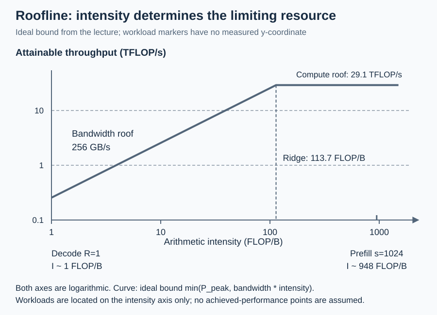
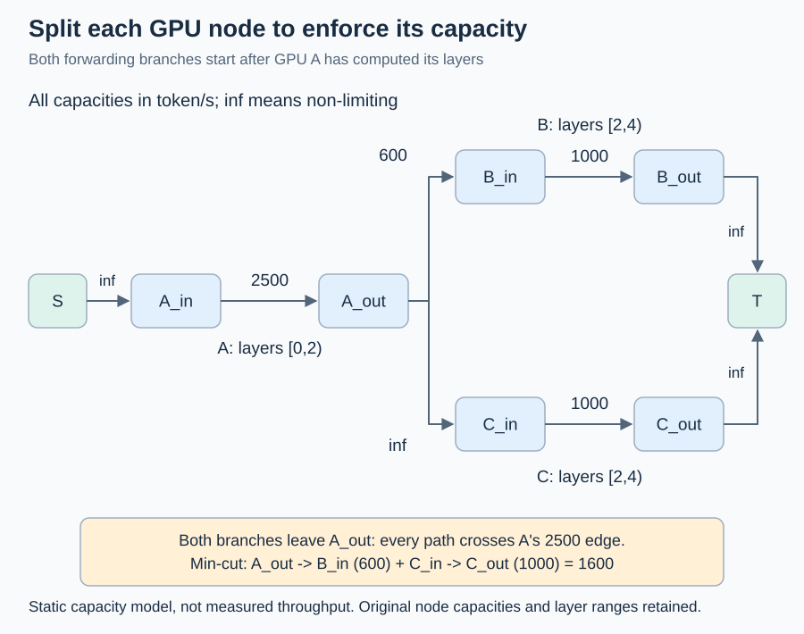
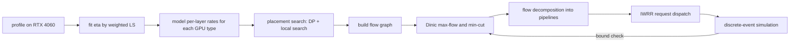

# D9 异构与多模型 serving：代价模型、max-flow 放置与按价格规划

[← 课程索引](../index.md) · [配套 lab9](../../labs/lab9/README.md) · [← D8 RL rollout](08-rollout-scheduling.md)

> [!abstract] 这一讲要解决的问题
> foundations 和前八讲都默认一台机器、一种 GPU、一个模型。真实部署的约束是：手头的卡型号不一，价格相差几倍；同一批卡上要跑好几个模型，每个模型有自己的 TTFT/TPOT SLO；卡之间的网络带宽差距也很大。本讲先把单层的 FLOPs 和字节数算清楚，用 roofline 加效率系数 $\eta$ 建一个能拟合、能报误差的代价模型；然后把集群建成流网络，用 max-flow 给出吞吐上界，用 min-cut 找瓶颈，用 DP 加局部搜索放置层；最后在 SLO 和价格表下做多模型共置的最小成本规划，用离散事件仿真检验。学完后你能在一张 RTX 4060 Laptop 上实测效率系数，推到规格表上的其他 GPU，并且清楚哪些数字是 **measured**，哪些只是 **modeled, not measured**。

| 阅读模块                     | 时间  | 必须留下的学习产物                      | 对应实验      |
| ---------------------------- | ----- | --------------------------------------- | ------------- |
| §1 为什么要异构与多模型      | 20min | 一张口径校正后的规格表                  | data/gpus.csv |
| §2 prefill 与 decode 的代价  | 40min | Qwen3-1.7B 单层 FLOPs/字节手算表        | A1/A2         |
| §3 代价模型与效率系数        | 30min | 加权正规方程推导                        | A3/A5         |
| §4 显存可行性                | 15min | 4060 上最大 KV token 数的手算           | A4            |
| §5 集群即流网络              | 40min | 3 卡 4 层例子的 max-flow 与 min-cut     | B1–B3         |
| §6 层放置搜索                | 25min | DP 递推式和一个"DAG 胜过不相交链"的反例 | B4/B5         |
| §7 流分解与请求调度          | 15min | 一段 IWRR 序列                          | B6/B7         |
| §8 SLO 下的多模型共置        | 35min | 容量手算、B&B 下界的有效性证明          | C1–C3         |
| §9 价格表与成本效率          | 15min | USD/1M tokens 对比                      | C4            |
| §10 P/D 拆分对代价模型的影响 | 10min | KV 传输字节手算                         | —             |
| §11 机制与代码对应           | 10min | 函数对照表                              | 全部          |
| 前沿与 baseline 对照         | 30min | 三篇工作的机制差异卡                    | C/R           |
| 研究问题                     | 15min | 一个可证伪的假设和停止条件              | R5/R6         |

**共 5h，另做 lab 约 25h。** 5h 包括所有手算和随堂自测；Helix 和 Coral 论文只要求读指定的图和小节，通读全文属于选读。

随堂自测计入上表时间。先在笔记里写答案，再展开核对要点。

## §1 为什么要异构与多模型

### 1.1 成本的基本账

serving 的成本指标是每个 token 花多少钱。设一张卡每小时租金为 $\pi$（USD/h），这张卡在满足 SLO 的前提下每秒能产出 $\Theta$ 个 token，则

$$
\text{USD per 1M tokens}=\frac{\pi\times10^6}{3600\,\Theta}.
$$

例如 AWS 上单张 H100 折算约 6.88 USD/h（p5.48xlarge 8 卡 55.04 USD/h 均摊），假设吞吐 3000 token/s，成本是 $6.88\times10^6/(3600\times3000)\approx0.64$ USD/1M tokens；L4 按 g6.xlarge 0.8048 USD/h、假设 400 token/s，成本约 $0.56$。这里的吞吐是假设值，属于 modeled, not measured，但它说明了异构 serving 的出发点：**贵卡单位时间更快，不等于单位 token 更便宜**。Mélange 正是从这个观察出发，按请求长度和 SLO 选最便宜的 GPU 组合。

另外两个动机：

- **可用量**：云上高端卡经常租不到，能拿到的是一堆型号混杂的卡。Helix 的实验集群就是 A100、V100、L4、T4 混合。
- **多模型**：一个服务往往同时挂好几个模型，流量分布偏斜。小模型单独占一张卡会浪费显存和算力，于是要考虑共置（MuxServe、AlpaServe、Janus）。

### 1.2 规格表的口径陷阱

规划器的输入是规格表，口径错了，后面全错。三条规则：

1. **只用 dense 数字**。NVIDIA 数据中心页面上 H100、L4、L40S、A100、A10 的 Tensor 算力带星号，表示 "with sparsity"（2:4 结构化稀疏），dense 值要除以 2。例如 L4 页面写 242 TFLOPS，dense 是 121；H100 SXM 写 1979，dense 约 989。
2. **GeForce 卡看累加精度**。RTX 4090 的 FP16 Tensor 算力在 FP16 累加时为 330.3 TFLOPS，在 FP32 累加时只有一半，即 165.2。PyTorch 默认的 FP16 GEMM 用 FP32 累加，规划器应取后者。RTX 4060 Laptop 没有官方 TFLOPS，按 Ada 白皮书推出每 SM 每周期 512 FLOP（FP32 累加），$24\times2.37\,\text{GHz}\times512\approx29.1$ TFLOPS，这个数是 DERIVED，并且笔记本受功耗墙限制，持续频率通常更低。
3. **GB 和 GiB 分开**。显存容量按 GiB 计（8 GiB $=8\times2^{30}$ 字节），带宽按十进制 GB/s 计（256 GB/s $=2.56\times10^{11}$ 字节/秒）。

一个现成的反例：Demystifying（ICML 2025）论文 Table 1 里 H100 写 1979 TFLOPS（稀疏值），A100 写 312（dense），4090 写 83（非 Tensor 的 FP32 算力），三种口径混在一张表里。

> [!question] 随堂自测 D9-1：口径校正
>
> 1. 把 Demystifying Table 1 的三个数换成"dense FP16 Tensor、FP32 累加"口径：H100 SXM、A100、RTX 4090 各是多少？换算后 H100 相对 A100 的算力比是多少？
> 2. 某云上 L40S 1.861 USD/h（AWS g6e.xlarge），RunPod community 0.79 USD/h。假设吞吐都是 1500 token/s，两者的 USD/1M tokens 各是多少？

> [!tip]- 核对要点
>
> 1. H100 SXM $1979/2\approx989$；A100 是 312（页面上 624 带星号，312 本身就是 dense）；4090 取 FP32 累加的 165.2。比值 $989/312\approx3.2$，用原表数字会得到 $1979/312\approx6.3$，夸大了一倍。
> 2. AWS：$1.861\times10^6/(3600\times1500)\approx0.345$；RunPod：$0.79\times10^6/(3600\times1500)\approx0.146$。同一张卡差 2.4 倍，所以规划结论必须对价格表做敏感性分析。

## §2 prefill 与 decode 的代价

### 2.1 单层 FLOPs 的统一公式

以 Qwen3-1.7B 为例：$L=28$ 层，hidden $h=2048$，query 头数 $H=16$，KV 头数 $H_{kv}=8$，head_dim $d=128$，MLP 中间维 $I=6144$，词表 151936，embedding 与 LM head 共享权重。记 $q_{dim}=Hd=2048$，$kv_{dim}=H_{kv}d=1024$，每个元素 $b=2$ 字节（FP16/BF16）。

lab 把一个 batch 描述为 $R$ 个请求，每个请求本轮计算 $q$ 个新 token，已缓存 $c$ 个 token。prefill 是 $c=0,q=s$，decode 是 $q=1,c=\text{ctx}$，chunked prefill 介于两者之间。第 $i$ 个新 token（$i=0,\dots,q-1$）要和 $c+i+1$ 个位置做 attention（因果掩码，含自己），于是

$$
n=Rq,\qquad P=R\left(qc+\frac{q(q+1)}{2}\right),
$$

$n$ 是新 token 总数，$P$ 是 attention 的 (query, key) 对数。只计矩阵乘法，每次乘加记 2 FLOP：

$$
F=2n\left(h\,q_{dim}+2h\,kv_{dim}+q_{dim}\,h+3hI\right)+4HdP.
$$

第一项依次是 Q、K、V、O 四个投影和 SwiGLU 的 gate/up/down 三个矩阵。第二项是 $QK^\top$ 和 $AV$ 各 $2HdP$。注意 attention 项乘的是 $H$ 而不是 $H_{kv}$：**GQA 让多个 query 头共享一份 K/V，减少的是 KV 字节数，不是 attention FLOPs**。softmax、RMSNorm、激活函数的逐元素运算忽略不计。

字节数分四部分（每层）：

$$
B=\underbrace{b\left(h\,q_{dim}+2h\,kv_{dim}+q_{dim}h+3hI+2h+2d\right)}_{\text{weights}}+\underbrace{b\cdot R\,c\cdot2\,kv_{dim}}_{\text{KV read}}+\underbrace{b\cdot n\cdot2\,kv_{dim}}_{\text{KV write}}+\underbrace{b\cdot2nh}_{\text{act in/out}}.
$$

权重里的 $2h+2d$ 是两个 RMSNorm 和 Qwen3 的 q_norm/k_norm。约定：新 token 的 K/V 写入缓存后留在片上直接使用，不再读回；中间激活（gate/up 的输出等）假设融合在片上，不计入。这是一个有意的简化，§3.3 会说明它带来的偏差。

### 2.2 Qwen3-1.7B 的手算

单层参数：Q 和 O 各 $2048\times2048=4{,}194{,}304$，K 和 V 各 $2048\times1024=2{,}097{,}152$，MLP $3\times2048\times6144=37{,}748{,}736$，合计 $50{,}331{,}648$；加上 4352 个 norm 参数，FP16 下每层权重约 $100.7$ MB。28 层约 $1.41\times10^9$ 参数，再加 embedding $151936\times2048\approx3.11\times10^8$，总计约 $1.72\times10^9$，与官方"1.7B"一致。

KV cache 每 token 每层 $2\times1024\times2=4096$ 字节（4 KiB），28 层合计 $114{,}688$ 字节（112 KiB）。

**decode，$R=1$，$c=1023$**：

- $F=2\times50{,}331{,}648+4\times16\times128\times1024\approx1.007\times10^8+8.4\times10^6\approx1.09\times10^8$；
- $B\approx1.0067\times10^8+4.19\times10^6+4096+8192\approx1.049\times10^8$；
- 算术强度 $F/B\approx1.04$ FLOP/B。

**prefill，$R=1$，$s=1024$**：

- $n=1024$，$P=1024\times1025/2=524{,}800$；
- $F\approx1.031\times10^{11}+4.30\times10^9\approx1.074\times10^{11}$；
- $B\approx1.0067\times10^8+4.19\times10^6+8.39\times10^6\approx1.13\times10^8$；
- 算术强度约 948 FLOP/B。

### 2.3 roofline：谁是瓶颈

设峰值算力 $P_{peak}$（FLOP/s）、峰值带宽 $W$（B/s）。理想 roofline 时间是 $\max(F/P_{peak},B/W)$，两项相等时的强度 $P_{peak}/W$ 叫 ridge point。RTX 4060 Laptop 取 29.1 TFLOPS 和 256 GB/s，ridge $\approx114$ FLOP/B：

- decode（强度约 1）远在 ridge 左边，是**带宽受限**。28 层只读权重就要 $28\times1.007\times10^8/2.56\times10^{11}\approx11$ ms，约 90 token/s；LM head 另读 622 MB，再加约 2.4 ms。
- prefill（强度约 948）在 ridge 右边，是**算力受限**，每层约 $1.074\times10^{11}/2.91\times10^{13}\approx3.7$ ms。

batch 变大时，decode 的权重字节被 $R$ 个请求分摊，强度上升。但 KV 读取随 $R$ 线性增长：每个请求每层要读 $c\times4096$ 字节，只换来 $2\times50.3\text{M}+8192c$ FLOP。$c=1023$ 时 $R\to\infty$ 的极限强度是 $1.09\times10^8/4.2\times10^6\approx26$，仍低于 114。**长上下文的 decode 无论 batch 多大都停在带宽受限区**，这正是 Splitwise 和 DistServe 把 decode 放到带宽便宜的卡上的物理依据。

图：曲线是给定峰值算力和带宽下的理想上界；decode 与 prefill 只标注在强度轴上，不虚构实测吞吐点。两轴均为对数刻度。

图中横轴是算术强度，斜线是带宽屋顶，水平线是算力屋顶。decode 与 prefill 只在横轴标出强度位置：前者位于带宽受限区，后者位于算力受限区。这里没有给出实际吞吐，因此不画性能点。

> [!question] 随堂自测 D9-2：decode 的 batch 极限
>
> 1. 用 2.1 的公式，写出 Qwen3-1.7B 在 $q=1$、上下文 $c$ 时 $R\to\infty$ 的单层强度极限（只保留与 $R$ 成正比的项）。$c=0$ 时极限是多少？这说明什么？
> 2. 如果把模型改成 MHA（$H_{kv}=H=16$），$c=1023$、$R=1$ 的 decode attention FLOPs 和 KV 读字节各变成原来的几倍？

> [!tip]- 核对要点
>
> 1. 与 $R$ 成正比的 FLOPs 是 $2\times50{,}331{,}648+8192(c+1)$，字节是 $4096c+4096+8192$。$c=0$ 时极限约 $1.007\times10^8/12288\approx8200$，远超 ridge：短上下文的大 batch decode 可以变成算力受限；上下文越长，KV 读越早把强度压回来。
> 2. attention FLOPs 不变（仍是 $4HdP$）；KV 读字节翻倍（$kv_{dim}$ 从 1024 变成 2048）。

## §3 代价模型与效率系数

### 3.1 roofline 加效率系数

真实 kernel 达不到峰值。lab 用最简单的修正：

$$
t(F,B)=t_0+\max\left(\frac{F}{\eta_c P_{peak}},\ \frac{B}{\eta_m W}\right),
$$

$\eta_c,\eta_m\in(0,1]$ 分别是算力和带宽效率，$t_0$ 是固定开销（kernel launch 等），单位秒。这个式子在 lab 里是 `roofline_time`（A2）。

### 3.2 用加权最小二乘拟合 $\eta$

有 $N$ 个 microbenchmark 样本 $(F_i,B_i,t_i)$。令 $u_c=1/\eta_c$，$u_m=1/\eta_m$，参数 $\theta=(t_0,u_c,u_m)^\top$。如果已知每个样本落在哪一边（算力受限 $z_i=c$ 或带宽受限 $z_i=m$），模型就是线性的：

$$
\hat t_i=x_i^\top\theta,\qquad x_i=\begin{cases}(1,\ F_i/P_{peak},\ 0)^\top & z_i=c\\(1,\ 0,\ B_i/W)^\top & z_i=m\end{cases}
$$

样本时间从微秒跨到毫秒，普通最小二乘会被大样本主导。我们要的是相对误差小，于是最小化

$$
J(\theta)=\sum_i\left(\frac{x_i^\top\theta-t_i}{t_i}\right)^2=\sum_i w_i\left(x_i^\top\theta-t_i\right)^2,\qquad w_i=\frac{1}{t_i^2}.
$$

对 $\theta$ 求梯度并令其为零：$\nabla J=2\sum_i w_i x_i(x_i^\top\theta-t_i)=0$，得到加权正规方程

$$
\left(X^\top\mathrm{diag}(w)X\right)\theta=X^\top\mathrm{diag}(w)\,t,
$$

这是一个 $3\times3$ 线性方程组，用带部分主元的高斯消元即可。如果所有样本都落在同一侧，矩阵奇异（另一侧的 $u$ 不可辨识），实现应拒绝。

样本归哪一侧，取决于 $\eta$ 本身：$\eta_c$ 偏低时 ridge 右移，原本略高于 ridge 的样本变成带宽受限。于是用**交替**的办法：

1. 初始化 $\eta_c=\eta_m=1$、$t_0=0$；
2. 按当前参数给每个样本标 $z_i$：$F_i/(\eta_cP_{peak})\ge B_i/(\eta_mW)$ 记为 $c$，否则记为 $m$；
3. 解加权正规方程得到新 $\theta$；
4. 标签不再变化就停，否则回到第 2 步（设迭代上限）。

收敛时，每个样本的标签与 max 的哪一项更大一致，所以解是原分段目标 $J$ 的一个驻点。lab 的测试正是用这一点做独立 oracle：在解附近对 $J$ 做有限差分，梯度应接近零。

### 3.3 held-out 误差和模型的盲区

拟合误差不能用训练样本报。lab 的 `heldout_error`（A5）在训练集上拟合，在测试集上报相对误差 $\lvert\hat t-t\rvert/t$ 的均值、中位数和最大值。

这个模型抓不住的东西，写报告时要逐条讨论：

- **kernel 融合与 launch**：真实框架把逐元素运算融进 GEMM，或者反过来多出很多小 kernel，$t_0$ 只是一个平均值；
- **attention kernel**：FlashAttention 类 kernel 的效率和 GEMM、GEMV 都不同，用 GEMM 拟合的 $\eta_c$ 套到 attention 上会有偏差；
- **频率与功耗墙**：笔记本 4060 的持续频率随温度和 TGP 变化，同一个 kernel 前后差 10% 以上很常见；
- **中间激活**：2.1 约定中间激活留在片上，大 batch prefill 时 gate/up 的输出其实要写回显存；
- **通信与重叠**：跨卡的激活传输、和计算的重叠程度都不在单卡模型里；
- **调度器效应**：continuous batching 的 batch 组成随时间变化，固定 $(R,c)$ 的工作点只是近似。

本机一次实测（**measured**，RTX 4060 Laptop，驱动 566.24，WSL2，2026-10-18，lab9 随附的 `data/rtx4060_reference_profile.csv`）给出三条具体教训：

- **L2 会骗人**。4060 Laptop 有 32 MB L2。早期一次运行里，16 MiB 的拷贝测出约 840 GB/s，远超 256 GB/s 的显存带宽；所以 R2 的拷贝从 64 MiB 起步，GEMV 的权重取 64 到 128 MB。重复运行同一个小 GEMM 时，权重常驻 L2，按"每个操作数读一次"算的字节数也就不成立了。
- **空闲后的降频会骗人**。同样的程序，计时前只做 5 次 warmup 时，64 MiB 拷贝只有约 197 GB/s；每组配置先让 GPU 连续忙 300 ms 后，变成 228 GB/s。原因是 GPU 在两组配置之间一空闲就降到低 P-state（显存频率可从 8000 MHz 掉到 810 MHz），几次短 warmup 拉不回来。随附 profile 用的是 300 ms 预热，每行都满足 $p_{75}\le1.5\,p_{25}$。
- **拷贝比只读略慢**。预热后 64 到 512 MiB 拷贝为 227 到 231 GB/s，GEMV（几乎只读）为 235 到 247 GB/s。一个 $\eta_m$ 同时拟合两者，两头各错一点。
- **短时与持续算力不同**。没有 300 ms 预热时，WMMA GEMM 在 2048 方阵上测到 29.2 TFLOPS，恰好接近按 2370 MHz 推出的 29.1；预热后只有 22.1 TFLOPS（cuBLAS 25.4），4096 方阵 18.2 TFLOPS（cuBLAS 25.7）。持续负载下更慢，可能是功耗墙或温度降频，这次没有同时记录时钟，原因未单独确认。随附 profile 的拟合结果是 $\eta_c\approx0.67$、$\eta_m\approx0.91$、$t_0\approx4.3\,\mu s$；只用 copy 和 GEMM 拟合、在 GEMV 上 held-out，平均相对误差约 9.5%，最大约 11%。

还有一条要单独强调：在 4060 上拟合的 $\eta$ 直接乘到 L4、A100 的规格上，是一个**迁移假设**。由此得到的其他 GPU 的时间全部是 modeled, not measured，lab R6 要求对它做敏感度扫描。

> [!question] 随堂自测 D9-3：拟合与标签
>
> 1. 设 $t_0=0$，某 GEMM 样本 $F/P_{peak}=1$ ms，实测 1.25 ms；某 copy 样本 $B/W=2$ ms，实测 2.5 ms。$\eta_c,\eta_m$ 各是多少？
> 2. 真实 $\eta_c=0.5,\eta_m=0.9$。某样本 $F/P_{peak}=0.8$ ms，$B/W=0.6$ ms。初始化 $\eta=1$ 时它被标成哪一侧？用真实参数应该是哪一侧？如果只做一轮、不重新标签，会发生什么？

> [!tip]- 核对要点
>
> 1. $\eta_c=1/1.25=0.8$，$\eta_m=2/2.5=0.8$。
> 2. 初始 $0.8\ge0.6$，标为算力受限；真实 $0.8/0.5=1.6$ ms 对比 $0.6/0.9\approx0.67$ ms，也是算力受限。反过来的例子：$F/P_{peak}=0.3$、$B/W=0.4$，初始标为带宽受限，真实 $0.6$ 对比 $0.44$ 应是算力受限。不重新标签，这个样本会被当成带宽样本去拟合 $u_m$，把 $\eta_m$ 拉低，噪声为零也恢复不出真值。

## §4 显存可行性

一张卡承载 $k$ 层时，显存要装下权重、KV cache、激活和框架保留量：

$$
M_{w}(k)+k\cdot T_{kv}\cdot2\,kv_{dim}\,b+T_{act}(2h+2I)\,b+M_{res}\le C,
$$

$T_{kv}$ 是要缓存的 token 总数，$T_{act}$ 是一次前向的最大 token 数（激活峰值近似为残差、归一化输出和 gate/up 两个中间张量），$M_{res}$ 是 CUDA context 等保留量，$C$ 是容量（GiB 换算成字节）。整模型单卡部署时 $M_w$ 还要加上 embedding（共享权重只算一份，不共享时 embedding 和 LM head 各算一份）。可容纳的 KV token 数是

$$
T_{kv}^{max}=\left\lfloor\frac{C-M_{res}-M_w-T_{act}(2h+2I)b}{k\cdot2\,kv_{dim}\,b}\right\rfloor,
$$

分子为负时不可行。lab 的 `memory_fit`（A4）同时返回各项需求、是否装得下和 $T_{kv}^{max}$，就是这两个式子；向下取整和"刚好装满"的边界都有测试（容量恰好等于 12345 个 token 的需求时必须返回 12345，少 1 字节时返回 12344）。

**手算**：4060 Laptop，$C=8\times2^{30}=8{,}589{,}934{,}592$ 字节，$M_{res}=1$ GiB，Qwen3-1.7B 整模型 $M_w\approx1.7206\times10^9\times2=3{,}441{,}149{,}952$ 字节，$T_{act}=2048$ 时激活为 $2048\times16384\times2=67{,}108{,}864$ 字节。剩余 $4{,}007{,}933{,}952$ 字节，除以 $114{,}688$ 得 $T_{kv}^{max}=34{,}946$，约 34 个 1K 上下文的请求。

> [!question] 随堂自测 D9-4：放不下的时候
>
> 1. 同样条件换成 Qwen3-8B（36 层，$h=4096$，$H_{kv}=8$，$d=128$，$I=12288$，不共享 embedding，约 $8.2\times10^9$ 参数），FP16 能在 8 GiB 上单卡部署吗？至少要切成几段（假设每张 8 GiB 卡最多放一半显存给权重）？
> 2. 为什么 placement 规划里每张卡的"最多层数"不是常数，而要和工作点（batch、上下文）一起定？

> [!tip]- 核对要点
>
> 1. 权重约 16.4 GB，远超 8 GiB，不能。每张卡给权重约 4 GiB，至少需要 $\lceil16.4/4.29\rceil=4$ 段（按 $4\,\text{GiB}\approx4.29\times10^9$ 字节）。
> 2. 每层要为 KV 预留 $T_{kv}\times4096$ 字节（以 Qwen3-1.7B 为例），工作点的 batch 和上下文越大，每层占的显存越多，一张卡能放的层就越少。

## §5 集群即流网络

### 5.1 节点拆分与边容量

Helix 的核心观察：把集群看成有向图，token 从协调器出发，依次经过持有第 $0,1,\dots,L-1$ 层的 GPU，再回到协调器。每张 GPU 和每条链路都有容量，集群吞吐的上界就是这个网络的最大流。

建图规则（lab B1 的 `build_flow_graph`）：

- **节点拆分**：GPU $i$ 拆成 $i_{in}$ 和 $i_{out}$，边 $i_{in}\to i_{out}$ 的容量是它的计算吞吐。设 GPU $i$ 处理一层的 token 速率为 $r_i$（token/s，由 §3 的代价模型在工作点上算出），它持有 $k_i$ 层时容量为 $r_i/k_i$。节点本身的容量只能放在拆出的内部边上，放在入边上就限制不住"从别的节点流进来"的流量。
- **源和汇**：持有第 0 层（区间起点为 0）的 GPU 连 $S\to i_{in}$；持有最后一层（区间终点为 $L$）的 GPU 连 $i_{out}\to T$。
- **转交边**：GPU $i$ 持有 $[s_i,e_i)$，GPU $j$ 持有 $[s_j,e_j)$，当且仅当 $e_i=s_j$ 时连 $i_{out}\to j_{in}$。Helix 允许区间重叠，下一跳只要持有第 $e_i$ 层即可；lab 简化成恰好衔接，这样图一定无环，穷举也好写。
- **链路容量**：每个 token 跨卡要传一个 hidden 向量，$h\,b$ 字节。带宽 $\beta$（B/s）的链路，token 容量为 $\beta/(hb)$。Qwen3-1.7B 每 token 4096 字节，1 Gb/s 链路约 30500 token/s。

最大流最小割定理：$S$ 到 $T$ 的最大流值等于所有 $S$-$T$ 割中容量最小者。所以 max-flow 给吞吐上界，min-cut 指出瓶颈在哪些 GPU、哪些链路上。

### 5.2 手算例子

4 层模型，3 张卡：A 持有 $[0,2)$，$r_A=5000$，容量 $5000/2=2500$；B、C 都持有 $[2,4)$，$r_B=r_C=2000$，容量各 1000。A 到 B 的链路很慢，只有 600 token/s（约 2.46 MB/s），其余链路足够快（记为 $\infty$）。

图：所有路径先通过 A 的内部计算边，再从输出节点分叉。边容量单位为 token/s；最小割由慢链路和 C 的内部边组成。

图中矩形是拆分后的节点，边上数字是 token/s 容量，`inf` 表示不构成约束。两条转交分支均从 A 的输出节点发出，不能绕过 A 的内部计算边。

经过 A 的流至多 2500，分给 B 的至多 $\min(600,1000)=600$，分给 C 的至多 1000，max-flow $=1600$。对应的最小割是 $\{A_{out}\to B_{in},\ C_{in}\to C_{out}\}$，容量 $600+1000=1600$：瓶颈是一条慢链路加一张卡的计算，A 并不是瓶颈。把 A 换成更快的卡不会提高吞吐，升级慢链路或 C 才有效；min-cut 报告的就是这一点。

### 5.3 Dinic 算法

Dinic 交替做两件事：

1. 在残量图上从 $S$ BFS，得到每个点的层数 $\ell(v)$；$T$ 不可达就结束。
2. 只沿 $\ell(v)=\ell(u)+1$ 的边 DFS 找阻塞流，每推一次流，正向边残量减 $f$、**反向边残量加 $f$**。用"当前弧"指针避免重复扫描死边。

复杂度 $O(V^2E)$。反向边是正确性的关键：它允许后来的增广路"撤销"先前的错误选择。如果漏掉反向边，算法退化成贪心，在需要改道的图上会得到偏小的结果。min-cut 的提取（B3）是在**残量图**里从 $S$ BFS，可达集合 $X$ 与不可达集合之间的原图边就是割边，它们必然满流；在原图而不是残量图上 BFS 是常见错误。

这张图是 lab B/C 阶段的整体流程：实测只发生在第一步，之后的速率、流量和仿真结果都是 modeled, not measured，仿真吞吐必须不超过 max-flow 上界。

> [!question] 随堂自测 D9-5：割与瓶颈
>
> 1. 5.2 的例子里，如果把 A 到 B 的链路升级为 $\infty$，max-flow 和最小割变成什么？再把 A 换成 $r_A=3000$ 呢？
> 2. 某同学把 GPU 容量放在了 $S\to i_{in}$ 边上（只有第一段 GPU 有这条边）。对 5.2 的例子，他算出的 max-flow 是多少？为什么错？

> [!tip]- 核对要点
>
> 1. 链路升级后，B、C 各 1000，A 2500，max-flow $=2000$，最小割 $\{B_{in}\to B_{out},C_{in}\to C_{out}\}$。A 换成 3000 后容量 1500，max-flow $=1500$，最小割变成 A 的内部边。
> 2. A 的容量 2500 放到 $S\to A_{in}$ 上，结果不变；但 B、C 没有 $S$ 入边，它们的容量就丢了，算出 $\min(2500,600+\infty)=2500$。中间段 GPU 的计算约束消失，上界被高估。

## §6 层放置搜索

放置决定每张卡持有哪一段连续层，目标是最大化 max-flow，约束是每张卡的层数不超过显存允许的上限。Helix 把放置和流量一起写成 MILP，用 Gurobi 求解。lab 不依赖商业求解器，用两步启发式，再用穷举验证。

**一条链的 DP**（`partition_chain`）：给定有序的 GPU 链 $g_1,\dots,g_m$，每张至少一层、最多 $K_j$ 层，把 $L$ 层切成连续段，最大化瓶颈。令 $f(j,\ell)$ 为前 $j$ 张卡恰好覆盖前 $\ell$ 层时的最大瓶颈：

$$
f(j,\ell)=\max_{1\le k\le\min(K_j,\ell)}\min\left(f(j-1,\ell-k),\ \frac{r_{g_j}}{k},\ \text{link}(g_{j-1},g_j)\right),\qquad f(0,0)=\infty,
$$

答案是 $f(m,L)$。状态数 $mL$，转移 $O(L)$，总复杂度 $O(mL^2)$。例：两张卡 $r_1=600,r_2=300$，$L=3$，切成 $(1,2)$ 得 $\min(600,150)=150$，切成 $(2,1)$ 得 $\min(300,300)=300$，DP 选后者。

**多链加局部搜索**（`place_layers`，B5）：初始解有两类。一类是把 GPU 按 $r_iK_i$ 排序，蛇形分进 $p$ 条链（$p=1,\dots,n$ 都试）；另一类是若干个随机排列，轮流分进随机条数的链。每条链用 DP 切层。然后从最好的几个初始解出发做最优改进局部搜索：先试单卡移动（某张卡换成另一个合法区间或闲置），单卡移动都改进不了时，再试成对移动（卡 $i$ 换成区间 $r$，同时另一张卡 $j$ 取同一个区间 $r$ 做副本，或取紧挨着 $r$ 的区间）。只要 max-flow 严格变大就接受。成对移动不可省：最优解里常有两张卡持有同一段层、并行喂给下游，这需要两处同时改动才能到达。

为什么要在 DAG 上求流，而不是只看不相交的链？例：A 持有 $[0,2)$ 容量 300，B、C 各持有 $[2,4)$ 容量 150。把每张卡只分进一条链，最好是 A→B 一条链得 150，C 单独无法覆盖全部层。而在流网络里，A 的输出可以同时分给 B 和 C，max-flow 是 300。Helix 的 per-request pipeline 就是利用这种分流。

lab 的 oracle 是在 $\le5$ 张 GPU、8 层上穷举全部放置，用测试自己写的 Edmonds-Karp 逐个求值。测试要求每个固定用例不低于最优值的 90%，6 个用例的平均比值不低于 0.97，并且结果对单卡移动是局部最优（测试自己枚举所有单卡移动来验证）。参考实现在这 6 个用例上都达到了最优，但在 60 个随机小集群上仍有 7 个低于最优的 97%，最差约 0.87：局部搜索不保证最优，报告里要写明这一点，并把它和 Helix 的 MILP 区分开。

> [!question] 随堂自测 D9-6：DP 边界
>
> 1. 三张卡 $r=(900,600,300)$，$K=(4,4,4)$，链路不受限，$L=6$。用 DP 求最优切分和瓶颈。
> 2. DP 里写成 $k\le\ell-1$（少了 $k=\ell$），会在什么输入上出错？

> [!tip]- 核对要点
>
> 1. 枚举 $(k_1,k_2,k_3)$：$(3,2,1)$ 得 $\min(300,300,300)=300$，其他切分都更小，例如 $(2,2,2)$ 得 $\min(450,300,150)=150$。最优 300。
> 2. 每张卡至少一层时，$f(1,\ell)$ 只能从 $k=\ell$ 转移而来（第一张卡拿走全部前 $\ell$ 层）。少了 $k=\ell$，$f(1,\cdot)$ 全部不可行，并逐层传下去，任何链都返回不可行；单卡链（$m=1$）最先暴露。穷举所有切分的 oracle 在 $m=1$ 或 $m=2$ 的小例子上就能抓住它。

## §7 流分解与请求调度

max-flow 只给出每条边的流量，在线调度需要的是"每个请求走哪条 pipeline"。**流分解**：在有正流量的边上从 $S$ 找一条到 $T$ 的路径，取路径上的最小流量 $\delta$，把路径和 $\delta$ 记下来，路径上每条边减去 $\delta$，重复到 $S$ 没有正流出边。图无环时这个过程只产生路径、不产生环；每次至少把一条边减到零，所以路径数不超过 $\lvert E\rvert$。各路径权重之和等于流值，按边求和能还原原来的流（lab B6 的测试逐条检查这两点）。

有了路径和权重 $w_p$，调度器要按比例分发请求，并且分得均匀，不能先连发 $w_1$ 个再连发 $w_2$ 个。Helix 在每个节点上用交错加权轮询（IWRR）选下一跳；lab 的 `Iwrr` 采用 nginx 的平滑加权轮询：每个候选维护当前值 $c_p$，每次

$$
c_p\gets c_p+w_p\ (\forall p),\qquad p^\ast=\arg\max_p c_p,\qquad c_{p^\ast}\gets c_{p^\ast}-\sum_q w_q.
$$

权重 $(5,1,1)$ 时序列是 a a b a c a a，7 次一个周期，a 出现 5 次且分散。测试用前缀偏差 $\max_n\lvert\text{count}_p(n)-n\,w_p/W\rvert$ 检查是否交错，$W=\sum_q w_q$。

> [!question] 随堂自测 D9-7：IWRR
>
> 1. 手算权重 $(3,1)$ 的平滑加权轮询前 8 次选择（并列时选下标小的）。
> 2. 某实现把 $\arg\max$ 写成了 $\arg\min$，前 8 次会怎样？用什么测试能抓住它？

> [!tip]- 核对要点
>
> 1. 当前值演化：$(3,1)\to$ 选 a $\to(-1,1)$；$(2,2)\to$ a $\to(-2,2)$；$(1,3)\to$ b $\to(1,-1)$；$(4,0)\to$ a $\to(0,0)$。一个周期 a a b a，前 8 次 a a b a a a b a。
> 2. 选当前值最小的会让小权重的 b 被频繁选中，计数比例偏离 $3:1$，前缀偏差测试和最终计数测试都会失败。

## §8 SLO 下的多模型共置

### 8.1 单副本在 SLO 下的容量

两个延迟指标：TTFT 是请求到达到第一个 token 的时间，含排队和 prefill；TPOT 是之后每个输出 token 的平均间隔。设模型在某 GPU 上 prefill 一个长 $p$ 的请求需要 $T_p$，每个请求输出 $o$ 个 token。第一个输出 token 由 prefill 产生，所以只剩 $o-1$ 步 decode。batch 为 $b$ 时一步 decode 的时间记为 $\text{TPOT}(b)=\text{step}(b,\bar c)$，取平均上下文 $\bar c=p+o/2$。

共置时，该模型分到 GPU 时间的比例为 $\alpha$（独占时 $\alpha=1$），它所有 kernel 的时间都除以 $\alpha$：$T_p'=T_p/\alpha$，$\text{TPOT}'(b)=\text{TPOT}(b)/\alpha$。每个请求占用 $T_p'$ 的 prefill 时间和 $(o-1)\,\text{TPOT}'(b)/b$ 的 decode 时间（一步服务 $b$ 个请求），所以

$$
\lambda(b)=\frac{1}{T_p'+(o-1)\,\text{TPOT}'(b)/b}.
$$

prefill 会打断 decode，比例为 $\lambda T_p'$，用户看到的 TPOT 被拉长为 $\text{TPOT}'(b)/(1-\lambda(b)T_p')$。`slo_capacity`（C1）在 $b=1,\dots,b_{max}$ 中选使 $\lambda(b)$ 最大、同时满足三个约束的 $b$：

$$
T_p'\le\text{SLO}_{TTFT},\qquad \frac{\text{TPOT}'(b)}{1-\lambda(b)T_p'}\le\text{SLO}_{TPOT},\qquad b(p+o)\,m_{kv}\le M_{kv},
$$

$m_{kv}$ 是每 token 全部层的 KV 字节，$M_{kv}$ 是分给这个模型的 KV 预算。$o=1$ 时没有 decode，$\lambda=1/T_p'$，只剩 TTFT 约束。

**手算**：$T_p=0.1$ s，$\text{TPOT}(b)=0.02+0.0005b$ s，$o=201$（即 $o-1=200$ 步 decode），$\text{SLO}_{TPOT}=0.05$ s，显存不受限，$\alpha=1$。$b=30$ 时 $\text{TPOT}=0.035$，$\lambda=1/(0.1+200\times0.035/30)=3.0$ req/s，观察到的 TPOT $=0.035/(1-0.3)=0.05$，刚好满足；$b=31$ 时观察到的 TPOT 约 $0.051$，违约。容量是 3.0 req/s。

### 8.2 模板与最小成本覆盖

Coral 的做法是先离线枚举"模板"，再在线解一个小整数规划。lab 沿用这个两层结构：模板 $t$ 由（GPU 类型，模型子集，等分时间份额）构成，价格 $\pi_t$，对模型 $m$ 的容量 $c_{t,m}$ 由 C1 算出（不在子集中的模型容量为 0，显存放不下的子集直接剔除）。给定各模型的需求 $\lambda_m$（req/s）：

$$
\min_{n\in\mathbb{Z}_{\ge0}^{T}}\ \sum_t\pi_t n_t\qquad\text{s.t.}\ \sum_t n_t c_{t,m}\ge\lambda_m\quad\forall m.
$$

`min_cost_assignment`（C2）用分支定界：按模板逐个决定 $n_t$，在每个节点用剩余需求 $\rho_m$ 算下界

$$
\text{LB}=\text{cost so far}+\max_m\ \rho_m\cdot\min_t\frac{\pi_t}{c_{t,m}},
$$

LB 不小于当前最好解就剪枝。这个下界有效：任何可行补全都必须覆盖模型 $m$ 的剩余需求，而每单位 $m$ 容量至少花 $\min_t\pi_t/c_{t,m}$。**把 max 换成对 $m$ 求和就不再是下界**：一个共置模板同时服务多个模型，它的钱被重复计了。例：模板 $t_1$ 在一张卡上同时放模型 1 和 2，价格 1，容量 $(1,1)$；$t_2$、$t_3$ 各只放一个模型，价格 0.8，容量 1。需求 $(1,1)$ 时最优是一个 $t_1$，成本 1；求和下界 $0.8+0.8=1.6>1$，会把最优解剪掉；max 下界 $0.8\le1$，有效。

### 8.3 共置为什么有收益，又为什么不免费

共置的收益来自两处。一是**碎片**：需求很小的模型独占一张卡，容量大部分闲置。二是**统计复用**：AlpaServe 指出，突发流量下多个模型共享一组 GPU，每个模型突发时都能借到整组资源，尾延迟下降，突发度（到达间隔的变异系数 CV）越高收益越大。MuxServe 用 CUDA MPS 做空间复用，把不同模型的 prefill 和 decode 灵活共置；Janus 在生产规模上把 HBM 容量、算力、带宽三维资源向量装箱，用高斯过程预测资源需求。

共置也有代价：份额 $\alpha$ 会把 TPOT 放大 $1/\alpha$ 倍，紧的 TPOT SLO 下共置模型的容量可能塌得很厉害（见自测 D9-8）。等分份额是 lab 的简化，真实系统按负载动态调整。

### 8.4 离散事件仿真与它的 oracle

解析容量只是上界，排队要靠仿真。lab 的 `simulate_instance`（C3）是迭代级的离散事件仿真：每个实例在有活的模型之间轮转；轮到某个模型时，若有等待请求且活跃数小于 batch 上限，就先做一次 prefill（耗时 $T_p$，prefill 优先），否则对它所有活跃请求做一步 decode（耗时 $\text{step}(n_{active},c)$）；新到达的请求只在迭代边界进入队列；实例空闲时时间跳到下一个到达。系统内请求数的时间积分 $\int N(t)\,dt$ 在循环里逐迭代累加。请求按 IWRR 分到各实例。

仿真本身也要验，三个 oracle：

- **守恒**：到达数 $=$ 完成数 $+$ 仍在系统中的数。
- **Little 定律** $L=\lambda W$：仿真循环里对系统内请求数做时间积分得到 $L$，和到达率乘平均逗留时间比较。
- **M/D/1**：单模型、batch 上限为 1、输出长度 $o=1$（服务只有一次 prefill，时长恒为 $D=T_p$）、Poisson 到达时，系统是 M/D/1，平均排队时间由 Pollaczek–Khinchine 公式给出：

$$
W_q=\frac{\rho}{2\mu(1-\rho)},\qquad \mu=\frac{1}{D},\ \rho=\frac{\lambda}{\mu}.
$$

若仿真把 TTFT 从开始服务而不是从到达算起，排队时间就丢了，这个检查会失败。

- **吞吐上界**：$\text{step}(n,c)/n$ 随 $n$ 不增，$\text{step}$ 随 $c$ 递增，而活跃数不超过 $b$、上下文不小于 $p$，所以每个请求占用的 GPU 时间至少是 $T_p+(o-1)\,\text{step}(b,p)/b$，完成速率不超过 $1/\left(T_p+(o-1)\,\text{step}(b,p)/b\right)$ req/s。过载时仿真吞吐必须低于这个界，它和 max-flow 一样是静态上界。

仿真最重要的用处，是揭穿"按解析容量做规划"的乐观。lab bench 的四模型场景里（Qwen3 0.6B 到 8B，需求 6、3、1.2、0.4 req/s，AWS 价，假设的 $\eta$，全部 modeled, not measured），B&B 选出的共置方案每小时 2.01 USD，最便宜；但它让每个实例都跑在解析容量的边上，Poisson 到达下 SLO 达成率只有约 73%，突发（CV 为 3）时约 49%。不共置的方案贵 18%，Poisson 下达成率 100%。容量 $\lambda(b)$ 是"刚好满足 SLO"的边界，不是可以长期运行的工作点；规划必须留余量，或者直接把仿真放进规划回路。

> [!question] 随堂自测 D9-8a：为什么边界上的方案会违约
> 某实例按 C1 算出容量 3.0 req/s，规划给它分配 3.0 req/s 的 Poisson 流量。用 M/D/1 的直觉说明：即使服务时间完全确定，这个实例的 TTFT 会怎样？要把平均排队时间压到服务时间的一半以下，利用率 $\rho$ 最多是多少？

> [!tip]- 核对要点
>
> $\rho\to1$ 时 $W_q=\rho D/(2(1-\rho))\to\infty$，TTFT 无界增长。要求 $W_q\le D/2$，即 $\rho/(2(1-\rho))\le1/2$，得 $\rho\le0.5$。按容量的 100% 规划，就是把实例放在排队论上最差的位置。

> [!question] 随堂自测 D9-8：共置的代价与排队
>
> 1. 沿用 8.1 的数字，但该模型与另一个模型共置，$\alpha=0.5$。最优 $b$ 和容量各是多少？与独占相比，两个模型各占一半的共置在什么情况下仍然划算？
> 2. M/D/1 中 $\lambda=0.8$ req/s，$D=1$ s。平均排队时间 $W_q$ 和平均排队长度 $L_q$ 是多少？
> 3. 用 8.2 的例子说明：如果 C2 的下界写成求和，B&B 会返回什么解？

> [!tip]- 核对要点
>
> 1. $\alpha=0.5$ 时 $\lambda'=\lambda/2$，$\lambda'T_p'=\lambda T_p$，观察到的 TPOT 是独占时的 2 倍，于是要求独占口径下观察到的 TPOT $\le0.025$。$b=5$：$\text{TPOT}=0.0225$，$\lambda=1/(0.1+200\times0.0225/5)=1/(0.1+0.9)=1.0$，观察值 $0.0225/0.9=0.025$，刚好满足；$b=6$ 时约 $0.026$，违约。共置容量 $\lambda'=0.5$ req/s，独占是 3.0。只有当两个模型的需求都远小于 0.5 req/s、独占会让卡大量闲置时，共置才划算。
> 2. $\mu=1$，$\rho=0.8$，$W_q=0.8/(2\times0.2)=2$ s，$L_q=\lambda W_q=1.6$。
> 3. 根节点的求和下界 1.6 已经超过最优值 1；搜到 $n_{t_1}=1$ 的分支之前，只要先找到任何一个成本 $\le1.6$ 的解（如 $t_2+t_3$，成本 1.6），就会剪掉 $t_1$ 分支，返回 1.6 而不是 1。

## §9 价格表与成本效率

把吞吐换成钱，有三个层次：

1. **单卡选型**（Mélange）：把 GPU 选型看作成本感知的装箱，物品是按请求长度和请求率切出的 slice，ILP 求满足 TPOT SLO 的最便宜组合，报告比单一 GPU 类型最多省 77%。
2. **配置加副本**（Demystifying）：枚举配置（每类 GPU 几张、每个 stage 的 TP 度），用分层 profiling 加解析组合估吞吐，MILP 在预算和可用量约束下最小化 makespan；在 makespan 上二分，可行性检查近似成背包，约快 4 倍。
3. **多模型模板**（Coral）：离线对"节点集合、模型、SLO"求放置 ILP 并缓存模板，在线只解"每个区域实例化多少个模板"，在线求解从数小时降到数十秒。

lab C4 的 `baseline_plans` 用同一组模板给出三个基线，与 B&B 最优对比：只用一种 GPU（逐个 GPU 类型限制模板后求最优，取最便宜的一种）、不共置（只允许单模型模板）、贪心（每个模型独立选 $\pi_t/c_{t,m}$ 最小的单模型模板，取 $\lceil\lambda_m/c_{t,m}\rceil$ 台）。三个基线都是最优解的受限版本，成本不可能更低，这一点本身就是测试。成本指标用 `dollars_per_million_tokens`：

$$
\text{USD/1M tokens}=\frac{\sum_t\pi_t n_t\times10^6}{3600\,\Theta_{served}},
$$

bench 里 $\Theta_{served}$ 取规划需求对应的输出 token/s；方案在仿真里是否真的满足 SLO，由 C3 的 SLO 达成率另外报告，两者要一起看。

价格本身也不确定。同一张 H100，RunPod 页面（2026-10-08 更新）是 1.99 到 3.99 USD/h，AWS 按 p5 均摊约 6.88 USD/h；只比 SXM 型号（RunPod community 价 2.69 USD/h）也差约 2.6 倍。lab bench 默认用 AWS 按需价规划；换成 RunPod 价格表重跑是可选挑战（RunPod 页面没有列出 T4、A10G，需要先改候选 GPU 集合）。

> [!question] 随堂自测 D9-9：价格翻转
> 两种方案服务同样负载：方案 X 用 2 张 L40S，方案 Y 用 1 张 H100 SXM。用 AWS 价（L40S 1.861，H100 约 6.88）和 RunPod community 价（L40S 0.79，H100 SXM 2.69）分别算每小时成本，哪张表下哪个方案更便宜？

> [!tip]- 核对要点
>
> AWS：X $=3.722$，Y $=6.88$，X 便宜。RunPod：X $=1.58$，Y $=2.69$，仍是 X 便宜，但差距从 1.85 倍缩到 1.70 倍。若 Y 的吞吐比 X 高 1.8 倍，那么在 AWS 下按 token 计 X 仍略优，在 RunPod 下排名就翻转成 Y。同一份规划，结论可能随价格表改变。

## §10 P/D 拆分如何改变代价模型

DistServe 把 prefill 和 decode 放到不同 GPU 上，消除两者的干扰，按 TTFT 和 TPOT 分别配资源，优化目标是每 GPU 的 goodput（满足 SLO 的吞吐）。Splitwise 进一步指出 prompt 阶段受算力限制、token 阶段受带宽限制，token 阶段可以用更便宜的卡。HexGen-2 把这件事搬到异构集群上，用 max-flow 同时优化组间 KV 传输和各阶段并行策略。

对代价模型的三处改动：

1. **两套速率**：prefill 实例按算力受限的 $\eta_c$ 估，decode 实例按带宽受限的 $\eta_m$ 估，同一张卡在两个角色下的速率完全不同。
2. **KV 传输成为链路项**：每个请求从 P 实例搬到 D 实例的 KV 字节为 $p\cdot L\cdot2\,kv_{dim}\cdot b$。Qwen3-1.7B、$p=1024$ 时是 $1024\times114{,}688\approx1.17\times10^8$ 字节，10 Gb/s 链路上约 94 ms，已经接近一个 TTFT SLO。在流网络里这是一条"P 组到 D 组"的边，容量为带宽除以每请求 KV 字节（单位是 req/s，不是 token/s）。
3. **SLO 分别约束**：TTFT 只受 P 侧和传输影响，TPOT 只受 D 侧影响，C1 的耦合项 $1-\lambda T_p'$ 消失。

lab 没有实现拆分，可选挑战里给出了在 B1 的图上加 KV 传输边的做法。

## §11 机制与代码的对应

| 机制或公式             | lab 中的函数                                                                    | 上游实现位置                                               | 本 lab 简化了什么                        |
| ---------------------- | ------------------------------------------------------------------------------- | ---------------------------------------------------------- | ---------------------------------------- |
| §2.1 单层 FLOPs 与字节 | `layer_cost`（A1，`src/cost_student.hpp`）                                      | LLM-Viewer 的逐层 roofline 分析（主分支，核验 2026-10-18） | 只计矩阵乘法，中间激活视为片上           |
| roofline 加 $\eta$     | `roofline_time`（A2）                                                           | Vidur 的算子级预测模型                                     | 一个 $\eta_c$、一个 $\eta_m$、一个 $t_0$ |
| 加权正规方程与交替标签 | `fit_efficiency`（A3）                                                          | Helix `simulator/model_manager` 用 profiling 表            | 闭式求解，不用外部库                     |
| 显存可行性             | `memory_fit`（A4）                                                              | Helix `config/machine_profile.ini` 记录显存                | 激活用 $(2h+2I)b$ 近似                   |
| held-out 误差          | `heldout_error`（A5）                                                           | Vidur 报告误差小于 9%                                      | 只报单卡 kernel 级误差                   |
| 节点拆分建图           | `build_flow_graph`（B1，`src/flow_student.hpp`）                                | Helix 的集群图构建与 FakeClusterGenerator                  | 区间恰好衔接，不允许重叠                 |
| 最大流                 | `Dinic`（B2）                                                                   | Helix 用 MILP 联合求放置与流                               | 只求流，不联合                           |
| 最小割                 | `min_cut`（B3）                                                                 | —                                                          | 报告割边对应的 GPU 或链路                |
| 单链切层               | `partition_chain`（B4）                                                         | Helix MILP（Gurobi）                                       | 一条链的 DP                              |
| 层放置                 | `place_layers`（B5）                                                            | Helix MILP（Gurobi）                                       | 多起点局部搜索，穷举只到 5 卡 8 层       |
| 流分解                 | `decompose_flow`（B6）                                                          | Helix 在线 per-request pipeline 调度                       | 静态流                                   |
| IWRR                   | `Iwrr`（B7）                                                                    | Helix 的 IWRR 调度                                         | 静态权重，平滑加权轮询                   |
| SLO 容量               | `slo_capacity`（C1，`src/coloc_student.hpp`）                                   | Mélange 的 profiling 表、MuxServe 的放置                   | 等分时间份额                             |
| 模板最小成本覆盖       | `min_cost_assignment`（C2）                                                     | Coral 的两阶段 ILP（无公开代码）、melange-release 的 ILP   | 自写 B&B，模板规模小                     |
| 离散事件仿真           | `simulate_instance`（C3）                                                       | Helix simulator、splitwise-sim                             | 迭代级，无抢占、无拆分                   |
| 基线与成本指标         | `baseline_plans`（C4）、`dollars_per_million_tokens`（已提供）                  | Demystifying 的同构基线                                    | 单一价格表快照                           |
| cudaEvent 计时         | `time_cuda`（R1，`src/profile_student.cuh`）                                    | —                                                          | 中位数加 IQR，线性插值分位数             |
| microbenchmark         | `copy_vec4_kernel`（R2）、`gemv_fp16_kernel`（R3）、`gemm_wmma_kernel`（R4）    | cuBLAS（bench 中对照）                                     | 简单分块 WMMA                            |
| 实测再规划与敏感度     | `profile_to_samples`（R5）、`sensitivity_sweep`（R6，`src/replan_student.hpp`） | —                                                          | 非实测 GPU 的 $\eta$ 乘以 0.5 到 1.0     |

上游代码链接见资料汇总；Helix 仓库只核验了上述目录和文件名，没有固定 commit，整合阶段由 code-map 统一补上。

## 前沿与 baseline 对照

核验日期：2026-10-18（会议、年份和链接均来自调研笔记中打开过的官方页面或 GitHub API；标注"无公开代码"的是论文页面没有仓库链接）。

| 工作（会议 年）                                                                                                                           | 问题                                  | 关键机制                                                                | 与本 lab 关系（实现/简化/未覆盖）                           | 研究时必须对比                                          |
| ----------------------------------------------------------------------------------------------------------------------------------------- | ------------------------------------- | ----------------------------------------------------------------------- | ----------------------------------------------------------- | ------------------------------------------------------- |
| Helix（ASPLOS 2025）[论文](https://arxiv.org/abs/2406.01566) · [代码](https://github.com/Thesys-lab/Helix-ASPLOS25)                       | 异构 GPU 与异构网络上的单模型 serving | 集群建成流网络，MILP 联合求层放置与 max-flow，在线 per-request pipeline | 简化：B1–B7，DP 加局部搜索替代 MILP，区间不重叠             | max-flow 上界与仿真吞吐的差距；同集群下的 Petals 式贪心 |
| HexGen（ICML 2024）[论文](https://proceedings.mlr.press/v235/jiang24f.html) · [代码](https://github.com/Relaxed-System-Lab/HexGen)        | 去中心化异构环境的推理                | 非对称 TP/PP 切分，每个 stage 的 TP 度和层数可不同                      | 未覆盖：lab 只做 PP，不做 TP                                | 对称与非对称切分在同一集群上的延迟                      |
| HexGen-2（ICLR 2025）[论文](https://iclr.cc/virtual/2025/poster/30492) · 无公开代码（未核实到仓库）                                       | 异构环境下的 P/D 拆分                 | 谱划分分组，max-flow 优化组间 KV 传输与并行策略                         | 未覆盖：§10 只讲建模，可选挑战                              | KV 传输边是否成为瓶颈                                   |
| Mélange（arXiv 2024，未找到正式会议）[论文](https://arxiv.org/abs/2404.14527) · [代码](https://github.com/tyler-griggs/melange-release)   | 按价格选 GPU 组合                     | 成本感知装箱，按请求长度和请求率切 slice，ILP 满足 TPOT SLO             | 简化：C2 的覆盖问题，模板代替 slice                         | 单一 GPU 类型基线、同一价格表                           |
| MuxServe（ICML 2024）[论文](https://proceedings.mlr.press/v235/duan24a.html) · [代码](https://github.com/hao-ai-lab/MuxServe)             | 多 LLM 共享 GPU                       | 按流行度组 LLM unit，MPS 空间复用，P/D 灵活共置                         | 简化：C1 的时间份额，没有空间复用                           | 流行度偏斜下的共置收益曲线                              |
| AlpaServe（OSDI 2023）[论文](https://arxiv.org/abs/2302.11665) · [代码](https://github.com/alpa-projects/mms)                             | 突发流量下的多模型 serving            | 模型并行带来的统计复用，Gamma 到达控制突发度                            | 简化：C3 的 bursty trace 与实例内轮转                       | 扫 CV 时的 SLO 达成率                                   |
| SpotServe（ASPLOS 2024）[论文](https://arxiv.org/abs/2311.15566) · [代码](https://github.com/Hsword/SpotServe)                            | 可抢占实例上的 serving                | 抢占时重选并行配置，KM 二部匹配最小化迁移                               | 未覆盖：lab 是静态规划                                      | 可用量变化时的重规划代价                                |
| DistServe（OSDI 2024）[论文](https://www.usenix.org/system/files/osdi24-zhong-yinmin.pdf) · [代码](https://github.com/LLMServe/DistServe) | prefill 与 decode 互相干扰            | P/D 拆分，按 TTFT/TPOT 分别配资源，优化每 GPU goodput                   | 未覆盖：§10 建模讨论                                        | goodput 口径                                            |
| Splitwise（ISCA 2024）[论文](https://arxiv.org/abs/2311.18677) · [模拟器](https://github.com/Mutinifni/splitwise-sim)                     | 阶段特性不同却用同一种卡              | prompt 用高算力卡，token 用便宜卡，按吞吐/成本/功耗设计集群             | 未覆盖；其 Azure 2023 trace 可用于 C3                       | P/D 卡型配比的 Pareto 前沿                              |
| Demystifying Cost-Efficiency（ICML 2025）[论文](https://proceedings.mlr.press/v267/jiang25c.html) · 无公开代码                            | 异构 GPU 上的成本效率                 | 配置枚举，分层 profiling 估吞吐，MILP 加二分 makespan                   | 简化：C2/C4 的预算与基线结构                                | 同预算 makespan；Table 1 的口径问题                     |
| Coral（arXiv 2026）[论文](https://arxiv.org/abs/2605.04357) · 无公开代码                                                                  | 异构云 GPU 上的多 LLM 成本最小化      | 离线模板 ILP，在线模板实例化 ILP，用 Azure 与 BurstGPT trace            | 简化：C2 的模板加 B&B 正是这一结构的缩小版                  | 联合求解与分解求解的最优性差距                          |
| OpWeave（arXiv 2026）[论文](https://arxiv.org/abs/2609.14237) · 无公开代码                                                                | 算子级拆分的异构 serving              | 解析成本模型界定拆分收益上界，regularity-aware planner                  | 未覆盖：lab 停在层粒度                                      | attention 与 FFN 分别放置的解析收益                     |
| Janus（SOSP 2026）[论文 PDF](https://yangtonghome.github.io/uploads/Janus_SOSP2026.pdf) · [代码](https://github.com/Janus2026/Janus)      | 生产规模多 LLM serving                | 3 维向量装箱慢路径加弹性快路径，高斯过程性能预测                        | 未覆盖；其预测误差量级（算力与带宽中位约 7.8%）是 RQ 的参照 | 预测误差对装箱可行性的影响                              |
| KernelSight-LM（arXiv 2026）[论文](https://arxiv.org/abs/2606.28565) · 无公开代码                                                         | 未见过的 GPU 上预测 kernel 时间       | roofline 加学习的效率项，只用规格表和其他 GPU 的 microbenchmark         | 近邻：A3/R5 是它的极简版                                    | 单 kernel 误差（其报告 12.1%，roofline 基线 22.0%）     |
| ShuntServe（arXiv 2026）[论文](https://arxiv.org/abs/2606.18600) · 无公开代码                                                             | 异构 spot 集群上的成本效率            | roofline 估计器加 DP 放置，spot 中断时迁移                              | 近邻：方法与 lab A2+B4/B5 几乎相同                          | 必须引用并明确区分                                      |

**查新结论**：本讲研究问题最接近的工作有六篇。KernelSight-LM 已经做了"roofline 加学习效率项、跨 GPU 预测"，跨代只用规格表时单 kernel 误差 12.1%，加一次目标 GPU 的 microbenchmark 降到 3.8%，但只在数据中心 GPU 之间迁移，也没有接到规划器上。ShuntServe 用 roofline 估计器直接驱动 DP 放置，方法与本 lab 几乎相同，但没有分析估计误差对放置决策的影响。Coral 与 Demystifying 用逐配置 profiling（Coral 模拟器误差 5.6% 和 7.2%，Demystifying 4–7%），Hetis 报告跨 GPU 计算时间预测准确率最高 93.8%，Janus 报告 GP 预测误差 P90 约 24%，它们都只报预测精度。还没有被回答的是：(1) 成本模型误差（尤其是 $\eta$ 的系统性偏差）传到 Helix/Coral/Demystifying 类 max-flow 或 ILP 规划器之后，会不会让方案排名翻转、带来多少美元后悔值，以及 $\Gamma$-robust 或机会约束版本的规划值不值得；(2) 从功耗受限的消费级笔记本 GPU 迁移到数据中心卡时，$\eta$ 还能不能用。如果只做"在 4060 上拟合 $\eta$ 并报告预测误差"，就和 KernelSight-LM 撞车；如果只做"roofline 加 DP 放置"，就和 ShuntServe 撞车。以上判断基于本次检索，不是穷尽检索，正式选题前要重新查新。

苗组相关工作：Helix（ASPLOS 2025）、SpotServe（ASPLOS 2024，苗旭鹏一作）、Demystifying（ICML 2025）、Janus（SOSP 2026）列在[苗旭鹏主页 publications](https://hsword.github.io/publications/) 上；Coral 和 OpWeave 的 arXiv 作者列表中有苗旭鹏，尚未出现在主页（主页只列已录用论文）。Helix 到 Coral 再到 OpWeave 是同一团队从层级放置、多模型模板到算子级拆分的一条线，本讲和 lab9 就是沿这条线设计的。

## 研究问题

- **候选假设**：在 lab9 的模拟异构集群（L4、A10、L40S、A100、H100 的 dense 规格加两张价格表）上，若把非实测 GPU 的 $\eta$ 从 4060 的拟合值同比例缩小到 0.7 倍以下，至少有一种负载下 B&B 最优方案的排名第一会改变，且按名义 $\eta$ 选出的方案在"真实"系数下的美元后悔值超过 10%。反过来，如果在 $\eta\times[0.5,1.0]$ 全范围内排名都不变，说明在这类规划里 $\eta$ 的迁移误差并不重要，精力应该放到价格和可用量上。
- **最小实验**：R1 到 R4 在 4060 上实测 copy、GEMV、GEMM（中位数加 IQR，30 次），R5 加 A3 拟合，A5 报 held-out 误差（measured）；R6 把 $\eta$ 迁移到规格表上的其他 GPU（modeled, not measured），在 bench 的四模型场景和自己加的两模型、三模型变体上跑 C2 规划与 B5 放置；按 0.5、0.625、0.75、0.875、1.0 五档缩放 $\eta$（全部 GPU、只缩 $\eta_m$、只缩名义最优方案依赖最多的那种 GPU），报告排名第一是否变化、Kendall 距离和后悔值。对照组：只用一种 GPU、不共置、贪心三种基线；可选再加 RunPod 价格表。每个配置的 C3 仿真用 5 个随机种子，CV 取 1 和 3。随附 profile 的参考运行里，全部 GPU 缩放到 0.75 时排名第一已经翻转（Kendall 距离 3），这只是一个场景的一次运行，结论要靠更多负载和种子。
- **继续或停止的证据**：排名翻转出现在 $\eta$ 缩放 0.75 到 1.0 之间（落在 KernelSight-LM 报告的 12% 量级误差范围内）并且后悔值超过 10%，说明鲁棒规划值得做，下一步是加一个 $\Gamma$-robust 的 C2 变体并测鲁棒性代价。若翻转只在 0.5 附近出现，或者价格表切换造成的变化远大于 $\eta$ 造成的，就停止 $\eta$ 方向，改做价格和可用量的不确定性。若 4060 自身的 held-out 误差就超过 25%，先回去改代价模型，不进入规划实验。
- **纪律**：所有图表都分两列或两种线型，**measured**（只来自本机 4060）和 **modeled, not measured**（规格表乘 $\eta$、仿真、价格计算）不放在同一列比较；所有"其他 GPU 的吞吐"都必须带这个标签。
- **与导师讨论的问题**：(1) 能否租几小时 L4 或 4090 做一次真实迁移验证，还是用 LLMServingSim 的 4090 profile、Vidur 的 A100/H100 profile 当伪真值即可；(2) 组里 Coral 的模板枚举规模和在线求解时间，是否适合把鲁棒约束加进去；(3) 生产 trace 里吞吐系数误差的真实量级，有没有比 Janus 报告的数字更合适的参照。

## 资料汇总

下表的"指定观察"已计入本讲时间，通读论文或运行上游代码属于选读或 lab 挑战。

| 资料                                                                                                                                                                                                                       | 类型        | 指定观察                                                                                  | 时间  |
| -------------------------------------------------------------------------------------------------------------------------------------------------------------------------------------------------------------------------- | ----------- | ----------------------------------------------------------------------------------------- | ----- |
| [Helix 论文 HTML](https://arxiv.org/html/2406.01566)                                                                                                                                                                       | 论文        | 集群图的构造与 MILP 目标，记下节点容量和边容量各编码什么                                  | 20min |
| [Helix-ASPLOS25 仓库](https://github.com/Thesys-lab/Helix-ASPLOS25)                                                                                                                                                        | 代码        | README 的 simulator tutorial、`simulator/model_manager`、`config/machine_profile.ini`     | 15min |
| [Coral](https://arxiv.org/abs/2605.04357)                                                                                                                                                                                  | 论文        | 两阶段分解与"lossless"条件，对照 §8.2                                                     | 15min |
| [Demystifying Cost-Efficiency](https://proceedings.mlr.press/v267/jiang25c.html)                                                                                                                                           | 论文        | Table 1 的口径，MILP 与二分 makespan                                                      | 10min |
| [Mélange](https://arxiv.org/abs/2404.14527) · [melange-release](https://github.com/tyler-griggs/melange-release)                                                                                                           | 论文 / 代码 | 装箱建模与 slice 的定义                                                                   | 10min |
| [MuxServe 博客](https://haoailab.com/blogs/muxserve/)                                                                                                                                                                      | 图解        | 空间与时间复用示意图                                                                      | 5min  |
| [KernelSight-LM](https://arxiv.org/abs/2606.28565) · [ShuntServe](https://arxiv.org/abs/2606.18600)                                                                                                                        | 论文        | 两篇近邻的方法摘要，写一段区分                                                            | 10min |
| [VisuAlgo Network Flow](https://visualgo.net/en/maxflow)                                                                                                                                                                   | 图解        | 单步运行 Dinic，观察层次图和反向边                                                        | 10min |
| [Vidur](https://github.com/microsoft/vidur)                                                                                                                                                                                | 代码        | 算子级 profiling 与预测，注意它不支持异构 replica                                         | 选读  |
| [LLMServingSim](https://github.com/casys-kaist/LLMServingSim)                                                                                                                                                              | 代码        | 异构加速器模拟，README 中 4090 profile 的精度说明                                         | 选读  |
| [LLM-Viewer](https://github.com/hahnyuan/LLM-Viewer)                                                                                                                                                                       | 代码        | 纯 roofline 逐层分析，作为零拟合基线                                                      | 选读  |
| [UW CSE 599K LLM Serving Systems](https://courses.cs.washington.edu/courses/cse599k/25sp/)                                                                                                                                 | 课程        | roofline 性能分析与调度系统的讲次                                                         | 选读  |
| [NVIDIA L4](https://www.nvidia.com/en-us/data-center/l4/) · [H100](https://www.nvidia.com/en-us/data-center/h100/) · [Ada 白皮书](https://images.nvidia.com/aem-dam/Solutions/geforce/ada/nvidia-ada-gpu-architecture.pdf) | 规格        | 找到 "with sparsity" 脚注和 4090 的 FP32 累加列                                           | 5min  |
| [Azure LLM Inference 2023](https://github.com/Azure/AzurePublicDataset/blob/master/AzureLLMInferenceDataset2023.md)                                                                                                        | trace       | code/conv 两份，字段 `TIMESTAMP, ContextTokens, GeneratedTokens`；CC-BY，需引用 Splitwise | 选读  |
| [Azure LLM Inference 2024](https://github.com/Azure/AzurePublicDataset/blob/master/AzureLLMInferenceDataset2024.md)                                                                                                        | trace       | 一周的 code/conv；CC-BY，需引用 DynamoLLM（HPCA 2025）                                    | 选读  |
| [BurstGPT](https://github.com/HPMLL/BurstGPT)                                                                                                                                                                              | trace       | 213 天 Azure OpenAI 请求，含失败请求（Response tokens 为 0）；CC-BY-4.0                   | 选读  |
| [Mooncake traces](https://github.com/kvcache-ai/Mooncake/blob/main/FAST25-release/README.md)                                                                                                                               | trace       | 含 block hash，输入很长；仓库 Apache-2.0，trace 本身的许可证未核实                        | 选读  |
| [ShareGPT Vicuna unfiltered](https://huggingface.co/datasets/anon8231489123/ShareGPT_Vicuna_unfiltered)                                                                                                                    | 数据        | 只有长度分布，没有到达时间；页面标 Apache-2.0，但来源与授权不清楚                         | 选读  |
| [Lab 9](../../labs/lab9/README.md)                                                                                                                                                                                         | 实验        | 对照 §11 的函数表                                                                         | —     |

## 自测清单

- [ ] 不看讲义，写出 §2.1 的 $F$ 和 $B$，手算 Qwen3-1.7B 单层 decode（$c=1023$）和 prefill（$s=1024$）的算术强度，判断各自在 4060 上的瓶颈。
- [ ] 说出规格表的三条口径规则，把 Demystifying Table 1 的三个数换成同一口径。
- [ ] 推导加权正规方程，解释为什么要交替重新标签，以及收敛点为什么是驻点。
- [ ] 画出 5.2 例子的拆点图，算出 max-flow 和最小割，说明节点容量为什么只能放在内部边上。
- [ ] 写出链 DP 的递推式和边界，给出一个"DAG 上的流胜过不相交链"的例子。
- [ ] 手算一段平滑加权轮询序列，说明流分解的路径数为什么不超过 $\lvert E\rvert$。
- [ ] 用 C1 的公式算一个容量例子，证明 C2 的 max 下界有效、求和下界无效。
- [ ] 写出 M/D/1 的 $W_q$，说明它能抓住仿真里的哪种错误。
- [ ] 对照表中至少三篇工作（Helix、Coral、ShuntServe），各写一句机制差异和本 lab 的简化边界。
- [ ] 写出研究问题的可证伪假设、必须对比的基线和停止条件，并说明哪些数字是 measured、哪些是 modeled, not measured。

[← 课程索引](../index.md) · [配套 lab9](../../labs/lab9/README.md) · [← D8 RL rollout](08-rollout-scheduling.md)
