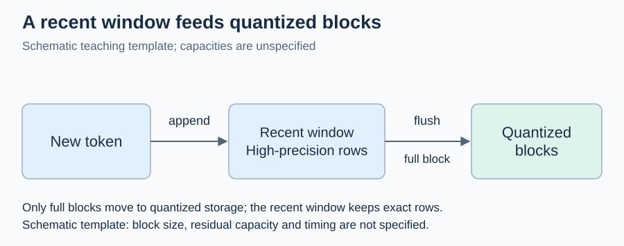
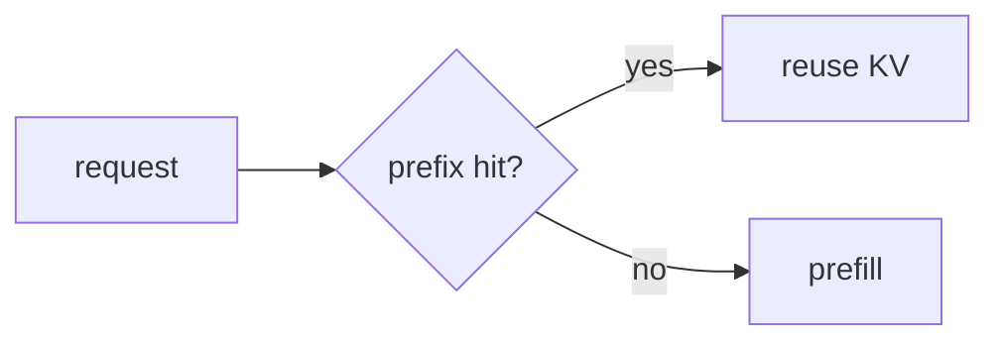

<!--
写作规范（本注释不会渲染；复制模板后可以保留，也可以在交稿前删掉）

1. 数学一律用标准 LaTeX：行内 $...$，行间 $$...$$（$$ 单独占一行）。
   - 用 \times \le \ge \ne \approx \to \alpha \sqrt{n} \sum \ell ^\top 等命令；
     禁止 Unicode 数学字符（× ≤ ≥ ≈ → ρ π μ ε ℓ √ ∑ ᵀ − 等），禁止 \( \) 与 \[ \] 定界符。
   - 变量、复杂度、下标都进公式：写 $T_d$、$O(n^2)$、$x_i$，不写 Td、O(n^2)、x_i；代码 span 只放代码。
   - 行内公式两端不留空格：$x$，不是 $ x $。表格里的绝对值写 \lvert x\rvert，不写裸竖线。
   - 散文中的流程箭头（读入 → 量化）可以保留，公式里一律写 \to。
   - 每个公式必须能被 KaTeX 解析：python tools/math_check.py --render --paths <本文件>。
2. ASCII 图和 Mermaid 图只用英文标签，中文解释写在图下方正文里。
3. 导航行在顶部和底部各放一次，格式完全相同。在 course/modules/ 里，相邻讲义写同级文件名（如 02-low-bit-kernels.md）；
   本模板为了在 templates/ 目录下也能通过链接检查，用的是 ../modules/ 前缀。
4. 中文初稿写完后，用 humanizer-zh 润色，不改事实、公式、代码和链接。
5. 引用的论文和代码必须亲自打开核验，并写核验日期；核验不了的不写。苗组工作只在确有关联时标注。
6. 交稿前运行：python tools/math_check.py --paths <本文件>、python tools/check_links.py。
-->

# Dn 主题：一句话说明要解决的系统问题

[← 课程索引](../index.md) · [配套 lab1](../../labs/lab1/README.md) · [← D1 上一讲标题](../modules/01-kv-cache.md) · [D3 下一讲标题 →](../modules/03-dynamic-compilation.md)

> [!abstract] 这一讲要解决的问题
> 用三到五句话写清楚：foundations 已经讲到哪里；本讲面对的具体约束（显存、带宽、延迟 SLO 或训练步时）；学完后能实现什么、能测出什么、能判断什么。不要写“本讲将介绍”。

| 阅读模块             | 时间  | 必须留下的学习产物           | 对应实验 |
| -------------------- | ----- | ---------------------------- | -------- |
| §1 第一个基础        | 40min | 一张手算表或一个推导         | A1       |
| §2 第二个基础        | 60min | 一个反例或一张状态图         | A2/B1    |
| §3 核心机制          | 60min | 不变量清单                   | B        |
| §4 机制与代码        | 40min | 机制到函数的对照表           | B/C      |
| 前沿与 baseline 对照 | 50min | 对照表中三篇工作的机制差异卡 | C/R      |
| 研究问题             | 30min | 一个可证伪的假设和停止条件   | R        |

**共 5h，另做 lab 约 24h。** 说明 5h 里包括哪些手算和源码阅读，哪些内容是选读。

随堂自测计入上表时间。先在笔记里写答案，再展开核对要点。

## §1 第一个基础：先把账算清楚

### 1.1 从最小的对象推导

正文先给定义，再给一个能手算的数值例子。行内公式写成 $O(n^2)$、$T_d$、$b_w=0.5+4/g$。行间公式单独成段：

$$
T(k)=T_d\,k + T_v(k)
$$

推导里出现的每个符号都要在第一次出现时说明含义和单位，例如“$T_d$ 是 draft 模型生成一个 token 的时间，单位 ms”。

### 1.2 一个容易算错的地方

写出常见错误、错在哪一步，以及如何用一个小例子当场发现它。

> [!question] 随堂自测 Dn-1：用一个具体数值提问
>
> 1. 设 $L=24$、$D=64$、$b=2$，问题写到能直接算出一个数为止。
> 2. 第二问要求比较两种方案，并说明比较口径。

> [!tip]- 核对要点
>
> 1. 给出结果和关键中间量，例如 $24\times64\times2=3072$。
> 2. 指出口径：两种方案是否在同一预算、同一输入下比较。

## §2 第二个基础：状态、布局或调度

### 2.1 用图说明数据怎样流动

ASCII 图只用英文，中文解释写在图下方：

图：示意图：只表示 append 与满块 flush，不指定容量或耗时。

图中 `recent window` 保存最近若干行高精度数据，攒满一个块后整体量化并移入 `quantized blocks`。

Mermaid 图同样用英文标签：

### 2.2 不变量

列出实现必须保持的性质，每条都能被 lab 中的某个测试检查到。

## §3 核心机制

### 3.1 机制本身

### 3.2 一个完整的反例

## §4 机制与代码的对应

| 机制或公式                    | lab 中的函数                  | 上游实现位置（固定版本） | 本 lab 简化了什么     |
| ----------------------------- | ----------------------------- | ------------------------ | --------------------- |
| 例：$s=(M-m)/15$ 的组内 scale | `quantize`（TODO A1）         | 仓库 + 文件 + 函数名     | 只做 CPU，不做 kernel |
| 例：在线 softmax 的重缩放     | `ResidualCache::attend`（B5） | 仓库 + 文件 + 函数名     | 单头，不分页          |

## 前沿与 baseline 对照

核验日期：YYYY-MM-DD（逐条打开论文和代码仓库，确认会议、年份和链接）。

| 工作（会议 年）      | 问题         | 关键机制       | 与本 lab 关系（实现/简化/未覆盖） | 研究时必须对比         |
| -------------------- | ------------ | -------------- | --------------------------------- | ---------------------- |
| 工作 1（会议 2024）  | 它解决的问题 | 一句话说清机制 | 实现：对应 B2                     | 同预算下的质量与字节数 |
| 工作 2（会议 2024）  |              |                | 简化：只做 CPU 数值               |                        |
| 工作 3（会议 2025）  |              |                | 未覆盖                            |                        |
| 工作 4（会议 2025）  |              |                |                                   |                        |
| 工作 5（会议 2026）  |              |                |                                   |                        |
| 工作 6（arXiv 2026） |              |                |                                   |                        |

每一行的“工作”格写成“名称（会议 年）”，后面附论文链接和代码链接，格式是“名称（会议 年）”加两个链接：论文、代码。没有开源代码就写“无公开代码”。至少 6 行，其中至少 2 行是 2025–26 年的工作。

**查新结论**：本讲「研究问题」一节的候选假设最接近的工作是 A、B、C（至少三篇，说明各自做到了哪一步）。它们还没有回答的是……；如果只做到……，就会和 A 撞车。这一段写成判断，不写成综述。

苗组相关工作（只在确有关联时保留这一行）：名称（会议 年），与本讲的关系是……

## 研究问题

- **候选假设**：一句可以被实验推翻的话，例如“在同一字节预算下，按层分配比统一分配的 attention 输出误差低至少 20%”。
- **最小实验**：用哪个 lab 阶段、什么数据、哪几个对照（含上表“研究时必须对比”的 baseline），跑多少次。
- **继续或停止的证据**：什么结果说明值得继续，什么结果说明应该停下或换题。
- **与导师讨论的问题**：两到三个需要导师判断的问题，例如可用的 trace、硬件或评测集。

## 资料汇总

下表的“指定观察”已计入本讲时间，通读论文或运行上游代码属于选读或 lab 挑战。

| 资料                               | 类型                      | 指定观察                         | 时间  |
| ---------------------------------- | ------------------------- | -------------------------------- | ----- |
| 资料名 + 链接                      | 论文 / 代码 / 图解 / 课程 | 看哪一张图或哪一个函数，记下什么 | 15min |
| [Lab 1](../../labs/lab1/README.md) | 实验                      | 对照 §4 的函数表                 | —     |

## 自测清单

- [ ] 不看讲义，推导 §1 的核心公式，并完成一个数值例子。
- [ ] 画出 §2 的状态图，说明每个不变量由哪个测试检查。
- [ ] 写出 §3 的一个反例，说明它为什么让朴素方法失败。
- [ ] 对照表中至少三篇工作，各写一句机制差异和本 lab 的简化边界。
- [ ] 写出一个可证伪的假设、必须对比的 baseline 和停止条件。

[← 课程索引](../index.md) · [配套 lab1](../../labs/lab1/README.md) · [← D1 上一讲标题](../modules/01-kv-cache.md) · [D3 下一讲标题 →](../modules/03-dynamic-compilation.md)
