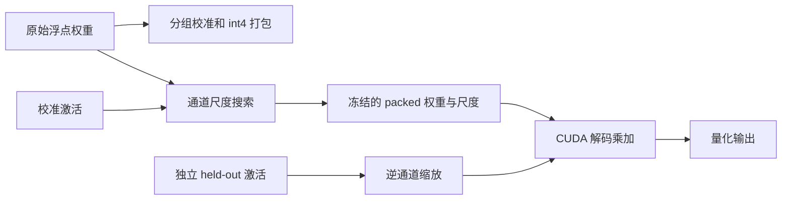

# Lab 2：从量化格式到可执行的低比特线性层

> [!abstract] 产出
> 完成 **17 个代码任务**：实现 C++ 量化器、CUDA/PTX 的四种执行路径，以及激活感知的校准搜索、字节预算选择和冻结 artifact 推理。参考答案 TODO 区有 **252 行有效代码**（不计空行、注释和单独括号），A/B/C 分别为 **100/77/75 行**。这些机制需要亲自实现，不能只调用现成的量化 API。

入口：[课程 D2](../../course/modules/02-low-bit-kernels.md) · [资源与借鉴映射](resources.md) · [评分](grade.md) · [参考解答](../../solutions/lab2/README.md)。所有命令从 `labs/` 执行；先完成 foundations 的 CUDA 基础与归约实验。

## 0. 工作量、依赖与执行顺序

| 部分                       | 阅读/手算 | 填写/调试 | 实验/分析 |    合计 |
| -------------------------- | --------: | --------: | --------: | ------: |
| A 基础：格式和校准         |      1.5h |      4.5h |        1h |      7h |
| B 核心：四条 CUDA 路径     |        1h |        6h |        2h |      9h |
| C 前沿：激活感知和预算选择 |      1.5h |        4h |      2.5h |      8h |
| 汇总报告和答辩             |         0 |         0 |        2h |      2h |
| **必修总计**               |           |           |           | **26h** |

26h 按已完成 foundations 的学习者估算，未经学生试学验证，不保证每个人都能在此时间内完成。请记录各任务的实际用时；首次调试 CUDA 可增加 4–8h。按每周 36h 安排，本讲约 5h、论文源码阅读约 5h，加上实验可作为一周的主要任务，期间不要同时开展另一个工作量较大的实验。选做挑战另计 6–12h。

A 可在 Mac/普通 Linux CPU 完成；B 需要 NVIDIA CUDA，已以 RTX4060/sm_89 为目标；C 的校准搜索可在 CPU 完成，**完整验收包括 CUDA artifact 推理**。默认小矩阵无需下载大模型，显存远低于 8GB。WSL 使用 NVIDIA 驱动支持的 CUDA；不要把 Intel 显存与 4060 显存相加。

```bash
python tools/run.py --lab 2 --impl student --mode test --device cpu --part A
python tools/run.py --lab 2 --impl student --mode test --device cuda --part B
python tools/run.py --lab 2 --impl student --mode test --device cuda --part C
python tools/run.py --lab 2 --impl student --mode bench --device cuda --part all
```

使用 `--impl reference` 单独运行参考答案，不会覆盖学生文件。程序会明确拒绝 `--device cpu --part all`，避免把未运行的 CUDA 任务记为完成。C 的 CPU 路径只检查校准 artifact 逻辑，GPU 集成需要另行运行。

## 1. 先理解完整数据路径



权重 `W` 是 `[rows, cols]`，输入 `X` 是 `[batch, cols]`，输出为 `X @ W.T`。signed q 范围 `[-7,7]`，存储为 `q+8`；不是二进制补码 int4。每行单独向 byte 对齐，scale 为每行每组 FP32。尾组不足 group，奇数列尾部高 nibble 不是有效权重。

主文件：`src/quant_student.hpp`（A/C 主机算法）、`src/gemv_student.cuh`（B 内核）、`quant_test.cpp`（独立 double oracle 与边界测试）、`pipeline.cu`（真实 CUDA 调用/计时）。每个 TODO 前均说明输入、输出、不变量、边界及测试提示。`common.cuh`、`test.cu`、`bench.cu` 保留旧版的三基线诊断；新必修统一通过 `exercise.py` 运行，实验范围已从旧版单个 GEMV TODO 扩展为完整任务。

## A. 基础：你定义的格式是否自洽？

### A.1 六个代码任务

| TODO / API         | 要完成的逻辑                                           | 参考有效行 | 验收测试                               |
| ------------------ | ------------------------------------------------------ | ---------: | -------------------------------------- |
| A1 `calibrate`     | 每行每组 absmax/7、零组、尾组、非有限数拒绝            |         14 | `scales_and_zero_tail`                 |
| A2 `pack`          | ties-away rounding、clamp、独立行 stride、低/高 nibble |         13 | `packing_bits`                         |
| A3 `unpack`        | 校验 artifact 长度与 scale，再逆变换                   |         14 | `roundtrip_error_and_invalid_artifact` |
| A4 `packed_linear` | 直接读取 packed 的批量 double 累加                     |         14 | `independent_batch_oracle`             |
| A5 `certificate`   | 半步长误差界、MSE、实际 payload+metadata 字节          |         15 | `certificate`                          |
| A6 `clip_pack`     | 每组枚举 clipping ratio，以原始 W 的误差选择并重新打包 |         27 | `clipping_exhaustive`                  |

按 A1→A2→A3→A4→A5→A6 的顺序实现。A6 复用前面已经验证的格式，但采用不同的选择目标。A4 必须直接读取 packed 数据，不能用展开后的矩阵代替，否则会绕过本阶段需要练习的存储布局。

### A.2 手算与反例（必须提交）

1. `rows=2, cols=5, group=3`：画出 6 个 packed bytes、4 个 scales，标明每组起止与两个无效高 nibble。计算与 FP32 的实际比例。
2. `W=[-7,-6,...,7]`：手算所有编码，解释为何 nibble 0 不出现在合法量化结果中。
3. 构造一组单个较大 outlier、许多中等权重，枚举 ratio `[1,.75,.5]`。clipping 为什么可能降低总 MSE，却违反原始 absmax 半步长误差证书？**A5 的≤1证书只适用于不 clipping 的 A2 格式生成路径**。
4. 权重 MSE 最低能否保证激活输出误差最低？用一列激活放大 10 倍的例子反驳。

测试矩阵包含 rows=1/3/7、cols=1/3/17/65、group=3/8/128、batch=1/3/7，并独立枚举 clipping 候选。不能仅凭“没有 crash”判断通过。

## B. 核心：解码、复用与并行度

### B.1 六个代码任务

| TODO / API         | 思考重点                                               | 参考有效行 | 验收测试                 |
| ------------------ | ------------------------------------------------------ | ---------: | ------------------------ |
| B1 `nibble`        | PTX `bfe.u32` 的约束和位移                             |          3 | 下列所有 kernel 数值测试 |
| B2 `fused_gemv`    | 一 warp/row、lane-stride K、尾部 mask、shuffle         |         14 | `warp_kernel`            |
| B3 `pair_gemv`     | 每 lane 读取一个 byte，两个元素可能跨 scale group      |         17 | `pair_group_boundary`    |
| B4 `tiled_batch`   | 一个权重复用于最多 4 个 token，寄存器累加和 token 尾部 |         19 | `tiled_batch`            |
| B5 `split_partial` | K 分区、局部 reduction、无 atomic partial 布局         |         16 | `split_k_tail`           |
| B6 `merge_partial` | 固定顺序合并分区、grid-stride rows                     |          8 | `split_k_tail`           |

B1 实现的是一个 PTX 原语，因此代码较短；整个 B 阶段仍需完成四条算术路径。B4 关注 register reuse，B5 关注增加 parallelism，两者目的不同，都不能仅靠修改 launch 参数完成。

### B.2 推理与实现步骤

1. 画出 B2 在 K=65 时每 lane 拿到哪些列。某些 lane 没有第三个元素，仍然必须进入 shuffle。
2. B3 使用 group=3：byte 中两列 `2,3` 对应不同 scale。这个反例应能发现两个元素误用同一个 scale 的错误。
3. B4 在 batch=7 时有两个 token tiles。最后一个 tile 的第 4 个 token 不写输出，但所有 lanes 仍完成归约。
4. B5/B6 将同一个 K 分成长度 17 的 partitions。分析 partial buffer 大小、额外 launch、额外写读；为什么少 rows 的 case 可能值得，多 rows 的 case 可能不值得？
5. 解释 FP32 reduction 改变顺序后为何允许小容差，而不能放宽到掩盖错误解码。

GPU 正确性覆盖 rows=1/7/33、cols=1/31/65/257、group=3/32/128、batch=1/3/4/7，四路径均比较独立 double 结果。CUDA event benchmark 扫 256/1024/2048 方阵与 batch=1/4/7。CSV `mode=0/1/2/3` 分别是 warp、pair、batch-tile、split-K；mode 0/1/3 在 batch>1 时逐 token launch，是明确的对照策略。

### B.3 提交两张图和一个负结果

画 `device_us vs cols`（按 batch 分面）与 `speedup vs batch`。至少独立运行五次保留每次原始日志；新 runner 的单次事件计时不能当作五个统计样本。每次运行同配置都先验证输出再计时。给出误差条、GPU/时钟/温度背景；没有 profiler 证据时不把速度差直接解释为“带宽瓶颈”。

保留一个 B3/B4/B5 没有胜过 B2 的配置，指出下一步可以如何区分 launch、寄存器压力和工作集效应。当前 benchmark 使用已驻留 GPU 的数据，计时不包括量化、H2D 和分配成本，因此不能将结果称为模型端到端加速。

## C. 前沿：AWQ 思想的可控缩小实现

### C.1 五个代码任务

| TODO / API          | 实现内容                                       | 参考有效行 | 验收测试                            |
| ------------------- | ---------------------------------------------- | ---------: | ----------------------------------- |
| C1 `channel_scales` | mean-abs activation、alpha 网格、几何归一化    |         14 | `channel_scales_identity`           |
| C2 `transform`      | `W'=W*diag(s)`、`X'=X/diag(s)`，不修改输入     |         13 | `equivalent_channel_transform`      |
| C3 `search`         | 每个候选真正量化并计算输出 MSE，含 alpha=0     |         21 | `exhaustive_search_and_no_mutation` |
| C4 `execute`        | 冻结 artifact 在独立输入上执行，逆缩放恰好一次 |         11 | `heldout_frozen_artifact`           |
| C5 `search_budget`  | group/alpha 联合选择，含 channel 元数据硬预算  |         15 | `budget_search`                     |

公式 `(X diag(s)^-1)(W diag(s))^T = X W^T` 说明浮点变换等价；加入量化后，尺度会改变各通道的误差分配。A6 的权重误差与 C3 的输出误差是不同优化目标，本 lab 不把二者混为一个 API。

### C.2 完整证据链

1. 校准集固定 seed，held-out 使用不同 seed。通道 0 在校准激活中放大；额外设计 held-out 中放大别的通道的分布变化。
2. 用 `alpha=[0,.25,.5,.75,1]` 搜索；与 alpha=0、A6 clipping-only 分别比较，不能只报告最佳候选。
3. 固定 bytes 预算枚举 group；C5 必须同时计 packed bytes、group scales、channel scales。与无预算最优误差比较，报告因预算失去的质量。
4. `pipeline.cu` 将选中的 artifact 上传 GPU，held-out 先做逆通道缩放，再分别走四条 packed kernel，与 C4 CPU 路径核对。本实验已提供完整调用链和答案，完成必修时也必须完成这一步集成。
5. 对每个配置记录 calibration MSE、held-out MSE、字节数、选中 alpha/group、GPU kernel 时间。C3 训练误差不劣于 alpha=0 是有限候选最小化的结果；held-out 不保证改善。

本实验复现 AWQ **基于校准激活搜索等价通道尺度**的机制，不包含 Transformer 层间 folding、完整 block 搜索、完整模型 perplexity 或 W4A16/Tensor Core 内核。阅读上游对应函数后，按 [resources.md](resources.md) 逐项说明实验做了哪些简化。

## 报告与验收

必交：17 个 TODO、全部阶段测试记录、手算布局、四 kernel 配对曲线、校准/held-out 对照、字节预算曲线、一个负结果、真实工时表。评分见 [grade.md](grade.md)。评分不要求实现必须快于 cuBLAS。

## 可选挑战

选做 6–12h：在保留 oracle 的前提下加入 FP16 activation 或使用 Tensor Core；对比 Marlin 的 dequant 与线程布局，分析为什么不能把其 `lop3` 代码直接放进当前 row-major W4A32 kernel。另一个方向是在真实模型局部 linear 上采集激活，重复 C 的校准/held-out 实验。选做不得替代必修。

## 资料汇总

| 资料                                                                                                 | 本实验中怎样使用                                                                   |
| ---------------------------------------------------------------------------------------------------- | ---------------------------------------------------------------------------------- |
| [课程 D2](../../course/modules/02-low-bit-kernels.md)                                                | 核对编码、warp 参与集合与两类误差；完成 NVIDIA 归约图和 AWQ 通道缩放图的观察任务。 |
| [资源与改编说明](resources.md)                                                                       | 定位 AWQ、Marlin 等上游实现，比较布局、dtype 与硬件约束后再移植。                  |
| [AWQ 作者论文](https://arxiv.org/html/2306.00978v5) / [代码](https://github.com/mit-han-lab/llm-awq) | 对照校准、等价变换和冻结 artifact，区分本实验与完整模型执行。                      |
| [参考实现](../../solutions/lab2/README.md)、[评分标准](grade.md)                                     | 独立作答后按任务核对 oracle、四条执行路径与报告证据。                              |
